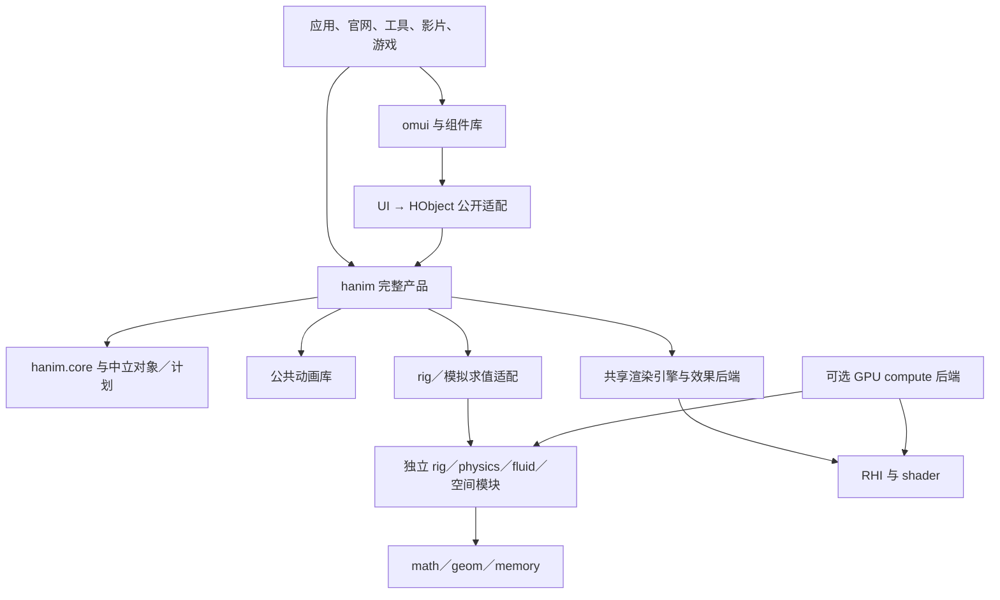

# 独立引擎、UI 与 Agent 控制：分层架构及高密度模拟

2026-11-04。**状态：架构讨论稿，接口与新包布局待 review，不是已实现声明。** 合并维护者本轮补充：hanim 应为高级独立动画产品；omui 是普通消费者；引擎底层支持骨骼、插值、物理、水体等扩展；硬件加速、性能、可观测性、profiling、Agent 操作与控制、跨平台边界从契约阶段设计。Noita 类像素材料反应／连锁破坏是基础设施的压力标准，不能将它缩成一个像素滤镜，也不把基础模块做成专用游戏。

继续遵守 D-55／D-59／D-61／D-65／D-66／D-81／D-82／D-87／D-88／D-93，及[hanim 完整引擎讨论](2026-11-04-hanim-animation-library-playback-design.md)、[人物技术与计算分层](2026-10-29-math-fighter-tech-design.md)。本文扩展[官网重构](2026-11-03-openmui-site-redesign-implementation-design.md)的基础能力设计；官网仍须完成全部 R0–R6，但不能作为引擎唯一消费者。规范身份为 openmui，实现与官网品牌为 omui。讨论稿不直接修改 OpenLifa 标准。

维护者后续明确的多产品对等、模拟／元胞、音频／MIDI、mcpp 的 HPC 构建插件、按需复杂度／体积与单一权威实现，统一见[顶层产品架构](2026-11-04-multi-engine-product-architecture-design.md)。本文保留各引擎、Noita 类负载、硬件与控制的技术展开；已有代码与目标能力按各自证据区分。

## 1. 产品边界与依赖方向

| 产品／模块 | 核心职责 | 不应承担的职责 |
|---|---|---|
| hanim | 通用对象、时间／插值、动画计划、组合、播放、效果绑定；core 可单独使用，完整产品也可脱离 UI 使用 | 具体 UI 控件、业务语义、游戏玩法、全局窗口／设备单例 |
| 渲染引擎 | 资源／渲染图、2D／3D／像素／粒子等特性、材料、合成、CPU 参考与 GPU 后端 | 改业务状态、做 Agent 授权、持有 UI 控件实现 |
| 通用计算／模拟 | 大批量数据、空间域、固定步长求解、检查点与后端；rig／physics／fluid 等独立模块 | 拥有 UI 主循环、把玩法和游戏实体类型带入底层 |
| omui UI 框架 | 状态／布局／输入／焦点／无障碍／语义；将视觉与部件适配为 HObject，使用公共 hanim | 复制动画／模拟／渲染器，依赖 mgame |
| 动画库 | 可参数化的公共配方、组合规则、适用域、能力与代价；至少 40 项真实库条目 | 把官网 endpoint builder 当通用动画资产 |
| UI 组件库 | 契约、状态、命名部件、真实绘制、角色默认配方 | 自持时钟、私有插值器、每帧脚本 |
| Agent／开发工具 | 查询、动作、引擎控制、诊断、会话；CLI／MCP／GUI 共用公开操作 | 让 UI 协议成为独立引擎的强依赖，给工具私有控制后门 |

示意箭头表示“消费者依赖能力”；省略共同依赖的 math／memory／trace 等：

通用模块不依赖 UI／mgame；游戏和 UI 都可消费这些模块。不要用一个横跨所有层的“EngineContext”携带 Runtime、设备、文件系统与全局服务。各系统只接收所需的类型化接口。hanim 高层播放器组合 renderer／simulation，core 不反向依赖它们。旧 `hanim` 模块需要先提纯为 core 才能引入完整伞包，具体迁移见 hanim 讨论稿 §3。

## 2. 用共享身份关联不同表示

UI 的模型与语义是行为事实来源；HObject 是可动画视觉表示；RenderGraph 是资源和 pass 的执行表示。它们的用途不同，不能强迫使用同一种节点结构。

| 表示 | 主要数据 | 与其它层的关联 |
|---|---|---|
| UI 状态／语义 | 稳定节点 ID、角色、属性、动作、授权、业务 revision | adapter 关联 HObject／part，保持像素、无障碍、agent、测试来自同一 UI 状态 |
| HObject／场景 | 对象与命名部件、可选 geometry／glyph／pixel／mesh／field 域、材料和资源引用 | 同一计划连接源／目标快照、当前呈现和渲染资源 |
| 动画／模拟计划 | 时间映射、通道、依赖、对应关系、求解策略、输入版本 | animation／simulation ID → 对象域与批次 |
| 帧管线 | 输入／状态／布局／准备／求值／提交等类型化阶段 | FrameId、stage、资源版本和执行时序 |
| 渲染图 | pass、读写资源、临时纹理、提交与输出目标 | 对象／动画／模拟 batch → pass／resource／submission |
| 诊断与会话 | trace、counter、日志、操作记录、检查点、重放输入 | request／actor／frame／plan／object／pass 的关联键 |

NodeId、ObjectRef、ResourceHandle、PlaybackHandle 是不同类型；句柄带 generation。状态 revision、呈现 revision、资源版本和时间各自明确，不能把同一个整数复用为所有版本。跨层保留映射，避免逐帧按显示文字识别对象。快照／查询在边界序列化，热路径使用中立类型和连续缓冲，不能每帧解析 JSON。

HObject 是薄句柄与按需 facets，不是带所有字段的巨型继承类。一个像素世界是 field／tile 资源及区域视图，可以作为一个或少量 HObject；**一百万材料单元不生成一百万 HObject，更不生成一百万 UI／语义节点**。Agent 默认看世界、区域、聚合与查询结果，需要精查时才按区域读取单元。

## 3. core 如何支撑不同动画与模拟

core 提供可扩展的时间、值域、计划、缓冲与批处理契约，不内置所有领域算法。统一接入不意味着强制所有类型使用线性 lanes 插值：

| 类型 | 正确的值域／求值 | 归属 |
|---|---|---|
| 数值／长度／向量／颜色 | lanes、关键帧、缓动、解析 spring／decay；颜色与 alpha 的空间明确 | core／math，部分已有 |
| 旋转／变换 | Quaternion 的 slerp／nlerp、局部／世界空间、最短弧与归一化；变换分解规则 | math＋core 类型策略；不能直接 lerp 任意矩阵元素 |
| 形状／字形／拓扑 | 准备阶段建立对应；每帧采样预分配数据；不同拓扑有显式 birth／death／重组策略 | 对象／几何／内容适配＋公共库 |
| 骨骼／姿态 | skeleton、bind／inverse bind、local pose、层级求值、遮罩／叠加／混合、重定向、IK／约束 | 独立 rig；hanim 编排，renderer 负责蒙皮与材质 |
| 物理驱动 | 位置／速度／约束／碰撞状态，固定 tick 与稳定求解顺序；表现与权威状态分离 | 独立 physics／simulation，游戏或动画各自适配 |
| 水体／烟／密集材料 | 格点／粒子／场、邻域、边界、迭代与收敛、源汇、检查点 | 独立 spatial／fluid／reaction 求解模块；不能称为几个 tween |
| 程序化／用户扩展 | 纯采样函数或声明过的状态求解器；CPU 原生批次／可选 GPU kernel | 带 CTS 的 evaluator 插件，脚本只构造与发命令 |

必须明确三种求值类别：

1. **解析／直接采样**：给定不可变输入与 t 直接取得结果，支持乱序并行；不依赖上一帧已经计算。
2. **采样素材**：按时间查询动画 clip、pose、烘焙模拟或缓存；插值与压缩误差有声明。
3. **有状态模拟**：`state[n+1] = step(state[n], inputs[n], fixed_dt)`。任意时刻重建依赖有效检查点与输入日志，求解代价不是 O(1)。Engine 统一控制时间，但必须报告准备／重算状态、所需 tick 与成本。

播放暂停、视觉倒放、物理时间反演、业务撤销是不同操作。确定性模拟的“倒放”通常是恢复检查点再前向重建历史；不能用负 dt 或倒放位置轨道冒充物理逆过程。重放还依赖相同求解器版本、参数、资源、种子、步长和输入顺序。GPU 视觉求解可按容差验收；权威模拟若要求逐位相同，只能选经过跨后端证明的实现。

水面 shader、格点／粒子流体求解、像素材料运动是不同能力；材质“看起来像水”不能替代后两项。耦合时动画驱动力／约束／发射器等输入，模拟推进状态，present 在固定 tick 之间插值供显示，效果处理最终物质。视觉着色不自动反向改变权威物理；需要反馈时通过显式 typed field／事件接口声明。

## 4. 独立模块建议与复用

以下是建议角色与路径，尚未新建包；不批量搬迁现有源码：

| 层 | 候选模块 | 边界 |
|---|---|---|
| base | `modules/base/math`、`geom`、`memory` | 复用确定性数学、随机、曲线、基础几何、句柄／arena；不复制公式与哈希 |
| base | `modules/base/rig` | 独立骨架／姿态／约束／CPU 求值，只输出姿态和变形数据；遵守 D-88 |
| base | `modules/base/spatial` | 稀疏 chunk／tile、邻域／halo、区域索引、活动域、空间查询与版本；格式不包含某个游戏材料规则 |
| base | `modules/base/simulation` | 固定 tick、输入序、检查点与缓存调度等通用机制；不规定全部求解算法 |
| base | `modules/base/physics`、`fluid` 等 | 按真实消费者拆出的独立领域算法／适配；每种声明数值域、精度、误差、状态与失败行为 |
| gfx | `modules/gfx/compute` 及后端／算法适配 | 基于 RHI／shader 的批量 kernel、数据驻留与依赖；不让 base 依赖 gfx |
| gfx | `modules/gfx/render/{vector,mesh,particles,…}` | 共用 render graph／纹理池／设备；场、网格与粒子的可视化也是渲染特性 |
| ui／mgame | 各自 adapter、组件／世界／玩法规则 | 消费模块，保留领域语义；不把 gongfu 的受击框／规则下沉到通用 rig |

当前 `mgame.physics` 只是确定性的扫掠碰撞等有限基础，不是已完成的通用刚体引擎；`gongfu.present2d` 中的角色技术也不能直接当作独立 rig 已交付。提取时先稳定契约，再用原消费者与一个异构消费者验证。第三方算法按 mcpp 生态、许可、质量和确定性评估选用，不先写一套低质量完整物理库，也不未经测量承诺某个第三方满足全部性能。

## 5. Noita 类负载的通用基础

维护者将 Noita 类像素反应与连锁破坏作为底层能力标准。[Noita 官网](https://www.noitagame.com/)明确其像素物理模拟定位；[开发者 GDC 技术分享](https://www.gdcvault.com/play/1025695/Exploring-the-Tech-and-Design)可作参考。本节是本项目的架构推导，**不声称下列方案就是 Noita 的内部实现，也不虚构其 FPS、硬件或单元规模**。

### 5.1 必须支持的通用机制

- **密集与稀疏域**：连续 typed field／SoA 与稀疏 chunk 并存，支持多通道（材料 ID、温度、速度、压力、寿命等）；物理单元不等于屏幕像素，分辨率和相机缩放解耦。
- **活动与因果传播**：静止区域可休眠；邻域改变、热／压力传播、外部事件必须唤醒相关块。模拟活动域与渲染 dirty 区域分开：画面未变化不代表物理可以跳过。
- **可确定的并行调度**：读写集、halo、分阶段提交和冲突规则明确；分块边界行为与全域参考一致。稳定遍历、固定迭代与以坐标／tick／规则流为键的确定性随机可重放；不能依靠线程竞争决定材料移动。
- **反应与耦合**：规则描述条件、源汇与作用通道，由原生批次执行；材料／流场／热场／碰撞模块通过显式采样和提交阶段交换数据，避免彼此任意回调。需要迭代反馈时展开有限子步／迭代，不把无约束环塞进 DAG。
- **破坏与结构变化**：区域修改、连通域／轮廓／网格提取、分离块转刚体／碎片、局部碰撞代理重建；这些是空间／几何／physics 插件，魔法、关卡、材料配方等属于消费者。
- **有界状态与事件**：事件队列、工作集、检查点、暂存和线程缓冲都有容量／增长／溢出策略；链式反应超预算可观察，不能静默丢关键模拟事件。
- **高效可视化**：field／粒子／分离块直接引用共享 buffer／texture，按区域或批次提交；不逐像素构造 Path、JSON 或虚函数对象。

动画系统可以驱动力、发射器、约束目标、材料参数或相机，并把求解结果作为可视域；**模拟求解器负责状态演化，hanim 负责时间、编排与对象播放，renderer 负责成像**。这条分工同样适用于 UI 水波、动态图表、角色、粒子、视频和交互作品。

### 5.2 性能标准必须以负载证明

先建立以下 benchmark 家族，规模和硬件写进每份报告；起始扫描可用 256²／512²／1024² 单元和不同活动比例，数字是测试梯度提议，不是已经达到的容量：

| 负载 | 主要检查 |
|---|---|
| 静止域＋少量活动 | 代价随活动块而非世界总面积增长；唤醒正确 |
| 全域材料运动 | active 100% 时真实最坏成本、吞吐、缓存与带宽，不用空场景证明快 |
| 连锁反应／热传播 | 跨块边界、事件峰值、声明的守恒量／源汇、稳定性与队列容量 |
| 连锁破坏与分离体 | 连通域／碰撞重建峰值、同步和资源 churn，不只测平稳阶段 |
| 同场景动画＋模拟＋渲染 | CPU／GPU 临界路径、上传／下载量、present 延迟和 warm allocations |
| UI／Agent／profiling 并发 | 操作响应、查询与采样预算；观察不能冻结主循环 |
| checkpoint／seek／回放 | 固定种子与输入还原状态；检查点大小、seek 时间、冷／暖缓存分开 |
| CPU／并行／GPU 一致性 | CPU 权威路径 hash；GPU 声明容差、领域不变量与真实画面，不能只比截图 |

交互目标按参考场景明确 60 Hz 的 16.67 ms 或 120 Hz 的 8.33 ms **整帧预算**，再分解临界路径；不能把各模块单独通过相同预算当作合计通过。首版硬件／分辨率／模拟规模与 p95／p99 门槛需实测后固定进预算文件。未建立可运行压力场景、物理硬件测量和端到端输入证据前，不得宣传“Noita 级性能已达标”。

容量和带宽要先算账。例如仅作布局估算，1024² 单元若每单元 16 B，单份状态是 16 MiB，双缓冲为 32 MiB；每秒 60 次全域单遍读＋写已是约 1.875 GiB/s 的逻辑数据量，尚未计邻域、流场、多轮求解、渲染和检查点。不能靠给每单元加线程解决；需要真实布局、局部性、活动比例、分块与驻留测量。这些数字不是 Noita 的内存数据或本项目实测性能。

权威模拟不能为追求 FPS 自动少算 tick、关闭反应或改变材料规则。渲染可降分辨率、密度与装饰效果；纯表现模拟可按声明降质并记录。超载时明确报告模拟落后／降质／失败；T0 与 T4 不承诺相同世界规模和质量。

## 6. 硬件加速从数据和执行契约开始

1. **准备与热路径分离**：准备时校验、匹配、编译计划、分配工作区／资源、选择 kernel；热路径按类型批量求值。简单动画编译到 Set／SoA，不强制所有对象先光栅化或提取像素。
2. **显式资源读写与位置**：buffer／field 的布局、stride、格式、读写区间、CPU／GPU 驻留、有效版本和访问生命周期写入任务；避免每个 solver step 都来回上传下载。
3. **一个设备与共享图**：compute 和 render 共享 RHI、提交与资源依赖；准备图／固定 tick 求解图／渲染图可以有不同时间频率，由宿主组合，不能每帧重跑不需要的准备。
4. **CPU 路径是一级实现**：标量参考 → 经 CTS 的 SIMD／工作线程批次 → 可选 GPU。后端分派在批次入口，热循环不逐元素调用虚函数、不逐元素走脚本。
5. **同步与生命周期**：host state 有唯一写入者，工作线程处理不可变快照／独占输出，GPU 使用 submission／fence 语义；资源在最后使用完成后释放。正常帧避免 wait_idle／同步 readback，读回与 capture 单独计费。
6. **数值能力有等级**：精度、原子操作、reduction 顺序、可确定性和 CPU／GPU 误差在能力描述中声明。GPU 上执行不自动意味着所有算法更快或逐位一致。
7. **扩展后端保留薄边界**：优先共享 RHI／shader；专用加速器若确有价值，以可选 backend 接入同一 buffer／kernel／同步契约，不把厂商 API 写进 core 或 UI。

冷启动、数据迁移、分配峰值与设备丢失恢复也属于性能与正确性边界。设备失效后按策略重建资源／计划或选择明确替代；不能留下引用旧设备纹理的 HObject。

## 7. 跨平台抽象

| 边界 | 接口与能力 | 当前边界／目标 |
|---|---|---|
| portable core | 标准库＋独立基础模块、类型／时间／数学／计划 | 不导入窗口、浏览器、驱动、UI；manifest 选模块，不散布平台宏 |
| OS 服务 | `mcpplibs.os` 的文件／进程／IPC 等 | UI／引擎不直写平台调用；浏览器不可用能力须报告／替代 |
| host | 时钟、输入、窗口／离屏、显示节奏、生命周期、输出目标 | SDL3／Web／headless／嵌入宿主；主循环和设备可注入 |
| RHI | typed resource、command list、caps、compute、提交、读回、present | 现有 SDL_GPU（Vulkan／Metal／D3D12）、WebGPU、WebGL2；不要求所有后端具备 compute |
| shader／compute | 公共参数、资源绑定、格式与后端实现 | CPU reference、Slang 及实际 shader 后端；精度与成本明确 |
| capabilities／profile | 编译进什么、设备能做什么、计划如何适配 | 编译 profile、运行 T0–T4、使用 L0–L3 三者独立 |

能力查询优先于操作系统名称判断。严格模式缺能力报错，adaptive 调整质量，fallback 使用指定替代；报告实际后端、原因和确定性等级。当前 WebGL2 没有 compute，应明确选择 CPU／其它实现，而非伪装运行 GPU 求解。

## 8. Agent 原生：操作、控制、观测是不同契约

| 方面 | 例子 | 契约 |
|---|---|---|
| 应用操作 | 查找组件、填写、激活、撤销、事务 | UI 语义与业务动作，沿用 openas actor／effect／授权／记录 |
| 引擎控制 | 查询对象／计划，play／pause／seek／rate／retarget，改参数，控制模拟 | 引擎自己的类型化命令与能力描述，不伪造 UI 按钮，也不依赖 UI Runtime |
| 开发诊断 | trace、profile、pass／资源／内存、当前质量、慢帧原因 | 可发现、可查询、可订阅；启动／停止采样和改管线有明确状态影响 |

建议在独立层定义不依赖 UI 的资源／命令描述与观察接口，UI、hanim、renderer、simulation 各提供 provider；Agent transport、CLI、MCP 和 Inspector 是消费者。低层 core 不需要导入网络、JSON、UI 或 Agent 模型。SDK 可默认组合 Agent 服务，裁剪配置可移除 transport；这不妨碍能力元数据在本地 API 中使用。

每条操作描述参数类型、前置 revision、作用域、效果、完成条件与失败结果；变更命令由 owning thread／frame boundary 执行。请求携带 request／actor／resource ID，返回 accepted／applied／settled 等可区分状态，不能把入队成功当成画面已经完成。会话记录可以关联业务动作和引擎控制，但业务 undo 与视觉 seek 不混用。重复请求是否可幂等重试有明确定义，不承诺无条件跨进程 exactly-once。

授权所用的 action effect 与动画的 visual effect 必须保持不同类型／命名空间，避免统一 SDK 后出现“效果”一词的语义混淆。

开发控制与应用操作的暴露策略分别声明，沿用现有 openas 边界处理实际动作；不能因为控制入口叫 debug 就默认绕过 actor、效果和记录。只读操作不被无故变成需要额外授权的业务动作。引擎接口的协议身份、版本和 schema 应独立定义，UI adapter 再使用 openmui 标准；不假造新协议已经属于已发布标准。

查询应支持 revision／diff、范围、分页、聚合、采样与有界订阅，不能每帧把全部像素／粒子转成 JSON。高频帧只导出轻量事件与计数；大快照、纹理读回、profile 文件按明确请求异步产生并计费。CLI JSON 与用 omui 编写的工具界面读取同一份数据。

### 8.1 默认就是人和 Agent 双用户

维护者进一步明确：**使用引擎和框架的开发过程默认可由 Agent 控制／开发／测试／调试；开发出来的 app／游戏默认支持 openas Agent 操作。人和 Agent 是两个默认 actor 视角，不是发布后再额外安装的自动化附件。**

| 使用环境 | 默认行为 | 可配置性 |
|---|---|---|
| 开发模式 | 全部已注册的应用／引擎／框架、构建／测试／重载／调试控制默认可发现、可调用；预置开发会话授权，常规开发操作不逐次要求额外审批 | 开发者与本机用户仍可按项目、provider、动作、资源与 actor 收窄 |
| app／游戏的发布配置 | 默认生成 Agent 能力描述、语义与公开动作、操作记录及支持的 transport；人和 Agent 使用相同状态和动作实现 | 开发者配置能力上限、开放范围、输入／调试入口与默认策略；用户配置自己的限制与授权 |
| 单次运行／连接会话 | 使用当前生效策略，能查询开放范围、策略来源及拒绝／需回答原因 | 用户暂停／关闭入口、撤销授权、限定作用域／时长；会话只在允许范围内变化 |

“默认支持”包括纯引擎程序和游戏，不要求先创建 UI Runtime；独立引擎通过 control provider 暴露对象／计划／模拟／资源与诊断，UI 再额外提供语义和业务动作。人通过 GUI／Inspector 使用同一公开操作；Agent 可通过本地 API／CLI／MCP／桥接调用。状态结果一致，记录明确 actor 和来源。

开发模式不是根据请求里的一句 `dev=true` 临时升级，也不靠 NDEBUG 宏猜测。构建／启动配置明确选择 preset，建议默认 auto 按构建 profile 解析，开发启动器创建开发会话并预置其 actor／委托链授权；应用发布配置使用发布 preset。自定义 profile 和嵌入宿主可显式声明。该选择、实际开放能力及是否含开发控制必须出现在 describe／构件元数据／agent.md 中，打包检查验证发布配置没有意外继承本机开发会话。

### 8.2 多级配置与实际权限

权限不能只有一个全局开关。区分入口、能力上限、当前授权、输入策略、开发控制与资源作用域：

1. **构建／发行配置**：编入哪些 provider／transport，发布能力硬上限，开发／发布 preset。
2. **开发者／应用／项目配置**：哪些动作和资源可暴露、作用域、效果、是否支持 Agent 输入、哪些开发控制可用、默认规则。
3. **宿主／用户配置**：当前用户对应用／项目／actor 的限制、持久授权、暂停与撤销。
4. **会话／临时配置**：本次连接、actor 委托链、资源子集、有效期与运行时开关。

生效能力受硬上限和所有限制的交集约束；在此范围内，由所选 preset 与用户／会话 grant 决定直接执行、需回答或拒绝。开发 preset 默认全开放并给予开发会话授权，开发者或用户显式收窄仍有效。发布 preset 默认保留 Agent 能力，具体业务动作按开发者声明和用户设置决定；不能把“保留接口”误当所有业务动作无条件执行，也不能把“受权限控制”实现成默认删除 Agent 能力。

openas 继续承担 actor、effect、grant、决定与记录的共同语义。开发授权由本机开发宿主在创建会话时预置，不由收到的 Agent 请求给自己授权；使用 openas::decide 的结果执行，而不是散布 `if(debug) bypass`。现有 S-10 的真人专属业务动作与开发测试能力须分清：开发测试 provider 可提供明确标记的 fixture／注入／重置等能力，不能靠伪造真人 actor 宣称通过生产语义测试；如确需改变标准规则，单列标准变更，不藏进 UI adapter。

### 8.3 对应实施与验收

- 独立 hanim／renderer／simulation 与 omui、游戏各有默认 describe／能力目录；默认模板无需额外安装插件即可被 Agent 操作和观察。
- 开发 preset 下，Agent 能直接完成创建／运行／测试／暂停／单步／寻址／采样／profile／调试与支持的重载；记录带开发会话、actor 和结果，不逐次弹出常规开发权限确认。
- 同一任务分别从人操作和 Agent 调用完成，比较业务状态／模拟状态／语义及需要确定的帧；不以模拟点击脚本替代原生接口证明。
- 开发者 cap／scope、用户限制／grant、会话限制的组合有 CTS；拒绝在变更前发生，撤销及时生效，describe 能解释实际策略来源。
- dev／release／打包三条路径分别检查默认值；开发全开放、发布可配置且双用户能力保留，不能只在 README 写支持。
- 多 Engine／多 Runtime 互不串授权；后台请求只在 owner thread／确定边界提交。会话断开、对象销毁、资源代次变更与配置更新均有验证。

本轮开始前已有 app 默认 Agent endpoint／agent_input、AppSpec 的 cap／grant、openas::decide、CLI／Web 接口和操作记录，AgentAccess 为进程级状态。**开发全开放 preset、完整多级策略与独立引擎 provider 尚未收口**；下列候选改进须按实际验证范围判断，不能把已有字段或单个模块通过当作完整默认行为已交付。

#### 阶段性实现与本地证据（候选，尚未整体收口）

已增加 `AgentMode`、实例 `AgentAccess`、`AgentPolicy`／`AgentRestrictions` 与可信 `AgentSession`。模式与 effect cap 分开；developer／user／session 的 enabled、input、cap 和 operation 集合逐层相交。开发授权绑定本机 C++ 创建的会话及所属实例，JSON 中的 actor／委托链文本不能创建授权；撤销后同一会话不能自动补回。`Runtime` 和它的 `Verbs` 共用实例内 `InvocationContext`，独立 `Verbs` 自持上下文，不使用全局或线程局部调用栈。

真实失败基线为 `core/tests/agent_context_test.cpp` 与 `view/tests/agent_context_test.cpp`：远端 read 回调发起默认本地调用时，旧实现丢失 remote／actor，实际执行了 cap 之外和 S-10 的动作，分别失败 3／6 条断言。第一批 core 在 dev、release、LLVM sanitize 各 **8 个程序、37 组通过**，已提交为 `20e6f54`。随后 Protocol 的 6 组真实请求基线有 5 组失败、15 条断言失败，已接入实例会话并验证开发预授权、撤销不补授权、晚绑定、逐层收窄与队列投递时重查；新增会话用例覆盖跨实例／重连与失效。

SDK 现在从 mcpp 实际 profile 生成 constexpr 元数据；`AppSpec.agent_mode` 默认 automatic，`dev` 选 development，其余 profile 选 dual-user，自定义 profile 可显式选择。已有 `AppSpec.agent` 继续表示 effect cap，不能填 development 冒充模式。`agent_developer`、`agent_user` 提供两级限制，Protocol 提供可信会话及会话限制；可信启动参数 `--agent-mode` 选择 preset，`--no-agent`／`--no-agent-input` 收窄入口。每次 startup 在 setup 前创建并绑定独立 AgentAccess。**迁移时，setup／工具代码须使用 `rt.agent_access()`；free `agent_access()` 只保留未绑定底层消费者的兼容语义，不再是所有应用的全局配置入口。** 官网 Guide 的 3 处旧 global grant／revoke 调用已迁移：2 组真实绑定实例场景先失败 4 条断言，再验证真人 Allow for visit 后请求执行、另一实例仍需回答、撤销只影响本实例；Site 全 19 程序、125 组在三配置通过，不因低层 CTS 通过就略过应用迁移。

三种宿主已传递可信会话；同帧人／Agent 输入使用调用者拥有的 `InputAttribution` 区间，由 Runtime 逐事件进入／恢复上下文，layout／paint 仍一次，未覆盖的事件保持真人。新增真实 Web 基线先失败 2 条断言，修复后通过；底层 6 组覆盖两种事件顺序、S-10／cap、同帧先收窄／撤销、多个区间、timer 和非法范围的零变更拒绝。Guide Markdown 标注生成进程的 profile／有效策略，明确 native dev 生成器不能代替目标 Web 的实际授权；目标以 `describe.agent_policy` 为准，不写会话凭据。

最新 motion／SDK／site 本地集成在 dev、release、LLVM sanitizer 各 **27 个程序、187 组通过**，含 SDK 6 组及真实 Guide 文件。外部 `OMUI_EXPECT_BUILD_PROFILE` 独立核验生成值：dev 实际 development／external 请求退出 0；release、sanitize 实际 dual-user／同请求退出 2，避免用同一个生产 helper 推导期望导致自洽通过。日志 `/tmp/omui-travel-sdk-site-verified-{dev,release,sanitize}.log`。此前更广的 GCC dev 10 包 62 程序通过；GPU sanitizer 的外部 driver 残留另见 hanim 文档，不套作上述纯 CPU 集成失败或通过。

当前 operation 集合支持精确名、`prefix.*` 和 `*`；空列表明确拒绝。资源／对象范围、授权到期、transport peer 的逐连接会话配置、用户配置持久化、全部语言模板、独立引擎 provider、完整控制操作的 actor／trace 关联与打包默认值继续保留为实施项，不把 operation 前缀匹配或首个 C++ SDK 消费者当作这些能力已经完成。`agent_policy_for_profile` 当前属于 UI 层的 openmui.core，只供 omui 宿主与外层 adapter 复用；无 UI／spec 依赖的控制／preset 契约须另行下沉，不能让 hanim core／base／gfx 直接 import openmui.core。

目标 Web 构件现已实际核验，而非从 native dev 生成器推断：源 `77979b5` 的 `site-web` wasm 经正式 mcpp pack，在 Chromium 156 由 `describe.agent_policy` 返回 `dual-user`／`profile:site-web`、实例绑定、入口及 input 开启、有效会话，且 development grant／预授权 development controls 均为 false。请求伪造 `dev`／`mode`／真人 actor 不改变该结果。真实原生 Agent input 穿过 Wasm 帧循环打开 Core 菜单，action journal 保留 `agent:deployment-check;via=service:input`；随后真实 CDP 真人指针关闭同一菜单。该 8 项并入既有 `tools/ci/site-motion.mjs`，本轮全 123 项通过，日志与 JSON 为 `target/site-agent-motion-policy-browser.report.omui.json`。

对 SDK、三个宿主、Protocol、Guide、CLI guide 与应用／示例／游戏／语言层的配置调用交叉审计，未发现其它生产消费者仍错误修改 legacy 全局权限。生产 free `agent_access()` 只保留明确未绑定 Runtime 的兼容回退；不能机械删除兼容 CTS。本次是源码审计，没有把它另计为新增测试通过。上述发布构件证据不关闭前段列出的独立引擎、资源作用域、持久配置及全部语言模板工作。

## 9. 可观测性与 profiling

建立关联链：**一次请求 → 状态 revision → 准备／匹配 → 动画／模拟批次 → 渲染 pass／submission → 呈现帧**。可以回答“为什么动、为什么降档、哪次请求触发、哪里慢、资源为什么仍被占用”。

| 分类 | 必须量化／可查询 |
|---|---|
| 动画 | 准备耗时、样本／通道／部件数、配对结果、fallback、活动计划、seek／retarget 成本 |
| 模拟 | active cells／chunks、每 tick 耗时、迭代、事件峰值、检查点大小、重放距离、求解误差／不变量 |
| 渲染 | CPU 录制／验证／提交、实际 GPU 时长（设备支持时）、pass 数、draw／dispatch、损伤／重绘范围、上传／读回字节 |
| 资源 | CPU／GPU 当前与峰值、池容量／命中、arena 溢出、缓存版本与失效原因、pending release |
| 帧与交互 | p50／p95／p99、错过 present、输入／Agent 操作到可见完成的延迟、队列积压 |
| 观测自身 | profiler 开销、事件容量／丢失、采样率、快照与日志序列化成本 |

CPU submit 用时不能标成 GPU 执行用时；GPU timestamp／pipeline statistics 是可选 capability，缺失标 unavailable。CPU／GPU 时钟关联须有校准与误差范围。采样器是可组合 provider，不把 debugger 私有逻辑塞进所有 shader。

现有 trace／counter、阶段 timings、Chrome trace JSON、CLI profile／stats／logs／clock／pipeline 与 Inspector 可复用；**当前 trace 不具备上述完整关联字段，RHI 明确尚无 GPU timestamp 接口**。当前 Agent Protocol 依赖 UI Runtime；独立引擎 provider、统一控制效果／记录、长会话／多实例和跨线程诊断仍需实施／核验。源码存在不是整套观测已验收。

节点寻址的输入已在本地候选实现中统一使用 `Runtime::drawn_bounds`；显式坐标保持原值，H1 无绘制路径仍可工作。新增 `modules/ui/agent/tests/presentation_input_test.cpp` 以真实移动中控件验证可见位置命中、目标位置未命中及操作归属；旧实现 3 组中 1 组失败、6 条断言失败，修复后 3 组通过。连同 motion／view／base／agent，每个 dev、release、LLVM sanitize 配置均为 19 个程序、233 组通过。这些结果只证明当前输入／呈现候选，不替代开发策略、网站或独立引擎控制验收。开发 clock／pipeline 等分支的作用域、actor、effect 与会话记录仍须逐项核验，不能仅靠业务 act 的测试覆盖。

## 10. 性能与解耦同时成立的条件

- 契约边界按计划／阶段／批次，不在每个像素／骨骼／粒子上分配对象、虚调用、序列化或跨语言。
- 数据使用 SoA／AoSoA、span 与预分配 scratch；选择布局由真实访问模式和 benchmark 决定，不把“所有数据必须 SoA”变成无证据规则。
- 状态更新、资源更新、匹配与 shader 编译有版本缓存；不为解耦重复复制全部数据。共享 lease／view 具有明确所有权与同步，不把裸指针寿命交给调用者猜。
- 可视数据只读快照可并行；权威状态提交串行或通过确定性冲突规则完成。GUI、Agent 和 profiler 不直接在后台线程改运行时。
- 基准分准备／冷帧／暖帧／资源峰值／稳定帧／最坏反应，报告具体后端、硬件、编译 profile、场景 seed、版本、分辨率和观测开销；只测平均值不足以证明高质量。
- 编译裁剪与运行适配共用同一能力描述。低端不加载不需要的 rig／fluid／高级 shader；高端不受 UI 专属对象模型限制。
- 编译期依赖同样要解耦：基础消费者导入 core／所需分区，完整应用才导入伞模块；新效果或内容库不应导致所有数值消费者重新编译／链接。记录干净构建与增量构建成本，保留当前 R0 缓存／图切换问题，不用架构图宣称构建已稳定。

已有预算 `tests/bench/budgets.bench.omui.json` 是基线，不能把其中 motion／glass 测试当成骨骼／流体／Noita 类性能的证据。新模块必须新增 CTS、trace／日志、真实 bench 与预算；只完成接口或 kernel 不能宣告端到端完成。

## 11. 实施顺序与当前证据

1. **契约图与迁移清单**：确定 HObject／Plan／Evaluation／Presentation／Control provider／资源同步边界，区分通用底层与 UI／游戏适配；既有包逐项映射，不先大规模搬目录。
2. **通用动画纵切**：独立 hanim 消费者完成轮廓＋真实像素域＋材料组合，播放／寻址／打断；UI 通过公开 adapter 消费同一条链。
3. **空间模拟纵切**：独立 headless 程序完成分块材料移动、一个跨块反应／传播规则与局部破坏，CPU 标量参考、并行调度、checkpoint；不是完整 Noita 游戏。
4. **计算与硬件纵切**：同一工作负载走实际 compute 后端，验证数值／领域不变量、驻留与同步、端到端帧预算；保留明确 CPU／缺能力路径。
5. **rig／physics／fluid 与库迁移**：按相同接口补齐独立模块、Manim 功能矩阵、40 公共动画条目、组件默认动效、20 创意任务；不把它们收窄为纵切范围。
6. **Agent／profiling 闭环**：从公开控制接口构造、查询、重放、定位慢帧，CLI 与 GUI 共用数据；补齐负载下响应和观测开销证据。观测契约在第 1 步设计，各阶段随实现交付，不留到最后外挂。

2026-11-04 本地已有第一块新几何代码：`hanim:shape` 的 PreparedShapeMorph 只依赖 std／既有 hanim 数值；准备时升阶、保形细分、方向／起点对应，采样写调用者缓冲。dev／release／LLVM sanitizer 的 hanim 各 8 程序、62 用例通过，其中 shape 15 项包括真实 triangle→circle、极大／极小尺度与不可分辨短边错误、乱序采样、暖采样无标量／数组分配和固定几何指纹；GCC／LLVM 的指纹均为 `37b21beebb9bc81e`。日志 `/tmp/omui-hanim-shape-final-{dev,release,sanitize}.log`。另独立于 UI／site 的图形消费者同三配置各 5 项通过：单条当前路径、原始端点 1×／2× 实际 CPU 像素、真实 Material 参数和 tone＋blur、乱序／倒放一致；生成真实帧条与 WebP，见 [hanim README](../../modules/base/hanim/README.md)。原始与细分表示独立 flatten 的差异只允许在声明的边界带，实际最大 coverage 差 1× 为 1／5、2× 为 0／6（8-bit），离边界差异 0。消费者日志 `/tmp/omui-hanim-shape-consumer{,-release,-sanitize}.log`，本轮完整 lint 为 0 问题。**这不是 HObject／Engine／像素模拟／GPU 加速已完成的证据**；现有 UI 集成和全目标消费者继续推进。

原官网 R0–R6／C2–C6、品牌／代码 logo／信息架构／渐进披露／字体与性能工作仍保留。新引擎基础逐项服务于这些消费者，最终不能只靠官网目录数量验收。所有提交追加 PR #1；本地真实测试优先，跨平台 CI 异步；同时工作的 subagent 不超过 2。
