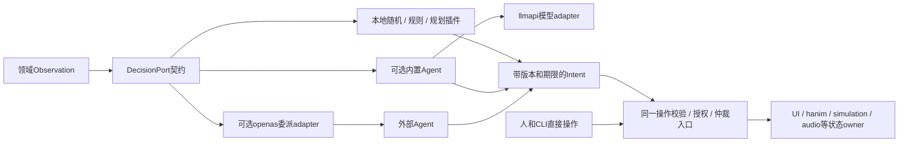

# Feature 裁剪、可插拔 AI／Agent 与局部像素风格

2026-11-05。**综合架构补充，供 review；本轮核查现有代码与上游接口，不宣称新 AI 引擎、像素风格包或 feature 矩阵已实现。** 本仓基线 `3401262`，承接[顶层×子系统方案](2026-11-05-system-subsystem-architecture-and-api-design.md)。本轮将维护者的新要求落实为核心／可选边界、内部与外部决策来源、局部风格配方和可验证的实施顺序。

## 1. 核心结论与当前事实

推荐统一原则：**核心提供稳定契约、状态所有权与组合机制；可选能力通过包／feature 引入实现，运行时在实际编入且可用的能力内选择。** AI 原生表示引擎能被观察、控制并接入决策能力；不要求每个引擎都链接模型库。风格原生表示组件暴露语义、部件和表现槽；不要求组件认识每种美术风格。

| 当前事实 | 可以复用 | 不能据此宣称 |
|---|---|---|
| mcpp 2026.11.2.2已有features、feature-deps、依赖边default-features、构建capability | 按源／包／工具选择能力；无宏模块分区方案 | 所有本项目引擎已经实现细粒度裁剪；运行时布尔值会自动缩小产物 |
| `openmui.agent`是UI控制endpoint，已有actor与多级限制 | 领域操作、授权、记录与外部Agent接入 | 已有通用内置AI运行时 |
| `gongfu.ai`有确定性领域bot | 经验证可提取的策略机制 | 已有通用规划／推理引擎，或需要将格斗逻辑移入AI核心 |
| llmapi 0.2.8有C++23模型调用、工具调用、结构化输出等 | 作为可选模型调用库，经薄adapter接入 | `chat_async`已经是非阻塞I/O；任意模型调用可以进入UI帧循环 |
| theme已有token、overlay、style effects/motions及scope | 局部主题／风格、按role/type分配效果与动效 | 完整嵌套效果隔离、portal与每种复杂scope都已验收 |
| renderer已有CPU/GPU `pixelate` | 复用现有块采样算法和共享renderer | 完整像素美术语言；size=1在任意DPR下都是identity |

本地核对入口：[feature夹具](../../tests/features/mcpp.toml)、[独立feature消费者](../../tools/ci/features-consumer/mcpp.toml.in)、[theme接口](../../modules/ui/theme/src/theme.cppm)、[内置效果](../../modules/gfx/render/vector/src/effects.cpp)、[UI授权](../../modules/ui/core/src/access.cpp)、[gongfu.ai](../../mgame/gongfu/ai/README.md)。上游核查固定到llmapi提交 `a48d0cd3147b5bf67b4c25f98764d47cf7f028d1`，详见§4。

进一步源码复审发现：UI的effect_state当前只自动驱动名为`progress`的参数；pixelate只有`size`，不能给它duration就声称size被动画。disabled当前会剥离styled effect，命中目前只处理首个effect的source_of，未组合完整more_effects逆映射。它们分别是通用参数桥接、基础外观／反馈分类、交互映射的缺口。[参数解析](../../modules/ui/view/src/props.cpp)、[绘制／状态／命中](../../modules/ui/view/src/frame.cpp)。这些是代码核查，不冒充本轮浏览器复现。

## 2. Feature：控制交付物，运行开关控制使用

### 2.1 四个层次分别表达

| 层次 | 解决的问题 | 规则 |
|---|---|---|
| 包／构建feature | 哪些代码、依赖、shader、工具及资产进入构件 | 关闭后实际闭包和构件中消失；不依赖链接器碰巧删除全部东西 |
| 产品发行预设／capability选择 | 某个发行配置选择哪些实现与目标 | 产品预设组合清单、features、target、资产和运行策略；capability绑定不等于设备已经支持 |
| 运行时能力与启用状态 | 当前设备／宿主是否支持、资源是否准备、实例是否启用 | 未编入、未就绪、不可用分别返回；启用不能重新创造被裁掉的代码 |
| 操作权限与用户偏好 | 谁可以使用；reduced motion等限制 | 权限不由feature开启自动授予；偏好在已编入能力内约束表现 |

需要同时记录 `compiled / supported / ready / enabled / authorized` 的状态及原因。运行时关闭模型、GPU效果或网络服务，可节省运行资源，但已编入的代码仍占体积。

这里的“产品发行预设”不等于mcpp的build profile。当前dev/release等profile主要控制优化、调试、LTO和编译标志，不自动启用feature或绑定模型provider；不能自行假设存在 `[profile].features`。产品预设应由明确清单／已有构建入口展开，并记录最终解析结果。

### 2.2 使用现有mcpp机制

mcpp在该版本采用加法feature合并；可选运行依赖使用 `[feature-deps.<name>]`，可选工具用 `[feature-xlings.<name>]`。普通 `[dependencies]` 总参与解析。依赖边可使用 `default-features = false`；同一包的另一条边仍可开启默认项／feature，因此必须审计整个消费者图。**不存在 `--no-default-features` CLI选项**，本仓旧夹具注释需纠正；真正CI已使用独立消费者边配置。

依据：mcpp固定版本的[features设计](https://github.com/mcpp-community/mcpp/blob/8d099cb1dae8419165361c92d34878901e485c93/docs/06-features-and-capabilities.md)、[异构构建](https://github.com/mcpp-community/mcpp/blob/8d099cb1dae8419165361c92d34878901e485c93/docs/42-heterogeneous-builds.md)。本轮核对安装版本help及这些版本化源码，没有运行新的feature构建矩阵。

项目继续用清单选择模块分区、导出 `inline constexpr` 能力及 `if constexpr`，不引入全仓 `#ifdef`。公共稳定类型／句柄不随feature任意改变布局；可选API用子模块显式导入，动态发现使用能力查询。feature闭包、工具链、后端和资产版本进入构建／BMI／缓存键，防止不同配置混用构件。

feature粒度按独立职责和实际成本划分，例如模型调用、Agent编排、像素风格包、GPU求值。颜色、速度、noise强度属于运行参数，不为每一个参数创建编译开关。已有能力先测实际closure，再决定拆包或feature，避免几百个布尔开关产生不可验收的组合空间。

### 2.3 推荐默认配置和增量选择

| 产品配置 | 默认完整能力 | 可选增量 |
|---|---|---|
| hanim采样 | 时间／对象／描述／匹配／采样与必要诊断 | renderer adapter、GPU、特殊域、控制provider |
| 常规omui应用 | 语义、交互、默认motion、主题、选定宿主及双用户控制 | 像素/玻璃等风格包、内置AI、额外协议／设备 |
| AI规则消费者 | 观察/意图契约、所选规则策略 | llmapi、内置Agent编排、外部Agent委派、记忆/检索 |
| 模型调用消费者 | llmapi adapter及调用所需依赖 | 工具调用循环、长期上下文、本地推理、可视工具 |
| 极简专用产品 | 明示裁剪后的能力清单 | 按需添加；不冒充默认omui发行配置 |

内置模型／Agent默认不进入普通UI/hanim闭包，不下载权重、不启动推理worker。关闭内置AI不关闭外部Agent可用的语义操作、调试和输出。开发者可以明确裁剪控制接入或某个transport，但构件必须声明其能力；不能通过去掉默认motion／Agent支持来声称“同功能默认UI更小”。

独立包首先保证不使用即不依赖；feature负责包内能力或便利伞包的依赖选择。模型权重、词表、字体、style资源、着色器变体、JS胶水及预加载／service worker清单都在裁剪审计内，不能只看C++符号。

## 3. AI／Agent：统一决策端口，决策来源可替换

### 3.1 四类能力与两种外部交互

| 能力 | 责任 |
|---|---|
| 决策／策略核心 | Observation→Intent；状态机、seed、deadline、预算、任务生命周期与取消 |
| 可选模型调用 | 通过llmapi等provider请求结构化结果；也可只聊天／embedding，不启动Agent |
| 可选Agent运行时 | 观察→规划→工具调用→反馈的有界编排；上下文、重试和检查点按需插件 |
| 领域动作／控制 | 校验意图、资源revision与权限，提交到实际状态owner；人／内置Agent／外部Agent共用 |

外部Agent既能**直接使用应用公开能力**，也能作为应用主动请求的**决策来源**。openas承担操作与授权协议，不自动变成一个模型服务；作为外部决策来源时，对端需声明相应操作／会话能力。



图是运行时信息流，不能照抄为双向C++包依赖。领域port只依赖中立数据／控制契约；策略、内置Agent及委派adapter消费契约；应用宿主装配，不令UI或hanim反依赖AI。

### 3.2 DecisionPort的最小契约

请求包含任务ID、控制权epoch／lease generation、观察快照／revision、时间／坐标空间、可选动作schema、约束、deadline、随机种子和预算。响应是类型化Intent或明确的无动作／失败／取消结果，并携带这些请求身份、所依据revision、有效期、来源和资源引用。

Intent不会直接写对象内存。领域操作验证坐标、范围、对象代次、权限和当前revision，在允许的帧／tick／block边界发布；过期或被人操作取代的结果丢弃、重规划或按显式策略重新校验。稳定动作schema同时用于原生代码、GUI、Agent工具与测试，不另写一套“AI专用动作”。

统一的是结果边界，不是统一耗时：简单规则可以有界同步求值，网络／模型走异步任务；事件或低频决策驱动连续运动。帧循环、音频回调和逐顶点路径不等待模型。

构建capability provider、领域control provider、模型provider、DecisionSource和compute backend是不同契约。尤其允许同一应用同时选本地规则、远程模型与外部Agent，不能用单一排他 `ai` provider错误限制组合。

### 3.3 外部Agent委派及防止重复动作

推荐默认**返回意图模式**：应用发布观察与候选动作，对端返回Intent，应用统一验证并提交。外部Agent也可以主动调用已公开动作；需要长时间接管时，使用显式、有范围和期限的控制租约。

另一种**委派执行模式**允许外部Agent在授予的范围内通过同一操作入口执行，返回已执行操作ID及结果。任务必须声明采用哪一种模式，不能既执行动作又将同一Intent重新应用。实际执行使用任务／动作ID去重及状态查询；断线重试不承诺网络“恰好一次”。

外部驱动可查询语义、订阅变化，并请求必要区域真像素。断线／超时可切回已选本地策略或保持安全状态，选择与切换有日志；不自动把全部工程、屏幕和凭据发给对端。内部模型与外部Agent执行应用操作时都继承developer/user/session范围，复用openas判定，进程内位置不是额外权限。

来源切换由宿主推进controller epoch并撤销旧租约，旧来源的未提交Intent、执行授权和后续响应一起失效。仅检查对象revision不足以阻止同revision下的旧响应；默认同一受控动作域只有一个有效驱动租约，多个来源同时建议时由显式仲裁器选择。已提交动作不因epoch变化自动撤销，仍遵循领域undo／补偿规则。必须验证“外部断线→本地接管→旧响应／旧直接调用抵达”。

委派请求／响应使用注册的应用操作schema经openas适配，不为此另造网络协议或声称openas已经定义通用模型推理服务。对端没有决策操作时可选择已支持的观察订阅＋显式动作接管模式，能力差异对用户和Agent可见。

### 3.4 原生易用性的具体验收：二维桌面角色／Live2D场景

以下为**候选API示意，尚未实现**。`pet_port`是应用公开的领域port，提供位置／活动范围／状态观察及walk_to、look_at、set_expression等动作；AI核心不认识“宠物”这个特定业务。

```cpp
// 三种可替换来源；并非要求同时创建全部来源。
auto source = ai::local(policy::wander(work_area, seed));
// auto source = ai::agent(model, allowed_tools, agent_options);
// auto source = ai::external_agent(session, delegation_options);

auto behavior = ai::drive(pet_port, source, drive_options);
```

正式接口应返回 `expected<DriveRef, Failure>` 并提供查询、暂停、来源切换、取消和release；port身份带owner/generation，源关闭或port销毁时停止新决策并撤销租约。取消完成与请求实际结束分别可观察，不能只销毁一个句柄就释放正在执行的provider状态。复杂任务额外暴露step／工具调用上限和上下文预算，简单策略仍保持少量默认参数。

简单随机移动只用公共math随机与wander配方，不需要模型、网络或通用Agent循环。更复杂规则／utility决策作为策略插件；聊天／理解指令可选llmapi，生成受限目标或表情意图；多步任务再启用Agent编排。外部Agent可通过相同port代替内置决策。

角色移动、表情、眨眼、呼吸由hanim和相应rig／模型adapter连续执行；拖拽、命中、窗口／屏幕坐标转换由宿主与领域控制负责。模型迟到、取消或离线不能冻结角色。Live2D/Cubism模型适配、桌面透明窗口／点击穿透／多屏DPI分别是独立后端能力，不因“AI接口简单”就记为已经支持。首先可用现有二维对象验证同一决策链，再加入具体模型适配。

验收任务：无需改角色／动画代码，依次切换本地策略、内置模型Agent、外部Agent；三者均完成移动／表情任务。人拖动时旧决策失效；离线仍可漫游；录制回放可重现接受的决策；GUI关闭后CLI能控制并获取真实区域像素。

## 4. llmapi复用与上游适配边界

维护者指定复用 [mcpplibs/llmapi](https://github.com/mcpplibs/llmapi)。本轮实际核查版本为0.2.8、提交 `a48d0cd3147b5bf67b4c25f98764d47cf7f028d1`；采用其 `Client<Provider>`、消息／工具／响应类型与provider能力，避免在本仓再实现供应商HTTP、SSE和消息序列化。[公开API](https://github.com/mcpplibs/llmapi/blob/a48d0cd3147b5bf67b4c25f98764d47cf7f028d1/docs/en/cpp-api.md)

源码发现的集成边界：

| 已核查行为 | 架构影响／建议工作 |
|---|---|
| `Client::chat_async`内部调用同步 `provider_.chat`；provider也用 `co_return chat(...)` | 协程外观不保证非阻塞。当前原生宿主只能在有界worker隔离同步I/O；Web需真正兼容的异步transport。取消UI等待不等于取消底层请求 |
| 调用与Task使用异常；Client有可变conversation且不提供并发同步 | 本项目adapter边界转换为expected；不将异常暴露到核心；每任务独立会话或明确串行，不能多Agent共享可变Client |
| Client默认将assistant结果记录为 `response.text()` | 工具调用循环要保留ToolUse/ToolResult结构和对应ID，不能把纯文本conversation当完整Agent历史 |
| 流式回调为文本；公开接口未提供本方案所需的完整取消／有界事件协议 | 增补request lifecycle、结构化stream事件、背压、deadline、重试信息和能力查询；无对应支持时如实标记 |
| 清单使用tinyhttps，仓内携带JSON实现 | 先审计版本／依赖及mcpp生态，通用修正尽量在上游完成，不能在本仓再复制网络或JSON库 |

源码依据：[Client](https://github.com/mcpplibs/llmapi/blob/a48d0cd3147b5bf67b4c25f98764d47cf7f028d1/src/client.cppm)、[Task](https://github.com/mcpplibs/llmapi/blob/a48d0cd3147b5bf67b4c25f98764d47cf7f028d1/src/coro.cppm)、[provider](https://github.com/mcpplibs/llmapi/blob/a48d0cd3147b5bf67b4c25f98764d47cf7f028d1/src/providers/openai.cppm)、[清单](https://github.com/mcpplibs/llmapi/blob/a48d0cd3147b5bf67b4c25f98764d47cf7f028d1/mcpp.toml)。这是源码核查，没有本轮联网模型调用或吞吐测试。

允许在实施中向llmapi提PR，建议依次为：①结构化错误与完整tool history；②真正异步／取消／流式事件及可测transport；③Web/原生后端与按需依赖、构建适配。先用不需要付费模型的fixture／本地transport测协议、错误、乱序／中断，再明确记录真实provider测试范围。上游保持供应商调用库定位，AI决策编排、领域动作与openas授权留在各自owner。

上游变化需在llmapi独立分支／PR完成，适用版本发布／索引可用后本仓消费；不把上游源码拷进本仓长期打补丁。当前任务是方案补充，**本轮没有创建llmapi PR、升级依赖或承诺其尚未实现的能力**。本仓的方案提交继续追加PR #1。

同步worker过渡方案的生命周期也需明确：停止等待只使结果不再提交；Client、回调捕获、缓冲和任务存储必须保留到请求实际结束。有界排队／并发饱和返回可识别错误；deadline不允许释放仍执行的对象。底层没有超时／中断保证时，不承诺有限关停；真正取消需要transport支持或独立、可管理的执行隔离。Web不能默认照搬原生线程方案。

## 5. AI产品包、资源与实时边界

候选位置如下，按首批任务创建，最终命名另审，不占用现有表示UI endpoint的 `openmui.agent` 身份：

```text
modules/base/ai/                 [候选] 最小产品入口，不默认导入provider
  core/                         Observation/Intent/任务与DecisionPort契约
  policy/                       按需规则/随机/utility等通用策略
  model/                        最小模型能力与任务接口；与llmapi类型薄映射
  agent/                        可选工具循环/计划/任务编排
  provider/llmapi/               可选模型调用adapter；native边界处理异常
  control/                      AI任务的查询/暂停/取消/观测provider
modules/gfx/ai/inference/        [候选] 确有需求时的GPU/推理库adapter
integrations/ai/openas/          [候选] 外部决策来源/委派执行适配
modules/content/ai/...          [候选] 素材/检索等确有内容依赖的adapter
```

这不要求先建全部包。model契约只包含调度／能力差异所需的最小描述，不重写llmapi的消息体系、每家provider类型或序列化。若能直接使用其公开类型且保持轻量闭包，就采用薄导出；否则将供应商类型留在adapter边界。实际目录与layering规则、README和独立消费者一起落地。

llmapi负责调用远端或兼容服务，不等于嵌入式推理runtime。未来本地推理采用生态可选实现，模型资产归公共resource/asset机制；第三方若拥有GPU allocator/queue，明确互操作、租约／fence和复制，不能假装自动接入RHI或重写它一遍。共享CPU任务基础；AI、每个模型、每个引擎不各建无限线程池。

规则预算、并发请求、token／上下文／费用（若provider可报告）、内存／显存、输出队列与deadline均可观察。输出来自外部服务时作为外部输入记录：来源版本、观察revision、所接受决策、提交边界和结果；回放消费记录，不重新请求模型并声称确定。可选长记忆／embedding／检索是独立插件，默认不持久化或自动收集全部数据。

## 6. Effect、Theme、Style、Motion的职责

| 层 | 内容 | 可独立使用 |
|---|---|---|
| Effect算子 | 像素采样、palette映射、dither、材质或几何修饰 | 可作用于一个对象／部件／mask／图层／明确合成结果，无需全局主题 |
| Theme/token | 语义颜色、文字、间距、形状、边框、密度和基础motion token | 局部token覆盖；不强制任何图像后处理 |
| Style pack | 将token、材料/effect配方、选择器、资产、motion rules、降档规则组成可复用美术语言 | 可在局部scope应用，并与其他scope风格共存 |
| Motion recipe | 基于公共hanim动画/参数/效果的状态过渡 | 可脱离该风格在其他对象上复用；不由组件写私有timer |

因此**像素风既可以只取一个effect，也可以使用完整style包**。完整包可包含受限色板、阶梯轮廓、边框／阴影、字体策略、网格与动效；不等同把整窗低分辨率化。液态玻璃同理，材料、字体对比、部件与动效策略共同组成风格。

### 6.1 局部作用域与覆盖规则

支持对象、部件、角色选择、子树、mask和显式合成层；应用到根节点只是其中一个选择。现有 `theme::apply_style(runtime, name, scope)`／`theme_scope` 已提供局部主题基础；拟议pixel包可接入它，完整paint-domain／portal策略仍需扩展和验证。

目标解析步骤为：**继承或显式base theme → 有序style ID／版本 → 参数／资源绑定 → 局部显式覆盖 → 用户偏好／能力约束 → tokens、paint-domain/effect链、公共motion绑定**。当前 `compose_style` 只组合一个style自己指定的theme，不把多style组合与父scope继承当成已实现；F3需先补这一通用解析契约与诊断。

motion沿现有“节点显式槽→风格规则→框架默认”选择，然后受用户reduced/off与能力预算约束。effect链顺序、作用阶段和mask显式描述，不能照token覆盖规则猜测滤镜合成。网格单位、palette资源格式、选择器或paint-domain结构变化可能触发重新准备；已准备参数块中的数值轨道才进入逐帧采样。不同类型的style改变可查询实际成本与失效原因。

继承的是风格上下文与规则，不是在每个子节点重复应用同一后处理。节点可reset或局部替换；像素scope与玻璃scope并排不相互污染。嵌套时，外层已经合成的像素效果会覆盖内层图像，即使内层换了theme——需要通过paint-domain、pass顺序／mask明确决定内层是否参与，而不是把主题reset当滤镜隔离。

风格规则还要区分**基础外观**和hover/pressed等**状态反馈**：disabled/reduced不能让像素材质突然消失；disabled仍显示明确状态，reduced只抑制不必要时间变化。此分类适用于所有style，不能专门为pixel组件打补丁。命名部件隔离需保持原绘制顺序、遮挡与clip，不能为了文字保真将全部文字无条件移到最终最上层。

portal／弹层保留逻辑owner的style context或显式选择目标context；其绘制层、effects和backdrop采样由合成计划记录。DOM/语义树继承并不能自动保证脱离父绘制层的弹框走同一效果。缓存键包含scope／style版本、DPI／网格原点、资产和采样依赖；切换时历史帧也保留原scope归属。

### 6.2 避免hardcode的具体方式

组件提供状态、语义role及可选稳定部件名，如surface、label、thumb、track、focus；图形仍通过公开primitive或material槽表达。风格包用数据选择这些角色／槽，组合通用算子和动画；不存在 `if (style == "pixel")` 的每组件分支、网站专用像素实现或效果名特判的私有时钟。

确需新的画法时，增加有schema、参数、CPU参考／目标后端、能力／预算与CTS的通用算子；style只引用它。新增部件角色应通过组件契约生成机制处理。配方中的美术参数与精选预设是必要设计，不把“不能hardcode”误解为不能有默认配色或不能手工设计动效；禁止的是散落在引擎／组件中的场景专用实现。

包可以使用现有 `*.style.omui.toml`、`*.effect.omui.toml`、`.slang` 与未来公共motion描述；不在本稿虚构已被解析器支持的palette／parts／resource字段。先补schema、诊断及版本，再提供文件示例和生成绑定。

## 7. 像素风格包：首批具体内容

### 7.1 静态表现与可调参数

建议名称 `pixel`，作为独立可选包或style feature；共用renderer已有pixelate，不复制算法。候选能力包括：grid单位与锚点、cell size、palette资源、色彩空间／量化、固定相位dither、阶梯边缘、描边／阴影、文字保真和style强度。tokens／轻量描边不必创建离屏层；只有需要合成输入的pass才申请纹理与采样范围。

**关键现状缺口：**现有pixelate按逻辑size×DPR生成块并平均。DPR=2时size=1仍可能是2×2采样，故 `1→N→1` 不能作为严格无损开关。需要明确disabled／amount=0旁路、逻辑／设备像素单位、网格原点和端点契约；运动、裁剪、分块或窗口移动时网格相位不能无意跳动。

palette映射／dither与块采样是不同算子，后续按公共effect扩展；处理线性／显示色、alpha与预乘边界，透明像素不把邻域染黑。字体默认保留清晰label/focus，装饰surface／图标可更强像素化；指定像素字体仍需中英fallback、IME、字号和DPI验证。

### 7.2 配套动画由公共配方组合

| 配方候选 | 通用组合 | 约束 |
|---|---|---|
| 网格步进入／退出 | move/fade＋time或path quantization | 起终点策略明确；reduced下保留直接反馈 |
| 像素块揭示 | 通用reveal/mask＋稳定seed和cell参数 | 不创建逐像素UI节点，不改变业务顺序 |
| 阶梯按压／回弹 | surface/scale或位移＋短段sequence | 适配组件用途，命中和label保持可读 |
| 色板／材质过渡 | 公开参数轨道＋palette权重／material mix | 色彩跳阶是声明策略，不能掩盖未知效果 |
| 选择指示器滑动 | indicator位置轨道＋网格采样 | focus与选择状态即时可见，不由动画推迟提交 |
| 块状重排／组装 | 公共对象匹配＋stagger＋cell reveal | 非交互碎片与实际操作对象身份分开 |

上述依赖尚未全部成为hanim公共配方，因此是实施清单，不计为已完成动画数量。snap输出只影响声明的表现通道；严格网格终点与精确业务目标不一致时必须选择端点策略，不偷偷改布局／数据。图像采样变化默认不改变点击几何；真正位置／形变要通过UI adapter发布一致的命中几何，非一一映射效果明确交互策略。

像素风不要求所有组件都跳帧，也不要求所有时间都steps。对话框可用短reveal，开关使用thumb移动，输入框重视光标／选区／IME可读，图表可保留连续数据反馈。配方按role和用途选择，仍复用公共动画原语。

### 7.3 首个真实场景与验收

同一页面放默认编辑区、像素风工具卡、玻璃预览区；卡内包含button、switch、input和popover。只改变卡的scope，人和Agent完成开关／文本编辑／弹层选择，公共动画控制过渡。再把同一pixel配方应用于独立hanim对象或桌面角色装饰层，证明不依赖某个UI组件。

本地验收覆盖DPR 1/1.25/2、缩放／移动、窗口／clip／tile边缘、嵌套scope、portal、连续中间帧、打断／retarget、reduced/off、中英文字、IME/焦点和真实截图。关闭style feature时其专属数据、字体、注册和变体不进入产物；共享pixelate等算子只有在整个闭包都无消费者时才要求消失，现renderer统一导出shader的方式可能需要另补注册／源选择裁剪。

局部性分两类验证：固定allocation时，声明输出／覆盖区域之外逐像素不变；允许字体／密度引发reflow时，核对预期几何变化，外部token、对象身份、值和动作保持不变。portal覆盖、filter reach及backdrop读区域单独声明，不能把合法布局移动误报成作用域污染。CPU和所选GPU能力分别核实；自定义Slang效果当前可能没有CPU实现，不能默认使用CPU跳过效果的图像验收pixel style成功。

## 8. 多角度自我review与修正

本表记录架构反例及修正，**不是宣称对应实现测试已经通过**。

| 视角 | 反例／发现的问题 | 本方案修正与验收要求 |
|---|---|---|
| 体积 | `enabled=false`但依赖、模型、shader和资源仍嵌入 | 包/feature闭包与资源清单共同审计；零初始化／零隐式下载另测 |
| 构建一致性 | 某条边关闭default，另一条边重新开启；不同feature复用BMI；误认release自动选功能 | 计算完整并集、唯一模块分区／ABI，feature进入缓存键；产品预设与build profile分开 |
| 默认Agent原生 | 关闭内置AI顺带删外部控制 | 分离AI计算、决策来源、control和transport；默认UI双用户能力保持 |
| 复用边界 | 为模型服务重写HTTP/SSE／消息类型 | 复用llmapi，通用修复走上游；本仓薄adapter＋领域编排 |
| 异步／实时 | 看到 `chat_async` 就在帧内await，或取消等待就释放Client | 依据源码确认同步路径；worker有界，资源保留至完成；真正取消／关停与Web异步单独验收 |
| 决策正确性 | 人已拖动，迟到模型把角色移回去；固定seed假装服务确定性 | revision／期限／仲裁；回放记录已接受决策，不重请求模型 |
| 外部驱动 | 外部已执行后重复提交；断线回退后旧来源继续控制 | 区分提议／执行模式、action ID去重；controller epoch统一撤销旧来源与租约 |
| 权限／上下文 | 内置Agent直接写内部对象，或自动上传整个工程 | 同一操作授权入口，显式观察范围；原生传参不必经网络／JSON |
| 主题与scope | 内层theme reset仍被外层pixel滤镜影响；portal逃出父wrapper | style context和paint-domain分别管理，显式mask／合成范围及采样依赖 |
| 像素端点 | size=1在高DPI下仍改变像素 | 明确旁路端点、单位／锚点及DPR矩阵 |
| 可读／交互 | 整窗pixelate使文字、光标和焦点不可辨；效果改变位置却保留旧命中 | 部件选择与前景保真、真实命中适配；无障碍与reduced约束优先 |
| 状态／桥接 | disabled剥离基础材质；给size参数duration却完全不动 | 通用appearance/feedback分类，任意typed参数经hanim桥接；不硬编码progress或pixel例外 |
| 非hardcode | 每个组件加pixel分支，或全靠网站截图模拟 | 通用效果插件＋style数据＋公共motion配方；独立消费者复用 |
| 包图／状态owner | AI、openas和UI互相import；每个引擎都拥有任务/权限/GPU池 | 中立port、应用装配、单一owner；不同领域状态保持独立 |
| 产品真实性 | “支持AI桌宠”被误写成已支持Live2D、透明窗口、多屏和所有模型 | 分开列模型adapter、宿主能力、AI任务与输出证据，按需实现 |

独立复审后已修正六项设计问题：build profile不等于feature预设；来源切换增加epoch；同步worker取消保留资源；style关闭不强删其他消费者共享的算子；局部像素不变限定allocation／输出范围；明确新增style编译协议而不假设现有单style解析器已经支持。这些修正进入上述契约和验收，仍待实施验证。

## 9. 实施顺序与本轮review项

1. **F0 成本基线**：记录默认UI／纯hanim／规则消费者闭包；将feature与能力清单加入构件，修正失效命令注释。
2. **F1 最小AI控制链**：一个DecisionPort、seeded wander、一个领域动作adapter；无模型／网络也能运行，外部Agent仍可控制和审查。
3. **F2 llmapi／外部委派**：先分别完成可取消模型任务和外部Agent决策来源，统一revision／期限／错误；需要的通用改进在llmapi独立PR交付。CLI/headless先通，GUI可选。
4. **F3 局部pixel风格**：先补像素单位／旁路、局部scope和部件保真，再由style文件组织公共效果和motion；真实混合风格页面与独立对象验收。
5. **F4 泛化与产品化**：按需扩Agent规划、上下文、local inference、更多style；feature闭包矩阵、Web／设备及40／20公共成果映射持续验收。

与主方案P1–P5交叉执行：F1/F2检验control契约，F3检验hanim/UI/render契约，不另起彼此独立的引擎实现。最多2名subagent，写操作用隔离worktree；本地相关检查通过后追加PR #1，跨平台CI异步。

建议review：**默认UI保留轻量双用户控制、内置AI可选；DecisionPort允许规则／内置Agent／外部Agent替换；llmapi作为模型调用owner；pixel作为局部可组合style包，底层effect独立可用。** API名字与新包身份仍为候选，关键是上述职责、作用域、成本和生命周期能被真实场景验证。

本轮交付是设计与源码核查，没有新增模型调用／像素风运行时或性能宣称。新功能需完成对应独立消费者与真实图像／交互证据后再记入进度。

文档集成本地检查：仓库lint为0问题，5份变更Markdown的83个本地链接与代码围栏检查通过，git差异格式检查通过；`tests/features/mcpp.toml`只修正命令注释，没有修改feature行为。用户原有mcpp.lock字节保持不变且不纳入提交。
