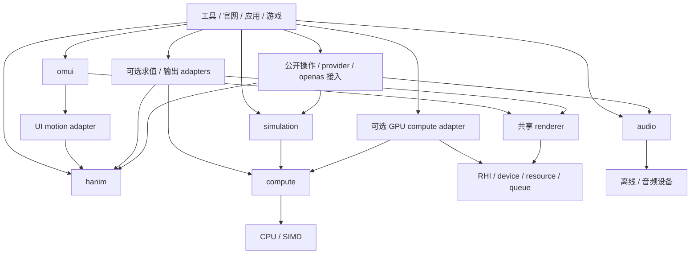

# 项目顶层 × 子系统架构：分级接口、代码树与实施方案

2026-11-05。**供维护者 review 的综合方案，不将候选设计记为已实现，也不在本轮冻结公共 API。** 基线为 `2f39e01`；当前能力以[项目评审](../reivews/2026-11-05-project-progress-review.md)及源码为准。本轮另做真实 hanim 消费者接口实验，结果见 §3。本方案整合前期讨论；已有 D-xx、AGENTS、规范和质量要求继续有效，新增目录／接口按本文明确的迁移门槛实施。

后续补充基线 `3401262`：[Feature、可插拔AI／Agent及局部像素风格](2026-11-05-features-ai-agent-scoped-style-design.md)加入核心/可选feature边界、llmapi复用、规则／内置Agent／openas外部Agent三种决策来源，以及theme×effect×motion的局部style设计与自我review。以下§3保留上一检查点实际运行结果；本次补充没有重跑或扩大其验收范围。

## 1. 结论与评估

推荐：**以独立产品为边界、以本域能力为内核、以类型化契约组合全局；日常 API 简短，复杂约束逐级显露，所有层级复用同一执行体系。**

当前主要问题是能力链路尚未贯通。严格 2D hanim 已有真实对象、编排、播放和可选渲染；UI 默认动效仍主要消费 `hanim.core`。官网的 40 个基础场景、20 个创意场景，也不能等同框架用户可带走的 40 个公共动画和 20 个完整组合工程。继续扩大官网私有实现会放大这个断点。

| 评估维度 | 当前证据 | 设计与实施结论 |
|---|---|---|
| 独立性 | base/gfx/content/media 已分层；hanim 外部消费者可真实运行 | 保留现有实现，补齐公开入口和消费闭包，避免全仓搬家 |
| 语义完备性 | Program 目前是严格整对象形变的嵌套编排 | 演进通道、作用域、状态与资源 IR；流畅语法本身不能补齐这些能力 |
| 产品完备性 | UI、音频、渲染、CLI 都已有可运行原料 | 以实际任务评估成熟度；模拟、HPC、完整制作链仍有明显缺口 |
| 简单使用 | 存在 `play(object, morph_to(target), ...)` 与显式 Program | 推荐直接 `morph(source, target)`＋`play(animation)`；保留高级 prepare |
| 复用与成本 | 数学／内存／渲染已有单一 owner；仍有多余依赖与重叠算法 | 建立迁移台账，按实际闭包和工作负载收敛，不依据目录名称推断体积 |
| 质量 | 已有局部 CPU／Web／像素／浏览器验证 | 本轮最小实验不替代完整视觉、设备、Agent任务与每维 ≥90 验收 |

不提供缺少验收分母的总完成百分比。R0–R6、C2–C6、40／20、完整组件默认动效、独立引擎与工具链的目标保留。**本地相关真实验证通过即可继续并提交 PR #1；其他平台 CI 异步反馈，失败按实际影响修复，不作为开始下一项工作的统一等待条件。**

## 2. 产品边界与共同契约

omui、hanim、renderer、simulation、audio、compute及可选AI／Agent在产品层对等。包依赖仍单向；一个产品可以消费另一产品的公开能力。独立意味着可单独构建、运行、测试、发布和解释依赖，不意味着相互复制数学、资源管理或渲染器。



箭头表示所选包消费公开能力；应用按清单选adapter并注入接口，hanim内核和base计算契约不反向import高层adapter。图中并非全部依赖都必须启用；例如纯 hanim 采样不导入 renderer，纯 CPU 模拟不导入 RHI，纯音频导出不导入 UI。公共基础省略在图外。

最小共同契约分六类；按真实消费者逐项提取，不先写一个万能 SDK：

| 契约 | 必须明确 | 不承担 |
|---|---|---|
| 身份与版本 | owner、稳定资源身份、运行时 generation、revision；冻结快照与借用 view 的生命周期 | 强迫 UI 节点、像素单元、音频 voice 成为同一个对象类型 |
| 数据视图 | 元素类型、shape／stride、单位、坐标空间、读写范围、内存域与租约 | 把所有数据转换成 JSON 或 tensor |
| 时间 | 时间基、转换、时延、采样边界；animation time／sim tick／audio sample 的映射 | 一个全局可变时钟统一推进所有系统 |
| 操作 | 参数 schema、结果／错误、revision 前置条件、取消和事务能力 | 声称全部操作可撤销或全部引擎事务自动原子提交 |
| 能力与资源 | 支持域／后端／数值等级、预算、准备与发布、显式复制和失效 | 隐式 GPU 下载、默认导入全部插件、无法解释的静默降档 |
| 观测 | 对象／计划／操作关联 ID、trace、日志、预算和有限查询 | 每顶点、每像素、每 sample 格式化日志或调用 Agent |

**共同模式与领域 IR 分开。** Animation IR、Simulation Plan、AudioGraph、RenderGraph 保留各自状态、优化合法性和实时约束。复用资源视图、算法、批次、记录机制；不制造一个巨大通用图，让所有领域为它改模型。

**标准与实现分开。** openmui规范由OpenLifa标准仓库维护，openas提供actor／授权／动作语义；各引擎自己的数据／算子契约先作为公开、版本化产品接口验证，不将每个内部结构立即升级成新标准。需要修改标准时沿既有子模块／独立PR流程，标准不反向依赖实现。

插件默认按mcpp清单静态选择，注册表只包含所选能力；每种插件有契约版本、能力查询、CTS、trace与日志类别。调用粒度是阶段／批次，不能每像素虚派发。C++ Modules不自动提供跨编译器稳定二进制ABI；若需要动态插件，必须另定义经过审查的版本／工具链／生命周期边界，不能将任意C++对象布局作为长期协议。当前C++23、契约生成、唯一生成头文件等规则继续遵守。

## 3. 最小接口实验：验证什么、如何使用

本轮实验位于 [tools/ci/hanim-api-probe](../../tools/ci/hanim-api-probe/README.md)，是独立外部消费者的候选 façade，**不等于公开 `hanim` 已增加这些签名**。测试用真实对象／轮廓／效果参数，调用现有 `PreparedProgram::prepare` 和 `Engine::play`，不另写匹配、时间求值或播放器。

实验结果、实际可编译示例、运行命令及依赖闭包在该目录 README 与机器报告中登记。此次只验证已实现的严格 morph 域；移动／揭示的完整公共配方、通道混合、组合效果隔离、任意路径 effect、GPU 和状态反应均不由该实验宣告实现。

**本轮实际结果：Linux GCC 16.1.0、C++23、mcpp 2026.11.2.2，dev／release各76项断言及生命周期检查通过。** 这不是76个功能或完整场景。外部工程的实际resolution与编译数据库包含10个库＋消费者，未依赖UI、规范、renderer或RHI；两个消费者源实际使用C++23。记录见[版本化报告](../../tools/ci/hanim-api-probe/2026-11-05.report.omui.json)。

验证包含：三角轮廓到圆近似的真实cubic中点／对象变换、blur→tone参数顺序；五时间点及乱序seek下便利／预备播放相同；两轨三段嵌套、stagger前保持源、前段终点接续；ObjectRef在prepare捕获当前revision、Snapshot冻结、对象销毁后计划保留几何；槽复用后旧ref仍失败、foreign owner、冲突、非法时长／effect、节点／深度预算和release。构造描述不改业务对象、不启动播放。

实验只写了冷路径描述树和lowering，复用原编译／播放。ObjectRef需属于借用的Engine；外部注册表走显式Snapshot。它没有像素输出、GPU、性能／零分配或sanitizer的本轮证据。现有独立CPU渲染消费者的像素证据另计；不会拿参数插值冒充可见blur验收。正式产品仍需能力、捕获一致性、作用域和发布策略收口，不能直接把实验文件搬成稳定API。

### 3.1 分级入口与扩展层

下列是**最终公共 API 的推荐形态**；实际实验支持的子集以 §3 结果为准。`hengine` 是局部变量名，类型仍可采用 `hanim::Engine`，无需再发明第二种 engine 类型。

```cpp
// 以下是互为替代的入口示例；不能直接对同一对象同时启动全部实例。
// L0：一个动作；target 是形态模板，不是要被删除／替换的业务对象。
auto started = hengine.play(anim::morph(card, panel));

// L1：只写本次需要调整的参数；时间有单位。
auto animation = anim::morph(card, panel)
    .duration(600ms)
    .easing(ease::in_out_cubic)
    .with_effect(fx::blur(0, 2));
auto played = hengine.play(animation);

// L2：组合仍是动画描述；这里两个形变源是不同对象。
auto entrance = parallel(
    anim::morph(title, expanded_title).duration(400ms),
    sequence(
        anim::morph(card, panel).duration(600ms),
        anim::morph(card, expanded_panel).duration(200ms)));

// L3：显式承担准备成本，查看能力／资源／诊断，再播放。
auto prepared = hengine.prepare(entrance, prepare_options);
if (!prepared) {
    report(prepared.error());
    return;
}
auto playback = hengine.play(*prepared, playback_options);
if (!playback) {
    report(playback.error());
    return;
}
```

短示例将 `expected` 保存在变量中；正式教程必须处理错误。`play(prepared, playback_options)` 的完整配置仍属目标，不能把当前原生仅支持的 `play(PreparedProgram)` 写成已具备所有播放选项。

L4 扩展作者使用显式选择器、通道策略、算子／adapter／kernel 注册、schema 与编译接口。它不成为普通调用的必需前置知识；配方作者通常写一个返回动画描述的普通 C++ 函数即可。

| 写法 | 推荐定位 | 取舍 |
|---|---|---|
| `anim::morph(a, b)` | 主入口 | 动作、源、目标直接可见；复杂目标用具名类型澄清角色 |
| `morph_to(b)(a)` | 可选配方绑定形式 | 适合先构造再应用，但双括号不作为第一层教学负担 |
| `a.animate().morph_to(b)` | 可选 UI／应用 façade | 不要求所有可动画对象继承或持有引擎 |
| `a \| move(...) \| blur(...)` | 暂不作为首批必要语法 | 时间顺序、数据管线和效果 scope 容易被同一个运算符混淆 |

### 3.2 语义先于语法：需要冻结的行为

1. **描述值无执行副作用。** 构造和组合不启动时钟、不修改对象；链式返回值不意外改写被复用的原配方。描述持有稳定引用或 owned snapshot，不保存临时 C++ 对象的悬垂引用。
2. **引用与快照分别表达。** `ObjectRef` 推荐在 prepare 捕获；`Snapshot` 明确冻结在 capture 时。prepare 后普通参数／几何更新不能暗改已准备计划。失效、版本不符、跨 engine 身份分别返回可定位错误。
3. **动画输出与业务状态分开。** morph 的 B 是目标样式／几何模板；不会默认移除 B、替换 A 的业务 ID。UI adapter 决定如何发布表现和命中几何，业务状态仍由 UI 操作 owner 管理。
4. **阶段源连续。** `sequence(morph(A,B), morph(A,C))` 第二段接前段边界的实际姿态。`morph(B,C)` 是另一个被操作对象。需要跳变时使用明确冻结源／重置操作。
5. **通道冲突可解释。** 同对象不同通道可按声明组合；同通道写入默认报错，replace／add／blend 等显式选择。现有原型只有整对象冲突，不能假装已经支持细通道。
6. **组的三种行为不同。** 动画一个 group 的整体变换、逐成员施加动画、按成员 stagger 是不同表达。选择集、次序、空集、成员增加／删除策略都须可查看。
7. **时长不偷换含义。** 叶子的 `.duration` 调整该动作；组合用 `fit_duration`／时间映射（候选名）表达压缩总时长。无限循环不能被当成有自然有限时长。默认配置不覆盖配方显式参数。
8. **交叉播放有仲裁。** 同目标同通道新实例默认拒绝冲突；显式 replace／crossfade／retarget 才接管。打断从当前实际合成输出开始；C0 与 C1 分别承诺。已完成／取消资源如何保留、何时 release 必须明确，句柄离开作用域不偷偷改变共享播放。
9. **失败不部分发布。** prepare 失败保留旧计划；play 的资源预留失败不留下半个新实例。跨域编辑如非原子事务，须返回明确部分结果或补偿记录。
10. **简单也有成本边界。** 便利 play 可以同步做冷准备；严格帧内路径用预备计划。匹配／shader 编译／结构变更与动态参数块更新分开，不能用“自动”隐藏偶发卡顿。

### 3.3 现代 C++ 的使用位置

采用 C++23 Modules、`std::expected`／`[[nodiscard]]`、Concepts、`std::chrono`、强类型单位／空间、span 和预分配缓冲。约束模板用于指出“期望目标位置，却收到效果”这类领域错误。fluent builder 可使用 explicit object parameter，保留值类别并减少重复重载；无须让调用者理解该机制。[WG21 P0847R7](https://www.open-std.org/jtc1/sc22/wg21/docs/papers/2021/p0847r7.html)

错误组合可用 `and_then`／`transform`，教程默认仍展示容易调试的显式分支；不要求所有用户学习函数式链。[WG21 P2505R5](https://www.open-std.org/jtc1/sc22/wg21/docs/papers/2022/p2505r5.html)

编译期检查用于固定参数和 schema；动态对象准备仍是运行时工作。表达应尽早变成有限、稳定的描述数据，不将整部影片编码为庞大模板类型。编译时间、BMI 和 Wasm 体积也纳入成本。C++26 反射仍限于既有 `modules/ui/reflect`；普通产品入口不提高整个项目工具链门槛。

## 4. hanim 的局部架构：动画中心，域和效果可扩展

### 4.1 核心执行链

```text
动作 / 配方 / Agent描述
  → Animation描述（对象选择、时间、通道、effect scope）
  → 规范化和类型检查
  → 匹配 / 属性迁移 / 能力与资源解析
  → PreparedPlan（常量、参数块、对应关系、批次、容量与依赖）
  → Playback（时间和控制）或直接 sample(t)
  → 版本化属性 / 姿态 / 几何 / 场视图
  → 可选 renderer、UI、文件或其他域 adapter
```

保留一套编译／播放实现。单属性无 effect 可特化为直接采样路径；复杂计划才需要多批次、资源表、scope 和设备同步。轻路径是同一语义的优化结果，必须与参考执行等价，不另造不支持高级语义的第二引擎。

IR 应保留五种关联视图：**作者层级／scope、时间编排、通道读写／数据依赖、有状态跨 tick 边、设备资源／批次**。当前平铺 tracks／segments 可作为已编译执行形式之一，不能充当丢失 scope 的唯一源 IR。现有 strict morph 作为兼容节点，逐步进入新表示。

### 4.2 对象与像素级控制

HObject 是动画域身份及表示能力，允许属性、路径、轮廓、mesh、rig、粒子、像素／field、相机等 adapter；不要求这些表示同时存在，也不要求每个像素是独立 HObject。公开选择器可精确到部件／顶点／属性／区域，执行仍是 SoA／buffer 上的批量操作。

“像素级”须分开验收：①轮廓或顶点连续变形后光栅化到像素；②图像／材质参数的像素效果；③真实像素物质或粒子的对应、移动和属性迁移。前三者不是同一个算法。现有严格轮廓 morph 证明①的一个子集，不等于③、更不等于所有拓扑变形或 Noita 反应。

默认对应先用显式身份／语义约束，再使用所选域的几何策略；不确定或不支持时返回诊断、让用户选替代策略。孔洞、部件增删、拓扑变化、材质属性守恒各有明确规则。不能承诺任意 A→B 都有唯一正确的自然对应。

骨骼动画以 pose／clip／blend／约束及 rig adapter 接入，蒙皮复用共享几何／计算；物理驱动用模拟域结果或显式耦合，不给每个骨骼再建私人播放器。相机 pose、镜头参数和运动可动画；其 view image 上的景深／模糊属于渲染 scope。相机不必转换成可见轮廓。

### 4.3 effect 与 style 的组合

| 类型 | 处理阶段／作用对象 | 示例与代价 |
|---|---|---|
| Match modifier | prepare 的候选、代价与对应约束 | 锁定特征、改匹配偏好；可能使对应缓存失效 |
| Path／attribute modifier | 已对应载体的轨迹、属性 | 扰动、弧线、权重、颜色；按类型与空间批量求值 |
| Reaction／constraint | 声明状态、属性和触发规则 | 质量＋区域、阈值、接触、邻域；有状态时接模拟求解／重建 |
| Material／view effect | 当前材质或合成结果 | tone、blur、折射；需要 renderer 能力和资源范围 |
| Style package | 上述配方与 UI 策略的组织 | 像素风、液态玻璃；可带字体／布局／motion policy，但不改每个组件实现 |

主动／被动是 effect 的绑定方式，pure／stateful 是求值性质，匹配／路径／材料是阶段，彼此正交。环境场只是反应输入之一，不能把属性＋状态＋事件／邻域反应收窄成一个“重力场系统”。动画 effect 与 openas 授权中的 action effect 使用不同类型。

风格化可局部作用于对象、部件、scope或显式合成层。像素风的完整style包组合token、公共pixel/palette等effect、部件/role规则及公共motion配方；单个effect也可脱离主题独立使用。已有局部theme_scope不自动隔离父级后处理；pixelate的高DPI端点、portal、文字/命中与disabled外观必须按[专项方案§6–8](2026-11-05-features-ai-agent-scoped-style-design.md#6-effectthemestylemotion的职责)处理。组件不增加按风格名称分支的专属实现。

局部 `.with_effect(...)` 只作用于明确阶段／对象；整个组合图像处理建议显式 `composite(animation).with_effect(...)`（名称待 review）。不把路径 effect 自动广播给所有子对象，也不让所有 parallel 默认创建离屏纹理。能力不支持时失败或按显式策略降档，不能静默忽略效果后报告成功。

`A→B` 的路径扰动可在对应轨迹上加端点为零的包络；需 C1 时还约束端点导数。给 Bezier 控制柄随便加“质量”并不会自动得到合理物理：必须选择刚体、粒子、软体或形变笼模型，并保留拓扑连接约束。高自由度通过模型和契约提供，不靠无类型属性袋。

### 4.4 高级自定义与保存能力

算子注册描述包含：稳定 ID／版本、typed ports、读写集、单位／空间、阶段、scope、pure／stateful、CPU 参考、GPU 变体、数值等级、预算、schema 和 trace。用户可替换对应、路径、属性迁移或求解器；脚本只构造／控制，逐帧批次由已准备原生代码或 kernel 执行。

普通 C++ 函数用于构造配方；进程内原生回调可作为受限扩展，但不能默认保存、跨进程、GPU 编译或被 Agent 解释。可交付工程要求注册算子及版本化描述。扩展缺少某个后端时，可查询能力并在 prepare 得到明确失败／选择结果。

## 5. 目标代码树与兼容迁移

以下是**方向树**：`[新增]` 为候选位置，达到实际职责与验证门槛才创建 package；不在本轮铺空目录。未标注的目录为已有成员或分组。目录层次表达允许依赖，仍需实际 package DAG 检查同层环。

```text
spec/                              openlifa.openmui 子模块；std-only
modules/
  base/
    math/ geom/ memory/ hash/       共享数值、几何、存储和身份机制
    unicode/ image/ fuzzy/
    log/ trace/ session/ pipeline/
    hanim/
      core/                        保留 hanim.core：std + openmui.math
      contract/                    [新增] 最小动画域类型/端口契约，按需提取
    time/                          [新增] 时间值/映射；不拥有各域时钟
    control/                       [新增] 中立操作/provider接口；不导入UI/网络
    resource/                      [新增] 稳定资源身份、版本和租约契约
    compute/                       [新增] 数据/算子/CPU执行；优先复用生态
    ai/                            [新增] 决策/模型任务契约；内置能力按feature选用
      core/ policy/ model/ agent/  [新增] port、通用策略、模型适配契约、Agent编排
      provider/llmapi/ control/    [新增] 复用llmapi；AI自身可观察/可控制
    simulation/                    [新增] 状态推进、checkpoint、输入重建
      cellular/ physics/ material/ [新增] 按模型选择，不随core全量导入
  gfx/
    rhi/{sdl,webgpu,webgl,cts}/     唯一GPU设备/资源/队列/同步底座
    shader/rules/                  kernel/shader构建、反射及必要运行数据
    raster/
    render/{vector,effect,cts}/    同一渲染图与池
      mesh/ particle/ field/      [新增] 2D/3D/场的渲染特性
    compute/rhi/                   [新增] GPU计算执行，直接消费RHI
    ai/inference/                  [新增] 确有需求时的可选推理实现/设备互操作
    hanim/                         [迁移] 唯一 package hanim / import hanim
      object/ library/ effect/
      program/ engine/
      ir/                          [新增] 含scope/通道/资源的动画IR
      pixel/ rig/                  [新增] 域算法/adapter，按需引入
      control/                     [新增] hanim领域provider
      render/vector/               已有可选共享renderer消费者
  content/
    text/ layout/ markdown/ i18n/
    asset/                         [新增] 素材图/处理器契约，codec按需插件
    hanim/text/                    [新增] 文字域adapter，不能反向拉入gfx默认伞
  media/
    audio/device/
      midi/ automation/ control/  [新增] 各自明确成本与实时契约
    timeline/ video/webm/
  ui/
    core/ view/ semantic/ agent/ accessibility/ ...
    motion/                        UI状态/部件/命中→hanim公开能力
    theme/{default,compact,styles}/
    host/{headless,sdl3,web}/
      web/toy/                     Web SDK子后端
      tui/                         [新增] 独立终端语义呈现与输入
integrations/                      [新增] 可选上层组合；须先扩展layering规则
  openas/                          协议/授权/传输绑定，连接中立provider
  ai/openas/                       [新增] 外部Agent决策来源/委派适配
  composition/                     所选域的时钟/资源/操作装配，不默认全导入
components/                        基于UI的组件库，契约优先，不写动画循环
lang/                              各语言薄绑定，仍通过生成ABI
mgame/                             玩法/ECS/输入/联网/保存及游戏集成
  sim/ physics/                    通用部分逐步委托独立模块，保留领域契约
  gongfu/                          格斗规则独立，不被UI或底层引擎反依赖
tools/
  cli/ gen/ mcp/ inspector/         现有工具先复用
  project/                         [新增] 工程、历史与任务模型，非万能编辑器
  animation/ ui-design/ audio/     [新增] 可选GUI，同一CLI/API任务
  materials/ operators/ assets/ scene/ gameplay/  [新增] 后续真实制作工具
mcpp/                              仅构建插件；不成为运行时依赖
site/ examples/ showcase/          普通消费者与作品，复用公开定义
src/entry/                         宿主/应用入口；根包仍是 openmui.sdk
```

新包身份按“路径就是包名”逐项落定；这里的 simulation／compute 等目录不是新产品品牌的定案。现有 `openmui.*` 技术名继续兼容。独立产品可在未来抽仓，外部依赖通过 mcpp 包解析，不能跨成员相对路径 include 源码。

**hanim 伞包迁移是必要且有限的。** 将 package `hanim` 从 `modules/base/hanim` 移至 `modules/gfx/hanim`，core 保留原路径／身份；base/hanim 变为分组。默认产品伞导出 object／library／effect／program／engine，渲染、GPU、provider 与 UI 均显式可选。原 `import hanim` 可保留 core 符号；旧 path 依赖须给迁移说明。不能同时注册两个 `hanim` 包，也不能让 base 反依赖 gfx。同步修改 workspace、依赖路径、lint fixture、README 和独立消费者；本轮先 review，不实际搬包。

`integrations` 位于应用装配层，仅组合已公开能力；底层域不能反依赖它。`integrations/openas` 只依赖control、必要base和外部openas，复用 `openas::decide`，不导入具体引擎／UI或实现第二套总线。领域provider依赖自身引擎＋control，不反依赖该协议适配。

多引擎装配先放具体 `src/entry/*`，至少两条真实宿主出现同职责重复后，才评估提取 `integrations/composition`；通用部分接收已选择的provider／资源接口，不静态依赖全部引擎。新增目录时为openas适配和composition分别写lint白名单／层级与包DAG检查，不能给整个integrations通配许可。第一条验证为独立hanim provider与UI provider经同一openas适配控制／观察，不为目录完整预造统一Runtime。

## 6. 共享 owner 与去重计划

| 职责 | 单一 owner | 迁移／不变量 |
|---|---|---|
| 数学、确定性、随机／hash | `openmui.math`／`openmui.hash` | 不在hanim、DSP、shader host再写一份；设备变体对同一参考验收 |
| arena、槽与代次机制 | `openmui.memory` | 各域保留typed handle，不能跨owner误用 |
| 动画匹配、插值、编排 | hanim及其域插件 | UI只保留语义选择、默认配方与发布策略；旧算法按等价证据迁移后删除 |
| GPU设备／buffer／同步 | RHI | compute不绕经renderer；不同设备不假装零拷贝 |
| pass、瞬态纹理池、成像 | renderer及feature | UI／动画／模拟／工具只提交公开输出；不各写一个截图渲染器 |
| 时间映射 | 小型公共契约 | 音频时钟、模拟状态、动画播放位置仍归本域 |
| 持久资源与内容依赖 | resource契约＋asset层 | asset ID、CPU lease、device generation、transient allocation分开 |
| 操作与授权 | 中立操作实现＋openas标准／适配 | 不复制现有授权判定；UI Value/verb与通用协议映射分开 |
| trace／log／录制基础 | 现有公共库 | session记录容器不等于授权会话；业务undo、模拟rollback、视觉seek分别处理 |
| 工程／素材／历史／构建 | 共用工具模型＋领域处理器＋mcpp | 九个工具不各造素材数据库、保存格式和发布器 |

先列四项真实收敛工作：①UI motion→hanim；②完整hanim伞包；③audio源码目前通过 `hanim::dm` 用数学，可改直接math，先确认全部用途；④audio的JSON目前用于CLI，评估拆CLI目标／包以降低纯DSP依赖成本。后两项属于已发现的依赖机会，未测链接结果前不声称能节省多少字节。

“不重复”约束同职责的权威实现；CPU／SIMD／GPU、不同数值精度和不同DSP算法是可验证变体，并非必须合并成一段低效代码。共享机制不能损害领域约束。

## 7. 各引擎的局部完备性与全局接口

| 子系统 | 本域核心与组合方式 | 对外契约／下一项可验收能力 |
|---|---|---|
| **hanim** | 可动画数据、对应、时间、通道、effect、计划与控制 | 一个通道＋路径modifier＋scope；独立采样、UI与renderer消费同一结果 |
| **simulation** | `State[n] + Input[n] → State[n+1]`，规则、约束、积分、邻域与检查点 | CPU参考两材料/阈值/邻域实验；稳定顺序、冲突、chunk halo和重建 |
| **compute/HPC** | typed views、算子库、计划优化、CPU/SIMD/GPU批次 | 一个算子的CPU参考/GPU实现，驻留与资源交接，数值等级和实测成本 |
| **AI／Agent（可选）** | Observation→Intent与有界任务；规则/内置Agent/外部Agent可替换 | 一条领域port，seeded策略、llmapi模型任务和openas委派分别验证；领域引擎不反依赖AI |
| **renderer 2D/3D** | 内容/相机/材料→pass/资源图→图像 | 共用vector/mesh/particle/field特性；先验证一个GPU输出与CPU参考的闭环 |
| **audio** | 音源/采样、voice、路由、DSP、调制、音序和transport | sample时钟自动化、离线/设备同源；MIDI作为可选输入/输出库 |
| **omui** | 语义状态、布局、输入、焦点、行为与多种呈现 | 组件只画状态；motion adapter消费公共库，动画/命中/焦点/可访问性一致 |
| **mgame** | 玩法、世界、输入、回滚、存档及所选引擎装配 | 复用独立solver，不将玩法移入内核；成熟游戏制作链单独验收 |
| **工具链** | 工程/资源/操作/任务，CLI与GUI两种前端 | 无GUI完成创建→编辑→运行→观察→保存→干净工程重现 |

### 7.1 模拟、反应和 Noita 类压力场景

物理、材料／化学规则、元胞自动机是可独立选择的模型／solver。刚体、软体、流体、反应扩散、离散材料等各自声明单位、边界、积分稳定性和误差；视觉材料反应不冒称科学化学模拟。

通用基础包含稀疏／稠密存储、活动区、chunk／halo、邻域、更新顺序、事件／阈值、确定随机、checkpoint和输入重建。Noita 类大量像素反应检验吞吐、内存、边界一致性和局部更新；不为其建立专用世界模型，更不每像素分配 UI 节点或发 openas 消息。

GPU 近似误差可能改变离散反应分支，不能只用图像 epsilon 证明状态等价。区分逐位确定、可重复误差界和视觉近似；权威状态默认采用被验证的数值配置。带状态反应通过 checkpoint＋输入重放恢复，不承诺所有 seek 为 O(1)。

### 7.2 compute、RHI 与分块渲染

mcpp 是构建工具，GPU／HPC 插件负责 kernel 编译、变体、绑定、资源与构件；运行时由独立compute库负责数据、调度和设备执行。优先消费生态的taskflow及适用算子／库，不重新写一个通用任务系统。

设备资源记录 owner、generation、格式／layout、memory domain、访问模式和fence。兼容设备间共享 view；不兼容时产生显式可计量复制。CPU提交、上传、GPU执行、同步、读回、渲染分别测量；没有GPU时间查询时报告缺失。

模拟chunk、计算workgroup、屏幕tile尺寸独立。分块渲染必须保留filter reach、跨块背景采样、透明顺序和damage传播；同一整图参考对照多种tile尺寸、相机／字体／DPI变化和设备重建。不能裁掉边界得到“通过”。

### 7.3 audio 与跨域时间

音频 sample clock、模拟固定tick、动画局部time、渲染预测上屏时间通过显式映射组合。改变GUI帧率不能改变离线WAV；重复截图、动画seek、motion-blur多次采样不能重复推进模拟或发出live声音／业务事件。

DSP callback 无分配、无阻塞、无GUI锁、无网络／openas、无GPU同步等待；控制经有界命令在合法block／sample边界发布。结构变更先冷准备。采样／重采样可共享算法机制，但声道、抗混叠与实时要求保留本域语义。

全局宿主记录“哪个时刻、哪个版本的数据送给谁”，不接管所有域状态。需要原子跨域编辑时只能使用各方支持的prepare/commit协议；否则明确补偿／部分成功。撤销编辑、恢复模拟、倒放视觉、重放外部事件分别定义。

## 8. Agent 原生：控制面与数据面分离

**开发阶段和产物使用阶段都默认有人／Agent双视角。** 引擎提供可描述的操作、查询、控制、日志和真实输出；应用宿主聚合provider。纯数学或DSP库无需启动网络服务，采用这些库的可执行工具／宿主提供对应控制面。

开发配置对其所属应用／引擎实例默认开放全部已声明开发能力，便于Agent创建、调试、测试与profile。它不等同整个机器任意权限，也不会改变调用者的操作系统权限。发布时由开发者规定上限，用户再配置，session可继续收窄；实际请求统一经openas判定，并保留actor与结果。

操作共享schema、稳定资源ID／revision、结果／错误、取消及权限范围；GUI、CLI JSON、TUI和openas都调用同一领域实现。Agent使用语义操作；人用可视化编辑并查看同一操作／状态。热路径数据由批次／共享视图传递，openas不进入逐顶点或逐sample循环。

无GUI的视觉审查通过真实renderer输出指定**工程revision、时间、camera／surface、区域、缩放、色彩空间**的像素及provenance。无设备时使用被声明支持的CPU／离屏后端，无法实现的效果明确报告；不能回传示意图当作真实输出。音频同理支持片段导出和分析。

### 8.1 内置智能和外部驱动共享操作边界

内置AI／Agent是可选的决策和编排产品，现有openmui.agent仍表示控制endpoint。推荐DecisionPort以观察、约束、revision和期限请求Intent；来源可选本地规则、复用llmapi的内置Agent，或通过openas委派的外部Agent。外部Agent既可直接操作，也可作为应用请求的决策来源；提议模式和委派执行模式须区分以避免重复动作。

以桌面二维角色为验证：随机wander无需模型；模型／外部Agent只给高层目标和表情，hanim连续执行运动。人拖动会使迟到决策失效。控制、授权和状态提交共用原有owner，AI不直接写引擎私有状态。llmapi已有同步/协程外观接口，但当前chat_async仍调用同步I/O；异步／取消与Web支持按上游适配计划验证，不将它放进实时帧路径。详细分工与源码依据见专项方案§3–5。

## 9. Web 优先、多后端与按需成本

平台／宿主／设备／输入输出／发布格式是独立维度，按能力选择。Web是第一批架构验证与性能目标；Toy是Web宿主的SDK子后端，不复制renderer或框架。独立引擎不能为了用Web设备而强制导入现有带UI、IME、语义和Agent的UI host，应抽小型共享生命周期／设备适配。

| 配置 | 主要能力与限制 | 验收重点 |
|---|---|---|
| Web＋WebGPU | 图形/compute依实际设备能力；线程、存储和音频受宿主条件影响 | 首帧/长帧/内存/驻留、恢复与真实浏览器操作 |
| Web＋WebGL/CPU | 图形与求值能力不同，不能声称相同compute支持 | 同功能可接受降档或明确拒绝，能力查询可见 |
| Web＋Toy | 复用Web能力，加SDK云存储/分数等映射 | SDK可用性、登录/失败/生命周期与打包实际验收 |
| Native／mobile | SDL窗口输入、选定RHI与audio设备、平台服务 | DPI/IME/触摸、设备丢失/休眠、内存和分发 |
| Headless／CLI | 不创建窗口，真实计算/图像/声音输出 | 无GUI完整任务、区域输出、机器错误与退出码 |
| TUI | 终端单元格、键盘焦点、终端能力下的语义降级 | 同操作可完成；不宣称终端具有液态玻璃同等像素效果 |
| MCU／低档设备 | 实际工具链/内存/设备配置裁剪 | 真机或明确仿真范围；不是只凭架构图宣称支持 |

至少持续构建七种基础配置：纯hanim采样、hanim＋CPU输出、UI＋默认动画、CPU模拟、模拟＋WebGPU、音频离线、完整工具；增补规则AI、llmapi/内置Agent、外部委派、局部pixel及其关闭配置。测实际依赖闭包、产物／传输字节、初始化工作、峰值内存和未选模块加载。明确裁剪配置可以关闭所选功能，但不能冒充保留默认动画与Agent控制的常规omui配置。

feature按构建能力选择源码／依赖／工具和资产，运行开关只控制已编入功能。mcpp加法feature并集、feature-deps和依赖边default-features需要做全图审计；不使用不存在的CLI开关或宏分支。常规UI保留轻量双用户控制，内置AI/provider/模型资产默认可选；开启也不自动授予操作权限。feature配置、实际设备能力、资源ready、运行启用和权限分别可查询。详见专项方案§2。

Web现有实测预算与精确范围见评审：总传输4,718,757 B、首帧代理前2,817,083 B，是既有构件结果，不是本轮新测，也不是真实FCP/LCP。新增能力同步按页代码／字体／资源交付，不能把123个workspace成员全部拖进首包。

## 10. 工具、素材与成熟独立游戏制作链

工具后置于相应公开能力，但从早期就用CLI真实任务检验；GUI可以直接用omui实现，是额外消费者，也是框架质量验证。共享工程／素材／操作历史，按需打开对应工作区。

| 核心工具族 | 真实用途 | 反向验证 |
|---|---|---|
| Inspector／profiler | 查对象、操作、计划、内存、时间与像素来源 | 可观测性、权限、headless、性能归因 |
| UI设计 | 组件/响应式/主题/动效/多语言 | 默认motion、语义与渐进披露 |
| 动画／时间线 | 对象、匹配、effect、镜头、编排与导出 | hanim全链、打断和确定性 |
| 音频／MIDI | 音源、乐器、片段、自动化、混音和导出 | DSP/实时性/跨域时间 |
| 材料／模拟 | 规则、状态、邻域、区域、单步与重建 | solver/chunk/GPU/反应 |
| shader／算子 | typed ports、kernel、变体、预算与分析 | compute/RHI/能力与数值等级 |
| 素材 | 导入、裁切/分件、元数据、依赖、重导入和目标变体 | 资源身份、内容缓存、构建管线 |
| 场景／关卡 | 空间、碰撞、灯光/相机、导航、实例及流式载入 | render/physics/assets/输入 |
| 玩法／叙事数据 | 行为、任务、对话、平衡、存档迁移与回放 | 游戏运行时、版本和真实生产链 |

九类工具的名称不等于成熟游戏支持已经完整。还需要输入重绑定、角色/rig生产、导航/AI、长期存档与版本迁移、音视频/本地化资产、打包补丁、崩溃诊断、资源授权、可访问性、发布与恢复测试；联网按游戏需求选用，不强制每个应用承担。将需求归入已有领域模块和工具任务，不另建重复底层。

素材身份与文件路径分离；记录源、处理器版本、依赖、目标变体、授权元数据和重导入映射。生成工程不能依赖编辑器私有临时文件。mcpp负责构建与增量交付，工具负责内容编辑和任务编排。

## 11. 完备性、创新与性能验收

每个产品发布至少有：公开包/入口、独立消费者、能力矩阵、失败语义、版本/生命周期、控制/观测、CTS、基准预算、最小配置闭包和可导出任务。通过一条纵切是阶段退出条件，不等于该产品成熟。

| 研究方向 | 预期收益 | 可以否定方案的实验 |
|---|---|---|
| 同一语义按复杂度特化 | 简单调用成本接近直接插值，复杂组合仍可编译GPU批次 | prepare/帧时间、峰值内存、编译/BMI/Wasm、scope等价；若简单场景更贵则调整 |
| 匹配＋属性迁移＋连续重定向 | 从任意时刻编辑仍保持形态与材料连续，诊断可理解 | 拓扑/孔洞/部件增删、守恒属性、C0/C1、失败策略、CPU/GPU成本 |
| 增量反应＋GPU驻留＋有限解释 | 大规模状态变化与Agent审查兼顾 | 活动比例/chunk边界/离散分支/重建/局部读回与观测开销 |

这些是研究命题，不能未经证据宣称首创或已全面超过Manim／游戏引擎。比较采用相同素材、工作负载、设备、版本和输出质量；分别衡量表达力、结果质量、准备、实时、内存、启动及跨平台。Manim、游戏动画、DCC、实时模拟并非一个可用单项跑分覆盖的领域。

预算拆为冷准备、热求值、发布、GPU、输出、观测；原有“每帧零分配”只对明确热路径验证。记录p50/p95/p99、工作集、活动比例、数据规模与数值等级。优化必须在保持语义、像素质量及无障碍的前提下完成；没有基线的性能数字先测再定，不凭方案写毫秒承诺。

## 12. 实施顺序与退出条件

| 包 | 交付 | 本地退出条件／依赖 |
|---|---|---|
| **P0 本轮** | 最小API外部实验＋本综合方案＋review项 | dev/release真实求值、依赖审计、文档索引；公共API未冻结 |
| **P1 入口与最小契约** | hanim伞包、四层authoring入口、错误/生命周期、必要typed通道与scope；独立成本基线 | 旧API兼容、外部工程可用、简单与显式prepare同源；无需先完成所有域 |
| **P2-A 动画→UI→渲染** | 一个过程modifier、四类组件adapter/default recipe、共享输出 | 按钮/开关/浮层/列表，人/Agent触发；中间态、命中、焦点、打断、reduced/off |
| **P2-B 反应→计算→渲染** | 两材料+阈值+邻域；CPU参考、chunk/checkpoint、一个WebGPU批次 | 顺序/边界/重建/资源驻留；有单独Noita扩负载计划，不宣称已达标 |
| **P2-C 时间线→audio** | 复用现有audio/timeline的一条自动化和视觉同步 | CLI输出WAV/图；视觉30/60/120fps不改离线音频；seek不重复live事件 |
| **P3 共享收敛** | 根据三条任务提取time/resource/control等；删旧重复实现 | 单一owner、兼容迁移、包DAG与最小配置不退化；不用等待全部P2终局 |
| **P4 库与官网** | 公共≥40基础动画、≥20可用创意工程、组件默认动效；R0–R6体验/按页交付 | 每项有公共定义、参数、交互、独立工程、质量/性能证据后计数 |
| **P5 工具与产品化** | 先Inspector＋动画/UI完整工具任务，再音频/素材/关卡/玩法；扩后端 | CLI完整、GUI可选、资源重导入与导出重现；共同CTS＋后端专用CTS |
| **P6 完整验收** | 独立产品发布与成熟场景矩阵；C2–C6质量闭环 | 逐维目标、真实Agent/读屏/设备/制作任务；未测项明确开放 |

P2-A/B/C是三个**尽早验证的不同领域**，不是先造完hanim再考虑GPU和audio。最多2名subagent：按当期关键路径给两条可独立任务；主线程负责公共契约、第三条小实验及集成，任务轮换。写操作用隔离worktree、约定文件owner；同一根mcpp.lock不由并行任务各自改写。每轮一个签署检查点追加PR #1，相关本地验证通过后继续，CI异步登记。

新增feature/AI/style工作按专项F0–F4穿插：F0记录裁剪基线；F1规则port和外部控制；F2 llmapi模型任务与外部Agent委派；F3局部pixel风格与公共动画；F4泛化与产品化。AI链检验control/time契约，pixel链检验UI/hanim/render契约。llmapi的通用适配走其独立PR，本仓仍追加PR #1，不在本仓复制供应商实现。

官网继续以简洁首页、代码动态logo、核心特色分组、顶级Agent与创意作品导航组织；每页开场先用真实任务展示差异，再分类选择／单舞台渐进披露，焦点或指针进入时接管互动，详情才展开参数/语言/代码。首页构图和按页交付可以并行；高级演示必须使用公共能力，不再增加私有动画算法。完整范围见[官网方案](2026-11-03-openmui-site-redesign-implementation-design.md)。

40项基础设计与20项任务的逐项清单沿用[导航／动效细案 §3–4](2026-11-04-omui-site-navigation-motion-execution-design.md#3-40-个基础设计清单)，本轮不再复制一套易漂移清单。新增交付映射为“公共动画ID／schema／参数 → 组件类型与部件默认配方 → 官网任务 → 可带走工程 → 版本化证据”。不同主题、语言、速度及easing名称不重复计数；复杂创意组合可使用多个公共动画。现有UI 11项MotionPrimitive及37类默认映射、40/20网站场景保持独立统计，直到逐项迁移与验收后再计入公共引擎库目标。

## 13. 本轮建议 review 的具体决策

以下是推荐方案，供维护者审阅，不新增未批准D-xx：

1. **主入口**：直接 `anim::morph(a,b)`／`move_to(object,target)`，以 `play(animation)` 为中心；显式prepare与高级注册分层。柯里化和运算符DSL不作为第一入口。
2. **效果表达**：叶子typed effect与组合输出scope明确区分，是否采用 `composite(...)` 名字待定；低层必须保留完整作用域语义。
3. **公开产品入口**：hanim伞包迁gfx，core保留base；renderer/GPU/provider可选，现有技术标识不整体更名。
4. **共享契约**：仅提取已证明的时间/资源/控制机制，各域IR与状态owner保留；integrations只做可选上层装配，先扩lint再落包。
5. **近期关键路径**：先API/IR与UI断点，同时用小型状态反应/GPU和audio任务检验全局契约；不先实现九个大编辑器。
6. **交付门槛**：40／20按公共可复用成果计数；官网局部检查不替代引擎/工具/设备验收；本地优先、CI异步。
7. **可选智能与风格**：feature裁剪控制真实依赖／资源；规则、内置Agent与openas外部Agent通过同一DecisionPort接入；模型调用复用llmapi；pixel作为局部可组合style，effect独立可用、motion公共复用。

已有明确用户要求（Web优先、Agent双视角、CLI完整、可裁剪、单一owner、局部×全局、40／20、最多2名subagent、同PR）不再作为待确认问题。

## 14. 文档关系与本轮边界

本稿作为当前综合review入口；[局部×全局准则](2026-11-05-local-global-composable-architecture-design.md)仍是AGENTS规则来源；[多引擎产品](2026-11-04-multi-engine-product-architecture-design.md)、[play细案](2026-11-04-hanim-play-api-design.md)、[可组合IR](2026-11-05-hanim-composable-operators-reactions-ir-design.md)、[独立游戏工具](2026-11-04-indie-game-tools-assets-design.md)保留专项细节。旧文档的四参数主入口、官网唯一验收、全平台CI等待措辞按最新要求修正；历史实测保留原提交归属。

本轮没有移动正式包、迁移UI算法、完成GPU／模拟／全部工具、重建官网或重新验收整个workspace。最小实验只为接口决策提供真实证据，不将方案篇幅或原型成功计为完整产品进度。

集成核对：两profile共用的47项实验／运行时代码哈希与报告一致，76项检查名和结果逐项匹配；根工作树lint为0问题，本轮变更文档的本地链接与差异格式检查通过。用户已有mcpp.lock保持字节不变且不纳入提交。历史全项目验证仍保持原提交归属。
