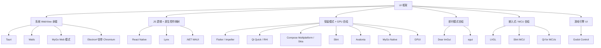
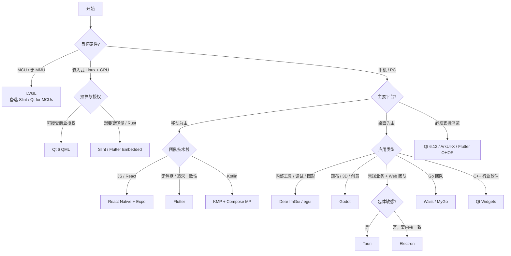

# 跨平台 UI 框架调研报告（2026-10）

> 调研对象：**Tauri / React Native / Qt / Dear ImGui / LVGL / Flutter / MyGo / Godot**，并补充 Electron、Compose Multiplatform、Slint、Avalonia、egui、Dioxus、Wails、Lynx、GPUI 等知名框架。
> 版本基线：截至 **2026-10-26**。
> 说明：文中体积、内存等性能数字都是**量级参考**，实际值取决于业务、平台和构建配置，选型前请用自己的场景做 PoC 实测。星级评分是作者的主观判断。

---

## 0. 结论速览（TL;DR）

| 场景 | 首选 | 备选 | 一句话理由 |
|---|---|---|---|
| 消费级移动 App（iOS/Android） | **Flutter** / **React Native + Expo** | Compose Multiplatform | 两者都已成熟。RN 靠 JS/React 人才池和原生控件取胜，Flutter 靠像素级一致和渲染性能取胜 |
| Web 团队做轻量桌面工具 | **Tauri 2** | Electron | 包体小（个位数 MB）、内存低，Rust 后端安全；需要浏览器内核一致性就选 Electron |
| Go 团队做桌面工具 | **Wails v2 / v3 beta** | **MyGo** | Wails 生态更成熟；MyGo 新颖（纯 Go、无 cgo、可原生自绘），但项目还很年轻 |
| 工业 / 车载 / 医疗 HMI（Linux SoC + GPU） | **Qt 6（QML）** | Slint、Flutter Embedded | Qt 积累深厚、工具链完整、6.12 是 LTS；注意商业授权成本 |
| MCU（无 MMU、KB 级内存） | **LVGL** | Slint、Qt for MCUs、TouchGFX | LVGL 是事实标准，MIT 授权，各芯片厂都有适配 |
| 引擎 / 图形 / 调试类内部工具 | **Dear ImGui** | egui | 即时模式，开发效率极高，几乎零依赖 |
| 画布型、创意型、3D 交互应用 | **Godot** | Flutter、Qt Quick 3D | “UI 本身就是产品”时 Godot 很合适，自带完整 2D/3D、动画和主题系统 |
| 需要覆盖鸿蒙 HarmonyOS | **Qt 6.12 LTS** | Flutter OHOS 分支、RN-OH、Lynx、ArkUI-X | Qt 6.12 已把 HarmonyOS 列为 LTS 官方平台 |

**几条主要趋势：**
1. **渲染路线分成三派，各有地盘**：GPU 自绘（Flutter/Impeller、Qt RHI、Compose、Slint、Godot、MyGo Native）、系统 WebView（Tauri、Wails、MyGo Web）、原生控件映射（React Native、Lynx）。
2. **去掉 Bridge、改为同步调用**：React Native 从 0.82 起只保留新架构（JSI + Fabric + TurboModules），0.84 默认使用 Hermes V1。
3. **Rust 化**：Tauri、Slint、Dioxus、egui、GPUI、Vello 都是 Rust 项目，Lynx 的部分实现也用了 Rust。
4. **热重载升级为热补丁**：Dioxus Subsecond 能热补丁 Rust 代码，Qt 6.12 支持 QML Hot Reload，Compose Hot Reload 已稳定，Flutter 推出了 Agentic Hot Reload。
5. **AI 原生**：Flutter 推出 GenUI/A2UI（由 AI 生成 UI），egui 提供 MCP 自动化检查协议，MyGo 仓库自带 AGENTS.md。框架开始主动适配 AI Agent。
6. **无障碍走向标准化**：AccessKit 正在成为 Rust 和自绘框架的通用无障碍层，egui、Slint、Godot 都已接入。

---

## 1. 版本基线（截至 2026-10-26）

| 框架 | 最新稳定版 | 近期要点 |
|---|---|---|
| Tauri | **2.12.3**（2026-10-10） | 2.12 是 2.x 系列最大的一次更新：WebView 权限请求处理、App-bound domains、放弃 Win7 支持。Tauri 3 已进入 alpha |
| React Native | **0.86** | 0.82 起只剩新架构，0.84 默认 Hermes V1，0.85 让 Animated 和 Reanimated 共用一个动画后端；Expo SDK 56 |
| Qt | **6.12 LTS**（2026-09-30） | QML 热重载、Canvas Painter 转正、StyleKit（实验性）、HarmonyOS 列为 LTS 平台 |
| Dear ImGui | **1.93.0**（约 2026-10-14） | 重构 ImDrawList 形状 API；1.92.x 系列做了动态字体改造 |
| LVGL | **v9.6.0**（2026-09-16） | v9 的最后一版（“稳定版”）：软件渲染最多快 25%、Kconfig 统一配置、可以 apt 安装；下一个大版本是 v10 |
| Flutter | **3.47**（2026-08）；3.50 计划 11 月发布 | 桌面端默认改用 Impeller；material_ui / cupertino_ui 拆成独立包并发布 1.0；Widget Previews 转正 |
| MyGo | **v0.6.x** | 纯 Go、无 cgo；一个应用里可以同时有 Web 窗口和原生自绘窗口 |
| Godot | **4.7.2**（2026-08-18） | 4.6 加入 LibGodot（可把引擎嵌入其他程序），4.7 加入 HDR 输出和 UI Transform Offset |
| Electron | **45**（2026-10-21，Chromium 156） | 大约每 8 周发一个大版本 |
| Compose Multiplatform | 1.8+（iOS 自 2025-05 稳定） | Web 端仍是 Beta；Swift Export 计划 2026 年稳定 |
| Slint | **1.18** | 实验性 Vello 渲染器；补齐了桌面能力（托盘、拖放、tooltip） |
| Avalonia | **12.1.4** | 原生 Wayland 后端，重写了 Android 后端 |
| egui | **0.37.0** | 新增自动补全弹窗；提供 MCP / AccessKit 检查协议 |
| Dioxus | **0.7.10** | Dioxus Native（基于 WGPU 的 HTML/CSS 渲染器）、Subsecond 热补丁 |
| Wails | v2.17（稳定） / v3.0.0-beta.32 | v3 支持多窗口和托盘，生成 TS 绑定 |

---

## 2. 架构分类：按“像素怎么画出来”划分



| 路线 | 原理 | 优点 | 缺点 |
|---|---|---|---|
| **系统 WebView** | 宿主进程（Rust/Go）加上 OS 自带的 WebView（WebView2 / WKWebView / WebKitGTK） | 包体极小，可直接复用整个 Web 生态 | 各平台内核不一致，Linux 上 WebKitGTK 是最大短板；IPC 要序列化 |
| **自带浏览器内核** | 把 Chromium 和 Node 一起打包 | 渲染完全一致，生态最大 | 包体 100MB 以上，内存占用高 |
| **原生控件映射** | JS 线程描述 UI，C++ 渲染器（Fabric）把它映射成 UIView / Android View | 原生观感和原生无障碍，能直接嵌原生组件 | 跨平台的细节要分别处理，动画和手势有额外复杂度 |
| **保留模式 GPU 自绘** | 框架维护 Widget/Element 树或场景图，用 Skia / Impeller / RHI / wgpu 自己画 | 像素级一致，性能稳定，动画能力强 | 不是原生控件，无障碍和 IME 都要自己实现；包体中等 |
| **即时模式** | 每帧调用 `Button("OK")`，UI 状态留在应用代码里 | 代码量最少，迭代极快，适合工具 | 定制样式和复杂布局能力弱，无障碍支持弱，持续重绘耗电 |
| **MCU 自绘** | 只重绘脏区，内存里只有部分帧缓冲，可用 DMA2D 或 2.5D GPU 加速 | KB 级资源就能运行 | 能力受硬件限制，开发体验接近 C 语言底层开发 |
| **游戏引擎 UI** | 引擎场景树中的 Control 节点，GPU 渲染 | 2D/3D、动画、着色器全都有 | 不是原生观感；空闲时要开 Low Processor Mode 降低功耗 |

---

## 3. 逐个框架剖析

### 3.1 Tauri（Rust + 系统 WebView）

- **架构**：Rust 核心（`tauri` crate + 窗口库 `tao` + WebView 封装 `wry`）加上前端（任意 Web 框架：React / Vue / Svelte / Solid…）。前端通过 `invoke` 调用 Rust 命令，Rust 通过事件推送消息给前端。
- **安全模型**：用 **Capabilities / Permissions（ACL）** 声明每个窗口能调用哪些命令和插件；支持 Isolation Pattern（在 iframe 沙箱里拦截 IPC）。2.12 新增 WebView 权限请求回调和 App-bound domains 导航限制。
- **平台**：Windows / macOS / Linux / iOS / Android（2.0 起支持移动端）。
- **优势**：Hello World 包体约 3–10MB，内存远低于 Electron；后端是 Rust，内存安全；插件体系完整（updater、fs、shell、sql、deep-link…）。
- **劣势**：
  - **WebView 碎片化**：Safari/WebKit 和 Chromium 的行为差异要你自己兜底，Linux WebKitGTK 的性能和特性最差。
  - 想深度定制就得写 Rust，学习门槛比较高。
  - 移动端生态远不如 RN 和 Flutter。
- **适用**：Web 团队做桌面工具，或对包体和内存敏感的桌面应用（例如密码管理器、开发工具、内部系统客户端）。
- **授权**：MIT / Apache-2.0。

### 3.2 React Native（JS/TS + 原生控件）

- **新架构（0.82 起是唯一架构）**：
  - **JSI**：JS 和 C++ 之间同步、零序列化地直接调用，取代了旧的异步 JSON Bridge。
  - **Fabric**：C++ 实现的并发渲染器，支持 React 18/19 的并发特性。
  - **TurboModules**：原生模块懒加载。
  - **Codegen**：根据 TS 类型自动生成原生绑定。
  - **Hermes V1**：0.84 起的默认引擎，用 AOT 字节码加快启动。
- **生态**：**Expo** 是官方推荐的开发方式（Expo Router、EAS Build / Update、Expo Modules API）。微软维护 RN Windows / macOS。`react-native-web` 可以覆盖 Web 端。
- **优势**：React 人才池最大；控件是原生的，观感和无障碍都是原生水平；可以 OTA 热更新（EAS Update；CodePush 已随 App Center 在 2025-03 下线）。
- **劣势**：复杂动画和手势依赖 Reanimated / Gesture Handler；第三方原生库质量参差不齐；升级成本历来偏高（新架构之后有所改善）。
- **适用**：消费级移动 App；已有 Web/React 团队的公司；需要动态化发布的业务。
- **授权**：MIT。

### 3.3 Qt（C++ / QML）

- **两套 UI 技术**：
  - **Qt Widgets**：传统桌面控件，CPU 绘制，模拟原生风格，适合工具类和行业软件。
  - **Qt Quick / QML**：声明式语言 QML（属性绑定 + JS 表达式）+ 场景图 + **RHI**（统一抽象 Vulkan / Metal / D3D11/12 / OpenGL），GPU 渲染。
- **最新进展**：
  - 6.10 为 Qt Quick 加入 FlexboxLayout。
  - 6.11 加入 Canvas Painter（基于 RHI 的 HTML Canvas 2D 风格 API）和 Task Tree（声明式异步）。
  - **6.12 LTS**（支持 5 年）加入 QML Hot Reload 和 StyleKit（用一套 QML 样式同时给 Widgets 和 Quick 换肤），并把 HarmonyOS 列为 LTS 平台。
- **全栈能力**：网络、数据库、多媒体、WebEngine（Chromium）、3D（Qt Quick 3D）、蓝牙、串口等。Qt for MCUs 覆盖低端芯片，Qt for Python（PySide6）覆盖 Python 开发者。
- **优势**：工业、车载、医疗领域的事实标准；平台覆盖最广（桌面、移动、嵌入式 Linux、QNX、VxWorks、HarmonyOS、MCU）；文档和工具（Qt Creator、Qt Design Studio）成熟。
- **劣势**：
  - **授权复杂**：开源版是 LGPLv3/GPLv3，部分模块只有 GPL 或商业授权；嵌入式设备量产通常要买商业授权。
  - C++ 门槛高；移动端生态和观感不如 Flutter 和 RN；包体偏大。
- **授权**：LGPLv3 / GPLv3 / 商业。

### 3.4 Dear ImGui（C++ 即时模式）

- **架构**：即时模式（IMGUI）。每帧调用 `ImGui::Begin / Button / SliderFloat…`，库只生成顶点和索引缓冲（ImDrawList），由后端（DX / Vulkan / Metal / OpenGL / SDL / GLFW）提交给 GPU。UI 状态“就是你的变量”。
- **特性**：Docking、多视口（窗口可以拖出主窗口）、Tables；1.92 起支持动态字体和高 DPI；周边有 ImPlot、ImNodes、ImGuizmo 等扩展；通过 cimgui 绑定到几乎所有语言。
- **优势**：零依赖，嵌入任何渲染器都只要几小时；写调试面板、编辑器、可视化工具的效率极高；游戏、引擎、图形、机器人行业几乎人手一份。
- **劣势**：
  - 不适合面向终端用户的精美产品 UI，样式和布局能力有限。
  - 没有无障碍支持，IME 和复杂文本排版能力弱。
  - 默认每帧重绘，需要自己做空闲节流。
  - 1.92.8、1.92.9、1.93 都有 API 破坏性变更，需要锁定版本。
- **授权**：MIT。

### 3.5 LVGL（C，嵌入式 / MCU）

- **定位**：开源嵌入式 GUI 的事实标准。最低要求约 64KB Flash（推荐 180KB 以上）、几十 KB RAM，支持 16/32/64 位 MCU。
- **架构**：
  - 对象树（`lv_obj`）+ 样式系统（类 CSS，支持状态和过渡）+ Flex / Grid 布局。
  - 只重绘脏区，帧缓冲可以只开部分大小（≥ 1/10 屏）。
  - 绘制单元可插拔：软件渲染、ARM DMA2D、NXP VG-Lite、NemaGFX、OpenGL/NanoVG；矢量图形用 ThorVG（SVG/Lottie）。
- **最新进展**：
  - v9.5 加入原生模糊和阴影、Wayland/EGL 后端，15 个控件获得统一的数据绑定接口。
  - **v9.6** 侧重稳定性：软件渲染最多快 25%，加入 ARM SVE2 加速；头文件分成公有和私有；配置统一由 Kconfig 生成；增加约 2,900 处参数检查；支持 apt 安装。
  - 下一个大版本 v10 会删除所有标记为废弃的 API。
- **工具链**：官方 LVGL Pro 编辑器（XML 声明式 UI）、SquareLine Studio、SDL / Linux 模拟器、各芯片厂 SDK（ESP-IDF 组件注册表中 9.5 下载量已超过 110 万次）。
- **优势**：资源占用极低，移植性极强，MIT 授权对商业友好，社区和芯片厂支持都很广。
- **劣势**：C API 写起来啰嗦；复杂应用的工程化（状态管理、国际化、测试）要自己搭；大版本之间迁移成本不小。
- **授权**：MIT。

### 3.6 Flutter（Dart + 自绘引擎）

- **架构**：
  - Dart（开发时 JIT 支持热重载，发布时 AOT 编译为原生机器码）。
  - Widget → Element → RenderObject 三棵树。
  - 引擎从 Skia 迁到 **Impeller**：预编译着色器，基本消除首帧着色器编译导致的卡顿。
  - 平台嵌入层（Embedder）负责对接 iOS、Android、Web、Windows、macOS、Linux 以及自定义嵌入式平台。
- **最新进展**：
  - Impeller 已是 iOS 上唯一的渲染器，Android（API 29+）默认使用，3.47 起桌面端也默认使用；Web 端仍用 Skia（CanvasKit）和 Wasm。
  - Material / Cupertino 从框架中拆成独立包（`material_ui` / `cupertino_ui` 1.0）。
  - 3.44 加入 Agentic Hot Reload、GenUI/A2UI（让 AI Agent 生成和驱动 UI）、Android Hybrid Composition++。
- **生态**：pub.dev；状态管理常用 Riverpod / Bloc / Provider；Shorebird 提供代码热更新；原生互操作用 Pigeon / FFIgen / JNIgen；Toyota 等车企把 Flutter 用在车机嵌入式上。
- **优势**：多端像素级一致；动画和自定义绘制能力强；热重载体验业界领先；一套代码同时覆盖移动和桌面。
- **劣势**：
  - 不是原生控件，平台观感要自己调；Web 端首屏偏重，SEO 弱。
  - Dart 只在 Flutter 圈子里使用，人才池比 JS 小。
  - 嵌入原生视图（Platform View）有性能代价。
- **授权**：BSD-3-Clause。

### 3.7 MyGo（Go，WebView 和原生自绘双模式）

- **项目**：[egoist/mygo](https://github.com/egoist/mygo)，当前 v0.6.x，MIT 授权。
- **架构**：
  - **纯 Go，不用 cgo**：交叉编译和分发都很简单。
  - **Web 模式**：使用系统 WebView（WKWebView / WebKitGTK / WebView2）。前端用 HTML/JS 写，`mygo generate` 会给 Go 服务生成 TypeScript 客户端，模式类似 Wails。
  - **Native 模式**：用 `github.com/egoist/mygo/ui` 包以 Go 代码声明 UI，GPU 自绘（Metal / D3D11 / OpenGL）。支持 flex/grid 布局、输入法、虚拟列表、SVG、动画、读屏器，还能脱离窗口测试视图。
  - **两种窗口可以出现在同一个应用里。**
  - 桌面 API 齐全：菜单、托盘、对话框、通知、全局快捷键、deep link、文件关联、签名的自动更新等。
- **官方给出的数据**：二进制约 7MB；原生 UI 模式内存约 44MB，带 WebView 约 62MB；空闲 CPU 0%。
- **优势**：Go 团队几乎没有门槛；“同一个应用里混用 Web 窗口和原生窗口”的思路很新颖；从仓库自带 AGENTS.md 能看出它对 AI 编程友好。
- **劣势与风险**：**项目非常年轻**（0.x），基本由单人主导，API 还会变；目前只支持桌面，没有移动端；社区和第三方组件还很少。
- **建议**：可以用于内部工具、原型或个人项目；生产项目要评估维护风险，同类方案里 Wails 更稳。

### 3.8 Godot（游戏引擎的 Control UI 体系）

- **架构**：
  - C++ 引擎，场景树（Node）结构；UI 由 **Control** 节点组成，包括 Container 布局（HBox / VBox / Grid / Flow…）、Theme 主题、锚点和边距。
  - 脚本可用 GDScript、C#，或通过 GDExtension 用 C++ / Rust / Go 等。
  - 渲染层支持 Vulkan / D3D12 / Metal / OpenGL ES；Godot 编辑器本身就是用自己的 UI 系统做的。
- **最新进展**：
  - 4.5 通过 AccessKit 支持读屏器。
  - 4.6 加入 **LibGodot**，可以把引擎当库嵌进其他程序；Windows 默认改用 D3D12；编辑器面板可以浮动。
  - 4.7 加入 HDR 输出、UI Transform Offset、新的 Asset Store。
- **用来做应用**：
  - 官方文档把它定位为 Electron / Qt 的一种可选替代，但也明确说“引擎首先为游戏服务”。
  - 典型案例是 Pixelorama（像素画编辑器）和 Material Maker（材质编辑器）。
  - 要开启 *Low Processor Mode* 避免每帧重绘；可以定制导出模板，裁掉 3D 和音频来缩小体积。
- **优势**：画布型、可视化、3D 交互类应用能做到其他框架难以企及的效果；MIT 授权，完全免费；一套工程能导出桌面、移动和 Web。
- **劣势**：没有原生观感；做表单和数据密集型 UI（CRM、后台管理）效率不如常规框架；默认包体偏大；读屏器、IME、富文本这些“应用级”能力比 Qt 和 Web 弱。
- **一条选型经验**：**“UI 本身就是产品”时选 Godot；“UI 只是查看和编辑数据的窗口”时选常规框架。**
- **授权**：MIT。

---

## 4. 横向对比矩阵

### 4.1 基础属性

| 维度 | Tauri | React Native | Qt | ImGui | LVGL | Flutter | MyGo | Godot |
|---|---|---|---|---|---|---|---|---|
| UI 语言 | HTML/CSS/JS | JSX/TS | C++、QML | C++ | C（可选 MicroPython/XML） | Dart | Go，或 HTML/JS | GDScript、C#、C++ |
| 后端语言 | Rust | JS + 原生 | C++（也可 Python） | C++ | C | Dart（+FFI） | Go | 同 UI 语言 |
| 渲染方式 | 系统 WebView | 原生控件 | 自绘（RHI）/ Widgets | 即时模式 GPU | 自绘（脏区重绘） | 自绘（Impeller） | WebView 或 GPU 自绘 | 引擎 GPU 自绘 |
| UI 范式 | 取决于前端框架 | 声明式（React） | 声明式（QML）/ 命令式（Widgets） | 即时模式 | 保留模式（命令式，v9 起可用 XML 声明） | 声明式 | 声明式 | 场景树 + 信号 |
| 桌面 | ✅ | ⚠️ 社区和微软维护 | ✅ | ✅ | ⚠️ 只适合模拟或简单应用 | ✅ | ✅ | ✅ |
| 移动 | ✅（2.0+，生态弱） | ✅✅ | ✅ | ⚠️ | ❌ | ✅✅ | ❌ | ✅ |
| Web | ❌（本身就是 Web） | ⚠️ 通过 RN-Web | ⚠️ 通过 Wasm | ⚠️ 通过 Emscripten | ⚠️ 通过 Emscripten | ✅ | ❌ | ✅（Wasm） |
| 嵌入式 / MCU | ❌ | ❌ | ✅ Linux SoC / MCU | ✅（有 GPU 时） | ✅✅ | ✅ 仅 Linux SoC | ❌ | ⚠️ |
| HarmonyOS | ❌ | ⚠️ RN-OH | ✅ 6.12 LTS | – | ✅（可移植） | ⚠️ OHOS 分支 | ❌ | ❌ |
| 授权 | MIT/Apache | MIT | LGPL/GPL/商业 | MIT | MIT | BSD-3 | MIT | MIT |
| 主要维护方 | Tauri 基金会（CrabNebula 等） | Meta + 社区 | The Qt Company | Omar Cornut + 赞助商 | LVGL Kft + 芯片厂 | Google | 个人（EGOIST） | Godot 基金会 |

### 4.2 资源与性能（量级参考）

| 指标 | Tauri | Electron* | React Native | Qt | ImGui | LVGL | Flutter | MyGo | Godot |
|---|---|---|---|---|---|---|---|---|---|
| 最小包体 | 3–10 MB | 80–150 MB | 移动端 7–20 MB | 动态链接 15–40 MB（静态链接更小） | 1–3 MB | **100–500 KB Flash** | 移动端 5–15 MB，桌面 20 MB+ | 约 7 MB | 默认模板几十 MB，裁剪后可缩小 |
| 空闲内存 | 30–100 MB（含 WebView 进程） | 150–300 MB 以上 | 50–150 MB | 20–80 MB | 10–50 MB | **KB 级** | 50–150 MB | 44–62 MB | 50–150 MB |
| 冷启动 | 快 | 偏慢 | 中（Hermes AOT 有改善） | 快 | 极快 | 极快 | 快（AOT） | 快 | 中 |
| 复杂动画 | 依赖浏览器 | 依赖浏览器 | 中，借助 Reanimated 可做到高 | 高（QML） | 低 | 中（取决于硬件） | **高** | 中 | **高** |
| 空闲功耗 | 低 | 中 | 低 | 低 | 偏高（需节流） | 低 | 低 | 0% CPU | 中（需开 Low Processor Mode） |

\* Electron 列只作参照。

### 4.3 工程体验（主观评分 1–5）

| 维度 | Tauri | RN | Qt | ImGui | LVGL | Flutter | MyGo | Godot |
|---|---|---|---|---|---|---|---|---|
| 上手难度（越高越容易） | 3 | 4 | 2 | **5** | 2 | 4 | 4（Go 开发者） | 4 |
| 生态与三方库 | 4（复用 Web 生态） | **5** | 4 | 3 | 3 | **5** | 1 | 3 |
| 原生观感 | 2 | **5** | 3（Widgets 4） | 1 | – | 3 | 2 | 1 |
| 像素级一致性 | 3 | 3 | **5** | **5** | **5** | **5** | 4 | **5** |
| 热重载 | 4（前端 HMR） | 4（Fast Refresh） | 4（6.12 QML） | 2 | 2 | **5** | 4 | 4 |
| 无障碍 | 4（Web a11y） | **5** | 4 | 1 | 1 | 4 | 3 | 3 |
| 长期稳定性 | 4 | 4 | **5**（LTS） | 4 | 4 | 4 | 2 | 4 |
| 招人难度（越高越容易） | 3 | **5** | 3 | 3 | 3 | 4 | 4 | 3 |

---

## 5. 其他知名框架速览

| 框架 | 语言 | 渲染 | 平台 | 定位与现状 |
|---|---|---|---|---|
| **Electron** | JS/TS + Node | 自带 Chromium | 桌面 | 桌面应用霸主（VS Code、Slack、Discord、Figma、Notion）；v45 / Chromium 156；体积和内存是长期痛点 |
| **Compose Multiplatform** | Kotlin | Skia 自绘（Android 上用原生 Compose） | Android / iOS / 桌面 / Web（Beta） | iOS 自 1.8 稳定；可以“共享逻辑 + 原生 UI”，也可以共享 UI；Google 官方推荐 KMP 来共享逻辑 |
| **SwiftUI / Jetpack Compose** | Swift / Kotlin | 原生 | 各自平台 | 原生声明式标杆，单平台最佳选择 |
| **.NET MAUI** | C# / XAML | 原生控件映射 | 移动 / 桌面 | 微软官方方案，口碑一般，社区更多转向 Avalonia / Uno |
| **Avalonia** | C# / XAML | Skia 自绘 | 桌面 / 移动 / Web / Linux 嵌入式 | 12.x 加入原生 Wayland、重写 Android 后端；WPF 迁移的首选 |
| **Uno Platform** | C# / XAML | Skia 或原生 | 全平台 | WinUI API 兼容 |
| **Slint** | `.slint` DSL + Rust / C++ / JS / Python | 自绘（软件 / FemtoVG / Skia / Vello） | 桌面 / 嵌入式 / **MCU** | 由前 Qt 工程师创立；1.18；授权为 GPLv3、免版税或商业；是 Qt 和 LVGL 的新竞争者 |
| **egui** | Rust | 即时模式（wgpu / glow） | 桌面 / Web | Rust 版 ImGui，接入 AccessKit 和 MCP 检查；Rerun 在用 |
| **Dioxus** | Rust（类 React RSX） | WebView / Web / Native（Blitz + WGPU） | 全平台 | 0.7 加入 Subsecond 热补丁和全栈能力 |
| **Iced** | Rust（Elm 架构） | wgpu | 桌面 | System76 的 COSMIC 桌面就基于它 |
| **GPUI** | Rust | GPU 自绘 | 桌面 | Zed 编辑器的 UI 框架，2026 年官方收缩了编辑器之外的投入；社区有 gpui-ce 和 gpui-component |
| **Wails** | Go + Web | 系统 WebView | 桌面 | Go 版 Tauri；v3 仍是 beta |
| **Fyne / Gio** | Go | GPU 自绘 | 桌面 / 移动 | 纯 Go 的原生 UI 方案，Fyne 偏控件库，Gio 偏即时模式 |
| **Lynx** | JS/TS + CSS（ReactLynx） | 原生渲染，双线程，PrimJS 引擎 | iOS / Android / Web / HarmonyOS | 字节跳动 2025 年开源，用于 TikTok 多个业务；目前要嵌入宿主 App 使用，外部生态还早 |
| **GTK4 / libadwaita** | C / Rust / Python… | GSK（GPU） | Linux 为主 | GNOME 生态 |
| **wxWidgets** | C++ | 原生控件 | 桌面 | 老牌方案，原生观感 |
| **TouchGFX / emWin** | C++ / C | MCU 自绘 | MCU | 分别是 ST 和 SEGGER 的方案，绑定各自芯片生态 |
| **ArkUI / ArkUI-X** | ArkTS | 原生 | HarmonyOS（ArkUI-X 可扩展到 iOS / Android） | 鸿蒙原生开发首选 |

---

## 6. 当前流行的技术趋势

### 6.1 渲染层：GPU 自绘成为主流，图形抽象层也在统一

- **跨图形 API 的抽象层**：Qt 有 RHI，Flutter 有 Impeller（Metal / Vulkan / GLES），Rust 生态有 wgpu，Godot 有 RenderingDevice。业界不再直接写 OpenGL。
- **预编译着色器和管线缓存**：Impeller 的核心思路就是消除运行时编译着色器导致的卡顿。
- **矢量渲染研究**：Vello（GPU compute 矢量渲染）已进入 Slint 1.18 作为实验性渲染器；ThorVG 被 LVGL、Godot 等用来渲染 SVG 和 Lottie。
- **嵌入式也有 GPU 了**：2.5D GPU（VG-Lite、NemaGFX）和 ARM SIMD（Helium、SVE2）加速正在普及，LVGL 9.x 持续加入这类后端。

### 6.2 JS 跨端：去 Bridge、同步调用、多线程

- React Native 的 JSI 让 JS 直接持有 C++ 对象引用，旧 Bridge 已彻底删除。
- Lynx 用**双线程**：主线程负责首屏同步渲染，后台线程运行业务逻辑。
- JS 引擎本身也在演进：Hermes V1、Static Hermes（AOT），以及字节跳动的 PrimJS。

### 6.3 响应式模型：从虚拟 DOM 走向细粒度响应式（Signals）

- Web 侧 Solid、Svelte 5 Runes、Vue Vapor、Angular Signals 都在去掉或弱化虚拟 DOM。Tauri、Wails、MyGo Web 模式可以直接受益。
- 原生侧其实一直是细粒度绑定：Qt QML 的属性绑定、Slint 的属性绑定、Compose 的 snapshot state。
- 结论：**声明式 UI + 细粒度依赖追踪** 已经是共识。

### 6.4 Rust 化与内存安全

- Tauri、Slint、Dioxus、egui、Iced、GPUI、Vello 都是 Rust 项目；Lynx 和 Flutter 生态也有 Rust 组件（例如 `flutter_rust_bridge`）。
- 动机：内存安全（受政府和企业安全合规推动）、能编译到 Wasm、性能可预测。
- 常见做法：**用 Rust 写核心库，再通过 UniFFI 或 `flutter_rust_bridge` 供多个 UI 壳调用**。

### 6.5 开发体验：从热重载到热补丁

| 能力 | 代表 |
|---|---|
| 保留状态的热重载 | Flutter、RN Fast Refresh、Compose Hot Reload（已稳定）、Godot |
| 声明式 DSL 热重载 | Qt 6.12 QML Hot Reload、Slint LivePreview |
| **编译型语言热补丁** | Dioxus Subsecond（Rust）、Live++（C++） |
| 组件预览 | Flutter Widget Previews（3.47 稳定）、Compose Preview、Storybook |

### 6.6 AI 原生

- **GenUI / A2UI**：Flutter 3.44 支持由 LLM 输出 UI 描述，客户端实时渲染（Agent-to-UI 协议）。
- **可被 Agent 操作的 UI**：egui 0.35 起可以通过 AccessKit 树和 MCP 让 Agent 读取 UI 状态、驱动操作。读屏器用的无障碍树正在变成 AI 自动化测试的接口。
- **AI 辅助编码**：Flutter 有 Agentic Hot Reload；MyGo 等项目自带 AGENTS.md；设计稿转代码（Figma 转 Flutter / Compose / LVGL XML / QML）的工具大量出现。
- 影响：**声明式、类型化、可以文本描述的 UI**（JSX、QML、Slint DSL、LVGL XML）对 AI 最友好；ImGui 这类即时模式代码也容易让 AI 生成。

### 6.7 安全与权限

- Tauri 的 Capabilities ACL、App-bound domains、Isolation Pattern。
- Electron 默认开启 `contextIsolation` 和 `sandbox`。
- 移动端遵循最小权限，桌面端也在跟进（macOS 沙箱、MSIX）。

### 6.8 无障碍标准化

- **AccessKit**（Rust 实现，对接 UIA / NSAccessibility / AT-SPI / Android）已被 egui、Slint、Godot 等接入，自绘框架的无障碍短板正在补齐。
- 欧盟《欧洲无障碍法案》（EAA）2025-06 起生效，无障碍成了**合规要求**，不再只是加分项。

### 6.9 平台格局：鸿蒙成为第三极

- Qt 6.12 LTS 官方支持 HarmonyOS；Flutter 和 RN 都有 OpenHarmony 社区分支；Lynx 原生支持鸿蒙；ArkUI-X 反向扩展到 iOS 和 Android。
- 面向国内市场的产品，选型时要把**鸿蒙适配成本**列为必须评估的维度。

### 6.10 发布与动态化

- 代码热更新：Expo EAS Update（RN）、Shorebird（Flutter）、Tauri / MyGo 的签名自动更新。
- Web 侧依然是一次部署、处处生效。WebView 类方案的优势之一，就是可以把部分 UI 改成远程加载。

---

## 7. 架构策略与最佳实践

### 7.1 推荐的分层架构：核心层 + 外壳层

```
┌─────────────────────────────────────────────────────────┐
│ UI Shell（可替换）                                       │
│  Flutter / RN / Tauri 前端 / QML / ImGui 调试面板 / LVGL │
├─────────────────────────────────────────────────────────┤
│ 表现层：ViewModel / Store（单向数据流 + Signals）         │
├─────────────────────────────────────────────────────────┤
│ 绑定层：FFI / UniFFI / JSI / Tauri IPC / gRPC / Codegen   │
├─────────────────────────────────────────────────────────┤
│ 领域核心（与平台无关）：Rust / C++ / Go / Kotlin(KMP)     │
│  业务规则、同步、存储、网络、加解密                         │
├─────────────────────────────────────────────────────────┤
│ 平台适配：文件、通知、传感器、硬件驱动（HAL）              │
└─────────────────────────────────────────────────────────┘
```

- **好处**：UI 技术可以替换（例如将来从 Electron 迁到 Tauri）；核心逻辑可以单测；同一个核心能接多个前端（桌面用 Tauri、移动用 Flutter、设备用 LVGL）。
- **代表**：1Password（Rust 核心 + 各平台 UI）、Figma（C++ / Wasm 核心 + Web UI）、Signal（Rust libsignal）、KMP 的“共享逻辑 + 原生 UI”模式。

### 7.2 常见组合方案

| 组合 | 适用场景 |
|---|---|
| **Qt / Flutter 做主界面 + ImGui 做工程模式** | 设备产品：产线调试、诊断面板 |
| **Linux SoC 上跑 Qt/Slint，MCU 副屏跑 LVGL** | 车载、家电的多屏方案 |
| **Tauri 外壳 + Rust 核心 + 前端框架** | 安全敏感的桌面工具 |
| **原生 App + 嵌入 RN / Flutter / Lynx 页面** | 大型 App 渐进式跨端（Add-to-App） |
| **Godot（LibGodot）嵌入宿主应用** | 在常规应用里嵌入 3D 或交互画布 |
| **KMP 共享逻辑 + SwiftUI / Compose 原生 UI** | 对原生体验要求极高的移动端 |

### 7.3 状态管理

- **单向数据流**：State → View → Intent → Reducer/Store → State。RN 常用 Zustand / Redux Toolkit / Jotai，Flutter 常用 Riverpod / Bloc，Compose 用 MVI。
- **服务端状态和客户端状态分开管理**：前者用 TanStack Query 或 SWR 一类工具，后者用本地 Store。
- **离线优先**：本地数据库（SQLite / Realm / Drift），配合 CRDT 同步（Automerge、Yjs）。
- **即时模式（ImGui）**：状态直接放在业务结构体里，不需要框架级状态管理，这正是它适合做工具的原因。

### 7.4 性能策略

| 问题 | 对策 |
|---|---|
| 首帧卡顿 | Impeller 预编译着色器；RN 用 Hermes AOT；Qt 用 qmlcachegen 预编译 QML |
| 长列表 | 虚拟化（FlashList、`ListView.builder`、Qt ListView 的 delegate 复用、MyGo 虚拟列表） |
| IPC 开销 | 批量调用、二进制传输（Tauri Channel、JSI 共享内存）、避免高频 JSON 往返 |
| 空闲功耗 | ImGui / Godot 按需重绘；LVGL 只重绘脏区；关掉不用的动画 |
| 包体 | Tauri / Wails 用系统 WebView；Flutter 按 ABI 拆包并做 tree-shake；Godot 定制导出模板；Qt 静态链接 + 模块裁剪 |
| MCU 内存 | LVGL 用部分帧缓冲 + DMA 双缓冲；字体按需子集化；图片用 RLE 或 GPU 原生格式 |

### 7.5 质量与工程化

- **视觉回归测试**：Flutter Golden Test、Storybook + Chromatic、Qt Squish、LVGL 测试框架（v9.6 覆盖率 82%）。
- **E2E 测试**：Detox / Maestro（RN）、`integration_test` / Patrol（Flutter）、Playwright / WebDriver（Tauri）。
- **设计系统**：用 Design Token（颜色、间距、字体）统一生成各端主题；Qt 6.12 的 StyleKit 和 Flutter 拆分出的 Material 包都在往“样式和框架解耦”方向走。
- **版本策略**：Qt 用 LTS；LVGL 每个版本支持 1 年；ImGui 锁定具体版本；RN / Flutter 每季度跟进一次升级，避免技术债堆积。

---

## 8. 选型决策树



---

## 9. 风险清单

| 框架 | 主要风险 | 缓解措施 |
|---|---|---|
| Tauri | WebView 不一致（尤其 Linux）；Tauri 3 带来迁移成本 | 跨平台 E2E 测试；关注 Tauri 3 迁移指南；功能检测与 polyfill |
| React Native | 原生依赖升级难；第三方库停止维护 | 用 Expo 托管依赖；优先选择 Expo Modules 生态的库 |
| Qt | 授权费用和合规；LGPL 的动态链接要求 | 早期法务评估；明确用到的模块各自的授权 |
| ImGui | API 破坏性变更；不适合面向用户的 UI | 锁定版本；只用于工具和调试界面 |
| LVGL | v9 到 v10 的大版本迁移 | 现在就清理所有 `LV_DEPRECATED` 用法；利用 v9.6 的公有和私有头文件分离 |
| Flutter | Google 战略投入的不确定性；Web 端短板 | 核心逻辑与 UI 解耦；Web 端另选方案 |
| MyGo | 单人维护、0.x 版本、生态空白 | 只用于非关键项目；保留迁移到 Wails 的退路 |
| Godot | 应用级能力（IME、富文本、无障碍）不完善；包体大 | 用 PoC 验证关键交互；定制导出模板 |

---

## 10. 对自研 UI 框架的启示（如果打算自己做）

1. **渲染层**：直接用 wgpu、Skia、bgfx 等抽象，不要直接写图形 API；从第一天就设计文本排版（HarfBuzz + ICU / cosmic-text / Parley）和 IME，这是自绘框架最常栽跟头的地方。
2. **布局**：直接用 Flexbox（Yoga / Taffy）和 Grid，开发者的学习成本最低。
3. **响应式**：采用细粒度 Signals 加批量更新，避免整树 diff。
4. **无障碍**：直接接入 AccessKit，这样也顺带获得了 AI Agent 和 E2E 测试需要的访问接口。
5. **开发体验**：可以写成文本的声明式 DSL 或宿主语言 DSL，加上热重载、组件预览，再提供 AGENTS.md / MCP 等 AI 友好入口。
6. **分层**：参考 MyGo 和 Dioxus 的“Web 后端和原生后端可以互换”设计，降低用户的迁移门槛。
7. **最小可用平台**：先把一个平台做到极致，比如桌面或嵌入式 Linux，再扩展。LVGL、ImGui、Slint 都是这样起步的。

---

## 参考来源

**Tauri**
- [Tauri Core Releases](https://tauri.app/release/core/)
- [Announcing Tauri 2.12](https://v2.tauri.app/blog/tauri-2.12/)
- [tauri@2.12.0](https://v2.tauri.app/release/tauri/v2.12.0/)
- [Tauri (Wikipedia)](https://en.wikipedia.org/wiki/Tauri_(software_framework))

**React Native**
- [React Native Blog](https://reactnative.dev/blog/)
- [React Native 0.85 – Bacancy](https://www.bacancytechnology.com/blog/react-native-0-85)
- [RN Ecosystem Mid-2026 (Medium)](https://medium.com/@dinesh.kachhot/the-react-native-ecosystem-in-mid-2026-expo-sdk-56-react-native-0-85-and-react-19-2-59919e4d76c5)
- [React Native in 2026 – Ben Houston](https://ben3d.ca/blog/react-native-in-2026)

**Flutter**
- [What's new in Flutter 3.47](https://flutter.dev/blog/whats-new-in-flutter-3-47)
- [Flutter & Dart's 2026 roadmap](https://flutter.dev/blog/flutter-darts-2026-roadmap)
- [Flutter 3.35.0 release notes](https://docs.flutter.dev/release/release-notes/release-notes-3.35.0)
- [State of Flutter 2026](https://devnewsletter.com/p/state-of-flutter-2026/)

**Qt**
- [Qt 6.12 LTS Released](https://www.qt.io/blog/qt-6.12-released)
- [Qt 6.12 LTS – Phoronix](https://www.phoronix.com/news/Qt-6.12-LTS-Released)
- [Qt 6.11 Released](https://www.qt.io/blog/qt-6.11-released)
- [Qt 6.10 Released](https://www.qt.io/blog/qt-6.10-released)
- [Qt 6.11 Release Wiki](https://wiki.qt.io/Qt_6.11_Release)

**LVGL**
- [LVGL v9.6: The Stability Release](https://lvgl.io/blog/release-v9-6)
- [LVGL 9.5 Changelog](https://lvgl.io/docs/open/9.5/CHANGELOG)
- [LVGL v9.5 is here (Forum)](https://forum.lvgl.io/t/lvgl-v9-5-is-here/23544)
- [Migrating from v9.5 to v9.6](https://lvgl.io/docs/open/changelog/migration-v9-6)
- [LVGL Releases (GitHub)](https://github.com/lvgl/lvgl/releases)

**Dear ImGui**
- [ocornut/imgui (GitHub)](https://github.com/ocornut/imgui)
- [Release v1.92.9](https://github.com/ocornut/imgui/releases/tag/v1.92.9)
- [imgui v1.92.7 notes](https://cpp.libhunt.com/imgui-changelog/1.92.7)

**MyGo**
- [MyGo 官网](https://mygo.egoist.dev/)
- [MyGo Native UI 文档](https://mygo.egoist.dev/docs/ui)
- [egoist/mygo (pkg.go.dev)](https://pkg.go.dev/github.com/egoist/mygo)
- [Trying MyGo – azukiazusa](https://azukiazusa.dev/en/blog/mygo-desktop-app/)

**Godot**
- [Godot 4.6 Released – Phoronix](https://www.phoronix.com/news/Godot-4.6-Released)
- [Godot 4.7 stable 下载](https://godotengine.org/download/archive/4.7-stable/)
- [Godot: Creating applications（官方文档）](https://docs.godotengine.org/en/stable/tutorials/ui/creating_applications.html)
- [Should You Build a Desktop App with Godot?](https://abdulkadersafi.com/blog/should-you-build-a-desktop-app-with-godot)
- [Create non-game apps with Godot](https://simondalvai.org/blog/godot-apps/)

**Electron**
- [Electron Blog](https://www.electronjs.org/blog)
- [Electron Releases 2026-10-16](https://releases.electronjs.org/history/2026-10-16)

**Kotlin Multiplatform / Compose Multiplatform**
- [State of Kotlin 2026](https://devnewsletter.com/p/state-of-kotlin-2026/)
- [Is KMP production ready in 2026?](https://www.kmpship.app/blog/is-kotlin-multiplatform-production-ready-2026)

**Slint**
- [Slint 1.18 Released](https://slint.dev/blog/slint-1.18-released)
- [Slint 1.17 Released](https://slint.dev/blog/slint-1.17-released)

**Wails / Dioxus**
- [Wails v3 Beta](https://v3.wails.io/blog/wails-v3-beta/)
- [Wails v3 GA tracker](https://github.com/wailsapp/wails/issues/5844)
- [Dioxus 0.7 Release](https://dioxuslabs.com/blog/release-070/)

**Avalonia / egui / GPUI**
- [Avalonia 12](https://avaloniaui.net/blog/avalonia-12)
- [What's new in Avalonia 12.1](https://avaloniaui.net/blog/release-12-1)
- [egui Releases](https://github.com/emilk/egui/releases)
- [GPUI by Zed (DEV)](https://dev.to/dishant0406/gpui-by-zed-the-electron-killer-that-never-left-home-209o)

**Lynx**
- [Lynx vs React Native – Appwrite](https://appwrite.io/blog/post/bytedance-lynx-vs-react-native)
- [Lynx 2026 – PkgPulse](https://www.pkgpulse.com/guides/lynx-bytedance-framework-vs-react-native-2026)
