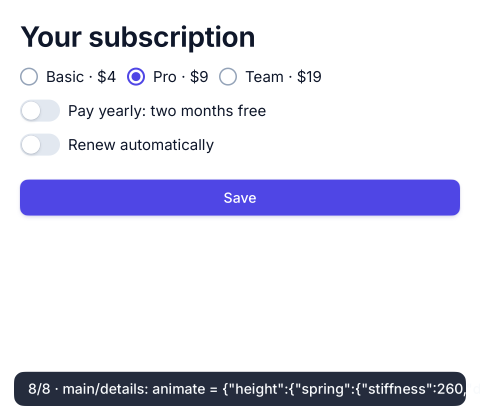

# 13 · Live Design: subscription settings

A subscription settings page (plans, yearly billing, automatic renewal), designed by an agent while it runs. The application starts as `omui new` leaves it.



What it shows is Live Design (D-149, D-151), played whole by `tests/live_design_test.cpp` through the designer's verbs, the same verbs an agent reaches over MCP (`design_*`):

1. **The agent designs it.** It writes the page in TypeScript (`design.edit`). It adds the switches, the renewal details and the Save button where they belong (`design.insert`), and sets the title (`design.set`). Each step runs within a frame, presented as it lands, and is a commit of the design's history. The file is untouched until the end.
2. **It says what the person expects.** "Turning on renewal opens the details briskly, springing at most 10%" is a motion expectation, and "there is a Save button" is a query (`design.expect`).
3. **The person tries it** (`design.handover`) and turns renewal on and off.
4. **The agent reads the facts back** (`design.check`). The details open from 0 to 72 px, and the spring overshoots by about 40%, more than the 10% the person allowed. The person agrees to more damping (`design.set`), and the facts hold.
5. **The demonstration becomes a test.** `design.save_scenario` keeps the person's steps and the expectations in `tests/renewal.scenario.omui.json`, and `design.replay` plays them again.
6. **Back through the history.** The timeline shows the design two steps back. A branch tries a tighter layout from there, and the agent switches back.
7. **A film of the design.** `design.film` runs each step as it was presented, under its caption, frame by frame. `omui design film` renders it to WebM.
8. **Written to the file** (`design.commit`). The TypeScript is the one source, and it still compiles. The edits' p95 stays within a frame (16 ms).

```sh
omui dev            # design it yourself, or let your agent (omui mcp) do it
mcpp run            # the application as a release runs it: no designer linked
mcpp test           # the whole design above, played and checked
```
