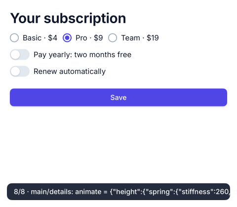

# 13 · Live Design: subscription settings

A subscription settings page (plans, yearly billing, automatic renewal), designed by an agent while it runs. It started as `omui new` leaves an application ([`design/start.ts`](design/start.ts)); [`app/main.ts`](app/main.ts) is the page the design came to, and [`design/main.replay.xdef.json`](design/main.replay.xdef.json) is the design itself, which the page plays in place.



What it shows is Live Design (D-149, D-151), played whole by `tests/live_design_test.cpp` through the designer's verbs, the same verbs an agent reaches over MCP (`design_*`):

1. **The agent designs it.** It writes the page in TypeScript (`design.edit`). It adds the switches, the renewal details, a place for what a user's agent adds (`slot("extras")`) and the Save button where they belong (`design.insert`), and sets the title (`design.set`). Each step runs within a frame, presented as it lands, and is a commit of the design's history. The file is untouched until the end.
2. **It says what the person expects.** "Turning on renewal opens the details briskly, springing at most 10%" is a motion expectation, and "there is a Save button" is a query (`design.expect`).
3. **The person tries it** (`design.handover`) and turns renewal on and off.
4. **The agent reads the facts back** (`design.check`). The details open from 0 to 72 px, and the spring overshoots by about 40%, more than the 10% the person allowed. The person agrees to more damping (`design.set`), and the facts hold.
5. **The demonstration becomes a test.** `design.save_scenario` keeps the person's steps and the expectations in `tests/renewal.scenario.xdef.json`, and `design.replay` plays them again.
6. **Back through the history.** The timeline shows the design two steps back. A branch tries a tighter layout from there, and the agent switches back.
7. **A film of the design.** `design.film` runs each step as it was presented, under its caption, frame by frame. `omui design film` renders it to WebM with the engine's video toolkit (`xtools video render`).
8. **Written to the file** (`design.commit`). The TypeScript is the one source, and it still compiles. The edits' p95 stays within a frame (16 ms).
9. **The design ships with the page** (`design.history.export`). Every step's TypeScript, its caption and who made it go into a replay (`replay@1`) that the page plays in itself (`generate.replay`): each step a real interface, presented as an edit is, from the counter `omui new` wrote to the page as it ships. The test checks that `app/main.ts` and the replay are what the design came to (`OMUI_EXAMPLE_WRITE=1` writes them, for a change that is meant).

## As it ships

[`omui.config.ts`](omui.config.ts) opens two surfaces to a user's agent, as data (D-144, G8): `extras`, a place under the plans for a view document (an offer, a note), and `look`, an overlay of the theme's tokens. Each change is drafted, previewed, committed and undone through `generate.*`, kept (on the Web, in the page's storage), and exported as one layer (`generate.export`, `customization@1`) that `generate.import` puts over the page again. The replay plays whatever generation's openness is: it is the page's own.

On the Web an agent in the browser tab reaches the same verbs through `window.omui`:

```js
await omui.invoke("generate.replay", { play: true });              // the design, in place
const draft = await omui.invoke("generate.draft", { surface: "look", document: { colors: { accent: "#0f766e" } } });
await omui.invoke("generate.commit", { draft: draft.data.draft });   // kept across a reload
```

```sh
omui dev            # design it yourself, or let your agent (omui mcp) do it
mcpp run            # the application as a release runs it: no designer linked
mcpp test           # the whole design above, played and checked
omui build --web    # the page: its design and the customization in a browser
```
