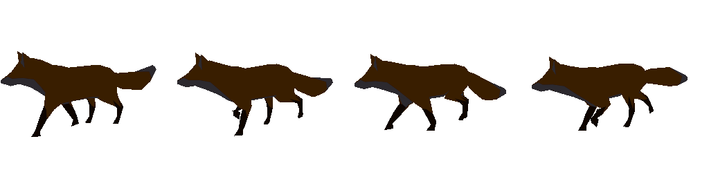

# hanim.skeleton

Skeletal animation as hanim's channels: skeletons, clips of each joint's translation, rotation and scale sampled at any time as a pure function of it and compressed by ACL within an error said and measured, blending, root motion as a channel, the step that chooses the next pose as a stage that plugs in, and the skin's matrices a renderer consumes — characters that save, restore and branch to the same bits on any number of workers.

hanim is the one owner of general animation (AGENTS.md §2.3, D-93), so skeletal animation is here, in hanim's terms: a clip is channels keyed in time, a fade is one of hanim.core's eases, a pose is a value. Compression is the Animation Compression Library (MIT, through mwrap's `mcpplibs.mwrap.acl`, in one native unit; D-83, D-176). A package of its own (D-99): ACL is a dependency a consumer of hanim's engine does not carry, and glTF's clips reach xrender.asset (feature `gltf`).

| Package | |
|---|---|
| `hanim.skeleton` (this directory) | Skeletons, clips, ACL, blending, root motion, the player, the state machine, crowds; features `gltf` (module `hanim.skeleton.gltf`) and `agent` (module `hanim.skeleton.agent`) |
| [hanim.skeleton.cts](cts) | The world contract on a crowd, the procedural biped and its clips the tests and `tests/bench` play, and the tests |

## Agent surface

A crowd of characters is a `Subject` of the agent kernel ([mlibs.agent](../../../base/agent)), module `hanim.skeleton.agent` — the package's feature `agent`, so a game that only plays characters links no agent kernel. Its operations are a catalog, [skeleton.ops.omui.ts](skeleton.ops.omui.ts) (the table `src/agent/catalog.cppm` and the listings `src/agent/skeleton.ops.json`, `.md` are `omui-gen ops`'s), with three guided tasks; how to use them, in order, is [skill.omui.md](skill.omui.md).

| | |
|---|---|
| Subject and addresses | `skeleton`, interface `hanim.skeleton@0.1`. A character is its index from 0; a clip, a state, a parameter and a joint are named; a place is metres, `[x, y, z]` with y up; a frame is a step played (1/60 s) |
| State | The `Crowd`: each character's machine (its parameters, the states fading and their shares, how far the fade is, the last transition), its layers, what it plays and where it stands; the hash covers all of it and every joint's skin matrix, bit for bit |
| Observation | `skeleton.observe`: the frame, the hash, the rig (joints; clips with their length, raw and compressed bytes, the error compression left, whether they carry root motion; the machine's states and parameters) and each character — its state, its fade, what plays with which weights, the last transition and the conditions it asked, its parameters, layers and place; `skeleton.joint`: a joint in the world and in the model; `skeleton.sample`: any clip at any time — a joint's place (or every joint's), the root motion from the clip's start and the distance compression left there |
| Control | `skeleton.set` a machine's parameter (a trigger: 1, taken by the transition that reads it); `skeleton.play` a state now, with a fade; `skeleton.blend` a clip layered on a joint's subtree or added — each given at once, before the next step, and taken back by seeking |
| Time | `skeleton.step`, `skeleton.seek` back within the steps kept — a checkpoint (the crowd's image) every 60 steps and the inputs given since, played again: the same bits as the run that stopped there |
| Preview | `skeleton.branch`: the crowd some steps ahead, one character sent to a state first if one is given, observed as `skeleton.observe` does; the crowd itself untouched |
| Budgets and tiers | `skeleton.observe` and `skeleton.sample` within a `budget` of bytes (characters or joints left out from the last, `more` says how many); `Options`: `keep` steps of history, a checkpoint `every` so many, `most_steps` a request |
| Not here | **Causes** as a record — who set the parameter that let a transition happen — and **source**: `capabilities` says so and the contract suite reports them unsupported; `observe` gives the last transition and its conditions |

## What it is



Khronos' Fox walking: `gltf::rig` made its skeleton and clips, a player samples Walk, `gltf::Bent` bends the file's skinned mesh by the player's skin through xrender.mesh's `bend`, and xrender's reference draws it (`cts/tests/gltf_test.cpp`, the outlines of two moments apart by 3,330 pixels at the least).

```cpp
namespace skeleton = hanim::skeleton;
auto bones = skeleton::Skeleton::make({{"hips", -1, {.translation = {0, 1, 0}}}, {"spine", 0, {}}});  // parents first
skeleton::Clip walk{.name = "walk", .duration = 1, .joints = channels, .root_motion = skeleton::RootMotion{0}};
walk.compress(*bones);                                     // ACL: 0.1 mm at 3 cm from each joint, at the clip's key rate
auto rig = std::make_shared<skeleton::Rig>(skeleton::Rig{*bones, {idle, walk, run}});
skeleton::Crowd crowd(rig, machine);                       // states, transitions by parameters, triggers and ends; fades eased
const auto hero = crowd.add();
crowd.characters()[hero].stage.set("speed", 3.2f);         // walk → run, faded over 0.25 s
crowd.characters()[hero].player.layer(0, {.clip = wave, .weight = 1, .mask = bones->find("upper_chest")});
crowd.step();                                              // 1/60 s: chosen, sampled, mixed, layered, moved by root motion
draw(crowd.characters()[hero].player.skin());              // each joint's model matrix × its inverse bind
```

- **A skeleton**: joints in order, parents first, each with its rest (move, turn, scale) and inverse bind (the skin's, or the inverse of the joint at rest); a base above the roots. `mask(joint)` is a joint's subtree as a weight a joint.
- **Clips are channels**: each joint's translation, rotation and scale keyed in time (linear, step or glTF's cubic spline); an empty channel is the rest. `sample` is a pure function of the time: the keys where they are, the same pose for the same time, any clip at any time (what a preview and motion matching need). Clips carry markers and tags for a stage to read.
- **ACL**: `Clip::compress` reads the channels at the clip's own key rate and compresses within `precision` (0.1 mm by default) at `shell` (3 cm) from each joint; `Compressed::error` is ACL's measure at its samples, and `measure` the same distance against the channels themselves at any rate (between ACL's samples too).
- **Blending**: by a weight; by a weight a joint (`mask`); a difference from a reference added back by a weight. A layer is a clip mixed or added on top of what the stage chose, with its own time and speed.
- **Root motion is a channel**: a clip's root joint across the ground and about the way up, taken out of its pose (the hips in place) and given as `motion(clip, from, to, laps)` — what a character's place is moved by each step, mixed by the weights of what plays, across loops.
- **The stage that chooses the next pose** is a concept, `PoseStage` (`advance`, `save`, `restore`): an `Actor<Stage>` steps any. The state machine is the first: states playing clips, transitions by a parameter above or below a value, a trigger, or a clip played through, from a state or from any; a fade keeps the shares of what fades out, so a fade interrupted carries on without a jump. Motion matching (a pose database searched each step) and learned controllers are the same concept's next implementations; the reserved points are random access to any clip at any time, markers and tags, root motion and velocity as channels, and transitions as blend operators (§9.4).
- **Output**: `model()` — each joint in the model's space — and `skin()` — each joint's model matrix times its inverse bind — and `world(joint)` with the character's place.
- **glTF** (feature `gltf`): `gltf::rig(imported)` makes a skin's joints (and every node between two of them) a skeleton, parents first, with the skin's inverse binds and what is above its root as the base, and each animation a clip; the skin's order is kept for its vertices (`skin_joints`). xrender.asset reads skins and animations as numbers ([its README](../../xrender/asset)); the conversion is here, as the project DAG has it (hanim may reach xrender; xrender reaches only mlibs). glTF's linear rotation is spherical: keys are added where a normalised mix strays from it by more than `tolerance` (0.1 mrad). Morph target weights, channels of nodes outside the skeleton and joints placed by a matrix are notes.
- **Drawn** (feature `gltf`): `gltf::Bent::of(imported, made)` keeps each instance the skin bends; `bent.bend(player.skin())` bends its mesh at rest by the player's matrices through xrender.mesh's `bend` (the one bending; hanim gives matrices, xrender draws), into two meshes in turn so the frame before is kept for the velocity. `meshes()` is the document's meshes with the bent ones in place, `before()` the frame before's, `changed()` what to give a device (`xrender.mesh.gpu`'s `Pass::bend`). Nothing allocated after the first frame

## Determinism

This package and the wrap build with no contraction of `a*b+c` into an FMA and no fast math; ACL is built without SIMD (`RTM_NO_INTRINSICS`, `ACL_NO_INTRINSICS`: RTM's NEON paths fuse multiply and add and its SSE paths use approximate reciprocals). Measured: a crowd of 16 characters stepped 240 times with a disturbance has the same hash with 0, 1 and 4 workers, in the dev and release profiles (Linux x86-64, GCC 16), pinned in the tests; the world contract (an image restored runs on, a branch runs alike, reading changes nothing) passes on one thread and on four. The wrap's CI pins ACL's compressed bytes and poses on Linux (x86-64, arm64; GCC and LLVM), macOS, Windows and wasm32 — the same on every row.

## Against the strongest

| Field | The strongest | Here | Where |
|---|---|---|---|
| Compression | ACL (the industry's: Unreal's default codec) | ACL itself: par in bytes and error on the same data; the procedural biped's clips 2.8–3.7× smaller within 0.1 mm (ACL's measure 0.046–0.102 mm, at 240 a second between its samples 0.127 mm at most); Fox's Survey 3.6× within 0.0001 units | par |
| Playback cost | ACL with SIMD | 5.2 ns a joint against 4.1 for the raw channels (64 × 50 joints, release, x86-64); ACL with SSE was 17.2 ns a joint against 26.8 without on a 64-joint clip on the same machine (a standalone build, GCC 16, `-O2`): the same bits everywhere cost about 1.6× at decompression | behind by the SIMD factor, for determinism |
| Runtime (sampling, blending, local to model) | ozz-animation (MIT; read as the reference, not used: its skeleton, sampling and blending jobs are the channel model hanim already owns — taking it would make two owners) | the same jobs, plus what ozz has not: root motion as a channel, a stage that chooses poses, a crowd that saves, restores and branches to the same bits, an agent's subject | ahead in what it does; ozz's SoA SIMD sampling not measured side by side here |
| State machines | Unreal's and Unity's animation graphs | states, transitions by parameters, triggers and ends, eased fades that carry on when interrupted, layers by mask and added; no blend spaces, no inertialised transitions yet | behind in breadth |
| A frame | — | 64 characters of 50 joints stepped in 0.101 ms median, 0.150 ms p99 on one thread (release, x86-64; 1.6 µs a character), nothing allocated | `motion/skeleton-*` |

**Open items** (measured, with what decides them):

- Khronos' Fox, its Walk and Run (short clips keyed at 24 a second): ACL leaves 0.0235 and 0.0005 units at its samples where 0.0001 was asked (0.013% of the model's 176 units); between samples Run is 1.0 unit off at the right hand near 0.58 s, against the channels read spherically. What decides it is a trace of that joint's keys (a turn near a half between two keys is the suspicion) and of ACL's choice of bit rates on it.
- A crowd's bent meshes cross to the device whole each frame (`Pass::bend`): bending on the device by a compute shader from the same numbers is xrender's next rung.
- Blend spaces, inertialised transitions, IK and motion matching: each a later implementation of an interface reserved here.

## Running it

```sh
mcpp test -p hanim.skeleton.cts   # the world contract (1 and 4 workers), sampling, ACL, blending, root motion, fades, layers, glTF and Fox, the agent contract and tasks
```

`motion/skeleton-sample-64x50` and `motion/skeleton-crowd-64x50` in `tests/bench` time ACL's playback beside the raw channels and a crowd's whole step; their budgets hold ACL to at most twice the raw channels, the step to 0.6 ms at p99 and to no allocation.
