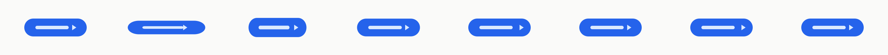
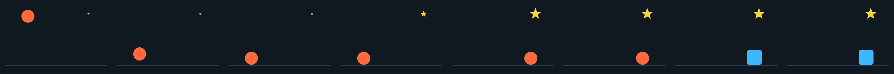
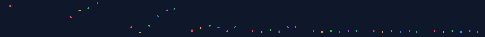
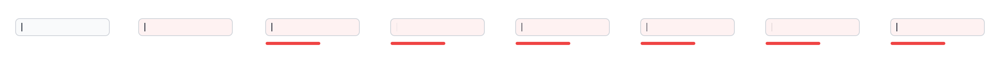
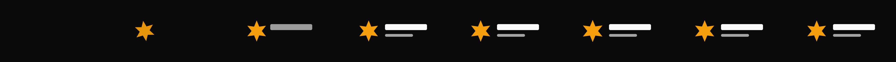
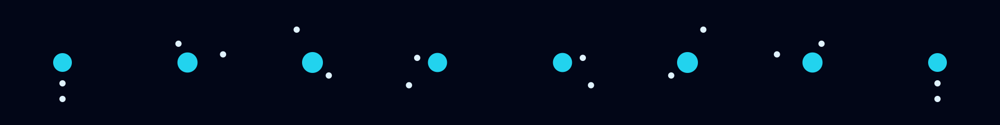
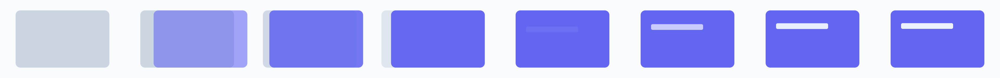
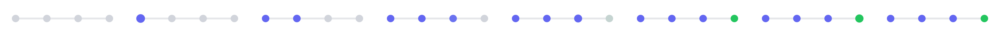
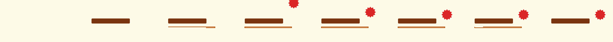
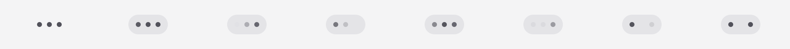

# hanim.studio examples

Twenty animations to take away: each a document (`<name>.animation.omui.json`) composed from hanim's recipe library, checked and drawn by the tests (`studio_test`: each reads, opens, has an end and moves through it). Copy one, change its shapes and timings, check it with `hanim check`, look at it with `hanim render … --frames 8`. Each strip is that command's output.

### attention-button

A call to action asks to be pressed: the button stretches like rubber, its arrow nudges twice (`rubber_band`, `nudge`).

### bounce

A ball drops, bounces lower each time, rolls to a box and becomes it; a star springs open (`drop`, `move_to`, spring `scale_to`, `morph`, `wobble`).

### card-shuffle

Three cards are dealt, reordered one after another, then two exchange places passing either side (`rise_in`, `reorder`, `swap`).

### confetti

Confetti drops in piece after piece, spinning, and settles (`drop_in`, `spin`, `stagger`).

### error-shake

A field refuses its input: it shakes and tints, a hint slides in, the caret blinks (`shake`, `fill_to`, `slide_in`, `blink`).

### flash-alert

A warning zooms in and flashes three times (`zoom_in`, `flash`).

### idle-cloud

An idle scene: a cloud bobs, the sun turns (`bob`, `spin`).

### like-heart

A like: the heart pops in and beats, sparks pop around it and rise away (`pop_in`, `heartbeat`, `rise_out`).

### loader-dots

A loader: three dots bob one after another (`bob`, `stagger`).

### logo-reveal

A logo: the mark spins in, the words slide in after it, the mark breathes (`spin_in`, `slide_in`, `breathe`).

### menu-open

A menu unfolds, its items slide in one after another, then it folds away (`unfold_in`, `slide_in`, `fold_out`, `fade_out`).

### notification-badge

A notification: the bell swings, its clapper nudges, the badge pops in and does a tada (`swing`, `nudge`, `pop_in`, `tada`).

### orbit-atom

An atom: the nucleus breathes, two electrons orbit at their own pace (`breathe`, `orbit`).

### page-transition

A page transition: the old page slides away as the new one slides in, its title rises (`slide_out`, `slide_in`, `rise_in`).

### play-pause

A play button pops in and morphs into pause (`pop_in`, `morph`, `pulse`).

### progress-steps

Steps completed one by one, the last one celebrated (`fill_to`, `pulse`, `tada`, `stagger`).

### sign-off

A signature: the name rises, its underline is written, a seal drops on, the underline is undrawn (`rise_in`, `write_in`, `drop_in`, `unwrite`).

### success-check

Success: the disc pops in, the check is written along its outline, the disc pulses (`pop_in`, `write_in`, `pulse`).

### toast

A toast rises in, its icon pulses, it waits, and sinks away (`rise_in`, `pulse`, `wait`, `sink_out`).

### typing-indicator

Someone is typing: the bubble pops in, its dots blink in turn (`pop_in`, `blink`).

