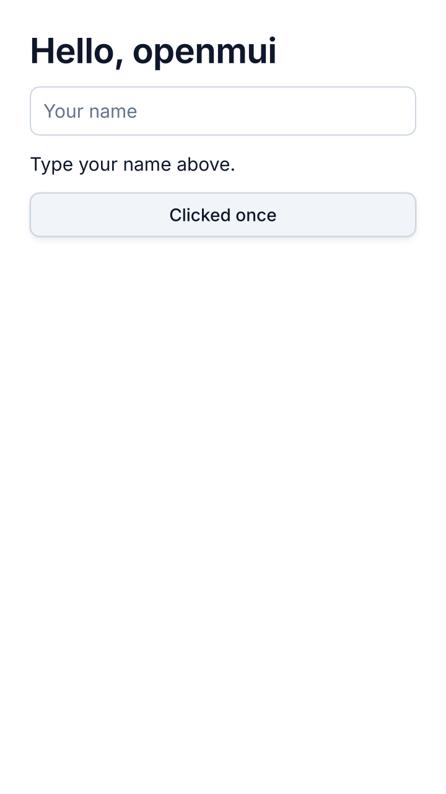

# omui.host.android

omui on Android (W10, G1): the framework draws every pixel (D-140) into the window the platform's `NativeActivity` gives it. There is no Java: an application is the shared library the platform loads.

`tools/ci/android.sh` (CI's android job) packs example 01's APK and checks what is inside; where the machine has KVM, it runs it on Android 7.0's emulator — it says it runs, a tap on its button changes the screen, Back ends it.

- **An application is `kind = "app"`.** On the desktop it links a program. On an Android row (`--target x86_64-linux-android`, `aarch64-linux-android`) it links the library the platform loads, and mcpp.plugins' `dist-apk` packs it into an APK signed with the published debug key: `mcpp run --target x86_64-linux-android --pkg-format apk` installs and runs it through `adb-run`, on the emulator or a phone. Example 01 is one such application.
- **The program's own `main` runs.** The platform calls `ANativeActivity_onCreate` (this host's). The host starts the program's `main`, found in the same library, on a thread of its own. `omui::run` there shows the application through `AndroidHost` (the SDK's `cfg(env = "android")` branch).
- **What the activity says, the runtime hears.**
  - The window appearing, changing size and going.
  - The display's density, which is the runtime's scale.
  - Pausing (frames stop) and resuming.
  - Touches, as touch pointers.
  - Keys, as keys. Back is Escape: what is open closes, and when nothing changes the activity ends.
  - The platform conventions are Android's (`Platform::android`): a touch held asks for the context menu, and a scroll stops at its edge.
- **Frames.** Each frame is drawn on the CPU (`xrender::CpuRenderer`) and shown in the window (`ANativeWindow`, RGBA). The host waits for events and does not spin: it draws while something moves, sleeps until the next timer, and draws nothing while paused or without a window.
- **Why a package of its own.** It is built for Android alone and needs the NDK's libraries (`libandroid`, `liblog`); the NDK's headers appear in `src/native/activity.cpp` alone.

Not yet:
- the agent endpoint on the device (reached through `adb forward`);
- the soft keyboard and input methods;
- the GPU renderer;
- lifecycle state kept across the activity being recreated.
