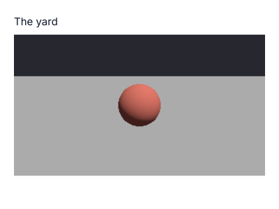

# xengine.ui

A game shown in an interface: the bridge between the game layer and omui, and the only xengine package that knows omui (D-162; lint `project-dag`).

The game is the engine's and runs on its own ([xengine.runtime](../runtime)); an interface is one way to show it. The component that shows it holds the same `Runtime` a headless program holds, steps it on the interface's clock and gives each step the person's input — the owner's stepping, the owner's seat:

```cpp
import xengine.ui;
import xengine.runtime;

// in a game's component:
void mounted() {
    game_.emplace(first_state(), {.stepping = xengine::runtime::Stepping::owner, .seat = xengine::runtime::Seat::owner});
    pacer_.start(services(), 120, [this](std::int32_t n) {
        while (n--) game_->step(input());          // the person's keys and pointer, sampled; an agent player's through game_->lane()
        services().invalidate_paint(node());
    });
}
bool on_event(omui::EventContext&, const omui::InputEvent& e) { return xengine::ui::feed(sampler_, e, services().bounds(node())); }
```

What the window played is the game with no window: each step's input, on a `Runtime` begun the same with no omui in the program, gives the same bits (the breakout's `agent_player_test` plays twenty seconds in the window and again alone).

- **The pacer:** it wakes at the next step due on the runtime's clock, takes every step due, and asks for frames while it runs. The clock is virtual under the headless host, so a headless second is exactly 120 steps. A stall past its catch-up is not owed afterwards. Its clock's `scale` is slow motion; `alpha` is the fraction between two steps, for drawing.
- **Events:** a key reaches `xengine.input` by its code (`code(Key)` for bindings). The pointer arrives within the game's area, 0 to 1 across and down, and a click as a mouse button. Losing focus lets go of everything. What the game does not take (text, an input method's composition) stays the interface's (D-76).

## A world in an interface: `Viewport`

The node of the UI tree where a world is (the plan's §4.3, R3). Layout, hit testing and semantics know where the world is; the node says which subject it shows, and the world's own questions go to that subject, found beside the interface (`subjects`) for as long as the node shows it. The picture is drawn elsewhere — the renderer's mesh pass, a field — and the node names it in its display list (`external_texture`), so the same node shows on a device (a texture) and with no device (pixels).

```cpp
omui::Element e;  e.type = &omui::component_type<xengine::ui::Viewport>();  e.id = "world";
// once mounted:
auto* viewport = runtime.component<xengine::ui::Viewport>(runtime.find("main/world"));
viewport->show({.label = "the yard", .subject = &world_subject, .pixels = [&] { return picture.view(); }, .width = 320, .height = 180});
viewport->changed();                       // each time the picture is drawn again
viewport->within(local_point);             // a place of the node as a place of the picture, 0 to 1
```



Drawn by `tests/viewport_test.cpp` with no window and no device: the yard by `xrender.mesh`'s reference, shown in the headless host's frame — at 25 places the frame is the picture to the level; the pixel under the ball is the viewport's node; the semantic tree has the node by its label with the subject's name as its value.

**The pointer kept to the world** (R5). A viewport shown with `look` takes the pointer at a press: the host holds it (SDL's relative mode; the headless host always can), it no longer crosses the interface, and every pointer event goes to the viewport with how far the hand moved. The movement gathers until the game takes it:

```cpp
viewport->show({.label = "the yard", .look = true});
// each step of the game:
const omui::Point looked = viewport->take_look();   // logical pixels since the last time: x right, y down
if (!viewport->holds_pointer()) { /* the person let go: Escape, or the window lost focus */ }
```

It is a capability asked of the host (`omui::Services::lock_pointer`): one that cannot says no and nothing changes. Escape is the person's way out and is not handed to the game.

**From a pixel on to the world.** An agent that asks the interface what drew a pixel (`ui.drew`) is told the node, and — where the node is a viewport — what it shows there: the subject to ask next, the place in its picture, and what the world itself says is at that place (`Shown::describe`, the game's: here the reference's id buffer):

```json
{"node": "main/world", "shows": {"subject": "world", "at": [0.5, 0.5], "there": {"instance": 2, "triangle": 1696}}}
```

**Hosts.** The headless host and the SDL3 host show a viewport's picture: by the CPU from its pixels; on a device the SDL3 host sends the pixels to a texture of its own when the picture's number changes. **Not yet:** a world drawn on the host's own device shown from its texture with no copy; the Web and Android hosts; the Web host's pointer lock (it says it cannot).

