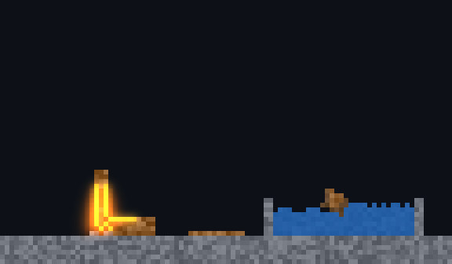
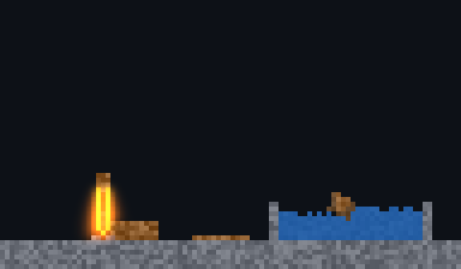
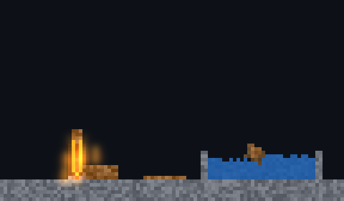
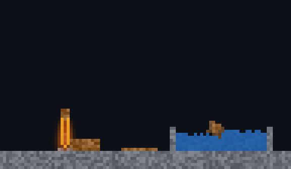
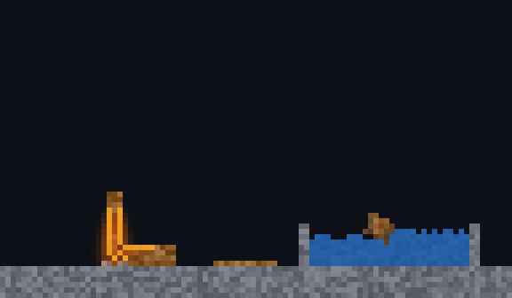

# xengine.cellular.present

A cellular field on screen as one image (D-132): its cells coloured by a palette — or by a shade that computes each (D-168) — into one image of an xrender `ImageStore`, a pixel a cell, drawn by one command however large the field — and only the tiles that changed recoloured, re-uploaded and redrawn.

```cpp
import xengine.cellular.present;
namespace ca = xengine::cellular;

auto view = ca::FieldPresenter::make(store, shape, channels, palette);   // the image is in the store
program.step(shape, cells, next, {.changed_tiles = mask});              // the step says which tiles changed
view->present(next, mask);                                              // or view->present(next): found by comparison
view->draw(list, {x, y, width, height});                                // one DrawImage, nearest sampling
```

- **Palette.** The first swatch whose tests a cell passes (each a channel and a range) gives its colour; none: the fallback. `recolor` takes a new palette: everything is recoloured at the next present.
- **Or a shade** (D-168). `FieldPresenter::make(store, shape, channels, shade)`: each cell's colour is computed — its row's base colour (the key channel's value: a material), uneven by the row's grain, then tints, each moving it toward a colour by how far a channel is along a range (`cellular::Shade`; the kernel's [contract](../CONTRACT.md) has the arithmetic, whole numbers). Where a tint emits, the presenter keeps a second image, the field's **light**, by the same tiles; `draw_glow(list, dest, radius)` draws it blurred and added over the field (one layer, the built-in blur, `BlendMode::plus`) — fire lights what is beside it. `reshade` takes another shade: another style pack, the same cells.
- **Matter on screen** (the feature `matter`, module `xengine.cellular.present.matter`). `lower(look)` turns [xengine.matter](../../matter)'s look — a pack's colours by material and phase, states that read a channel and never a material — into a shade for a field a lowered matter program steps: `FieldPresenter::make(store, shape, channels, lower(*matter::standard_look(program)))`.
- **Only what changed.** A present recolours the tiles the step's mask marks (`Execution::changed_tiles`, or-ed over several steps) — or, given only the cells, those that differ from the cells presented last — and updates the image in place (`ImageStore::update`) naming exactly those rectangles. The GPU renderer uploads only them; the CPU renderer's `DamageTracker` redraws only their rows, and the incremental frame is the full one byte for byte.
- **Immutable while drawn.** Two surfaces take turns: the one the store holds is never written. One still held elsewhere (a snapshot on another thread) is left as it is and a new one made.
- **Lifetimes.** The image stays in the store until `release()`; a presenter that outlives its store never touches it.

**On the device.** A field stepped on the GPU (`xengine.cellular.rhi`'s `Kernel`) is painted there too: `Painter::prepare(device, view->pixels(), view->fallback_pixel(), channels)` takes this presenter's palette as pixels, `record(list, cells, texture)` writes each cell's pixel into an rgba8 texture, and the GPU renderer draws it as one external texture (`list.external_texture(id, dest, 1, Sampling::nearest)`, `GpuOptions::external`) — the field never read back. Both paths keep one rule (`pixel_of` in the cellular core); the backend's test (`xrender.rhi.sdl`'s `field_present_test`) draws a field both ways every ten ticks and finds the same pixels.

The renderer knows no cells and the rules know no drawing: this package is the small adapter between them.

Tests (`mcpp test -p xengine.cellular.present`): every pixel its cell's colour after 60 steps, only the changed tiles recoloured and named; drawn with damage tracking, the incremental frame equals the full one at every step; a held snapshot unchanged, a new palette, refusals; by a shade, every pixel and its light after every step, the two images updated together, the glow brighter beside the fire and nowhere darker, the incremental frame with its glow the full one, another shade, refusals. Matter's scenes on screen are `mcpp test -p xengine.matter.cts on_screen_test`. Benchmarks: `simulation/cellular-1024-present` (12 changed tiles of 1024: 0.044 ms p95), `-present-all` (every cell: 2.7 ms), `-frame` (present, damage and the incremental CPU raster: 0.52 ms) — locally, release.

## A world by ladders (the feature `world`, D-178)

What a world of matter **is** is authoritative and the same on every machine; how it is **shown** is laddered — a machine goes down a step when its frames cost too much, and up again when there is room (`xengine.cellular.present.world`'s `WorldPicture`). Two ladders, each its own, the dearer lowered first:

| ladder | step | what is done | a frame shown and drawn on the CPU (576 × 336, a debug build) |
|---|---|---|---|
| `world.light` | `glow` | what emits, blurred and added over the field | 42.2 ms |
| | `baked` | no blur computed: over what emits, frames of a flame baked once from the glow's own form | 4.5 ms |
| | `none` | the shade alone | 2.1 ms |
| `world.scenery` | `alive` | the decorative layer stepped beside the world — scenery that catches from a real fire | + 0.5 ms |
| | `still` | scenery as placed | — |

| glow, scenery alive | glow, still | baked, still | none, still | none, scenery alive |
|---|---|---|---|---|
|  |  |  |  |  |

```cpp
auto picture = ca::WorldPicture::make(images, program, look, shape, {.fill = "air"});
picture->scenery({23, 46, 10, 4}, wood);                    // a hedge: shown, and where the scenery is alive, simulated
picture->bake(*a_small_world_with_a_fire);                  // once: the baked step's frames, from the glow's own form
const auto ladders = ca::WorldPicture::ladders();
mlibs::pipeline::Governor governor({ladders[0], ladders[1]});
// each frame
if (auto change = governor.frame(cost_ms, budget_ms)) picture->set(change->ladder, change->lowered, "frames over their budget");
picture->show(world);  picture->draw(list, dest);
```

- **One line, one way**: `show` takes the world as const. `xengine.matter.cts` ladder_test: the world's hash is the same at each of 360 frames shown at five standings of the ladders, and while each ladder moves every few frames under it.
- **Laddered by cost, not by kind**: on a CPU the blur is tens of times what the decorative layer costs, so the light goes first and a machine with no GPU can keep its scenery alive (the last picture above).
- **The low step is the high step's own**: `bake` runs the glow — this picture's look and blur — on a small scene the caller gives (the kernel names no material) and keeps its light as frames; the same scene gives the same frames (`Flipbook::key`). They are put over what emits (found from the light the presenter keeps, by blocks of 8 × 8 cells).
- **Mechanisms, not policy**: the ladders are `mlibs.pipeline`'s — a governor lowers and raises them with whatever else a host has laddered; `set` is where its decision, a recording's or a person's pin lands; `best_light` and `scenery_alive` are what the device allows at most (asked for more, it says so). `describe()` says where each ladder stands, why, and what each part is doing: nothing is lowered in silence.
- What is not here yet: a state's ladder written in the appearance data (the steps are the picture's own); a baked form's reach is one scene (a flame) — whatever else emits is shown as small fires at that step; decorative matter in flight (sparks, smoke of its own).
