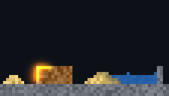
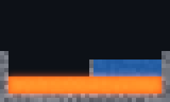
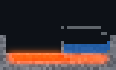

# xengine.matter

What things are made of, the state each instance carries, and laws that read properties and never a material's name — so a material that only says its properties takes part in everything (D-165).

Physics moves things; this is what they are and what they become. Fire does not know wood: it raises a temperature, and whatever has fuel, an ignition point below that temperature and oxygen beside it burns.

```ts
// world.matter.omui.ts — data, evaluated to the JSON snapshot the kernel reads (D-139)
import { defineMatter } from "omui/define";
export default defineMatter({
  materials: {
    air:   { phase: "gas", density: 1.2, oxygen: 1 },
    wood:  { density: 600, ignition: 570, fuel: 400, heat: 80, burnt: "ash" },
    ash:   { phase: "granular", density: 400 },
    water: { phase: "liquid", density: 1000, melting: 273, boiling: 373, boiled: "steam", frozen: "ice", moist: 64, porous: 8 },
    // …
  },
  laws: [
    { transfer: "temperature", by: "thermal" },                                             // heat flows, by how well both ends conduct
    { when: "wetness > 0", raise: { ignition: "wetness * 40" } },                           // wet is harder to light
    { when: "temperature >= ignition && burned < fuel && near.oxygen > 0",
      add: { burned: "burn_rate" }, flag: "burning" },                                      // burning
    { when: "burning > 0 && temperature < flame", add: { temperature: "heat" } },           // as hot as its flame, no hotter
    { when: "phase == liquid && boiling > 0 && temperature >= boiling", become: "boiled" }, // it becomes *its* gas
  ],
});
```

```cpp
import xengine.matter.json;   // the kernel (xengine.matter) and a definition from its JSON snapshot
namespace matter = xengine::matter;

auto program = matter::prepare_document(snapshot, "world.matter.omui.json");   // the plan, prepared once; problems by JSON pointer
// or matter::standard(): the standard definition, carried in the module
std::vector<std::uint32_t> state = program->fresh(instances, *program->material("air")), next = state;
program->place(state, instances, 7, *program->material("wood"));
matter::Workspace workspace;
std::vector<matter::Event> events;
if (auto stepped = program->step({instances, pairs}, state, next, workspace, &events)) state.swap(next);   // one tick
```

## The model

| | |
|---|---|
| **Columns** | A property every material has a value of: a number with a unit and a range, a phase, or another material (what this one becomes). The standard ones: mechanics (`density`, `friction`, `restitution`, `compliance`, `shape_stiffness`), heat (`thermal`, `ignition`, `melting`, `boiling`, `latent`, `warmth`, `starts_at`), burning (`fuel`, `burn_rate`, `heat`, `flame`, `oxygen`, `blast`), water (`moist`, `porous`), electricity (`conduct`), `phase`, and what it becomes (`frozen`, `melted`, `boiled`, `condensed`, `burnt`). A definition adds its own |
| **Materials** | A row: what it does not say is the column's default. `Program::value` is what the laws read, `number` what was written |
| **Channels** | What each instance carries, unsigned 32-bit: `material`, `temperature`, `wetness`, `charge`, `burned`, `burning`, `damage`, `pressure`, `phase_heat`; a definition adds its own. A channel may start from a property (`temperature` from `starts_at`: lava is placed hot), reset when the instance becomes something else, and name the events of leaving 0 and returning to it (`burning`: `ignite`, `go_out`) |
| **Laws** | Three kinds that change state, and one that moves things (below). A **transfer**: a channel flows between neighbours, from more to less, by the lesser of their two values of a property — the same amount counted at both ends, so what there is of it stays. A **reaction**: where a condition holds, channels are added to, taken from or set, a flag is raised; with `become`, a **conversion** — the instance turns into the material *its own* property names (`boiled`, `frozen`, `burnt`). And an **adjustment**: a property as the other laws read it, raised or lowered by state |
| **Conditions and amounts** | `temperature >= ignition && burned < fuel && near.oxygen > 0`: comparisons joined by `&&`, each between sums of channels, properties, `near.` sums over the neighbours, and whole numbers; a term × a whole number, / a power of two. Written in units — `temperature >= 373` is kelvin — and brought to whole numbers when prepared |
| **Carrier** | Whoever has instances and says which are beside which, with a weight: a lattice's cells and neighbourhoods, bodies and their contacts, particles and their near ones, a sample of an ambient field. The same laws on all of them |
| **Program** | The definition prepared once into an immutable plan (the preparation contract, `mlibs.cts:prepare`): names resolved, values checked against their columns, conditions parsed; refused with a code, a JSON pointer and what to write instead (`matter.name at /laws/13/when: `temprature` is no channel, property or phase (did you mean `temperature`?)`) |

**No law names a material.** `material == wood` in a condition, or `become: "steam"`, is refused (`matter.names-material`): a thing becomes what its own property says, so each material says what it turns into and the law only says when. A special case that must name one says `recipe: true`; `Program::recipes()` counts them — the measure that should stay near none.

**Whole numbers, in units.** Every value a law reads is an unsigned 32-bit integer and every sum saturates, so a step is the same bits on every machine. A column or a channel has a number of bits after the point (`fraction`): temperature is stored in 256ths of a kelvin, because a flow is a share of a difference and a difference of 47 K, in whole kelvin and at a 64th a step, would not flow at all. Laws are still written in kelvin: preparing brings every term of a comparison, and every amount, to its target's unit.

## Packs: a definition laid over another

A pack is a document of the same form that says only what it adds (D-182). `overlay(base, pack)` puts its columns, channels, materials and laws after the base's own; `standard_with(packs)` is the standard definition with packs over it, prepared.

```ts
// fuels.matter.omui.ts — three materials no law knows of
export default defineMatter({ materials: {
  coal: { density: 1400, thermal: 1, ignition: 700, fuel: 600, heat: 120, burnt: "ash" },
  peat: { density: 700, porous: 6, ignition: 520, fuel: 250, heat: 60, burnt: "ash" },
} });
```

```cpp
const auto pack = matter::read_pack(text, "fuels.matter.omui.json");
const auto program = matter::standard_with(std::array{*pack});     // coal catches from wood: no law was written for it
```

- **A pack may bring a law the world did not have** — its own columns, a channel, the laws, the materials that have the property — and say more of a material that is there (`iron: { lucent: 8 }`). The test's pack invents a glow that passes along what is lucent and wakes a crystal: it reaches one through iron and not the one behind wood.
- **A pack adds and never replaces.** A column, a channel or a law of a name the base has is a clash; so is a material said otherwise (`wood` already says its `ignition`). Every clash is said (`Clash`: the part, the name, why), none decided silently; the same row said twice the same way is not a clash.
- **An invented law is held to what every law is**: it names no material, and a transfer whose shares could take more than an instance has is refused when stepped.

**Laws that move things** (D-181) are a kind of their own, `move`: down a channel's slope — `{ name: "pressure throws", move: { down: "pressure", from: 300, speed: 0.003 } }` (from where the channel is at least `from`; `speed` m/s for each unit across a cell, for what is loose; `force` newtons for each unit beside a body's face) — or the same everywhere — `{ name: "gravity", move: { toward: [0, 1], accel: 9.8 } }`. Such a law has no condition and changes no state: this kernel's step leaves it to the carriers, each of which moves what it holds in its own way (cells fly, bodies take a force, the world falls). A slope is gone `down` (a pressure pushes away) or `up` (a pull), and the law may be scaled `by` a property of what it moves — what has none of it stays. [packs/magnetism.matter.omui.ts](packs/magnetism.matter.omui.ts) is a law the world did not have, whole: a lodestone gives a field, the field spreads and fades, what is `magnetic` is drawn up it. In a world made of the standard definition with that pack a crate of iron slides to the stone, a crate of wood stays, filings fly to it and sand lies ([cts/tests/cts/invented_test.cpp](cts/tests/cts/invented_test.cpp)); asked why a filing is where it is, the world names the pack's law.

**A property changed by state moves things too.** A `raise` or `lower` is read by the other laws — and by a carrier that weighs: the lattice sorts cells by `density` as the laws leave it. [packs/convection](packs/convection.matter.omui.ts) is one law over the standard definition, `{ name: "warm is lighter", when: "phase == gas", lower: { density: "temperature / 4096" } }`: air heated at the floor of a closed room has its warmth eight rows higher after 240 steps than without it (`cts/convection_test`). Measured limits, both below the pack: a density holds sixteenths, so the least the law can say is a sixteenth for each 256 K — air must be past 512 K to rise; and a gas does not leave a field, so a shaft to an open edge loses no more heat with the law than without (after 3000 steps 73% of the world's warmth is left with it, 57% without: carried to the roof it is further from the walls that conduct it out). The standard definition does not include the pack.

Not yet: fields that act at a distance (a channel spreads between neighbours only).

## One step

Every law reads the step's input; nothing a law writes is seen by another in the same step. In order ([CONTRACT.md](CONTRACT.md) has the arithmetic, which a carrier's own path is held to):

1. **near** — what some law reads of the neighbours, summed by weight;
2. **flows** — each transfer, pair by pair, the same amount lost at one end and gained at the other;
3. **laws** — per instance: its properties as its state leaves them (adjustments), then every reaction and conversion that holds;
4. **commit** — per channel: the first `set`, plus what is added, less what is taken, less what flowed out, plus what flowed in; a conversion changes the material and resets the channels that say so;
5. **events** — an instance became another material (which law, from what, to what); a channel that names them left 0 or returned to it.

A transfer whose neighbours could together take more than an instance has is refused before anything is written (`matter.unstable`), not clamped: clamping would make what leaves one end differ from what arrives at the other.

**Why** (D-169). `Program::why(carrier, input, instance)` is the same step for one instance, keeping what the step throws away: every adjustment, reaction and conversion judged — held, or the comparison that failed first — with what its condition read (a property as the instance's state leaves it); what each transfer carried to and from each neighbour; each neighbour's part of every near sum; and the instance's channels after. `after` is what `step()` writes for it, bit for bit, and only the pairs that name the instance are read — so a lattice gives a cell and the cells beside it as a carrier of their own. A record of causes is made of this at a commit; nothing of it is in a step's path.

## What the tests show

`mcpp test -p xengine.matter` — the standard laws ([standard.matter.omui.ts](standard.matter.omui.ts): 22 laws, 17 materials, no law naming one) on rows and small grids of instances:

- heat flows along a row and its total stays, step after step; iron carries it further than stone;
- a strip of wood lit at one end burns piece by piece (caught at steps 1, 61, 103, 142, 181, 220, 256, 281 — each from the last), every piece ash after 681; sealed from air nothing burns. What burns heats up to its flame's temperature (`flame`, 1100 K unless a material says) and no further: a fire is as hot as a fire is however closed the room, and the stone under a wood fire stays stone;
- wet wood does not light at 600 K and dry wood does; wood beside water becomes wet, the nearest wettest; in the heat it dries;
- water boils to steam, steam condenses, water freezes, ice melts — each material saying what it becomes. Boiling takes heat: water kept at 400 K is water at 373 K for 20 steps while it takes up its `latent` 540 K, then steam; steam kept at 300 K gives the same back in 8 and is water;
- lava beside water: the lava sets as stone and the water boils (the lava first: the water is at its boiling point taking up heat meanwhile);
- wood at the far end of an iron bar from a heat source catches at step 144, of a stone bar at 421; charge goes through iron and water and stops at wood;
- **alcohol and its vapour are added as two rows of properties and no law is changed**: it boils at its own point, its vapour condenses, catches beside a fire at step 14 where wood catches at 47, and burns out to smoke — 6 interactions for 2 rows;
- `why()` for every instance of a burning strip with ice in it, 260 steps: 7800 times what `step()` wrote, also given only the instance's own pairs; the step a piece of wood catches, said — `burns` held having read temperature, ignition, burned, fuel and near.oxygen, the oxygen one neighbour's (the air above), the greatest flow of heat in from the piece alight beside it; before that step the comparison that fails is the first, temperature against ignition; wet wood reads an ignition raised by its wetness;
- the same state whatever the order of the pairs; the arithmetic of one step against numbers worked by hand, saturating at both ends; a definition refused 23 ways, each by its code, pointer and message; JSON problems at their line and column.

The same laws with cells that move — the emergence set, nine phenomena and one no one wrote — are [cts/tests/emergence_test.cpp](cts/tests/emergence_test.cpp), told in [xengine.cellular's README](../cellular/README.md). Gunpowder is a row (it burns in three steps, hot, with its own oxygen, and its `blast` is `pressure`, a quantity that spreads and eases): an explosion is those numbers, not a law of its own.

**A carrier is held to this step.** [cts](cts) (`xengine.matter.cts`, contract `xengine.matter.carrier@1`) steps eleven small worlds by the reference and by a carrier from the same state and compares every value after every step — heat, fire, wet and dry, the changes of phase, charge, soups of every material (wrapped edges too, and a grid two wide), instances that are no material, values at the ends of 32 bits, a material added as rows, and a definition of its own using every kind of read and write. A carrier one pair wrong fails it; the pairs in another order do not. The lattice passes it whole, in small tiles and run sparsely (`mcpp test -p xengine.matter.cts`), and the same file has what the lattice adds — cells that move — on the standard definition.

`tests/prepare_test.cpp` is the preparation contract on it (12 cases). The reference step on 4096 instances each beside four is 2.3 ms in a debug build with nothing allocated (`omui-bench --filter simulation/matter`); it is the reference, not the path a large world runs.

## What it looks like

A thing carries a material and state; what is seen of it is a recipe's (D-168) — a world's style pack, apart from its laws: another pack changes the look and nothing of what happens. The feature `appearance` (on by default; module `xengine.matter.appearance`) is that recipe as data.

```ts
// world.appearance.omui.ts
import { defineAppearance } from "omui/define";
export default defineAppearance({
  phases:    { granular: { color: "#b9a377", grain: 0.16 }, liquid: { color: "#3b7fd9c8" } },   // a material no one named: by its phase
  materials: { wood: { color: "#8a5a2b", grain: 0.12 }, lava: { color: "#7a1d0a" } },
  states: [                                                                                    // in order, each over the last
    { name: "charred", by: "burned", to: "fuel", color: "#15100c", mix: 0.85, of: ["solid", "soft", "granular"] },
    { name: "glows with heat", by: "temperature", from: 800, to: 1500, color: "#ff4a0c", mix: 0.85, emits: true },
    { name: "aflame", by: "burning", to: 1, color: "#ffb428", mix: 0.8, emits: true },
  ],
});
```

```cpp
import xengine.matter.appearance;
auto look = matter::standard_look(*program);                                  // or look_document(program, text, file)
```

- **A material's base** is the colour and grain (how uneven: one place lighter, the next darker) the pack says of it — or, where the pack has never heard of it, its phase's. A pack serves many worlds: what it colours and a world has not is `Look::unused()`, not a failure.
- **A state** reads one channel along a range and moves the colour toward its own, by at most `mix`: from `from` (in the channel's unit: kelvin) to `to` — a number, or the thing's own property (`burned`, against its `fuel`); `to` below `from` is "the less, the more" (frost). `emits` makes it light as well, for whoever draws a glow. `of` keeps it to some phases.
- **A state never names a material**, as a law does not: `by: "material"` is refused (`matter.names-material`), and so a material added as a row is charred, wet, frosted and aglow like the rest. Lava glows because it is at 1600 K; no line says that lava glows.
- **A `Look` is numbers** — a colour a material, each state's channel, range (as the channel is stored, by material) and colour — and knows no renderer. A carrier's presenter lowers it: the lattice's is `xengine.cellular.present`'s feature `matter` (`lower(look)`: a `cellular::Shade`, each cell's pixel and light computed in whole numbers); whoever draws bodies reads the same look. Particles and sound by state are the same recipe's later sections (the plan's M6.5), read by the game layer.

[standard.appearance.omui.ts](standard.appearance.omui.ts) is the standard pack: the 17 materials' colours, five phases, and nine states — charred, wet, frosted, hot air (the air over a fire: where flames are seen), glows with heat, white heat, aflame, charged, blast. `tests/appearance_test.cpp`: the pack against the standard program in the channels' units; two materials it has never heard of, by their phases and charred against their own fuel; a pack for another world; 21 refusals by code, pointer and message; JSON problems at their line.

| A hearth, 420 ticks after a light at the pile's foot | Lava poured under water; 40 ticks on | Gunpowder, at its brightest tick | Peat — a row no pack names — by the standard pack and by another |
|---|---|---|---|
|  |   |  |   |

Real frames, six pixels a cell, drawn by the CPU renderer with no interface in the program: the copies here are what the test below wrote on 2026-11-13.

**On screen** (`mcpp test -p xengine.matter.cts on_screen_test`; the pictures are kept as PNG in the scratch directory the cases print): a hearth after 420 ticks — 9 cells alight and giving light, 31 cells of air over them showing their heat, 3440 pixels of the frame lit by the glow and none darker, sand against the pool darker than the dry heap (388 against 518 of 765); lava glowing of its own heat when poured, and after 500 ticks all of it set as stone, cooled, and dark; peat — a row of properties no pack names — its phase's colour, alight with the same flame; the same cells by another pack, a different picture and not a cell changed; gunpowder as a flash, 421 cells lit at its brightest tick and dark again after.

## Where it sits

Base layer. The kernel — module `xengine.matter`: definitions, the plan, the reference step — takes the standard library and `mlibs.utils` (errors, names, trace) and nothing else: `xengine.matter = { path = …, default-features = false }` is what a carrier's adapter takes (`xengine.cellular`'s and `xengine.dynamics`' feature `matter`). The feature `json` (on by default; module `xengine.matter.json`) adds a definition from its JSON snapshot with `mlibs.json`, and `standard()`: the standard definition carried in the module (`standard_snapshot`, the committed JSON embedded; the generator's test keeps the three — data module, snapshot, embedded text — the same). It knows no lattice, no body and no renderer. A carrier adapts on its own side: `xengine.cellular`'s feature `matter` lowers a program to the lattice's (`cellular::lower`: the materials' table, transfers by a column, reactions), where cells also move by `density` and `phase`; `xengine.dynamics`' feature `matter` reads the mechanical columns (`params_of(table, material, area)`: a soft body's mass, friction, restitution, compliance and shape stiffness — the table it had of its own is this one now) and will give contacts as pairs. What a state looks like is the appearance's (above); the feature carries the data and its preparation, colours as numbers, and still no renderer — the lattice's presenter and whoever draws bodies lower a `Look` on their own side.

Trace: category `simulation`, spans `simulation.matter.prepare` and `simulation.matter.step`, counters `simulation.matter.held` and `.became`.

## Agent surface

A definition and its plan hold no state of their own: the state a program steps is the carrier's, and an agent reaches it through the carrier's subject (the lattice's `field`: regions as numbers, placing, stepping, seeking, branching). To *design* a definition — change a row, see the same scene under it, keep and branch and merge what was tried — is [the material lab](lab)'s (`xengine.matter.lab`, its own package: it draws). What this package gives an agent directly:

| | |
|---|---|
| What a world is made of | `Program::describe()`: columns with units and ranges, channels, every material with what differs from the defaults, every law with its kind, its condition as written, what it changes — as JSON |
| What may be written | `omui/define`'s `defineMatter` types (the TS stubs), and the reader's problems: file, line, column, JSON pointer, and the nearest name |
| Why a thing looks as it does | `Look::describe(program)`: each material's colour and whether it is the pack's or its phase's, each state with its channel, unit, range by material and colour, and what the pack colours that the world has not — as JSON. The pixels themselves are the frame's to say (`frame.at` traces one to its layer) |
| Preview | `Program::prepare` and `prepare_document` are pure: a changed definition is prepared and stepped on a copy of the state before it replaces anything |
| Why an instance did what it did | `Program::why(carrier, input, instance)`: one instance's step said aloud — every adjustment, reaction and conversion judged (held, or the comparison that failed) with each value it read, each flow with each neighbour, the parts of every near sum, its properties as its state leaves them, and its channels after — bit for bit what `step` writes. Any carrier can ask it of any instance; it reads only the pairs that name the instance |
| A world of it, to an agent | The carrier's subject. On the lattice that is `matter` ([xengine.cellular](../cellular#a-field-of-matter-the-matter-subject), feature `matter-agent`): a region by material and in units, a material placed, a quantity applied, **why** a cell is what it is — the law, what it read, the neighbours that gave it and why they could, back to who applied what — what happened by name, and what would. The record is made at the frame's commit from `why`; this package holds no state and has no catalog of its own |

Minimal procedure, for a definition: write or edit a `*.matter.omui.ts`; `omui-gen snapshot` it; `prepare_document` and read the problems; `describe()` to check what was understood; run the scenario on a small carrier and read channels by name. For a look: write a `*.appearance.omui.ts`, snapshot it, `look_document(program, …)` and read the problems, `Look::describe` to check, and look at a real frame of a small scene.
