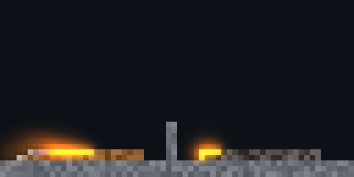

# xengine.matter.lab

The material lab: matter designed live by people and Agents — a material a file, the laws, the look and a scene to try them in, the world played again whenever one of them changes — with history, branches and claims, and no window needed (D-149, D-160, D-173).



*Wood (left) lit at 900 K and far along, its ash behind the flame; coal (right) — a 13th material, one row of data, no law added — would not light at 650 K, lit at 1100 K, and burns slower. `matter-lab picture` plays [the scene](media/coal-beside-wood.jsonl) again from its directory to these bytes.*

A definition of matter ([xengine.matter](..)) is rows of properties and laws that read them; what happens when two things meet is nobody's rule. So designing matter is changing a number and watching a world. The lab is the tool for that, and it is Live Design (D-149) outside an interface: the sources are the single truth, an edit is live at once, every step is a commit, alternatives are branches, and several can work at one lab without stepping on each other. Its history and its claims are the agent kernel's ([mlibs.agent](../../../../../base/agent)) — the same an interface's designer uses; the lab is the first adapter that is not an interface.

## What a lab is

A directory:

| Source | |
|---|---|
| `materials/<name>.json` | A material's row: its properties, its tags, and `look` (`{color, grain}`) when the pack colours it itself — a material is one file, so two added on two branches merge, and a claim on `materials/coal` is a claim on a file |
| `laws.json` | The laws, in order, a law a line |
| `look.json` | The appearance without its materials: phases, states (charred, aglow, wet…), nothing |
| `scene.json` | `{shape, filled, edits}`: what was placed and applied, each edit with the step it was made at and who made it |
| `channels.json`, `columns.json` | When the definition adds its own |

Every source is JSON kept a row a line, so that a change is a line's and history can say and merge it by line. Beside them the lab writes what a world ships — `world.matter.omui.json` and `world.appearance.omui.json`, the snapshots the kernel reads — and keeps its history under `.lab/` (commits by content, a picture a commit).

A source changed is **the definition prepared again, the look checked, and the scene played again — edit by edit, to the same step — before anything is replaced**. One with a problem changes nothing and says where, in the sources' own terms (`materials/ghost.json /burnt`, `laws.json /19/when`, `scene.json /edits/0`). The answer to a change is what it did to the world: cells whose material is another, and the materials there are now more or fewer of.

How far the scene is played is not a source: it is where the field is. `field.step` moves it; a `field.seek` back drops the edits made after.

## A session

`matter-lab new lab --shape 64x32`, then requests a line each (`matter-lab run lab --actor agent:claude`; [the whole script](media/coal-beside-wood.jsonl)). A hearth of wood, lit, and kept:

```jsonl
→ {"op":"matter.place","material":"wood","region":[4,27,22,2]}
→ {"op":"matter.apply","channel":"temperature","set":900,"region":[4,27,2,1]}
→ {"op":"lab.commit","message":"a hearth of wood, a wall beside it"}
```

A 13th material is a row. No law is added — `burns` reads `ignition`, `fuel` and the oxygen beside a thing, whatever the thing is:

```jsonl
→ {"op":"lab.material","name":"coal","properties":{"density":1400,"thermal":1,"ignition":700,"fuel":900,"heat":120,"burnt":"ash","look":{"color":"#4a4540","grain":0.14}},"intent":"a 13th material: coal — harder to light than wood, burns longer and hotter"}
← {"changed":["materials/coal.json"],"differ":0,"materials":{},"world":{"shape":[64,32],"filled":"air","steps":0,"frame":4,"materials":18,"laws":19,"hash":"43f7b81f5b14aa4a"},
   "commit":{"id":"7215e1aeb5716068","message":"a 13th material: coal — harder to light than wood, burns longer and hotter","actor":"agent:claude","branch":"main",…,"changed":["materials/coal.json"]}}
```

Placed and warmed to 650 K it does nothing, and the matter subject says why not:

```jsonl
→ {"op":"matter.place","material":"coal","region":[36,27,22,2]}
→ {"op":"matter.apply","channel":"temperature","set":650,"region":[36,27,2,1]}
→ {"op":"field.step","steps":200}
→ {"op":"matter.explain","cell":[36,27],"law":"burns"}
← {"cell":[36,27],"frame":206,"steps":200,"now":{"material":"coal","temperature":310.566},
   "judged":{"law":{"name":"burns","at":"/laws/8","when":"temperature >= ignition && burned < fuel && near.oxygen > 0"},"holds":false,"fails":"temperature >= ignition",
             "read":{"temperature":310.566,"ignition":700,"burned":0,"fuel":900,"near.oxygen":2}}, …}
```

At 1100 K it lights, and the fire goes along the pile from piece to piece — each lit by the heat of the one before, with the air above it:

```jsonl
→ {"op":"matter.apply","channel":"temperature","set":1100,"region":[36,27,2,1]}
→ {"op":"field.step","steps":400}
→ {"op":"matter.explain","cell":[39,27],"depth":1}
← {"cell":[39,27],"frame":607,"steps":600,"now":{"material":"coal","temperature":1150.54,"burned":60,"burning":1},
   "records":[{"frame":548,"step":541,"cell":[39,27],"what":"ignite","channel":"burning","law":{"name":"burns",…},
     "read":{"temperature":700.496,"ignition":700,"burned":0,"fuel":900,"near.oxygen":1},
     "gave":[{"cell":[38,27],"what":"temperature","amount":7.32031,"was":"coal","states":["burning"],
              "because":{"frame":432,"step":425,"cell":[38,27],"what":"ignite", …}},
             {"cell":[39,26],"what":"near.oxygen","amount":1,"was":"air"}]}, …]}
```

Before changing a row, what the change would do — the same scene played under both, nothing changed. Coal that lights like wood would have 30 pieces lit by now, not 19:

```jsonl
→ {"op":"lab.try","material":"coal","properties":{"ignition":560}}
← {"steps":600,"differ":0,"materials":{},"happened":{"burn_out":[6,6],"go_out":[6,6],"ignite":[19,30]},
   "reads":"[as it is, as it would be]: `differ` cells whose material is another, `materials` and `happened` those that are not the same"}
```

Why a row is what it is — the line, and who wrote it, what for:

```jsonl
→ {"op":"lab.explain","part":"materials/coal","property":"ignition"}
← {"part":"materials/coal","path":"materials/coal.json","now":{"line":4,"text":"\"ignition\": 700,"},
   "changes":[{"commit":"7215e1aeb5716068","by":"agent:claude","message":"a 13th material: coal — harder to light than wood, burns longer and hotter","line":1,"before":"","after":"{\n  \"density\": 1400, …"}]}
```

And the picture, through the renderer's frame entry — the same pixels `frame.capture` answers and `frame.at` traces:

```jsonl
→ {"op":"lab.picture","scale":8}
← {"path":"lab/.lab/pictures/26566ff1dcc63fef.png","size":[512,256],"bytes":14970,"steps":600}
```

The scene the session left, as it is kept:

```json
{
  "shape": [64, 32],
  "filled": "air",
  "edits": [
    {"step": 0, "place": "stone", "region": [0, 29, 64, 3], "by": "agent:claude"},
    {"step": 0, "place": "stone", "region": [30, 22, 2, 7], "by": "agent:claude"},
    {"step": 0, "place": "wood", "region": [4, 27, 22, 2], "by": "agent:claude"},
    {"step": 0, "channel": "temperature", "set": 900, "region": [4, 27, 2, 1], "by": "agent:claude"},
    {"step": 0, "place": "coal", "region": [36, 27, 22, 2], "by": "agent:claude"},
    {"step": 0, "channel": "temperature", "set": 650, "region": [36, 27, 2, 1], "by": "agent:claude"},
    {"step": 200, "channel": "temperature", "set": 1100, "region": [36, 27, 2, 1], "by": "agent:claude"}
  ]
}
```

`matter-lab picture lab --out again.png --steps 400` opens the directory, plays the scene to its last edit and 400 steps on, and writes the same 14 970 bytes; its `state` is `50c4c9acabc5bd1f`, the state the session's last commit recorded.

## Several at one lab

`matter-lab serve lab` is an endpoint Agents connect to, a session each with an identity of its own (`agent:session-1`, `-2`, … in the order they came; a host that knows who its Agents are makes the sessions itself: `Lab::subjects()`).

- **Claims.** `lab.claim` holds a part — `materials/<name>`, `laws/<name>`, `look`, `scene`, or `materials` and `laws` with `subtree` for all of them — for a lease that is renewed by asking again. Another's change to it waits, and is told who holds it and what for: ``"`materials/wood` is held by agent:a — "tuning how it lights" — for 30 s more"``. A history operation that would change the part waits too. What changes the field (`matter.place`, `field.step`, `field.seek`) changes the scene, and waits while another holds `scene`; reading never waits. A person is never held.
- **Branches.** `lab.branch`, `lab.switch`, `lab.merge` — by source and by line. Two materials added on two branches are both there after a merge; two properties of one material are both set; a row one side removed and the other left stays removed; the same line changed on both merges nothing and names the sources (`lab.diff` shows the lines). The merged definition is prepared and played before it is kept.
- **Who did what.** Every commit says its actor and the sources it changed; `lab.explain` on a part says who wrote each line and what for; `scene.json` says who placed each thing.

## The command

```sh
matter-lab new DIR [--matter FILE] [--look FILE] [--shape WxH] [--filled NAME]   # the standard definition and look, or snapshots given
matter-lab run DIR [--script FILE] [--actor ACTOR]      # requests a line each (a file, or standard input), answered in records; what is asked stays on record in DIR/.lab/facts.jsonl, so `{"op":"log"}` answers what earlier runs did
matter-lab serve DIR [--name NAME]                      # an endpoint Agents connect to, until it is stopped
matter-lab picture DIR --out PNG [--steps N] [--scale N]
```

One JSON answer on standard output (`run`: the records); exit 0 done, 1 failed (said why), 2 a wrong command. A definition written as TypeScript (`*.matter.omui.ts`) is given as its snapshot (`omui-gen snapshot`); the lab's `world.matter.omui.json` is one.

In a program:

```cpp
auto lab = xengine::matter::lab::Lab::create("my-lab", {.shape = {64, 32}});   // or Lab::open
mlibs::agent::SubjectSession session((*lab)->subjects());                      // lab, field, matter, frame
```

## Agent surface

The lab is a `Subject` of the agent kernel and `mlibs::agent::Sources` to the kernel's history; every operation is decided there first (openas). Its operations are a catalog, [lab.ops.omui.ts](lab.ops.omui.ts) (the table `src/catalog.cppm` and the listings `src/lab.ops.json`, `.md` are `omui-gen ops`'s); the order to use them in is [skill.omui.md](skill.omui.md).

| | |
|---|---|
| Subject and addresses | `lab`, interface `xengine.matter.lab@0.1`, beside `field` (time), `matter` (what is there and why) and `frame` (the picture) in the same session — the same subjects as the world is made again. A source is its path; a part of the design, as a claim names it, is the path without `.json`, and a law is `laws/<name>` |
| State | The sources' texts and the field they made, played to where it is; the hash covers both. The same sources and the same steps are the same bits, on any machine, from the directory alone |
| Observation | `lab.describe`: sources with lines and hashes, the world, the commit shown, changes not committed, claims; within a `budget` the sources are counted, not listed. `lab.read`: one source's text. `lab.diff`: two states by source and line |
| Control | `lab.material`, `lab.law`, `lab.edit`, `lab.reset`: one source changed, all-or-nothing, answered with what it did to the world and kept as a commit (`intent` its message). Placing and stepping are the matter subject's and the field's, recorded into `scene.json` |
| Preview | `lab.try`: the scene played under a change and under what runs, some steps on — cells that differ, materials and what happened in each, `[as it is, as it would be]`; the lab untouched |
| Causes and source | `lab.explain`: the commits that changed a part — who, what for, the lines before and after — and who holds it; with a `property`, the line that says it now and the commit that last wrote that line. From a pixel to a row: `frame.at` → the layer and the cell, `matter.explain` → the law and what it read, `lab.explain` → the row's line and its author |
| History | `lab.history`, `lab.commit`, `lab.branch`, `lab.switch`, `lab.revert`, `lab.merge`, `lab.tag`: the kernel's eight, over these sources; a commit says the sources it changed and has its picture |
| Authority | `lab.claim`, `lab.release`, `lab.claims`: leases on parts, enforced where a change is decided (`conflict`, with the holder and its intent); a person is never held. A session's actor is the session's, never what a request says |
| Budgets and tiers | `Options`: the largest field (`most_cells`), the most steps a scene is played to (`most_steps`), frames of history to seek within (`keep`), the picture's scale |
| Not here | **Time**: the field's (`capabilities` says so; the contract suite reports it unsupported, never passed). Bodies: dynamics'. Evaluating TypeScript: the lab reads snapshots. A window: a person's lab is this subject under an interface, not another tool |

## Checked

`tests/lab_test.cpp`, through the session an Agent has: the agent contract's suite on the lab (11 cases pass, time unsupported); a 13th material that lies, will not light under its ignition point, lights, burns by `burns` and is ash, with no law added; a row changed — the answer is the preview's, the row's line names its author, a revert returns the state's hash; ten sources with a problem, each refused with its place and nothing changed; two Agents and a person at one lab under claims, a lease ending; two branches merged by source and line, a conflict, a removal; the scene as a source — edits kept with their author, dropped by a seek, played from disk to the same hash; two connections at the lab's endpoint as two actors; this README's script played by a new lab, drawing this README's picture byte for byte; the picture read back through the frame subject, a pixel traced, a look changed with no cell changed.
