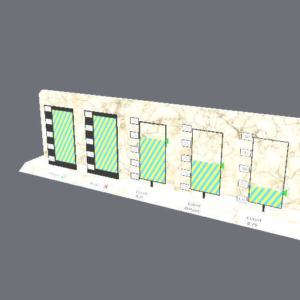
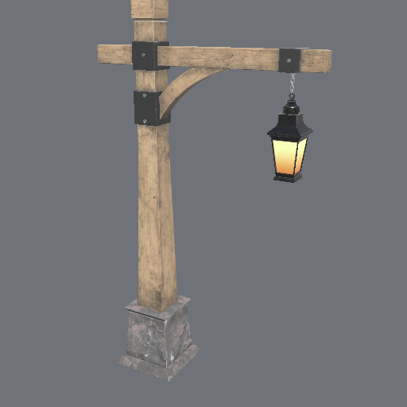
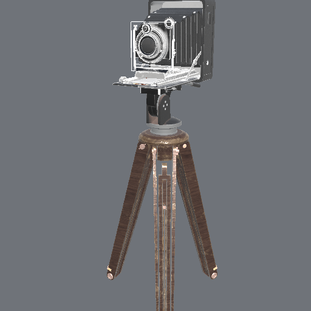
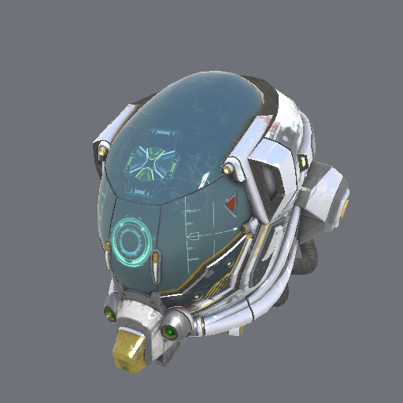
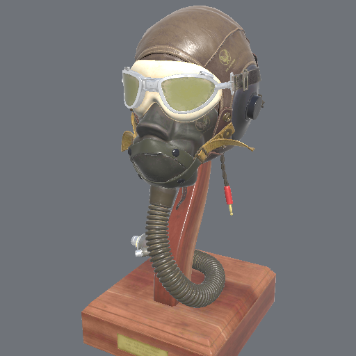

# xrender.asset

Things made elsewhere, brought in: a glTF 2.0 document as what the scene and the mesh pass are given — meshes in clusters, materials, textures, instances and lights — with a list of what the document said that was not carried (the foundation plan's §5.5, M6.3; D-171).

```cpp
import xrender.asset;
namespace asset = xrender::asset;

const auto model = asset::gltf_file("lantern.glb");          // or asset::gltf(bytes): a .gltf's text or a .glb's bytes
if (!model) return fail(model.error());                      // "not a glTF document: its JSON does not parse"
asset::place(*model, world, {.mesh = first_mesh, .material = first_material});
for (const asset::Note& note : model->notes)                 // /materials/0/normalTexture: a normal map → the mesh's own normals
    log(note.where, note.what, note.instead);
```

| | |
|---|---|
| **What is made** | A mesh in clusters a primitive (`mlibs.geom`'s `ClusteredMesh`: positions, normals, tangents, the first texture coordinates, indices; triangles, strips and fans), the materials (base colour, roughness, metal, emission with `KHR_materials_emissive_strength`; glTF's own defaults where the document is silent) with all five of their pictures — base colour, metal-roughness, normal, occlusion, emission — as `xrender.mesh` textures, colours as colours and numbers as plain numbers (PNG, JPEG, WebP by `EXT_texture_webp` and KTX2 by `KHR_texture_basisu` — a texture's own picture where it has one, else the one an extension names; in a buffer, in the document as base64, or in a file beside it), an instance for each primitive of each node of the scene at the node's place in the world, and `KHR_lights_punctual`'s lights. Numbers packed as `KHR_mesh_quantization` allows are read |
| **Stable ids** | An instance's id is the file's place: `base + (node + 1) × 65,536 + primitive + 1`; a light's `base + node + 1`. The same document gives the same ids in every run, and `Options::base` keeps two documents apart in one scene. `Imported::placed` says each instance's node, mesh, primitive and name |
| **Notes** | What the document says that is not in what was made is never dropped in silence: a `Note` each, with where it is in the document (a JSON pointer: `/materials/2/normalTexture`), what it is, and what was done instead. Today: the `KHR_materials_*` extensions beyond emission's strength; a third set of texture coordinates and on; a second colour a corner and on; skins, morph targets, animations, cameras; points and lines; pictures that are not PNG, WebP, JPEG or KTX2, and KTX2 files of light beyond a display's white; Draco and meshopt packing; any other extension. Carried, so no note: a sampler's wrap each way (`Texture::across`, `down`; a picture two textures give other edges is a texture each), `TEXCOORD_1` (`Mesh::second_uvs`) and a picture's `texCoord` of 0 or 1 (its own or its transform's: `Placing::set`), `KHR_texture_transform` a picture each (`Material::placing`), `COLOR_0` of three or four numbers, floats or shares (`Mesh::colours`), `KHR_materials_unlit` (`Material::unlit`), `doubleSided` (`Material::two_sided`), `alphaMode` BLEND (`Material::see_through`: the base colour factor's alpha times the picture's is how much the surface hides) and `alphaMode` MASK (`Material::cutout` the cutoff, `opacity` the base colour factor's alpha, the base picture's fourth byte its cover — and for a material that is whole the byte says nothing, as the format has it: one picture named both ways is a texture each). The list is the measure of what stands between this and the Khronos sample set drawn whole |
| **Refusals** | What cannot be read is refused with its reason and nothing is made: JSON that does not parse, a number that names what is not there, accessors that reach past their buffers, an index that names no position, a file beside the document that cannot be read (or no way given to read one), a document that requires Draco or meshopt packing. Nothing of a file is trusted: the parser's validation first, then `mlibs.geom`'s `check` on every mesh; an accessor with no bytes behind it (a length nobody vouches for) is not read |
| **Files beside the document** | `gltf_file` reads them from the document's directory and nowhere else (a name that climbs out, or an absolute one, is refused); `gltf` reads them through `Options::read`, by the name the document has |
| **Ordered for drawing** | `optimised(mesh)` (on by default for what is brought in; of use for a mesh made by code too): the triangles in the order a vertex cache serves best, cut into clusters of up to 124 that lie together and face alike, the corners in the order the clusters use them. The clusters' bounds and cones are `mlibs.geom`'s own (`clustered` by runs), so a cluster is the same thing whoever cut it |

## Measured

Khronos' sample models, read whole from their `.glb` (a debug build, 2026-11-14; the time is mostly pictures decoded and their smaller sizes made):

| Model | Triangles | Clusters | Instances | Notes |
|---|---|---|---|---|
| Box | 12 | 1 | 1 | none |
| BoxTextured | 12 | 1 | 1 | none |
| Duck | 4,212 | 35 | 1 | a camera |
| Fox | 576 | 7 | 1 | a skin, its bones and weights, 3 animations; no normals (worked out) |
| Avocado | 682 | 6 | 1 | none (3 textures) |
| Lantern | 5,394 | 46 | 3 | none (4 textures) |
| AntiqueCamera | 20,066 | 167 | 2 | none (6 textures) |
| DamagedHelmet | 15,452 | 130 | 1 | none (5 textures, each a JPEG) |
| AlphaBlendModeTest | 61 | 9 | 6 | none (5 textures) |
| FlightHelmet (its KTX2 variant) | 94,722 | 782 | 6 | one `KHR_materials_*` model (15 textures, each a KTX2 file: ETC1S and UASTC) |

Khronos' AlphaBlendModeTest, drawn by the CPU reference from what was brought in: its three panels cut out by their alpha are cut at the marks the model itself draws (0.25, the format's 0.5, 0.75), its whole panel is whole, and its panel seen through hides all at its foot and nothing at its top, the wall behind it showing through by as much as the model's alpha says.



Three of them drawn by the CPU reference from what was brought in — every picture of their materials, a sun, a sky to mirror:

| | | |
|---|---|---|
|  |  |  |

Khronos' FlightHelmet as it ships with KTX2 textures (`glTF-KTX-BasisU`: fifteen files, base colours packed as ETC1S and the rest as UASTC), read through [mlibs.image.ktx2](../../../base/image/ktx2) and drawn the same way — its lenses seen through:



A sheet of 4,608 triangles in a scattered order: cut as they come, a cluster spans the sheet (the widest 5.66 across its bounds); ordered, the widest is 1.39 in as many clusters (38). The plain meshlet builder fills every cluster and gathers what is left at the end into one 4.04 across — one culling can never leave out; the builder used closes a cluster early where it would grow wide.

## Beside model-viewer

Every scenario of [model-viewer's render-fidelity suite](https://github.com/google/model-viewer/tree/master/packages/render-fidelity-tools) whose model is one of Khronos' samples (a `.glb`, or a `.gltf` with the files it names) and whose surroundings are an HDR picture, drawn by the CPU reference (`xrender look`: the scenario's orbit, target and angle of view, its HDR as the surroundings, four samples a pixel, Khronos' neutral tone curve) and measured against model-viewer's golden in the suite's own measure — the root of the mean squared distance in YIQ over the most it can be, in decibels; the suite holds model-viewer against itself to −22 dB. `tools/dev/fidelity.py --xrender PATH` makes the table again (it fetches the scenarios, goldens, surroundings and models once into a cache outside the repository). 2026-11-14: of 90 scenarios 63 drawn, 27 within −22 dB — 21 at the first run; 23 once light was kept between a rough surface's small faces ([xrender.mesh](../mesh): BoxInterleaved, a fully rough metal, from −13.6 to −27.5 dB, and Lantern to the bound); 25 with the surroundings drawn behind the model where the scenario shows them (`--behind`: MetalRoughSpheres −17.6 → −28.1, its HDR variant −15.8 → −22.9, and six more nearer by 2 to 4 dB with no pixel of the golden left undrawn); 27 with an instance its place mirrors drawn the right way round (NegativeScaleTest −17.4 → −27.4, OrientationTest −20.2 → −24.5). The table below is one whole run after those (83 drawn, 37 within the bound; the four rows this paragraph names last are as now); since it, with a sampler's edges, a material's placing of its pictures and surfaces no light changes carried: TextureTransformTest −7.7 → −29.1 dB, TextureSettingsTest −15.5 → −26.2, UnlitTest −13.1 → −22.8 (40 within), TextureTransformMultiTest −11.2 → −12.9; with a second set of texture coordinates and colours at corners carried: VertexColorTest −11.8 → −36.1, BoxVertexColors −9.5 → −30.2, MultiUVTest −16.5 → −33.1 (43 within), TextureTransformMultiTest −12.9 → −18.0 (what it leaves out is clearcoat).

"The golden's pixels not drawn": where the golden has something and the picture drawn has nothing (the model stands elsewhere than the scenario expects — bones or shapes not applied — or is seen through and left out). "Left out": what the importer's notes say it did not bring in.

| Scenario | From the golden (dB) | The golden's pixels not drawn | Notes |
|---|---|---|---|
| khronos-TextureLinearInterpolationTest | -31.5 | 0 | 1 left out |
| khronos-TextureCoordinateTest | -30.4 | 0 |  |
| khronos-AnimatedTriangle | -29.3 | 0 | 2 left out |
| khronos-Triangle | -29.3 | 0 | 1 left out |
| khronos-TriangleWithoutIndices | -29.3 | 0 | 1 left out |
| khronos-SimpleMorph | -29.3 | 139392 | 3 left out |
| khronos-SimpleSparseAccessor | -29.3 | 0 | 1 left out |
| khronos-Duck | -29.3 | 0 | 1 left out |
| khronos-SimpleMeshes | -29.2 | 0 |  |
| khronos-Avocado | -29.0 | 0 |  |
| khronos-MetalRoughSpheres | -28.1 | 0 | 2 left out |
| khronos-BoxAnimated | -27.9 | 0 | 1 left out |
| khronos-RiggedFigure | -27.7 | 0 | 5 left out |
| khronos-Fox | -27.7 | 0 | 6 left out |
| khronos-BoxInterleaved | -27.5 | 0 |  |
| khronos-NegativeScaleTest | -27.4 | 0 |  |
| khronos-RiggedSimple | -27.4 | 0 | 5 left out |
| khronos-CesiumMan | -27.4 | 0 | 5 left out |
| khronos-TwoSidedPlane | -27.1 | 0 |  |
| khronos-Box | -27.1 | 0 |  |
| khronos-EmissiveStrengthTest | -27.0 | 0 |  |
| khronos-SpecGlossVsMetalRough | -26.7 | 0 | 2 left out |
| khronos-MaterialsVariantsShoe | -26.7 | 0 |  |
| khronos-BoxTextured | -26.3 | 0 |  |
| khronos-BoxTexturedNonPowerOfTwo | -26.3 | 0 |  |
| khronos-Suzanne | -25.4 | 0 |  |
| khronos-CesiumMilkTruck | -25.4 | 0 | 1 left out |
| khronos-AnimatedMorphCube | -25.2 | 0 | 2 left out |
| khronos-BrainStem | -25.0 | 0 | 121 left out |
| khronos-OrientationTest | -24.5 | 0 |  |
| khronos-EnvironmentTest | -24.3 | 0 | 1 left out |
| khronos-NormalTangentMirrorTest | -23.5 | 0 |  |
| DirectionalLightTest | -23.2 | 0 | 1 left out |
| khronos-MetalRoughSpheres-HDR | -22.9 | 0 | 2 left out |
| khronos-NormalTangentTest | -22.9 | 0 |  |
| khronos-Corset | -22.8 | 0 |  |
| khronos-AntiqueCamera | -22.5 | 0 |  |
| khronos-Lantern | -22.0 | 0 |  |
| khronos-Cube | -21.4 | 0 |  |
| khronos-AnimatedCube | -21.1 | 0 | 1 left out |
| khronos-SciFiHelmet | -20.9 | 0 |  |
| khronos-AlphaBlendModeTest | -20.9 | 0 |  |
| khronos-DamagedHelmet | -19.1 | 0 |  |
| khronos-BarramundiFish | -19.0 | 0 |  |
| khronos-IridescenceDielectricSpheres | -18.9 | 2720 | 686 left out |
| khronos-MosquitoInAmber | -18.9 | 0 | 5 left out |
| khronos-TextureEncodingTest | -18.3 | 0 | 4 left out |
| khronos-ABeautifulGame | -18.0 | 0 | 4 left out |
| khronos-LightsPunctualLamp | -17.1 | 0 | 16 left out |
| khronos-BoomBoxWithAxes | -16.7 | 0 |  |
| khronos-GlamVelvetSofa | -16.7 | 0 | 15 left out |
| khronos-MultiUVTest | -33.1 | 0 | 1 left out |
| khronos-ClearCoatTest | -16.3 | 12855 | 6 left out |
| khronos-ClearCoatCarPaint | -15.9 | 0 | 2 left out |
| khronos-TextureSettingsTest | -15.5 | 0 | 6 left out |
| khronos-InterpolationTest | -15.5 | 20320 | 1 left out |
| khronos-FlightHelmet | -15.4 | 0 | 1 left out |
| khronos-TransmissionTest | -15.3 | 0 | 14 left out |
| khronos-ToyCar | -15.1 | 0 | 14 left out |
| khronos-BoomBox | -14.8 | 0 |  |
| khronos-TransmissionRoughnessTest | -14.4 | 0 | 14 left out |
| khronos-AnisotropyStrengthTest | -14.3 | 0 | 49 left out |
| khronos-IridescenceMetallicSpheres | -14.2 | 2720 | 343 left out |
| khronos-SimpleSkin | -13.8 | 0 | 6 left out |
| khronos-SpecularTest | -13.3 | 0 | 23 left out |
| khronos-AnisotropyRotationTest | -13.3 | 0 | 4 left out |
| khronos-UnlitTest | -13.1 | 0 | 2 left out |
| khronos-IridescenceLamp | -13.0 | 0 | 5 left out |
| khronos-RecursiveSkeletons | -12.5 | 486318 | 90 left out |
| khronos-IridescentDishWithOlives | -12.5 | 0 | 12 left out |
| khronos-SheenChair | -12.3 | 0 | 27 left out |
| khronos-SheenCloth | -12.0 | 0 | 5 left out |
| khronos-VertexColorTest | -36.1 | 0 |  |
| khronos-TextureTransformMultiTest | -18.0 | 0 | 9 left out |
| khronos-AttenuationTest | -10.9 | 0 | 27 left out |
| khronos-GlassVaseFlowers | -10.8 | 0 | 2 left out |
| khronos-MorphPrimitivesTest | -10.4 | 1054 | 2 left out |
| khronos-IridescenceSuzanne | -10.0 | 0 | 11 left out |
| khronos-GlassHurricaneCandleHolder | -9.8 | 0 | 2 left out |
| khronos-BoxVertexColors | -30.2 | 0 |  |
| khronos-MorphStressTest | -9.2 | 0 | 6 left out |
| khronos-DragonAttenuation | -8.3 | 0 | 4 left out |
| khronos-TextureTransformTest | -7.7 | 0 | 21 left out |
| khronos-Sponza | — | — | its eye is at its target |
| khronos-MetalRoughSpheres-LDR | — | — | its surroundings are not an HDR picture |
| khronos-MetalRoughSpheresNoTextures | — | — | its eye is at its target |
| AlphaBlendLitmusTest | — | — | its model is not one of Khronos' samples |
| khronos-AnisotropyBarnLamp | — | — | its golden could not be fetched |
| khronos-AnimatedMorphSphere | — | — | its model could not be fetched |
| FurnaceTest | — | — | its model is not one of Khronos' samples |

Not drawn (7): 2 — its eye is at its target; 2 — its model is not one of Khronos' samples; 1 — its surroundings are not an HDR picture; 1 — its golden could not be fetched; 1 — its model could not be fetched.

What the table says is missing, most scenarios first: what a material says beyond the base five pictures (`KHR_materials_transmission`, `volume`, `clearcoat`, `sheen`, `iridescence`, `anisotropy`, `specular`, `pbrSpecularGlossiness`), a sampler's filter, bones and shapes applied where the model's rest is not its pose, the model's own lights.

## How it was designed (D-185)

1. *From this system's own ground.* An import is a value with its own account: the notes are data an agent reads (where, what, instead), not a log line — so "why does the helmet look flat" has an answer without a person looking. Ids are the file's places, so a pixel traced to an instance ([xrender.frame](../frame)) is traced on to a node of the document. A cluster's bounds and cone are worked out by the one owner of clusters (`mlibs.geom`), whatever tool ordered the triangles.
2. *What exists, combined.* Parsing is cgltf's and the ordering meshoptimizer's, each through its module wrap ([mcpplibs/cgltf-m](https://github.com/mcpplibs/cgltf-m), [mcpplibs/meshoptimizer-m](https://github.com/mcpplibs/meshoptimizer-m); D-56, D-83), each named in one native unit. Pictures are `mlibs.image`'s.
3. *The level of the best.* Against the reference loaders (Khronos' sample viewer, Filament's gltfio, Godot's importer): behind — they carry skins, animations, morph targets and the further `KHR_materials_*` models, which here are notes, and they hand a KTX2 texture to the device in its own blocks where here it becomes pixels first. Ahead in one thing those do not give: what was not carried, as data with its place. What comes next is in the notes' order of weight: skins and animations to hanim, then a device's own blocks.

## Agent surface

Part of the frame's subject ([xrender.frame](../frame)); what this package gives an agent's question, as plain functions:

| | |
|---|---|
| State and addresses | An instance by its id, which is its node and primitive in the document (`placed`); a material and a mesh by their place |
| Observation | `Imported` is all data: counts, `triangles()`, `bounds()`, every note |
| Causes | A `Note`'s `where` is a JSON pointer into the document; a refusal's text says what is wrong and, where there is a way on, the way (`Options::read`, another `Options::base`) |
| Control | `gltf`, `gltf_file`, `place` (refused whole, the scene as it was), `optimised` |
| Time | None: the same bytes in give the same value out |
| Not here | Who may read which file (the caller's `read`); drawing (the mesh pass); what moves (hanim, when skins and animations are carried) |

## Where things are

| | |
|---|---|
| `src/asset.cppm` | the interface |
| `src/asset.cpp` | placing into a scene, reading from a file |
| `src/native/gltf.cpp` | the one unit that names cgltf |
| `src/native/optimise.cpp` | the one unit that names meshoptimizer |
| `tests/asset_test.cpp` | 7 cases: a whole document; the same bytes twice, `.glb` and files beside; from a file; the notes; strips, fans and lamps; refusals; ordering |
