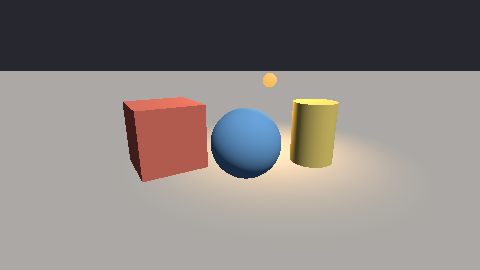
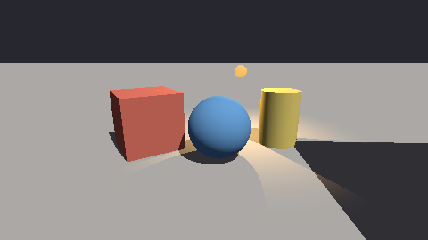
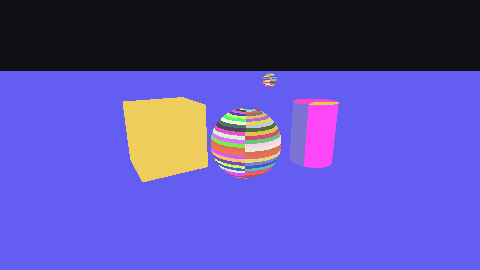
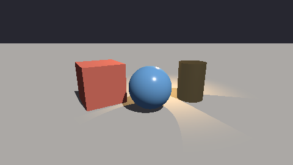
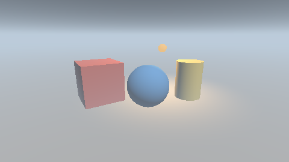
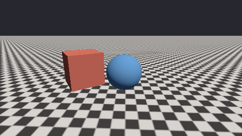
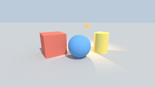
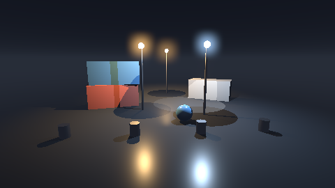
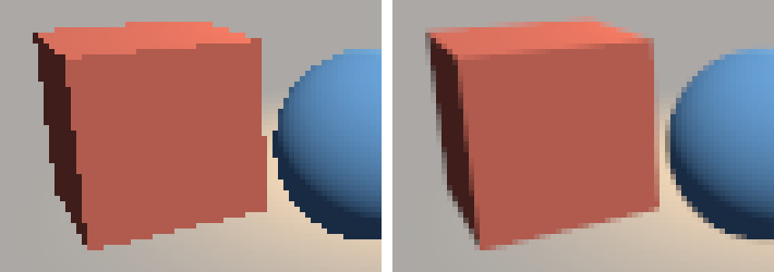

# xrender.mesh

Meshes drawn. What [xrender.scene](../scene) extracted, as pixels: the colour, and beside it the depth, the surface's normal, how far it moved since the last frame, and who drew it — the instance, the cluster and the triangle. This is the **CPU reference** (the foundation plan's §5.1–§5.3, §5.7; D-164, D-184): the same bits on every machine, what a GPU path of the same contract is compared with, and what a test or an agent with no GPU looks at.

| the yard | with shadows (a slab off the screen casts too) | who drew each pixel (a colour a cluster) |
|---|---|---|
|  |  |  |

All three are drawn by `tests/mesh_test.cpp` with no window and no device; the first two are pinned there bit for bit.

```cpp
import xrender.mesh;
namespace mesh = xrender::mesh;

mesh::Pass pass;
mesh::Targets frame;
frame.resize(480, 270);
scene::extract(world, view, seen);
pass.draw(world, seen, view, {.meshes = meshes, .materials = materials}, frame);
const auto who = mesh::at(frame, 240, 135);     // instance 11, its cluster and triangle, the depth and the normal there
```

| | |
|---|---|
| **One pass, five outputs** | colour (rgba8, sRGB; and the same as linear light), depth, normal (world), velocity (pixels since the last frame drawn), ids (draw, cluster, triangle). The four beside the colour are there from the first frame because each has a consumer now: the depth for what hides what, the ids for an agent's "who drew this pixel", the velocity for anti-aliasing over time, the normal for what lights a surface later (the plan's §9.4) |
| **Exact filling** | A triangle is clipped to the view's volume (and a guard band about it), its corners snapped to 1/256 of a pixel, and filled by the top-left rule with whole-number edges: two triangles that share an edge share no pixel and leave none between them. A sheet of 512 triangles turned 24 ways writes each of its pixels once |
| **The same bits** | IEEE arithmetic in a fixed order, no fused multiply-add, the sRGB curve from a table made with `mlibs.math`'s own powers. Either depth convention (the nearest at 0; or at 1 with no far plane) gives the same picture |
| **Clusters** | A mesh is drawn cluster by cluster (`mlibs.geom`'s `ClusteredMesh`). One outside the view, or whose triangles all face away (its cone), is left out — and no pixel changes (`cull_clusters` off draws them all; the tests hold the two to the same bits) |
| **Velocity** | The pass remembers where each instance was and how it was seen; a pixel says how far its point of the surface moved on the screen. What stood still under a still camera says exactly 0. `forget()` after a cut |
| **Shading** | A surface under suns, lamps and spots, a constant light from everywhere, and what the surface gives off. A material that says nothing more is matt. One that says a `roughness` below 1 or that it is `metallic` has a highlight as well: the microfacet model every engine draws with (GGX's spread, Smith's shadowing as Schlick wrote it, Schlick's Fresnel) from +, ×, ÷ and a square root alone, so its bits are the same everywhere (`reflected`). A polished ball's highlight is within two pixels of where the sun is mirrored to the eye and nearly seven times as bright as anything matt; rougher, it is dimmer and wider; a gold ball's highlight has gold's colour and the rest of it is dark — a metal with nothing about it to mirror. `Options::environment` gives it something: a sky above, the land at eye level, the ground below (three colours; `mirrored`), and a gold ball is then the sky through gold above and the ground through gold below, while a matt one is the same bits with it as without. A picture of an environment (a map) and textures are not here yet.  |
| **Frames gathered over time** | `Options::jitter` takes a frame's samples a little aside of each pixel's middle (`jitter_of(n)`: sixteen places that fill a pixel evenly); `Temporal::resolve` mixes each pixel with the last result where its surface was (the velocity) — unless neither there nor beside it was the same instance (the ids), when it begins again — and holds what it carries to what the frame shows about the pixel. Sixteen frames come to within a quarter of one frame's distance from sixteen samples a pixel; where a box was a frame ago nothing of it is left (3 pixels of 1,673). It is the reference of the method: the GPU's is held to it |
| **Shadows, by rays** | Given a tree of each mesh (`Assets::trees`, `mlibs.geom`'s `bvh_of`), a light reaches a surface only where a ray from the surface to the light meets nothing — every instance of the scene that `casts`, seen by the view or not. It is the ray query of geometry used for light (D-184): exact to the triangle, no map and no bias but the lift off the surface. A ball's shadow on a floor is where the sun's rays through a ball land: 56,376 floor pixels agree and none disagree |
| **Fog** | `Options::fog`: a colour, a density a unit of length at a height, and how fast it thins above it. What a ray goes through between the eye and a surface is worked out exactly (`through(fog, eye, toward, length)`: the integral, not steps; held to twenty thousand small steps within 1e-5), so fog that lies in a valley and clears above it is one formula; the background is a surface infinitely far — looked at upward through thinning fog it shows, level it does not. It is light and not geometry: ids, depth and velocity do not change, and the fogged light is what is gathered over time. No density: the pass does nothing for it, and the yard's pinned bits are the same.  |
| **Textures** | `Material::texture` names one of `Assets::textures`; the surface's base colour is multiplied by the picture's light at the mesh's texture coordinates (`mlibs.geom`'s `uvs`; it repeats). A `Texture` is made once from sRGB bytes into light at every size down to one texel, each the mean of four; a pixel looks up the size whose texels are about a pixel across — from where the surface is in the picture at this pixel, the next and the one below, worked out through the perspective — and mixes it with the next size. At a slant a pixel covers a long strip of the picture: up to eight places along the strip are taken, each at the size the strip's width asks (`Texture::over`), so a floor stays sharp across the way it is looked along. A floor of tiles to the horizon: its light along a row near the eye 0.350 ± 0.271, by the horizon 0.351 ± 0.015 — the mean of its tiles, no shimmer.  |
| **The surface's other pictures** | glTF's set, each one of `Assets::textures` laid by the same texture coordinates: `Material::surface` (its green multiplies `roughness`, its blue `metallic`), `normal` (which way the surface faces about its own normal — red along the picture, green up it, blue out — by `normal_scale`), `glow` (multiplies `emissive`), `shade` (its red is the share of the light from everywhere that reaches the surface, by `shade_strength`). The first, the second and the fourth are numbers, not colours: `Texture::made(…, Coding::plain)` keeps a byte ÷ 255 where a colour has the display's curve taken off. A normal picture is turned into the world by the mesh's tangents (`mlibs.geom`'s: w the side the picture's up is on, glTF's rule); a mesh with none has the two ways worked out from each triangle's corners and texture coordinates — the same surface (a sheet with tangents and without: within 0.0001 of light). An even picture is the material that says the same numbers, bit for bit (`tests/mesh_test.cpp`) |
| **Seen from both sides, cut out by a picture** | `Material::two_sided`: the surface is drawn whichever way round its triangles go, and at each pixel its normal faces the eye (asked of the normal there, as a device's shader can ask it) — a leaf, a sheet of cloth; without it a face turned away is not drawn. `Material::cutout` above 0: where the surface hides less than that — its `opacity` times its base picture's cover there — it is not there at all: not in the colour, not in who drew the pixel (`Stats::cut` counts the samples left out), not in the shadow it casts, and a ray goes through (`meet(ray, mesh, tree, material, picture)`: what the pass's shadows, the tracer and `pick` all ask; a ray asks the cover between the four texels of the finest size). A picture's cover is its fourth byte (`Texture::cover`; a picture that hides everywhere carries none and is the texture it was, bit for bit). Where there is a cover, `light` holds each texel's light times it, at every size: the mean of four texels and what lies between texels is the light of what is there, not of the clear texels beside it — a leaf's last pixel is as green as its middle, with no dark rim, whatever colour the clear texels were given (`tests/mesh_test.cpp`: the same bits). Limit: a cover's smaller sizes are plain means, so a thin thing far away thins out below the cut before it is a pixel wide (the cover-preserving sizes of Castaño 2010 need the cut at the texture's making; frames gathered over time do not bring it back). |
| **Seen through** | `Material::see_through`: the surface lets what is behind it show by the share it does not hide (1 − `opacity` × its base picture's cover there) — a pane of glass, a label on it, smoke on a card. Such surfaces are laid over the frame after everything whole, each pixel's own from the farthest to the nearest **whatever order they were drawn in** (sorted a pixel by depth, then by draw and triangle: the same bits in any order of drawing; panes that cross one another are right on both sides of where they cross). Each keeps its name: `Targets::through` holds, a pixel, who is seen through there, how deep, and its **share** of the pixel's light — what it hides times what the nearer ones let through; what is left of 1 is what stops the eye's (`through_at(targets, x, y)`; `describe` adds `"through":[{"instance":30,"material":4,"share":0.4}]`, so `frame.at` on a pixel of a window says the pane, its share, and the thing behind it; `shown` counts a pane's pixels as seen). The pixel's depth, normal, velocity and `ids` stay those of what stops the eye. It hides nothing from a light: it casts no shadow (the pass's rays and the tracer's go through; the tracer's eye rays go through as often as the surface does not hide — `1 − hides` of them). The order tried (D-185): first what this system alone has — a pixel's name was one surface, and with panes it is a list with shares that sum with what is behind to 1, so the question “what is here” has a whole answer through glass; then the device (below, [gpu](gpu)): the same order by peeling layers, held to this reference. Limits: the light a pane bends or tints by its thickness is not there (it hides or lets through, by a share); a see-through surface takes shadows and casts none, also where it hides nearly all |
| **Light followed along rays** | `traced(scene, view, assets, out, options, how)`: the reference of what the pass's constant light from everywhere stands in for (D-184 step c). A pixel sends `samples` rays; a surface's light is what it gives off, what the lights send it (as the pass works it out, shadows by rays) and what arrives from one more way about its normal, followed `bounces` times and then the sky. Checked by what must be so, not by a picture: an open floor of colour 0.5 under an even sky of (0.5, 0.6, 0.7) sends back (0.25, 0.3, 0.35) exactly; beside a ball it has 0.211 where the open floor has 0.298; before a red box in the sun its red over green is 1.071 against 0.949. A pixel's rays come from its number, the sample's and the seed: the same bits twice, and on every machine. 160 × 90 at 32 rays a pixel and two bounces: 1.34 million rays in 0.38 s on one thread. A surface with a highlight is followed two ways, as often each as it is a mirror: about its normal for its own colour, or thrown back by one of its small faces (chosen as the highlight spreads them, weighed by Schlick's share and Smith's hiding) — so it mirrors the scene: a floor of white metal under that sky is (0.499, 0.599, 0.699), and a red ball's image in it is the ball's red, as bright. Beside it the pass's constant light from everywhere, given the sky's colour, is 0.012 off a pixel on the yard — and 0.079 too light about the ball's foot: what a constant leaves out.  |
| **How open a place is** | `Options::occlusion_rays` (0: none, the pass's bytes as before), `occlusion_reach`, `occlusion_seed`: a pixel sends that many rays about its surface's normal, more toward it than along the surface, and the light from everywhere is scaled by the share that met nothing within the reach — with what the shut ways send back taken to be of the surface's own colour (open / (1 − colour · (1 − open))). Rays are drawn from the seed and the pixel, so a frame is the same bytes each time; `Stats::occlusion_rays` and `occluded` count them, and the lights' rays are counted as before. Held to the traced yard (64 rays a pixel): about the ball's foot the constant is +0.079 too light and 32 rays leave −0.022; on the whole yard the constant is 0.012 off (+0.007) and the rays 0.018 (−0.012) — a shut way is taken to be lit by the sky alone, and the yard's are in the sun. On a device: `xrender.mesh.gpu`'s `Open`, from what the eye sees, held to this |
| **Tone** | `Tone {exposure, filmic}`, the last step before the display's curve (`Glow::show`'s): the exposure scales the light; without `filmic` what is over the display's white is cut off there, a channel by itself; with it the light is bent toward white as it grows (Narkowicz's fit of ACES: +, × and ÷), so a lamp of (9, 5, 1.6) keeps red over green over blue where cut off it is flat white. No tone is the pass's own bytes |
| **Glow** | `Glow::show(light, width, height, bloom, colour)`: the frame as shown — the light, what of it is brighter than the display can show spread to the pixels about it (`Bloom`: a threshold, a radius, a strength), then the display's curve. It works on the light before the curve (`Targets::light`, or `Temporal::light()`), where "brighter than white" still exists; a layer's 8-bit effect (`xrender.effect`) comes after it and cannot know. Three box passes each way, each value summed afresh: one pixel of (9, 5, 1) over a threshold of 1 spreads exactly its excess (8, 4.444, 0.889), evenly to 1.5e-8, and reaches three radii and no farther. With no radius, or nothing bright, the frame is the pass's own bytes |

A harbour at night after rain — three lamps and a spot with their traced shadows (7,177 pixels in one), a wet quay that throws the lamps back, fog lying low, the globes' glow (1,109 pixels brighter than the display; 7,709 lighter for them) — 480 × 270, drawn with no window and no device, pinned bit for bit:



What the wet quay throws back is the lights and the environment's three colours; it does not mirror the containers (that is a reflection of the scene: a probe or rays, behind `Environment`).

One frame, and sixteen gathered (the box's corner, each pixel six across):



## Agent surface

Part of the frame's subject ([xrender.frame](../frame)); what this package gives it:

| | |
|---|---|
| Source | `at(targets, x, y)`: the instance (the scene's stable id), its mesh and material, the cluster and the triangle, the depth and the normal at a pixel — or that nothing drew it |
| Before anything is drawn | `pick(scene, view, assets, x, y, width, height)`: what is under a point of a view, by a ray through the meshes' trees — the instance and the triangle the id buffer would say, with no frame. Over the yard's 24,000 drawn pixels the two name the same triangle at 23,995 and never another instance |
| Observation | `shown(targets, out)`: every instance that reached the frame, with how many pixels and the box of them. An instance that was a draw (`xrender.scene`'s `extract`) and is not shown is behind something; `scene::why_unseen` says why one was no draw at all |
| Numbers | `Pass::last()`: draws, clusters looked at and left out (outside, facing away), triangles (outside, cut, facing away, filled), pixels written and hidden |
| In a frame | `objects(targets, out)` and `describe(targets, x, y, members)` make this picture a layer of [xrender.frame](../frame) (`PictureLayer`): `frame.at` on a pixel of it answers with the instance, mesh, material, cluster, triangle, depth and normal |
| Not here | Control and time (the scene's owner's) |

## Not yet

- **The GPU path** has begun: [xrender.mesh.gpu](gpu) draws the same scene through `mlibs.rhi` with one Slang shader and is held to this reference (5 of 129,600 pixels apart on lavapipe). Still to come there: textures; shadows there (a map, held to these traced ones) and the fog (held to this one); the resolve over time on the device, with the render graph's resources that last across frames (they land with it: it is their consumer).
- **An optimiser's clusters** and levels of detail (meshoptimizer through mwrap): the clusters here are a mesh's triangles in the order they come.
- **Speed**: this is a reference, one thread, a pixel at a time. Its cost is measured (`render/mesh-reference-yard` in `tests/bench`) so that it is known, not so that it is fast.

```sh
mcpp test -p xrender.mesh
```
