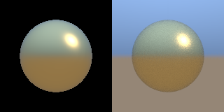

# xrender.mesh

Meshes drawn. What [xrender.scene](../scene) extracted, as pixels: the colour, and beside it the depth, the surface's normal, how far it moved since the last frame, and who drew it — the instance, the cluster and the triangle. This is the **CPU reference** (the foundation plan's §5.1–§5.3, §5.7; D-164, D-184): the same bits on every machine, what a GPU path of the same contract is compared with, and what a test or an agent with no GPU looks at.

| the yard | with shadows (a slab off the screen casts too) | who drew each pixel (a colour a cluster) |
|---|---|---|
|  |  |  |

All three are drawn by `tests/mesh_test.cpp` with no window and no device; the first two are pinned there bit for bit.

```cpp
import xrender.mesh;
namespace mesh = xrender::mesh;

mesh::Pass pass;
mesh::Targets frame;
frame.resize(480, 270);
scene::extract(world, view, seen);
pass.draw(world, seen, view, {.meshes = meshes, .materials = materials}, frame);
const auto who = mesh::at(frame, 240, 135);     // instance 11, its cluster and triangle, the depth and the normal there
```

| | |
|---|---|
| **One pass, five outputs** | colour (rgba8, sRGB; and the same as linear light), depth, normal (world), velocity (pixels since the last frame drawn), ids (draw, cluster, triangle). The four beside the colour are there from the first frame because each has a consumer now: the depth for what hides what, the ids for an agent's "who drew this pixel", the velocity for anti-aliasing over time, the normal for what lights a surface later (the plan's §9.4) |
| **Exact filling** | A triangle is clipped to the view's volume (and a guard band about it), its corners snapped to 1/256 of a pixel, and filled by the top-left rule with whole-number edges: two triangles that share an edge share no pixel and leave none between them. A sheet of 512 triangles turned 24 ways writes each of its pixels once |
| **The same bits** | IEEE arithmetic in a fixed order, no fused multiply-add, the sRGB curve from a table made with `mlibs.math`'s own powers. Either depth convention (the nearest at 0; or at 1 with no far plane) gives the same picture |
| **Clusters** | A mesh is drawn cluster by cluster (`mlibs.geom`'s `ClusteredMesh`). One outside the view, or whose triangles all face away (its cone), is left out — and no pixel changes (`cull_clusters` off draws them all; the tests hold the two to the same bits) |
| **Velocity** | The pass remembers where each instance was and how it was seen; a pixel says how far its point of the surface moved on the screen. What stood still under a still camera says exactly 0. `forget()` after a cut |
| **Shading** | A surface under suns, lamps and spots, a constant light from everywhere, and what the surface gives off. A material that says nothing more is matt. One that says a `roughness` below 1 or that it is `metallic` has a highlight as well: the microfacet model every engine draws with (GGX's spread, Smith's shadowing as Schlick wrote it, Schlick's Fresnel) from +, ×, ÷ and a square root alone, so its bits are the same everywhere (`reflected`). A polished ball's highlight is within two pixels of where the sun is mirrored to the eye and nearly seven times as bright as anything matt; rougher, it is dimmer and wider; a gold ball's highlight has gold's colour and the rest of it is dark — a metal with nothing about it to mirror. `Options::environment` gives it something: a sky above, the land at eye level, the ground below (three colours; `mirrored`), and a gold ball is then the sky through gold above and the ground through gold below, while a matt one is the same bits with it as without. With a picture of the surroundings every surface asks the picture (the row *Lit by a picture of the surroundings*).  |
| **Frames gathered over time** | `Options::jitter` takes a frame's samples a little aside of each pixel's middle (`jitter_of(n)`: sixteen places that fill a pixel evenly); `Temporal::resolve` mixes each pixel with the last result where its surface was (the velocity) — unless neither there nor beside it was the same instance (the ids), when it begins again — and holds what it carries to what the frame shows about the pixel. Sixteen frames come to within a quarter of one frame's distance from sixteen samples a pixel; where a box was a frame ago nothing of it is left (3 pixels of 1,673). It is the reference of the method: the GPU's is held to it |
| **Shadows, by rays** | Given a tree of each mesh (`Assets::trees`, `mlibs.geom`'s `bvh_of`), a light reaches a surface only where a ray from the surface to the light meets nothing — every instance of the scene that `casts`, seen by the view or not. It is the ray query of geometry used for light (D-184): exact to the triangle, no map and no bias but the lift off the surface. A ball's shadow on a floor is where the sun's rays through a ball land: 56,376 floor pixels agree and none disagree |
| **Fog** | `Options::fog`: a colour, a density a unit of length at a height, and how fast it thins above it. What a ray goes through between the eye and a surface is worked out exactly (`through(fog, eye, toward, length)`: the integral, not steps; held to twenty thousand small steps within 1e-5), so fog that lies in a valley and clears above it is one formula; the background is a surface infinitely far — looked at upward through thinning fog it shows, level it does not. It is light and not geometry: ids, depth and velocity do not change, and the fogged light is what is gathered over time. No density: the pass does nothing for it, and the yard's pinned bits are the same.  |
| **Textures** | `Material::texture` names one of `Assets::textures`; the surface's base colour is multiplied by the picture's light at the mesh's texture coordinates (`mlibs.geom`'s `uvs`; it repeats). A `Texture` is made once from sRGB bytes into light at every size down to one texel, each the mean of four; a pixel looks up the size whose texels are about a pixel across — from where the surface is in the picture at this pixel and at the other of its pair across and of its pair down (columns and rows paired from the first: the two by two a device takes its differences within), worked out through the perspective — and mixes it with the next size. At a slant a pixel covers a long strip of the picture: up to eight places along the strip are taken, each at the size the strip's width asks (`Texture::over`), so a floor stays sharp across the way it is looked along. A floor of tiles to the horizon: its light along a row near the eye 0.350 ± 0.271, by the horizon 0.351 ± 0.015 — the mean of its tiles, no shimmer.  |
| **A picture's edges, its placing, and a surface no light changes** | `Texture::across` and `down` say what the picture is past its edge each way (`Edge::repeats`, `mirrors` — turned about, `stops` — its edge's texels; glTF's three wraps), at every size. `Material::placing` lays each of the material's pictures its own way (`Placings`: the base colour's, the surface's, the normal's, the glow's, the shade's) — by the mesh's first set of texture coordinates or its second (`Placing::set`: `Mesh::uvs` or `second_uvs`, glTF's `texCoord`), then two rows, `Placing::made(offset, turn, scale, set)` as `KHR_texture_transform` composes them. Both sets are carried to the pixel once and each picture's placing applied there, to the place and to its differences alike (`Placing::moved`: the rows are linear in the coordinates, so a picture's differences are its placing of the set's differences — no interpolant a picture); the strip and the ways a normal picture turns follow it; the tracer reads the same. A colour at each corner (`Mesh::colours`, glTF's `COLOR_0`) multiplies the base colour, and its fourth what the surface hides — drawn, cut out, seen through, along rays and for a shadow's ray. The order tried (D-185). ① From what is here: a picture's set and its transform together are one linear map of the corner's coordinates, so the two sets are carried to the pixel once and every picture's map applied there — to its place and to its differences alike — with one shader for every material and nothing a picture between the stages (three.js carries a varying and a transformed copy a picture's set from its vertex stage and compiles a shader a combination); the device decides the set by a number in the draw's uniforms, the same for every pixel of the draw. ② From research: nothing beyond the format's own definition was needed. ③ not needed. `Material::unlit`: the surface shows its base colour times its picture, whatever the lights, the surroundings and the fog's light are (`KHR_materials_unlit`) — it still hides, is cut out and is seen through as any other. Cases: past its edge a mirrored picture is its mirror image and a stopped one its edge's texel at every size; a floor its material lays twice as fine is bit for bit the floor whose mesh's own coordinates are doubled, drawn and along rays; a picture laid by the second set is bit for bit the one laid by the first when they are the same; an even colour at the corners is the material multiplied by it to 1.2e-7 drawn and 6e-8 along rays, a grade across the floor is red on its left and blue on its right, and a floor whose corners hide a quarter is cut out wholly under a cut of a half; a surface no light changes sends its own colour, drawn and along rays |
| **The surface's other pictures** | glTF's set, each one of `Assets::textures` laid by the same texture coordinates: `Material::surface` (its green multiplies `roughness`, its blue `metallic`), `normal` (which way the surface faces about its own normal — red along the picture, green up it, blue out — by `normal_scale`), `glow` (multiplies `emissive`), `shade` (its red is the share of the light from everywhere that reaches the surface, by `shade_strength`). The first, the second and the fourth are numbers, not colours: `Texture::made(…, Coding::plain)` keeps a byte ÷ 255 where a colour has the display's curve taken off. A normal picture is turned into the world by the mesh's tangents (`mlibs.geom`'s: w the side the picture's up is on, glTF's rule); a mesh with none has the two ways worked out from each triangle's corners and texture coordinates — the same surface (a sheet with tangents and without: within 0.0001 of light). An even picture is the material that says the same numbers, bit for bit (`tests/mesh_test.cpp`) |
| **Seen from both sides, cut out by a picture** | `Material::two_sided`: the surface is drawn whichever way round its triangles go, and at each pixel its normal faces the eye (asked of the normal there, as a device's shader can ask it) — a leaf, a sheet of cloth; without it a face turned away is not drawn. `Material::cutout` above 0: where the surface hides less than that — its `opacity` times its base picture's cover there — it is not there at all: not in the colour, not in who drew the pixel (`Stats::cut` counts the samples left out), not in the shadow it casts, and a ray goes through (`meet(ray, mesh, tree, material, picture)`: what the pass's shadows, the tracer and `pick` all ask; a ray asks the cover between the four texels of the finest size). A picture's cover is its fourth byte (`Texture::cover`; a picture that hides everywhere carries none and is the texture it was, bit for bit). Where there is a cover, `light` holds each texel's light times it, at every size: the mean of four texels and what lies between texels is the light of what is there, not of the clear texels beside it — a leaf's last pixel is as green as its middle, with no dark rim, whatever colour the clear texels were given (`tests/mesh_test.cpp`: the same bits). Limit: a cover's smaller sizes are plain means, so a thin thing far away thins out below the cut before it is a pixel wide (the cover-preserving sizes of Castaño 2010 need the cut at the texture's making; frames gathered over time do not bring it back). |
| **Seen through** | `Material::see_through`: the surface lets what is behind it show by the share it does not hide (1 − `opacity` × its base picture's cover there) — a pane of glass, a label on it, smoke on a card. Such surfaces are laid over the frame after everything whole, each pixel's own from the farthest to the nearest **whatever order they were drawn in** (sorted a pixel by depth, then by draw and triangle: the same bits in any order of drawing; panes that cross one another are right on both sides of where they cross). Each keeps its name: `Targets::through` holds, a pixel, who is seen through there, how deep, and its **share** of the pixel's light — what it hides times what the nearer ones let through; what is left of 1 is what stops the eye's (`through_at(targets, x, y)`; `describe` adds `"through":[{"instance":30,"material":4,"share":0.4}]`, so `frame.at` on a pixel of a window says the pane, its share, and the thing behind it; `shown` counts a pane's pixels as seen). The pixel's depth, normal, velocity and `ids` stay those of what stops the eye. It hides nothing from a light: it casts no shadow (the pass's rays and the tracer's go through; the tracer's eye rays go through as often as the surface does not hide — `1 − hides` of them). The order tried (D-185): first what this system alone has — a pixel's name was one surface, and with panes it is a list with shares that sum with what is behind to 1, so the question “what is here” has a whole answer through glass; then the device (below, [gpu](gpu)): the same order by peeling layers, held to this reference. Limits: the light a pane bends or tints by its thickness is not there (it hides or lets through, by a share); a see-through surface takes shadows and casts none, also where it hides nearly all |
| **Light followed along rays** | `traced(scene, view, assets, out, options, how)`: the reference of what the pass's constant light from everywhere stands in for (D-184 step c). A pixel sends `samples` rays; a surface's light is what it gives off, what the lights send it (as the pass works it out, shadows by rays) and what arrives from one more way about its normal, followed `bounces` times and then the sky. Checked by what must be so, not by a picture: an open floor of colour 0.5 under an even sky of (0.5, 0.6, 0.7) sends back (0.25, 0.3, 0.35) exactly; beside a ball it has 0.211 where the open floor has 0.298; before a red box in the sun its red over green is 1.071 against 0.949. A pixel's rays come from its number, the sample's and the seed: the same bits twice, and on every machine. 160 × 90 at 32 rays a pixel and two bounces: 1.34 million rays in 0.38 s on one thread. A surface with a highlight is followed two ways, as often each as it is a mirror: about its normal for its own colour, or thrown back by one of its small faces (chosen as the highlight spreads them, weighed by Schlick's share and Smith's hiding) — so it mirrors the scene: a floor of white metal under that sky is (0.499, 0.599, 0.699), and a red ball's image in it is the ball's red, as bright. Beside it the pass's constant light from everywhere, given the sky's colour, is 0.012 off a pixel on the yard — and 0.079 too light about the ball's foot: what a constant leaves out.  |
| **Lit by a picture of the surroundings** | `Environment::picture`: a `Surroundings`, made once from an HDR picture as such pictures come (`Surroundings::made(rgb, width, height, {side, sizes, samples, turn, strength, most})`; `mlibs.image`'s `Light`, read from a Radiance `.hdr`, is one). It is kept so that each question a surface asks is one lookup: the picture itself (`toward`: what a ray into the open and a mirror see), it as a surface of each roughness mirrors it (`blurred`; eleven roughnesses), what falls on a matt surface about each normal (`falling`), and how much of an even light a surface mirrors by how it is looked at and how rough it is (`share`). With it a matt surface takes `falling` in place of the constant, one with a highlight takes that for its own colour and `blurred` times its share for what it mirrors (`mirrored`) — both by the surface's shade picture, glTF's occlusion being of all the light from about — and a ray of the tracer that meets nothing sees the picture. The order tried (D-185). ① What this system has that others do not: the light followed way by way is the reference here, so each stored answer is **held to it and the distance is said**, not taken on trust; and every number is a deterministic sum made once on the CPU — the same bits under GCC, LLVM and WebAssembly (pinned) — so a device is handed the numbers and gathers nothing itself, where a viewer that filters on the device has another picture a driver. From that: each picture is a square — an octahedron's eight faces unfolded — so a way's place is three divisions and no angle (the same arithmetic in a shader; one flat picture, for a device with no cube map to spare); a wide highlight (roughness 0.35 up) and what falls on a matt surface are summed over **every** texel of a small size, with no sampling and so no grain and no ringing about a sun (nine spherical harmonics ring there); each roughness's picture is as far across as its highlight is narrow, not half the one before — halving left roughness 0.3 at 16 across and its lamp 44% too dim against the sum over every texel, sized by the highlight it is 1% off (5.0% at most over eight roughnesses by three ways); the share is summed from the tracer's own highlight, not a fitted curve. ② From research: Karis's taking apart of the light and the share (2013), and Křivánek and Colbert's filtered sampling for the narrow highlights; for the tracer, a way chosen by where the picture's light is (`chosen`, `likelihood`) weighed against the way the surface throws (Veach's weights, a lobe at a time), which halves the grain of a lamp eight degrees wide at the same rays; and to measure, the product of the drawn light's distances from two followings with other rays, whose mean is the square of the distance from the truth with the rays' grain in neither. ③ was not needed. **Measured** (a ball under a sky, a ground and a lamp of (12, 10, 7) eight degrees wide, 1,444 pixels, 1,024 rays a pixel twice): the drawn light is 0.41% of the mean light from the truth for a matt ball, 0.94% polished (roughness 0.25), 0.97% satin (0.6), 6.46% gold (0.3, metal), 5.38% iron (0.45, metal), 5.82% a dull copper (0.7), 3.46% the roughest copper (1) — root mean square, before the display's curve; as shown the gold ball is 1.29 levels off at the mean. The gold ball's distance is the lamp's highlight: the stored picture is the highlight looked at straight on, and at a slant it is longer (the taking apart's own error; with six roughnesses in place of eleven it was 10.2%). **The lean, measured**: a rough surface's highlight is not about the eye's way turned over but leans toward the normal; by how much was chosen against the light followed, not taken from another renderer — with no lean the four metals are 6.91%, 6.57%, 10.35% and 13.88% off; leaning by the roughness squared (three.js's rule) 18.75%, 10.42%, 6.32%, 3.46%; by Lagarde's rule 10.64%, 6.39%, 5.16%, 3.46%; by the roughness to the third 7.30%, 5.33%, 5.05%, 3.46%; to the fourth — the highlight's own spread, squared — 6.46%, 5.38%, 5.82%, 3.46%, the one that is no worse than no lean anywhere, and the one used; to the sixth 6.85%, 6.27%, 7.98%, 3.46%. Made of 256 × 128 in 0.59 s on one thread; of a photographed studio 2048 × 1024 (model-viewer's `lightroom_14b.hdr`, read in 0.10 s) in 1.5 s — 1024 across for the picture, 512 down to 16 for the roughnesses, 1.4 million texels in all: what a picture and its half sizes take. Where nothing is drawn the pass leaves `Options::background`, or with `Environment::behind` the picture along the pixel's own way (what a viewer calls its skybox), through the fog as the background is. Limit: what a surface mirrors is not less where the place is shut in. On a device: [xrender.mesh.gpu](gpu)'s `load_surroundings`, the same numbers read the same way.  |
| **An instance its place mirrors** | A place with a negative scale turns a mesh into its mirror image: its triangles then go round the other way as seen, and the pass takes them so (the sign of the place's determinant) — its fronts are its fronts, nothing inside out. What is asked in the mesh's own space (a cluster's cone, a ray of the tracer or of `under`) is the same either way. Found by Khronos' NegativeScaleTest beside model-viewer, whose mirrored panels were drawn from behind. A mirrored box and ball, their own mirror images, are the unmirrored frame to the pixel (0 of 19,200 another thing's or of another light) |
| **Light that goes through a surface** | `Material::transmission` (KHR_materials_transmission): of the light that goes into the surface that share goes on through rather than being scattered back — its matt part is less by it, what it mirrors is as it was, a metal lets nothing through; `thickness`, `attenuation`, `attenuation_distance`, `ior` (KHR_materials_volume, _ior): a thin wall at 0, else a solid that bends what is seen through it and whose inside takes of the light by the way gone (Beer's law); `clearness` and `thick`, their pictures. **The pass**: what is whole is drawn first, the background behind it, then the frame's light at every size (`Texture::of_light`, with how much is drawn at each texel); a surface that lets light through shows that light where the eye's ray, bent into it, leaves it: with the mesh's tree (`Assets::trees`) the true way — through the solid to where the ray meets it again (its corners' normal there), mirrored back in at each face met past the critical angle (up to 4), bent out, and traced on through what is whole to the place it meets (or the surroundings infinitely far along it), that place read in the frame — without a tree, gone the material's thickness (the mesh's own units) straight on; straight behind for a thin wall — blurred as rough as it is (none at an index of 1), through its colour and its inside; where nothing is drawn behind it the background shows (`Targets::clear`, a pixel's clear part, which surfaces seen through leave as well — a page lays the frame over its own background by it, as `xrender look` now does). **Along rays** (the truth): the eye's ray goes on through one of its small faces — out of a thin wall again at once, into a solid across its real inside to where it meets the same thing again, bent out there (or thrown back within), what is within it met on the way, Beer's law by the real way gone. The order tried (D-185). ① From what is here: the tracer holds the real paths, so the pass's way is measured against them rather than taken on trust, and the frame's light at every size is the texture the pass already reads. ② From research: the frame behind read at the bent exit (three.js's `getIBLVolumeRefraction`, its roughness by the index) — taken, as the first step; Wyman's image-space refraction (2005: the solid's back faces give where the ray leaves and their normals bend it out) estimates the exit from the frame; ① again goes past it on the CPU: the mesh's own tree gives the exact exit, its normal, the bounces within and what the ray meets after (D-184), so the pass is the way the rays go rather than an estimate of it — and the device's back-face estimate is measured against this (18.7% of a ball's pixels further than 6 levels, 69.3% at the straight exit). ③ not reached. **Measured** (a red box and a blue ball behind, under a sun and a sky; what the glass changes, drawn against followed along rays, the two paths' own difference taken out): a clear pane 0.037 off of a change of 0.075 (its mirrored sky; the rays' grain), a ball of glass 0.28 of 0.46 (0.36 when the frame was read at the straight exit) — its image turned over as along rays: the red box, to the left, seen 1.55 columns right of the ball's middle drawn and 1.55 along rays; the rest is the frame's own light being the pass's, not the rays'; tinted inside, its red 0.17 of the untinted drawn and 0.18 along rays. Limits: on a device the way is estimated from the solid's far sides and a march over the frame, measured against this one (xrender.mesh.gpu's README, red 87); what is seen through a surface that lets light through is what is whole (another such surface behind it is not seen); on a device, the same way (xrender.mesh.gpu's README) |
| **Light kept between a rough surface's small faces** | `share(seen, roughness)`, `share_table()`, `kept(material, seen)`. The highlight here (GGX, Smith, Schlick) counts light that meets one small face and leaves; on a rough surface much of it meets a second face first, and counted once that light is lost: of an even light the roughest surface, looked at straight, sends back 2(1 − ln 2)/2 = 0.307 at the first face (the table's sum; in closed form for that corner). A fully rough metal drawn so is a third as bright as it is. `kept` gives the rest back: the highlight is multiplied by 1 + (what the surface mirrors head on) × (1 ÷ the table's sum − 1) — in `reflected` (a light's highlight), in `mirrored` under a picture, along the tracer's rays, and on a device by the same table. **The furnace's rule holds**: a white metal sends back all of an even light however rough — the pass's lookup to 0.00%, the roughest white ball along rays 1.002 of the light; a surface that mirrors 4% is brighter by under 11% at its roughest and at a glance. The order tried (D-185). ① From what is here: the table of shares was already summed from the tracer's own highlight for the surroundings, so what is lost is known exactly for every look and roughness and one table serves the lights, the picture, the rays and the device — the pass and its truth change together and stay held to one another. A walk over the small faces themselves inside the tracer (the light followed face to face) would be the truth of it; it asks for the faces' true hiding, which this highlight's measure is not, and is left for when the highlight's measure is changed. ② From research: the scale is Lagarde's and Filament's form of Kulla and Conty's keeping of energy (2017), chosen over their added lobe because one table already here answers it; Fdez-Agüera's form for a picture (2019, what three.js draws) gives the second face's light the colour of what falls rather than of what is mirrored — not taken, the tracer here being the measure. ③ not needed. Limits: a light's highlight hides its faces by another measure than the table's (the one for a single light), so by lights a white metal sends back 0.91 of an even light at roughness 0.3 and 0.6, and 1.00 at 1 — not all; the second face's light takes the first's colour once, where between faces of a coloured metal it deepens. |
| **A mesh a skin bends** | `bend(rest, skin, out)`: linear blend skinning, glTF's — each position by the sum of its joints' matrices weighed (`geom::Mesh::joints`, `weights`, four a corner), its normal by that sum's cofactor (square to a surface stretched one way and not another, the right way out under a mirror), its tangent by the sum. `skin` is the skin's matrices, joint × inverse bind (hanim.skeleton's `skin`). `out` is made like `rest` once; after that only its positions, normals and tangents are written and its clusters' bounds and cones worked out again (`geom::refit`), so a frame's bending allocates nothing. It is the one bending: xrender.asset poses a file's skins at rest with it and a device is given what it makes (xrender.mesh.gpu's `bend`). The velocity: `Assets::before`, a mesh each, the meshes as they were bent a frame ago — a corner's movement on the screen is from where it was, so what the joints moved moves (the post leaning further: the device 0.0025 px from it on average, `mesh.bent`). A tree of its triangles for rays is the caller's to build again |
| **Light followed along rays, through a surface's pictures** | The tracer reads what the pass reads of a surface: its base picture, its roughness and metal (`surface`), what it gives off (`glow`), and which way it faces (`normal`, about the mesh's tangents or the triangle's own ways) — an even picture of roughness and metal is the material that says those numbers, bit for bit. A ray leaves by the surface's own side whatever way the picture turned the normal, and a way the turned normal throws under the surface brings nothing. The `shade` picture it does not ask: how much of the light from about reaches a place is what its rays find. With no such picture its rays and pinned bits are as they were. So a model with pictures has a truth: Khronos' DamagedHelmet in model-viewer's scenario, followed at 384 × 384, 64 rays a pixel and three bounces (15.7 million rays, 14.8 s on one thread) — from it the pass's picture is −15.7 dB in the render-fidelity suite's measure and model-viewer's golden −15.5 dB: the two stand as far from the light followed, and their distance from each other (−19.1 dB) is between two approximations |
| **Light followed along rays, through the layers over a surface** | The tracer gathers the layers as the pass has them, each by rays: a clear coat (`clearcoat`, `clearcoat_roughness`: its own lobe about the surface's normal before its picture turned it, with its own ray chosen as its highlight spreads them and weighed against the picture of light's own choice, Veach's weights; what comes up through it less by its 4% Schlick), a sheen (Charlie's lobe on each lamp, on the picture's chosen way and on the matt ray — what is under it less by its albedo), a thin film (`mirrors_at` on every mirrored path), a highlight drawn out (`anisotropy`, `anisotropy_rotation`: the tangent, or the way the picture's coordinates grow, turned in the surface; its measure over how likely the round lobe was to choose a way). Their pictures too, as the pass reads them (a coat's amount, roughness and normal, a sheen's colour, a drawn-out way and strength, a film's amount and thickness): a coat striped by its picture 1.3% from the drawn. **Measured** (a ball under the test's picture of light, the drawn light against the gathered, root mean square of the mean light with the rays' grain out): a coat over rough red 1.1%, a film over near black 1.1% — as the plain surfaces (0.4–6.5%); a sheen over dark blue 14.1% lit by what falls on the surface times its albedo, 4.6% with `sheen_about` — its lobe asked 32 fixed ways chosen as they face the normal, each read blurred by the share of ways it stands for; brushed steel 77.6% with the one lookup about a bent normal (glTF's sample viewer's), 10.3% with `mirrored_drawn_out` — the lobe asked 64 fixed ways chosen by its stretched slope, each read blurred by the share of ways it stands for (Colbert and Křivánek 2007; 32 ways 14.9%, 16 ways 17.2%) |
| **How open a place is** | `Options::occlusion_rays` (0: none, the pass's bytes as before), `occlusion_reach`, `occlusion_seed`: a pixel sends that many rays about its surface's normal, more toward it than along the surface, and the light from everywhere is scaled by the share that met nothing within the reach — with what the shut ways send back taken to be of the surface's own colour (open / (1 − colour · (1 − open))). Rays are drawn from the seed and the pixel, so a frame is the same bytes each time; `Stats::occlusion_rays` and `occluded` count them, and the lights' rays are counted as before. Held to the traced yard (64 rays a pixel): about the ball's foot the constant is +0.079 too light and 32 rays leave −0.022; on the whole yard the constant is 0.012 off (+0.007) and the rays 0.018 (−0.012) — a shut way is taken to be lit by the sky alone, and the yard's are in the sun. On a device: `xrender.mesh.gpu`'s `Open`, from what the eye sees, held to this |
| **Tone** | `Tone {exposure, filmic, neutral}` (`neutral`: Khronos' PBR Neutral, what a viewer of products shows by — a colour below 0.76 is the material's own but for a small lift off black, and above it the brightest part is drawn toward 1 and the colour toward white), the last step before the display's curve (`Glow::show`'s): the exposure scales the light; without `filmic` what is over the display's white is cut off there, a channel by itself; with it the light is bent toward white as it grows (Narkowicz's fit of ACES: +, × and ÷), so a lamp of (9, 5, 1.6) keeps red over green over blue where cut off it is flat white. No tone is the pass's own bytes |
| **Glow** | `Glow::show(light, width, height, bloom, colour)`: the frame as shown — the light, what of it is brighter than the display can show spread to the pixels about it (`Bloom`: a threshold, a radius, a strength), then the display's curve. It works on the light before the curve (`Targets::light`, or `Temporal::light()`), where "brighter than white" still exists; a layer's 8-bit effect (`xrender.effect`) comes after it and cannot know. Three box passes each way, each value summed afresh: one pixel of (9, 5, 1) over a threshold of 1 spreads exactly its excess (8, 4.444, 0.889), evenly to 1.5e-8, and reaches three radii and no farther. With no radius, or nothing bright, the frame is the pass's own bytes |

A harbour at night after rain — three lamps and a spot with their traced shadows (7,177 pixels in one), a wet quay that throws the lamps back, fog lying low, the globes' glow (1,109 pixels brighter than the display; 7,709 lighter for them) — 480 × 270, drawn with no window and no device, pinned bit for bit:


What the wet quay throws back is the lights and the environment's three colours; it does not mirror the containers (that is a reflection of the scene: a probe or rays, behind `Environment`).

One frame, and sixteen gathered (the box's corner, each pixel six across):


## Agent surface

Part of the frame's subject ([xrender.frame](../frame)); what this package gives it:

| | |
|---|---|
| Source | `at(targets, x, y)`: the instance (the scene's stable id), its mesh and material, the cluster and the triangle, the depth and the normal at a pixel — or that nothing drew it |
| Before anything is drawn | `pick(scene, view, assets, x, y, width, height)`: what is under a point of a view, by a ray through the meshes' trees — the instance and the triangle the id buffer would say, with no frame. Over the yard's 24,000 drawn pixels the two name the same triangle at 23,995 and never another instance |
| Observation | `shown(targets, out)`: every instance that reached the frame, with how many pixels and the box of them. An instance that was a draw (`xrender.scene`'s `extract`) and is not shown is behind something; `scene::why_unseen` says why one was no draw at all |
| Numbers | `Pass::last()`: draws, clusters looked at and left out (outside, facing away), triangles (outside, cut, facing away, filled), pixels written and hidden |
| In a frame | `objects(targets, out)` and `describe(targets, x, y, members)` make this picture a layer of [xrender.frame](../frame) (`PictureLayer`): `frame.at` on a pixel of it answers with the instance, mesh, material, cluster, triangle, depth and normal |
| Not here | Control and time (the scene's owner's) |

## Not yet

- **The GPU path** has begun: [xrender.mesh.gpu](gpu) draws the same scene through `mlibs.rhi` with one Slang shader and is held to this reference (5 of 129,600 pixels apart on lavapipe). Still to come there: textures; shadows there (a map, held to these traced ones) and the fog (held to this one); the resolve over time on the device, with the render graph's resources that last across frames (they land with it: it is their consumer).
- **An optimiser's clusters** and levels of detail (meshoptimizer through mwrap): the clusters here are a mesh's triangles in the order they come.
- **Speed**: this is a reference, one thread, a pixel at a time. Its cost is measured (`render/mesh-reference-yard` in `tests/bench`) so that it is known, not so that it is fast.

```sh
mcpp test -p xrender.mesh
```
