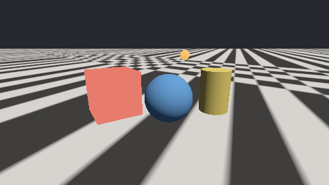

# xrender.mesh.gpu

The mesh pass on a device, through `mlibs.rhi` alone: the same scene, the same extraction and the same shading as [xrender.mesh](..)'s CPU reference, held to it pixel by pixel (the foundation plan's §5.1–§5.3, §5.7, D-184: the CPU is the reference, the GPU the same contract's other path).


```cpp
import xrender.mesh.gpu;

auto pass = *xrender::mesh::gpu::Pass::make(device);
pass.load(assets.meshes);                                        // each mesh's corners, once
mlibs::rhi::CommandList list;
pass.record(list, scene, extracted, view, assets.materials, colour, depth, width, height, options);
device.submit(list);                                             // colour: rgba8, sRGB, as the reference's
```

| | |
|---|---|
| **What it takes** | What the reference takes: `xrender.scene`'s scene and what it extracted for the view, the materials, `xrender.mesh`'s `Options` (ambient, background, fog). A device from whoever made it (SDL_GPU, WebGPU): only the interface is known here |
| **One shader** | `shaders/mesh.slang`, compiled at build time for the target's formats (`mlibs.shader.rules`). Suns, lamps and spots (eight a frame; more are counted as left out), matt surfaces and those with a highlight (the reference's `reflected`, term for term; and what such a surface mirrors of the environment; a polished ball and a gold post under a sky: 5 of 129,600 pixels apart ), a constant light from everywhere, what the surface gives off, fog worked out along the ray, the display's curve. Matrices go a row at a time and are applied by dot products |
| **Held to the reference** | On a backend's device (`xrender.rhi.sdl`'s `mesh_test`): the yard at 480 × 270 on lavapipe — 5 of 129,600 pixels further than 6 levels from the reference, mean difference 0.008 levels; in fog — the sky behind drawn through it along each pixel's ray (`shaders/sky.slang`) — 5 of 129,600 over the whole picture. The bound in the test is a thousandth of the picture and a tenth of a level |
| **The sun's shadows, by a map** | `Shadows`: two textures the caller made (`r32_float` and its depth, 2048² by default) and how far from the eye things are shadowed. The first sun's view of everything that casts — seen by the view or not — is drawn before the frame, over a ball about the near part of the view; a surface lifted two texels along its normal is in shadow where the map saw something nearer. Held to the reference's traced shadows: of 1,002 pixels the rays shadow the map shadows 985, and 71 of 129,600 pixels are further than 6 levels apart — a texel's width along the shadows' edges.  |
| **Lamps' and spots' shadows, by maps** | `Shadows::lamps_map` and `lamps_depth` (an `r32_float` and its depth, 6 × `lamp_size` wide, a row a lamp): six views about each of the frame's first `lamps` lamps and spots — a spot's only where its cone looks — each texel how far the nearest thing is, as a share of the lamp's reach. The mesh shader finds the view a point lies in, lifts the point a texel and a half off its surface, and compares. The yard under a sun, a lamp and a spot (512² a view, 8 views drawn): 8,707 of the 8,732 pixels the reference's rays leave dark are dark, 8,742 in all; 114 of 129,600 pixels further than 6 levels (a line along the shadows' edges) |
| **Frames gathered over time** | The reference's `Temporal` on a device. `Options::jitter` moves a frame's samples (in the light's, the who's and the velocity's passes alike); `record_who` writes which thing is at each pixel — the instance's own id, in an `r32_float` picture — and `record_velocity` how far each pixel's surface moved since the last frame (the pass remembers where everything was; what stood still says exactly 0); `Temporal::record` (`shaders/resolve.slang`) mixes the frame with the last result where the surface was, unless another thing was there, held to what the frame shows about the pixel; how many frames are gathered rides in the result's fourth part. The last result and the last who are the render graph's **histories** (`xrender.graph`): seven textures made once for any number of frames. On lavapipe, sixteen jittered frames of the yard: 11 of 129,600 pixels further than 6 levels from the reference's resolve; the box then moved a long way in one frame (3,539 pixels another thing's): 12 |
| **Textures** | `load_textures(textures)`: each of the reference's `Texture`s as a texture of light (`rgba16_float`) whose levels are the reference's sizes (`mlibs.rhi`'s `TextureDesc::levels`, a level uploaded at a time), and the mesh shader reads it as the reference does: between four texels of a size, between two sizes, by how many texels a pixel covers (the screen's own differences of the texture coordinate) — the size worked out as the reference works it out and named to the device, whose one read between texels and between levels stands for the eight reads a place it took on a sheet. The corners carry the mesh's texture coordinates. At a slant the same places along the pixel's strip as the reference's `over`. The differences are the screen's own, within a pixel's two by two — and the reference takes its differences so, so both take the same places along a strip. A floor of tiles to the horizon: 4 of 129,600 pixels further than 6 levels from the reference's on an RTX 4080 and on lavapipe (588 and 591 while the reference looked from each pixel to the next), 175 on SwiftShader under the page's WebGPU and WebGL2 (19 further than 16) |
| **A picture's edges, its placing, a surface no light changes** | The reference's `Texture::across` and `down` are the sampler a sheet is read through (one of nine, made when first asked for: repeat, mirrored repeat, clamp to edge each way); `Material::placing` is two rows of the draw's uniforms a picture (ten), the first's fourth number the set it goes by; a corner carries both sets and its colour (72 bytes, from 48), the light's stage takes the two sets' differences once and each picture's placing of them, and every stage that cuts out (the who's, the velocity's, the shadows') reads the base picture by its placing and the corner colour's fourth; `Material::unlit` leaves the stage with the base colour times its picture before any light. CTS `mesh.textures` again with the picture mirrored across and stopped down, the floor's material laying it coarser, turned and moved, the box unlit: 4 of 129,600 pixels further than 6 levels from the reference on an RTX 4080 and on lavapipe, 57 on SwiftShader (11 further than 16); and then laid by the floor's second set (its first all 0), coloured red to blue across it, the box cut out where its corners hide less than half: 4 on an RTX 4080, 5 on lavapipe, 31 on SwiftShader.  |
| **The surface's other pictures** | The reference's `surface`, `normal`, `glow` and `shade` pictures, read as it reads them (four more textures a draw, each over the strip a pixel covers). A corner carries the mesh's tangent (all 0: none, and the picture's two ways are worked out at the pixel from how the surface and its texture coordinates go across the screen — taken before any branch, as WebGPU asks). CTS `mesh.surface`: a floor with all of them but the glow, a box with bumps and no tangents, a ball whose roughness, metal and glow are pictures — 7 of 129,600 pixels further than 6 levels from the reference on an RTX 4080, 15 on lavapipe, 318 on SwiftShader under the page's WebGPU and WebGL2 (the floor's mean 0.59 of a level) — 440, 439 and 733 before the reference took its differences as a device does |
| **Lit by a picture of the surroundings** | `load_surroundings(surroundings)`: the reference's `Surroundings` as the device takes it — every square (the picture, it at each roughness, what falls on a matt surface, the shares) on one sheet of light (`rgba16_float`), each with a texel about it that is the texel across its edge, so the shader's one read between four texels is the reference's lookup, edges and all; where each square lies is told in a second block of uniforms. The numbers are the reference's own, made once on the CPU: the device gathers nothing, so there is no second picture of the surroundings that depends on a driver. A way's place in a square is three divisions (an octahedron unfolded) — the same arithmetic as the reference's, with no cube map, on WebGL2 as anywhere. A pixel takes one read for what falls on it and three for what it mirrors (the two roughnesses kept about its own, and its share). `Options::environment.picture` names it; with none loaded the frame is drawn as with no picture and `Stats::about` says 0. The shader that reads it is an entry of its own (`mesh_about_fs`: the pass's shading written once, over how a surface is lit from all about — Slang's interfaces), made at the first `load_surroundings`: a page that never loads one carries none of it (the least page's bytes: Wasm data 239,958 B against a budget of 240,000 — 578 B more than before, the price of the shading written once over an interface, and 42 B from full). Held to the reference (`mesh.about`: the yard's matt floor and box, its polished ball and its gold post under a sky, a ground and a lamp): 4 of 129,600 pixels further than 6 levels on an RTX 4080, 4 on lavapipe, 17 and 17 in headless Chromium on WebGPU and WebGL2. `render/mesh-device-about-1080p` on an RTX 4080: the whole frame with the four panes, lit by a picture 1024 × 512, 2.7 ms at the median and 3.8 ms at p99 against 2.6 and 3.6 with the constant light — 0.1 ms for the picture, nothing allocated (D-187's bound is 8.33). Limit: how well the picture stands for the light followed way by way is the reference's own measure ([xrender.mesh](..)); the squares are not compressed (a 2048 × 1024 photograph: 1.4 million texels, 11 MB of half floats) |
| **The picture behind everything** | The reference's `Environment::behind`: where nothing is drawn, the surroundings' picture along the pixel's own way — the sheet's first square read as the reference reads it, by one triangle over the frame before anything (`sky.slang`'s `sky_about_fs`), through the fog as the background is. Held by `mesh.about`: 4 of 129,600 pixels further than 6 levels from the reference on an RTX 4080 with 34,080 pixels of the frame the picture |
| **Light kept between small faces** | The reference's `kept`: its table of shares (32 × 32, an `rgba16_float` of 8 KB made with the pass) is bound at the fragment stage's slot 10 for every lit draw, read between four entries as the reference reads it, and multiplies a light's highlight and what is mirrored of a picture of the surroundings (whose sheet is at slot 11); under a picture the mirrored way leans toward the normal by the roughness to the fourth, as the reference's does. Held by the suite's cases as they were: on an RTX 4080 the yard with its polished ball and gold post 4 of 129,600 pixels further than 6 levels from the reference, lit by a picture 4, the harbour 350; on lavapipe 5 and 350. The frame's cost on an RTX 4080 with it (`tests/bench`, 1080p): the yard 2.24 ms at the median and 3.48 ms at p99 (2.23 and 3.28 before), with the four panes 2.57 and 3.93, lit by a picture 2.69 and 3.90, nothing allocated (D-187's bound is 8.33) |
| **Glow** | `Pass::make(device, reversed, true)` draws onto an `rgba16_float` target and leaves the light as it is, before the display's curve; `Glow::record(list, light, one, other, colour, width, height, bloom)` is the reference's `Glow` in seven passes — what is above the threshold spread along the rows and down the columns three times between two pictures of the caller's, then the light and what spread through the curve onto `colour` (`shaders/glow.slang`; texels read one for one). The yard with a lamp of (9, 5, 1.6) on lavapipe: lighter by the glow over 6,943 pixels (the reference: 6,996), 5 of 129,600 further than 6 levels from the reference's; with no radius, the plain pass's picture; through the reference's `Tone` (half the exposure, the filmic curve) 5 of 129,600.  |
| **How open a place is** | The reference's `Options::occlusion_rays`, from what the eye sees. `record_surface` draws the surface at each pixel (an `rgba16_float`: the normal folded onto a square, how far from the eye in two parts); `Open::record` sends each pixel's rays about its normal and steps them through that picture (12 steps a ray, nearer ones closer together, each ray begun at its own place in a step), a ray shut where a step lies behind what the eye sees there by more than the picture's grain and less than a thing is thick; the mesh pass, handed the result as `Shadows::open`, scales the light from everywhere as the reference does. On lavapipe, the yard under that light alone, 32 rays to 1.5: a block of 15 × 15 pixels is 0.27 levels from the reference's with it and 1.69 without (worst 5.3); the reference darkens a block by 1.69 levels on the whole, the device by 1.45; every one of the 65 blocks the reference darkens by over 4 levels, the device darkens. The same picture each time for a seed.  |
| **Its contract, on every backend** | [cts](cts) (`xrender.mesh.gpu.cts`): the cases above as a suite a backend's device is held to — eleven cases, all passing on lavapipe through SDL_GPU, on the page's WebGPU and on the page's WebGL2 (headless Chromium), with what each measured |
| **A package of its own** | Not `xrender.mesh`'s feature: its build program compiles a shader, and a build program's imports are not conditional on a feature (D-99; as `mlibs.rhi.cts`) |

**The harbour at night** — the reference's scene ([xrender.mesh](..)): three lamps, a spot and a faint moon, all five with shadows by maps (20 views of the lamps', 12 casters in the moon's), a wet quay, fog, the globes' glow — on lavapipe 351 of 129,600 pixels (0.27%) further than 6 levels from the reference's traced picture, mean difference 0.15 levels:


## Agent surface

Part of [xrender.frame](../../frame)'s (`agent = { part = "xrender.frame" }`): the picture it draws is a texture of the device, read back as pixels by the frame's own operations.

| | |
|---|---|
| Numbers | `Pass::last()`: draws, draws naming nothing loaded, triangles, lamps and lamps left out, casters in the sun's map, lamps with shadows and the views drawn for them |
| Source | `record_ids`: a pass of its own on an `r32_uint` target — each pixel the place of its draw in the frame's draws (`who(pixels, width, x, y)`), from which the scene gives the instance's stable id. On lavapipe 4 of 129,600 pixels name another draw than the reference's id buffer (an edge's). The triangle under a point is `xrender.mesh`'s `pick`, by a ray |

## The far cut

What lies beyond the view's far plane is cut at each pixel, not by the device's far plane: the pass draws through a projection whose far plane lies beyond the view's (what the eye sees keeps half of the depth's range) and a pixel whose own depth is past the half is not drawn — in the colour pass and in the ids', who's, surface's and velocity's alike, so their pictures cover the same pixels. A device cuts a triangle at its far plane as exactly as it chooses: on Apple's paravirtual device the far edge of the yard's floor fell on a row of the picture differently in one to three frames of sixteen jittered ones (183 pixels of row 70 in the frames gathered, 10 to 19 levels off; red 74), while the same row in a still frame matched. A pixel's depth is worked out at the pixel on every device, as the reference works out its cut. The depth target the pass leaves holds the view in half of its range (0 to 0.5; reversed, 0.5 to 1).

## Not yet

- **Several targets a pass**: who and the velocity are one drawing of the scene where the device has two colour targets a pass (`record_velocity_and_who`; the two passes where it has one — the same bytes either way, CTS `mesh.velocity-who`); the ids and the surface are still a pass each; normals and the triangle of a pixel are not drawn.
- **Shadows' cost**: a map is drawn again each frame whether or not anything moved (what a light's view cannot hold is left out, cluster by cluster).
- **The near cut** is the device's own near plane still; the far cut is every pixel's own (below).
- **The device's own filtering at a slant**: a pixel's strip is still up to eight places taken by the shader, each one read of the texture's levels; the device's own filter along a strip is not in `mlibs.rhi`.
- **Faces by winding**: the interface has no culling state; a face turned away is discarded by its normal in the shader.
- **Seen from both sides, cut out by a picture** (`Material::two_sided`, `cutout`, `opacity`): the colour pass turns a two-sided surface's normal to the eye instead of discarding it, and discards a pixel where the surface hides less than the cut — its picture's cover over the strip the pixel covers, read as the reference reads it (a picture's cover rides in the fourth number of its sheet, the light already times it). The passes that draw no colour ask the same questions the same way: `use(materials)` gives them the materials (who drew each pixel, the surface, the velocity — the same pixels left out, 0 differing between the pass that names draws and the one that names instances), and a light's views leave out of the map what the caster's material cuts out, by the cover between the four texels of the finest size, as the reference's ray asks it. Suite case `mesh.cut` — two fences of pickets, one seen from behind, their shadows by the sun's map against the reference's rays: 6 of 129,600 pixels name another draw and 138 are further than 6 levels on an RTX 4080 (mean 0.13 of a level), 6 and 139 on lavapipe, 26 and 172 in headless Chromium on WebGPU and on WebGL2.
- **What the eye does not see shuts nothing**: a ray is stepped through the picture of the frame, so the far side of a thing, and things off the picture or behind others, do not darken (the device darkens the yard by 1.45 levels a block where the reference's rays darken it by 1.69). Rays through the scene itself on a device are D-184's step d.
- **Seen through** (`Material::see_through`, `Layers`): the reference lays a pixel's see-through surfaces over one another by their depths; a device draws triangles in the order they are given. Here they are peeled: after the frame, how deep what stops the eye is goes into a picture (`behind`; the interface reads no depth target), then `Layers::count` times (4) every see-through draw is drawn again with a depth test of its own, each pixel keeping the nearest surface that is farther than the layer before and nearer than what stops the eye — its light times what it hides, and its depth for the next layer — and the layer is put *under* the ones before it (the target takes of it what they have not yet hidden); at the end all of them go over the frame's light, which keeps what they let through. A layer is drawn by the frame's own fragment shader, told by a uniform that it draws a layer (a second copy of it for the layers put 51 KB more of shader text into a page's Wasm than one shader with a second output that a frame's pass does not take). The result is the reference's order whatever order the draws come in, panes that cross included, exact for a pixel's nearest `count`; one more than that over a pixel and the farthest are not there. Chosen in D-185's order: what is ours first — the layers are held to a reference that names each pane's share of a pixel — then research: depth peeling (Everitt 2001) with the layers gathered from the front (the under operator), because it is exact and runs on every backend with what `mlibs.rhi` already has — two colour targets a pass, blending the first target only on full-screen passes (WebGL2 blends every target of a pass alike). Weighted blended transparency (McGuire and Bavoil 2013) is one pass but approximate: its picture depends on a weight function and cannot be held to the reference; a pixel's own list (an A-buffer) is exact with no `count` but needs storage buffers and atomics, which WebGL2 has not. Sorting whole things by distance — the common practice — is wrong where panes cross or overlap in turn. Suite case `mesh.through` — four panes before the yard, up to four over one another, given neither from the front nor from the back (the farthest, the nearest, then the two between), one thinning across its picture: without shadows 4 of 129,600 pixels further than 6 levels on an RTX 4080 and on lavapipe (mean 0.009 of a level), 35 in headless Chromium on WebGPU and on WebGL2, and **0 of the 23,962 pixels away from every edge** on all four, behind one pane, two, three and four alike; with the sun's shadows by its map 94 (122 in the browsers), the differences a shadow's edge on a pane. With one layer a pixel keeps its nearest pane; the pass that names who stops the eye never names a pane. Cost, measured (`render/mesh-device-panes-1080p`, an RTX 4080, 1920 × 1080, four panes each most of the picture across): 2.6 ms a frame at the median and 3.9 ms at p99, against 2.2 and 3.4 without the panes — 0.4 ms for the ten more passes, nothing allocated (D-187's bound is 8.33). Limits: a pass of light only (`Pass::make`'s `light`; into a target of display bytes they are drawn whole, counted in `Stats::through_whole`); `count` layers are always drawn (the device is not asked whether a layer came out empty); what stops the eye is drawn once more for `behind` (it could ride in the velocity's pass as a third target); the shares a pixel's panes have are the reference's to say, not read back from the device.
- **Light through a surface** (`Material::transmission`, `thickness`, `attenuation`, `ior`; `Stats::glass`, `behind_sizes`): where the target holds the light itself, what is whole is drawn first (its depth kept), its light is kept at every size on one sheet — the finest at the corner, the others in a column beside it, each made by a pass into a scratch texture and copied to its square (no render-to-level in `mlibs.rhi`) — and the surfaces that let light through are drawn after, reading it where the eye's ray, bent in, leaves (`mesh.slang`'s `transmitted`, `behind.slang`). A thin wall reads straight behind, as the reference does. For a solid (`thickness` over 0) two more passes come first: how far what is whole is at each pixel, and the solid's far sides — the nearest face turned away, its normal and distance (ids.slang's `surface_fs`, `solid_fs`; read through the colour pass's slots 8 and 9, which it leaves unused, so WebGL2's 16 samplers hold). The way through is Wyman's image-space refraction (2005): the far side met along the bent ray (the eye's distance to it read where the ray is, four times over), bent out by its normal, mirrored back in where it cannot leave (twice at most); the way out is walked over the frame against what is whole (24 growing steps, a crossing counted only within the step it took, five halvings), off the frame or never crossing it goes to the surroundings. The reference follows the same way exactly through the mesh's tree, so the estimate is measured, not trusted. Suite case `mesh.glass` (an amber pane and a ball of glass before the yard): elsewhere 3 of 129,600 pixels further than 6 levels and none of the pane's 6,991, on an RTX 4080 and on lavapipe; the ball 688 of 3,674 (18.7%, mean 11.9 levels) — read at the straight exit it was 69.3%, mean 46.2 (red 87 for the rest). Into a target of display bytes such a surface lets nothing through.
- **Clusters**: the colour pass and the ids', who's, surface's and velocity's passes leave out a cluster outside the view or wholly facing away, as the reference does (`Options::cull_clusters`; the clusters that follow one another are one draw call; `Stats::clusters`, `clusters_outside`, `clusters_away`, `runs`) — on the CPU, a draw at a time, and no pixel changes (the yard: 6,092 triangles where every cluster is 8,172, the same bytes). A light's view — the sun's map, each face of a lamp's six — leaves out the clusters outside it alone: both sides of what casts are in a map, so none is left out for facing away (`Stats::shadow_clusters`, `shadow_clusters_outside`, `shadow_runs`, `shadow_triangles`; the yard's eight views: 15,548 triangles where every cluster is 37,836, and not a texel of a map differs). Leaving out on the device itself and levels of detail are RN5's.

```sh
tools/ci/gpu.sh            # a device for this machine (lavapipe on Linux)
mcpp test -p xrender.rhi.sdl mesh_test
```
