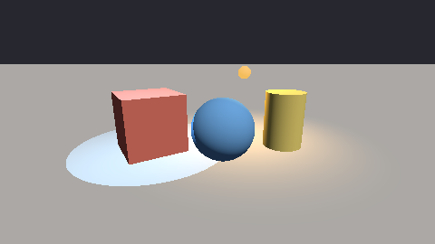
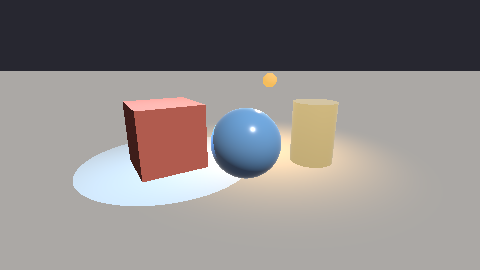
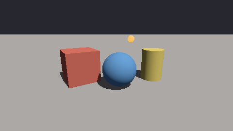
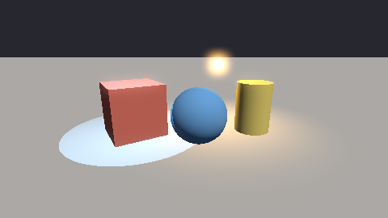
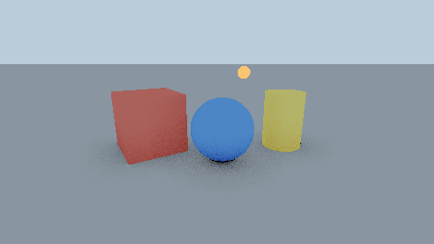
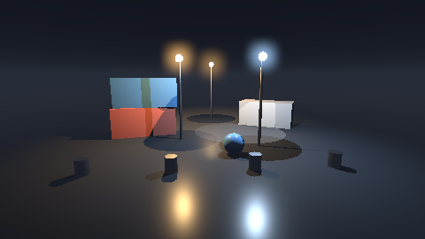

# xrender.mesh.gpu

The mesh pass on a device, through `mlibs.rhi` alone: the same scene, the same extraction and the same shading as [xrender.mesh](..)'s CPU reference, held to it pixel by pixel (the foundation plan's §5.1–§5.3, §5.7, D-184: the CPU is the reference, the GPU the same contract's other path).



```cpp
import xrender.mesh.gpu;

auto pass = *xrender::mesh::gpu::Pass::make(device);
pass.load(assets.meshes);                                        // each mesh's corners, once
mlibs::rhi::CommandList list;
pass.record(list, scene, extracted, view, assets.materials, colour, depth, width, height, options);
device.submit(list);                                             // colour: rgba8, sRGB, as the reference's
```

| | |
|---|---|
| **What it takes** | What the reference takes: `xrender.scene`'s scene and what it extracted for the view, the materials, `xrender.mesh`'s `Options` (ambient, background, fog). A device from whoever made it (SDL_GPU, WebGPU): only the interface is known here |
| **One shader** | `shaders/mesh.slang`, compiled at build time for the target's formats (`mlibs.shader.rules`). Suns, lamps and spots (eight a frame; more are counted as left out), matt surfaces and those with a highlight (the reference's `reflected`, term for term; and what such a surface mirrors of the environment; a polished ball and a gold post under a sky: 5 of 129,600 pixels apart ), a constant light from everywhere, what the surface gives off, fog worked out along the ray, the display's curve. Matrices go a row at a time and are applied by dot products |
| **Held to the reference** | On a backend's device (`xrender.rhi.sdl`'s `mesh_test`): the yard at 480 × 270 on lavapipe — 5 of 129,600 pixels further than 6 levels from the reference, mean difference 0.008 levels; in fog — the sky behind drawn through it along each pixel's ray (`shaders/sky.slang`) — 5 of 129,600 over the whole picture. The bound in the test is a thousandth of the picture and a tenth of a level |
| **The sun's shadows, by a map** | `Shadows`: two textures the caller made (`r32_float` and its depth, 2048² by default) and how far from the eye things are shadowed. The first sun's view of everything that casts — seen by the view or not — is drawn before the frame, over a ball about the near part of the view; a surface lifted two texels along its normal is in shadow where the map saw something nearer. Held to the reference's traced shadows: of 1,002 pixels the rays shadow the map shadows 985, and 71 of 129,600 pixels are further than 6 levels apart — a texel's width along the shadows' edges.  |
| **Lamps' and spots' shadows, by maps** | `Shadows::lamps_map` and `lamps_depth` (an `r32_float` and its depth, 6 × `lamp_size` wide, a row a lamp): six views about each of the frame's first `lamps` lamps and spots — a spot's only where its cone looks — each texel how far the nearest thing is, as a share of the lamp's reach. The mesh shader finds the view a point lies in, lifts the point a texel and a half off its surface, and compares. The yard under a sun, a lamp and a spot (512² a view, 8 views drawn): 8,707 of the 8,732 pixels the reference's rays leave dark are dark, 8,742 in all; 114 of 129,600 pixels further than 6 levels (a line along the shadows' edges) |
| **Frames gathered over time** | The reference's `Temporal` on a device. `Options::jitter` moves a frame's samples (in the light's, the who's and the velocity's passes alike); `record_who` writes which thing is at each pixel — the instance's own id, in an `r32_float` picture — and `record_velocity` how far each pixel's surface moved since the last frame (the pass remembers where everything was; what stood still says exactly 0); `Temporal::record` (`shaders/resolve.slang`) mixes the frame with the last result where the surface was, unless another thing was there, held to what the frame shows about the pixel; how many frames are gathered rides in the result's fourth part. The last result and the last who are the render graph's **histories** (`xrender.graph`): seven textures made once for any number of frames. On lavapipe, sixteen jittered frames of the yard: 11 of 129,600 pixels further than 6 levels from the reference's resolve; the box then moved a long way in one frame (3,539 pixels another thing's): 12 |
| **Textures** | `load_textures(textures)`: each of the reference's `Texture`s as a texture of light (`rgba16_float`) whose levels are the reference's sizes (`mlibs.rhi`'s `TextureDesc::levels`, a level uploaded at a time), and the mesh shader reads it as the reference does: between four texels of a size, between two sizes, by how many texels a pixel covers (the screen's own differences of the texture coordinate) — the size worked out as the reference works it out and named to the device, whose one read between texels and between levels stands for the eight reads a place it took on a sheet. The corners carry the mesh's texture coordinates. At a slant the same places along the pixel's strip as the reference's `over`. A floor of tiles to the horizon on lavapipe: 591 of 129,600 pixels (0.46%) further than 6 levels from the reference's, 8 further than 16 (588 and 8 on an RTX 4080; the same counts as with eight reads a place) — where the count of places steps, the device's differences (taken over two pixels by two) step a pixel away from the reference's |
| **The surface's other pictures** | The reference's `surface`, `normal`, `glow` and `shade` pictures, read as it reads them (four more textures a draw, each over the strip a pixel covers). A corner carries the mesh's tangent (all 0: none, and the picture's two ways are worked out at the pixel from how the surface and its texture coordinates go across the screen — taken before any branch, as WebGPU asks). CTS `mesh.surface`: a floor with all of them but the glow, a box with bumps and no tangents, a ball whose roughness, metal and glow are pictures — 440 of 129,600 pixels further than 6 levels from the reference on an RTX 4080 (mean 0.20 of a level), 439 on lavapipe, 733 on SwiftShader under the page's WebGPU and WebGL2 (mean 0.50) |
| **Glow** | `Pass::make(device, reversed, true)` draws onto an `rgba16_float` target and leaves the light as it is, before the display's curve; `Glow::record(list, light, one, other, colour, width, height, bloom)` is the reference's `Glow` in seven passes — what is above the threshold spread along the rows and down the columns three times between two pictures of the caller's, then the light and what spread through the curve onto `colour` (`shaders/glow.slang`; texels read one for one). The yard with a lamp of (9, 5, 1.6) on lavapipe: lighter by the glow over 6,943 pixels (the reference: 6,996), 5 of 129,600 further than 6 levels from the reference's; with no radius, the plain pass's picture; through the reference's `Tone` (half the exposure, the filmic curve) 5 of 129,600.  |
| **How open a place is** | The reference's `Options::occlusion_rays`, from what the eye sees. `record_surface` draws the surface at each pixel (an `rgba16_float`: the normal folded onto a square, how far from the eye in two parts); `Open::record` sends each pixel's rays about its normal and steps them through that picture (12 steps a ray, nearer ones closer together, each ray begun at its own place in a step), a ray shut where a step lies behind what the eye sees there by more than the picture's grain and less than a thing is thick; the mesh pass, handed the result as `Shadows::open`, scales the light from everywhere as the reference does. On lavapipe, the yard under that light alone, 32 rays to 1.5: a block of 15 × 15 pixels is 0.27 levels from the reference's with it and 1.69 without (worst 5.3); the reference darkens a block by 1.69 levels on the whole, the device by 1.45; every one of the 65 blocks the reference darkens by over 4 levels, the device darkens. The same picture each time for a seed.  |
| **Its contract, on every backend** | [cts](cts) (`xrender.mesh.gpu.cts`): the cases above as a suite a backend's device is held to — eleven cases, all passing on lavapipe through SDL_GPU, on the page's WebGPU and on the page's WebGL2 (headless Chromium), with what each measured |
| **A package of its own** | Not `xrender.mesh`'s feature: its build program compiles a shader, and a build program's imports are not conditional on a feature (D-99; as `mlibs.rhi.cts`) |

**The harbour at night** — the reference's scene ([xrender.mesh](..)): three lamps, a spot and a faint moon, all five with shadows by maps (20 views of the lamps', 12 casters in the moon's), a wet quay, fog, the globes' glow — on lavapipe 351 of 129,600 pixels (0.27%) further than 6 levels from the reference's traced picture, mean difference 0.15 levels:



## Agent surface

Part of [xrender.frame](../../frame)'s (`agent = { part = "xrender.frame" }`): the picture it draws is a texture of the device, read back as pixels by the frame's own operations.

| | |
|---|---|
| Numbers | `Pass::last()`: draws, draws naming nothing loaded, triangles, lamps and lamps left out, casters in the sun's map, lamps with shadows and the views drawn for them |
| Source | `record_ids`: a pass of its own on an `r32_uint` target — each pixel the place of its draw in the frame's draws (`who(pixels, width, x, y)`), from which the scene gives the instance's stable id. On lavapipe 4 of 129,600 pixels name another draw than the reference's id buffer (an edge's). The triangle under a point is `xrender.mesh`'s `pick`, by a ray |

## The far cut

What lies beyond the view's far plane is cut at each pixel, not by the device's far plane: the pass draws through a projection whose far plane lies beyond the view's (what the eye sees keeps half of the depth's range) and a pixel whose own depth is past the half is not drawn — in the colour pass and in the ids', who's, surface's and velocity's alike, so their pictures cover the same pixels. A device cuts a triangle at its far plane as exactly as it chooses: on Apple's paravirtual device the far edge of the yard's floor fell on a row of the picture differently in one to three frames of sixteen jittered ones (183 pixels of row 70 in the frames gathered, 10 to 19 levels off; red 74), while the same row in a still frame matched. A pixel's depth is worked out at the pixel on every device, as the reference works out its cut. The depth target the pass leaves holds the view in half of its range (0 to 0.5; reversed, 0.5 to 1).

## Not yet

- **Several targets a pass**: who and the velocity are one drawing of the scene where the device has two colour targets a pass (`record_velocity_and_who`; the two passes where it has one — the same bytes either way, CTS `mesh.velocity-who`); the ids and the surface are still a pass each; normals and the triangle of a pixel are not drawn.
- **Shadows' cost**: a map is drawn again each frame whether or not anything moved (what a light's view cannot hold is left out, cluster by cluster).
- **The near cut** is the device's own near plane still; the far cut is every pixel's own (below).
- **The device's own filtering at a slant**: a pixel's strip is still up to eight places taken by the shader, each one read of the texture's levels; the device's own filter along a strip is not in `mlibs.rhi`.
- **Faces by winding**: the interface has no culling state; a face turned away is discarded by its normal in the shader.
- **What the eye does not see shuts nothing**: a ray is stepped through the picture of the frame, so the far side of a thing, and things off the picture or behind others, do not darken (the device darkens the yard by 1.45 levels a block where the reference's rays darken it by 1.69). Rays through the scene itself on a device are D-184's step d.
- **Clusters**: the colour pass and the ids', who's, surface's and velocity's passes leave out a cluster outside the view or wholly facing away, as the reference does (`Options::cull_clusters`; the clusters that follow one another are one draw call; `Stats::clusters`, `clusters_outside`, `clusters_away`, `runs`) — on the CPU, a draw at a time, and no pixel changes (the yard: 6,092 triangles where every cluster is 8,172, the same bytes). A light's view — the sun's map, each face of a lamp's six — leaves out the clusters outside it alone: both sides of what casts are in a map, so none is left out for facing away (`Stats::shadow_clusters`, `shadow_clusters_outside`, `shadow_runs`, `shadow_triangles`; the yard's eight views: 15,548 triangles where every cluster is 37,836, and not a texel of a map differs). Leaving out on the device itself and levels of detail are RN5's.

```sh
tools/ci/gpu.sh            # a device for this machine (lavapipe on Linux)
mcpp test -p xrender.rhi.sdl mesh_test
```
