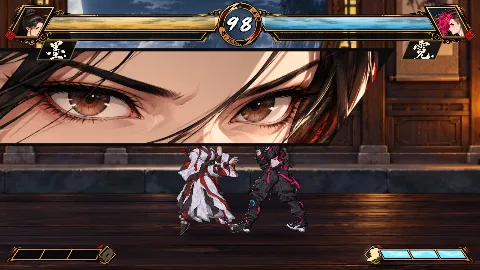

# 格斗游戏 — the fighting game

`omui-fight` is gongfu's match (`mgame/gongfu`) on openmui's stage: two fighters at 60 frames a second, from the keyboard or an agent, drawn in 2D by `gongfu.present2d`, with a training mode that shows every box and a frame meter (D-85 §8.7). Its working title is 拳意. It opens on a title and a select screen. Six fighters, chosen there or by the stage's `player1` and `player2` properties:
- Kata, the training fighter;
- the five designed ([characters design](../../.agents/docs/2026-10-28-gongfu-characters-design.md), [characters design 2](../../.agents/docs/2026-10-28-gongfu-characters-2-design.md)): 墨 (Mo), the ink brush-staff fighter — keep-away with waves of ink and a long reach (her art generated and skinned on bones: the [art pipeline](../../.agents/docs/2026-10-29-fighting-art-pipeline-design.md)); 霓 (Ni), the street fighter — rushdown; 璃 (Li), glass — set-ups with panes; 岳 (Yue), the giant — throws and armour; 刻 (Ke), time — rewinds and a clone.

How it was made, layer by layer, and what making it taught: [dev story](dev-story.md). The bar it is held to: [quality design](../../.agents/docs/2026-10-29-fighting-indie-quality-design.md).



```sh
mcpp run -p openmui.showcase.fighting
mcpp run -p openmui.showcase.fighting -- --training
mcpp run -p openmui.showcase.fighting -- --headless --png fight.png
```

| | Directions | Punches (L M H) | Kicks (L M H) |
|---|---|---|---|
| Player 1 | W A S D | U I O | J K L |
| Player 2 | ← ↑ → ↓ | Insert Home PageUp | Delete End PageDown |

- **The title and the select screen** come before the fight (the `select` component, `src/select.cpp`):
  - the title offers 对战 (versus) and 训练 (training);
  - on the select screen each player's cursor moves over the roster's tiles; a big lit preview of whom it rests on plays their idle, under their name in calligraphy;
  - behind it all, the home stage of whom player 1 is on pans slowly;
  - both ready, VS has its moment and the fight starts on player 1's home. A round over, the select screen comes back with the same fighters under the cursors.

  The main theme plays under them, rising as the players choose, with a cue for each move and choice. It fades under the VS; the fight's theme ends with its round.

  The keys are the fight's (player 1 U confirms and J goes back, player 2 Insert and Delete), and a gamepad's south confirms and east goes back. An agent uses the same screen through its `move`, `confirm` and `back` actions. Its art (`hud/menu-*.webp`) was generated and keyed like the HUD's.
- **Fighters are files** built into the program, in the formats a mod will use:
  - `fighters/<name>.fighter.gongfu.toml` is what the fighter does (`gongfu.data`);
  - `fighters/<name>.look.gongfu.toml` is how it looks and how its hits feel (`gongfu.present2d`): palettes for the two sides, bones, parts, clips and impact profiles.
  - `fighters/<name>.boxes.gongfu.toml` holds its hurtboxes, baked from the look's animation by `gongfu-studio bake`. The build (`gongfu.rules`) refuses a stale one, and training draws them: a jab's arm can be hit.

  A file that does not read appears in the stage's semantic value with the problem's line and column; the program doesn't crash.
- **The fight is heard** (`openmui.audio`). Each impact profile in a look names its sounds — attack, body, tail — from `sounds/fight.sound.omui.toml`.
  - The library has shared thuds, cracks, blocks and booms, and each fighter's own: ink for 墨, neon for 霓, glass for 璃, the mountain for 岳, the clock for 刻.
  - Sounds play on the frame the simulation made them, panned by where on the stage and louder for more damage. A super's flash has its sweep.
  - `omui-fight` hears them through the system's output (`openmui.audio.device`); headless or with `--quiet`, nothing is heard.
  - The fighters have voices (CC0 takes processed into each, in `voice/`): the struck cry out under a heavy blow or a counter, a breath apart; 坤 strains with his heavy blows; a K.O. is a fall.
  - An announcer calls the round: "fight", "time", the winner, a flawless victory or a tie (Kenney's CC0 Voiceover Pack: Fighter, in `voice/`, played through `openmui.audio`'s recording layers).
  - Offline, each sound starts on its frame's very sample, so a match's sound is as determined as its pixels: the tests pin a fight's audio and write it as a WAV.
- **The match runs on the runtime's clock.** A timer plays every frame that is due: a late frame catches up, and a stall of more than four frames is skipped, not replayed. Headless, a second is exactly 60 frames. Pausing is a property. While paused, `step` plays one frame.
- **An agent plays through the stage's actions:**
  - `press` holds a pad written in numpad notation (`6`, `2LK`, `5LP+LK`) until the next press; `release` gives the keyboard back.
  - The stage's semantic value is the match as an agent follows it: the frame, the seconds left, and each fighter's name, health, combo, position and what it is doing (`idle`, `walk_forward`, `5LP`, `hitstun`, …).
- **Training** (`mode = "training"`) adds, from `gongfu.training`:
  - the push, hurt, throw and active hit boxes of the current frame, lined up with the picture's camera (shake included);
  - the frame meter: the last 80 frames of each player, hitstop not counted;
  - each player's input history, with arrows, the buttons' colours and the frames each pad was held;
  - the readings under the timer: player 1's startup, the frame advantage and the combo's hits and damage;
  - actions to save and load a state, and to record a player and replay the recording looped (the dummy).

  Agents read the same values in the semantic value's `training`.
- **The HUD is black lacquer, gold leaf and a red seal.** Generated art is cut by `gongfu-studio` into frames, lettering, the names' calligraphy and fills (`hud/`). It shows:
  - portraits and brush-textured health with the recent damage draining in red;
  - posture, the super meter's three chambers and its level;
  - the timer in a medallion;
  - combo counts, COUNTER and PUNISH COUNTER, K.O.

  It is a pure function of the match, so a rollback draws it again the same. Training's tools still use seven-segment numbers and a few words shaped once.
- **Stages are painted in layers.** Each home stage has five generated, keyed layers (`stages/art/`) placed by parallax in its stage file: far, the back wall, the floor, the props at its ends, and the foreground.
  - 墨's study at night: a moon gate open on ink-wash mountains.
  - 霓's neon alley in the rain.
  - 坤's rooftop at blue hour.

  `gongfu-studio stage` previews a stage with two fighters for scale.

`tests/select_test.cpp` covers the menus: the title's modes, choosing by keys and by gamepad, and the title and the select screen with pinned pixels. `tests/sound_test.cpp` covers what the game sounds like, each with pinned sound: the menus' music and cues, the announcer's calls, and the fighters' voices. `tests/fighting_test.cpp` covers:
- the roster read;
- 60 frames a second on the clock, exactly;
- the keyboard walking both players;
- pause and step;
- an agent walking in and landing a jab, which the semantic value reports;
- training's readings as an agent reads them (a blocked jab is +3, a jab cancelled into a fireball is a combo of 900);
- a saved state coming back, and the dummy replaying a recorded walk exactly;
- the versus and training frames at the jab's active frame, with pinned pixels;
- 墨 as designed: every normal's, ink wave's and anti-air's startup and its advantage on hit and on block, measured in the simulation against the design's table.
