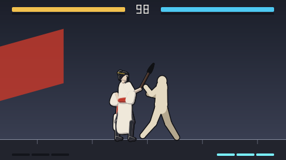

# Dev story — the fighting game

How `omui-fight` was made, told from the developer's side: what was built, at which layer, with which of the framework's capabilities, and how fast it runs. It ends with a self-review: what was awkward, what is missing, and what generalises. The quality bar the game is held to, with an honest grade of where it stands today, is in [the fighting game's quality design](../../.agents/docs/2026-10-29-fighting-indie-quality-design.md).

## 1. What we set out to make

A serious 2D fighting game, minimal but not a toy: five designed fighters, each with its own way of winning and its own feel, plus Kata, the training dummy. Systems a fighting-game player recognises: cancels, throws, a posture meter that breaks, Sekiro-style clashes where two attacks meet, and supers at one, two and three bars, the third with a cinematic. A training mode with boxes, a frame meter and recordable dummies. Rollback netcode. It is also a showcase (D-63): each fighter shows one capability of the engine, in the place where it belongs in the game.

## 2. The layers

The game is the top of a stack, and every layer below it is usable without the one above. Nothing was pushed down a layer for the game's convenience, and nothing general was written inside the game.

| Layer | Package | What it is | Depends on |
|---|---|---|---|
| Fighting framework, core | `mgame/gongfu` (`gongfu`) | The match as a pure function: state, rules, frame data, Q16.16 fixed point | the standard library only (it can leave the repository unchanged) |
| Fighting framework, data | `gongfu.data`, `gongfu.rules` | Fighter files (`*.fighter.gongfu.toml`) read and checked with located diagnostics; the build rule that bakes hurtboxes and embeds fighters | gongfu, toml++ |
| Fighting framework, presentation | `gongfu.present2d` | A frame of a match drawn: skeletons, looks, sparks, cinematics | gongfu, `openmui.render.vector`, hanim |
| Fighting framework, tools | `gongfu.training`, `gongfu.ai`, `gongfu.studio` | Readouts and dummies; seeded bots; bake, check, contact sheets, the balance report | the above |
| Game engine services | `mgame.net`, `mgame.sim`, `mgame.input` | Rollback netcode, timelines, input sampling | the standard library, openmui for the UI glue |
| Independent components | `openmui.audio`, `openmui.render.vector`, `hanim`, `openmui.image` | Sound, vector rendering, animation, images | the standard library, each other |
| UI framework | openmui | The stage as a component, its semantic node, its actions, the window | — |
| The game | `showcase/fighting` | The stage, the HUD, the sound library, the roster, the fighters' files | all of the above |

The rule we kept to: **general systems below, specialised systems in the middle, the application on top.** The stage needed a picture turned grey for 刻's time stop. `DisplayList::recolor` went into the vector renderer, because recolouring a range of drawn commands is a renderer capability. It did not go into the game as a special case. The same applies to `DisplayList` clipping and transforms used by the cinematics.

## 3. How each part was built

### The match: deterministic, rollback-ready

- The state is one plain struct (`gongfu::State`), copied to save and hashed to compare. Numbers are Q16.16 fixed point, so the match is the same bytes on GCC, LLVM, ARM and wasm. The tests pin the hashes of whole recorded matches on every platform.
- A frame is `step(state, pads) → state`. Nothing outside the state matters: no clocks, no allocation, no virtual calls, so rolling back 8 frames is just copying and stepping again.
- The rules arrived as numbered requirements from the character designs (G-1 … G-22, P-1 … P-8). Each has a test in `mgame/gongfu/tests` and a hash in the rollback run.

### Fighters as data

- A fighter is three files: `*.fighter.gongfu.toml` (moves, frame data, cancels, supers), `*.look.gongfu.toml` (bones, palettes, keyframed clips, impacts, cinematics), and the generated `*.boxes.gongfu.toml` (hurtboxes baked from the animation).
- The build rule (`gongfu.rules`) embeds all three in the program and refuses a stale bake, naming the command to run. Animation and collision cannot drift apart.
- Frame data is measured, not trusted: the tests play each move in the simulation and compare startup, active, recovery and advantage with what the file declares.

### Presentation: a pure function of the match

- `gongfu.present2d` draws a frame from `(state, frame)` alone. Sparks are seeded by the event's frame and entity, and cinematics are timelines keyed to the lock's frame. Rollback therefore never saves any presentation state, and a replay renders identically.
- Everything is vector (`openmui.render.vector`), so any resolution is sharp and the headless host renders exact, pinnable pixels. The cinematics (墨's 永 written stroke by stroke, 璃's panes, 刻's stopped clock) are the same machinery: paths, gradients, clips, transforms and hanim curves.
- 墨's projectile is a character being written. That is glyph-level animation from openmui's text stack (`glyph_motion`), used because a calligrapher's projectile should be a character, not as a demo.

### The stage as an openmui component

- The stage is a contract-first component (`contract/stage.contract.omui.toml`): its props, events and actions are generated, and the same actions serve the keyboard, an agent (`press`, `step`, `fill` …) and the tests.
- Its semantic node states the match: health, posture, meter, what each fighter is doing, and the training readouts. An agent can play from that, and the tests assert against the same thing a screen reader would read.
- The match runs at exactly 60 Hz on the runtime's clock. The headless clock is virtual, so a headless second is exactly 60 frames, and tests are exact.

### Sound

- `sounds/fight.sound.omui.toml` is a library of synthesised sounds: thuds, cracks, glass, ink, neon, a temple bell, a clock. Each fighter's look names the sounds of its impacts (attack, body, tail).
- `openmui.audio` mixes them sample-accurately with no libm and no floating-point contraction. An offline render of a match's sound is the same bits on GCC and LLVM, pinned in a test. The device (`openmui.audio.device`, miniaudio) only plays what the mixer renders.

### Balance and the AI

- `gongfu.ai` reads a fighter's kit from its data (pokes by reach, anti-airs, projectiles, throws) and plays it with a 14-frame reaction, seeded.
- `gongfu-studio versus` plays every pair for hundreds of rounds and reports win rates and where each fighter's damage comes from. Those numbers drove the first balance pass (characters design 2, §9.5), and the tests hold the result as gates on every run.

## 4. Performance

| What | Measured | How |
|---|---|---|
| A frame of the match | well under a microsecond | `tests/bench`, budgets in `budgets.bench.omui.json` |
| Rollback, 8 frames | 196 ns a frame, nothing allocated | the rollback bench |
| Sound, 48 voices | about 0.045 ms per 128-frame block (budget 0.5 ms) | `audio/mix-48` |
| Determinism | the same match hash on six platforms; the same pixels on GCC and LLVM | pinned in the tests |

What made it fast is mostly what made it deterministic: plain data, no allocation in a frame, no virtual calls on the hot path, fixed point. Performance work was rarely a separate step.

## 5. Assets, and how they were made

| Asset | How it was made today | What it should be made with |
|---|---|---|
| Fighters' moves and frame data | TOML by hand (an agent and the maintainer), checked by `gongfu.rules` with located diagnostics | the same, plus `gongfu.studio`'s graphical move editor |
| Animation (bones, keyframes, cinematics) | **keyframe numbers in TOML by hand**, judged from contact sheets (`gongfu-studio sheet`) and the tests' PNGs | `gongfu.studio`'s timeline with onion skins and pose editing, an openmui application |
| Hurtboxes | baked from the animation (`gongfu-studio bake`) | — (done) |
| Sounds | synthesised sounds as TOML data | a sound editor on `openmui.audio` with instant preview |
| Music | none yet | a tracker on `openmui.audio` (the quality design §6) |
| The README loop | recorded headless (`Headless::record` → animated PNG) | — (done) |
| The promo video | not yet | a deterministic replay exported through openmui-video (S5) |

## 6. Self-review

**What worked**

- Determinism first made almost everything else simpler: rollback, replays, pinned pixels and sound, a bot-driven balance report, and an agent playing through the same actions.
- Data files with located diagnostics, plus the build refusing stale bakes, caught real mistakes early. Examples: a stale hurtbox, and a notation (`22K`) read as a held direction.
- Contract-first components let the keyboard, agents and tests share one set of actions.

**What was hard, and what it says to improve**

- **Making the art is the bottleneck.** Every pose of every fighter is numbers in a TOML file, judged by rendering a PNG and looking at it. That is slow, and it is why the fighters still look like mannequins (the quality design grades art 1.5/5). This is the clearest finding: the graphical `gongfu.studio` (timeline, onion skins, pose editing, swap drawings) is the next tool to build. It belongs in `mgame/gongfu/studio` as an openmui application (D-61), not inside the game.
- **No hot reload for fighters.** A changed look needs a rebuild because the files are embedded. Tuning wants the opposite: a development mode where the stage watches the files and reloads them in place. The rollback design makes this safe, because the state does not hold presentation data.
- **Debugging rendering with pinned hashes is coarse.** When a pin changes, the PNG in `/tmp/openmui-tests` is the only clue. Pixel diffs against the last accepted frame, with the regions that changed highlighted, would make pin updates reviewable. That is a `openmui.testing` capability, not a game feature.
- **Two bugs came from looking a projectile up by its owner** (a segfault on LLVM, silent on GCC). Identity should be explicit (`from`) wherever an entity can change hands; this belongs in gongfu's design notes.
- **No music, no menus, no camera work.** The game lacks these, not the engine; the quality design plans them as a vertical slice of 墨 and 霓 first.

## 7. Practices that generalise

These are collected in [best practices](../../docs/en/best-practices.md):

- Keep simulations as plain data and pure steps (fixed point, or doubles with exactly rounded operations only). Rollback, replay, tests and netcode follow from that.
- Draw presentation as a pure function of (state, frame). Never save rendering state for rollback.
- Make components contract-first, so a person, an agent and a test act through the same actions.
- Keep assets as data with located diagnostics, and have the build check what was derived from them (bakes, embeds).
- Write performance-critical code (simulation, mixing, rendering) in C++. Tunable content (fighter data, sounds) belongs in data files that can be reloaded, and scripts (TS, Lua) only where logic itself needs to be tuned live — never in a frame.
