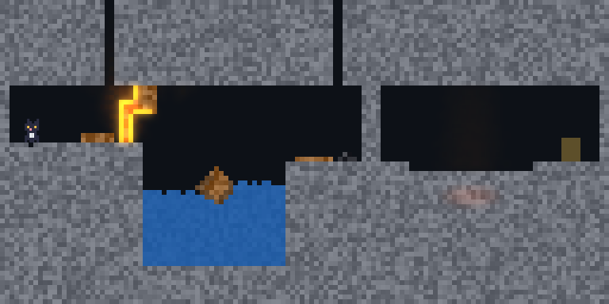
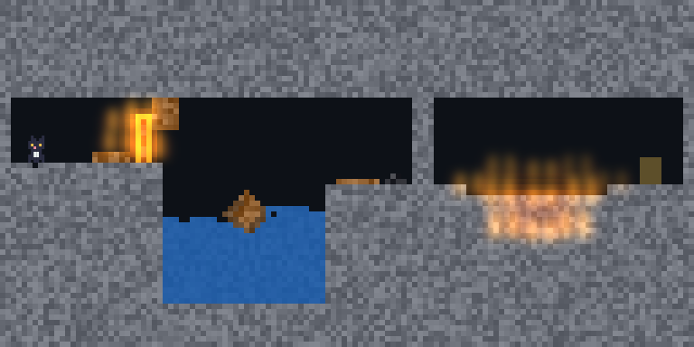
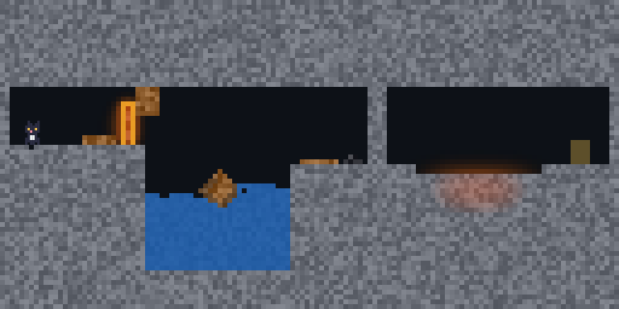

# Kiln

Mui the pixel cat, with a wand of fire, water and bombs, in caverns where everything is matter: the world is the standard definition of matter on a lattice of 0.1 m cells, with rigid bodies made of its cells and cells in flight ([xengine.cellular](../../modules/projects/xengine/kernel/cellular)'s `MatterWorld`). Nothing in it is scripted: a barricade of wood burns because fire heats it past its ignition point, a crate floats because wood is lighter than water, a wall gives way to a blast, water poured on lava sets it to stone. M6.2's vertical slice ([the plan's](../../.agents/docs/2026-11-12-foundation-omui-xengine-emergent-world-design.md) T2.6–T2.7).



**State of it**: the simulation, the game as `xengine.runtime` plays it — no interface, played by an agent that branches ahead — and its picture, drawn headless by a ladder, are done and tested; a window to play it in is next.

| Package | What |
|---|---|
| [sim](sim) | The simulation: Mui (walks, climbs a step of a cell, jumps, swims and runs out of breath, is hurt by heat and fire), the wand (bolts of fire, water, bombs), the first cavern, the exit; a pure function of the state and the frame's actions, its state a value (a copy is a branch) |
| [headless](headless) | Kiln as a game on its own (D-162): the simulation as the runtime's `Playable`, stepped without omui, sought back and branched ahead; the playtest — an agent playing as a person does, through `world.observe`, `world.branch`, `world.act`, `world.step`, finishing the first cavern and, given the cavern with a mistake planted, stopping where it cannot go on and saying why |
| [picture](picture) | Kiln on screen as a display list: the world by presentation ladders (D-178) — the light (a glow; frames of a flame baked once from the glow's own form; none) and the scenery (simulated beside the world; as placed) — what flies, the wand's bolts, the exit, Mui. It reads the state and changes nothing of it |

The first cavern: Mui starts on a ledge; a barricade of wood bars the way (fire); a pool with a crate afloat (jump, or swim before her breath runs out); a stone wall to the ceiling (a bomb; a keg of gunpowder by it is a hazard, not a key); a pit of lava (water sets it to stone); the exit beyond.

```sh
mcpp test -p omui.showcase.kiln.sim     # stands, burns the barricade open, swims, holes the wall, cools the lava; the same frames bit for bit
mcpp test -p omui.showcase.kiln.headless   # the playtest: finishes the first cavern; stops at the planted second wall and says why
mcpp test -p omui.showcase.kiln.picture    # the four steps of the ladder drawn headless; the game's checksum the same at each
```

How it was made, and what making it changed in the engine: [dev-story.md](dev-story.md).

## The same game, drawn as the machine can

What the level calls scenery — dry roots by the barricade, brush on the ledge — is not in the simulation: it is matter that is only shown. A picture with room simulates it beside the world by the same laws, so it catches from the barricade's fire; one without draws it as placed. The light is laddered too: a glow, frames of a flame baked from it, or none. The game's checksum is the same frame by frame wherever the ladders stand (`picture_test`).

| glow, scenery alive | glow, scenery still | baked | no light |
|---|---|---|---|
|  |  |  |  |

A known limit of the baked step: its frames are of one scene, a flame, and they are put over whatever emits light — so the lava glows as small fires there.

## What the playtest found

The player in `headless/tests/playtest_test.cpp` sees what a person is shown and does what a person can; it tries ahead by branching. Playing the first cavern it found two things about the game, not yet changed:

- it crossed the lava pit without casting water: by the time she reached it the lava's top had set to stone and cooled enough to walk on — the water puzzle was not needed (why it sets so soon is to be looked at: the heat it gives the air and the stone, or the bomb's sand falling on it);
- at the pool it spends a bomb on the pool's far wall before it finds the swim.

And one that was changed: a bomb's rubble used to come down as stone again and shut the hole it made; a bomb now shatters the stone about it to sand first, which slumps into a heap she walks over.
