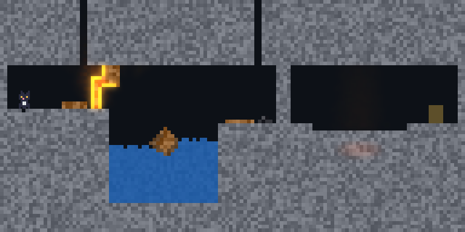

# Dev story — Kiln

How Kiln was made, and what making it changed below it. Kiln is the vertical slice of M6.2 ([the plan](../../.agents/docs/2026-11-12-foundation-omui-xengine-emergent-world-design.md), T2.6–T2.7, T2.10b, T2.11): a small game whose job is to prove that a world of matter, bodies and cells in flight is something a game can be built on — by a person and by an agent — and to find where it is not. It is a half-made game and says so: there is no window to play it in yet.

## 1. Design

- **The hook:** everything is matter, and nothing is scripted. Mui has a wand of fire, water and bombs; each obstacle of the cavern is opened by what the matter does, not by a trigger. Wood burns because fire heats it past its ignition point. A crate floats because wood is lighter than water. Water sets lava to stone because that is what lava becomes when it loses its heat.
- **The first cavern** is four of these in a row — a barricade of wood (fire), a pool with a crate afloat (jump or swim), a wall of stone (a bomb), a pit of lava (water) — with a keg of gunpowder by the wall as a hazard rather than a key.
- **What the game adds to the world is small on purpose:** a cat who reads the field (what holds her up, what she swims in, what hurts her), a wand that writes to it (heat, water, a blast), an exit. A rule the game would need that matter does not already give is a finding about the infrastructure, not something to add to the game.

## 2. How each part is built with the framework

| Layer | Package | What it is |
|---|---|---|
| The laws | `xengine.matter` | the standard definition: 17 materials, 19 laws, none naming a material |
| The world | `xengine.cellular` (`rigid`, `particles`, `decor`) | `MatterWorld`: the lattice, bodies made of its cells (Box2D under `xengine.dynamics`), cells in flight — one deterministic value, saved, restored and branched as one |
| Time and the agent | `xengine.runtime`, `mlibs.simulation`, `mlibs.agent` | the game as a `Playable` on a timeline; the subject `world` (observe, act, step, seek, branch) |
| The picture | `xengine.cellular.present` (`world`), `mlibs.pipeline` | `WorldPicture`: the world shown by two ladders a governor moves — the light, the scenery |
| The game | `showcase/kiln/sim`, `headless`, `picture` | the cat, the wand, the cavern as rows of characters; the game with no interface; its display list |

- **The state is a value.** `kiln::State` holds a `WorldValue`; a copy is a branch of the whole world. The timeline, the playtest's look-ahead and a seek back are all the same thing: copies.
- **The game never sees the picture.** `Picture::show` takes the state as `const`. What the level calls scenery — roots by the barricade, brush on the ledge — is not in the simulation at all: where the picture has room it is simulated beside the world by the same laws and catches from the barricade's fire; where it has not it is drawn as placed. The game's checksum is the same at each of 520 frames wherever the ladders stand (D-178).
- **No omui in the game.** `headless` links the runtime and the kernels only (lint `closure`); an agent finds it at a kernel endpoint and plays it.

## 3. Assets and how they were made

There are no image files in the game.

- **The cavern** is rows of characters in `sim/src/sim.cpp`, a cell each (`#` stone, `w` wood, `~` water, `l` lava, `C` a crate that is a body).
- **Mui** is 6 × 10 rectangles over her 3 × 5 cells.
- **Matter's colours and light** are the standard appearance (`standard.appearance.omui.ts`): a base colour a row, its grain, tints along channels, what emits.
- **The baked flames** of the low step of the light are frames of the rich step itself: a hearth — a post of wood alight on a floor — run and drawn by the same code, twelve frames, kept by a key of what they were made from.
- **README media** are drawn headless by `picture_test`, one PNG a step of the ladder.

## 4. Self-review

**What worked**

- **Branching as the way to play-test.** The player in `playtest_test` is shown what a person is shown and does what a person can; before each move it copies the world and tries ahead. It finishes the first cavern (frame 6423) and, given a cavern with a second wall and one bomb, stops at x 111.5 and says why: no bomb left, 20 cells in the way, and nothing else opens stone. It needed nothing of the game but `observe`, `act`, `step` and `branch`.
- **The slice found real faults below it,** each fixed where it lay and not in the game:

| Found by | Fault | Fixed in |
|---|---|---|
| the playtest in a release build: health 0 from frame 0 | the rigid world's saved image was written through an object's bytes and came out wrong under gcc -O2 | the image is written a byte at a time, little-endian (`xengine.dynamics`) |
| CI's benchmark step killed at 300 s | the lattice kernel built at -O0 | the kernel's package builds at -O2 (225 s → 39 s) |
| a frame of the world allocated | the coupling made its scratch each frame | kept between frames; a budget of 0 allocations a frame in `tests/bench` |
| the ladder's steps in the wrong order | one ladder of four steps, ordered by guess | measured (glow 42 ms, baked 4.5, none 2.1; scenery alive +0.5) and split in two ladders, the dearer lowered first |
| the world contract's suite, written for a third dimension | a cut image left Box2D's world unusable | Box2D's bytes under a length and a checksum of ours |

- **One governor.** The picture's ladders are moved by the same `mlibs.pipeline` governor that lowers omui's motion and effects; a decision is a recorded input.

**What was hard, and what it says to improve**

- **A bomb's rubble shut the hole it made.** Stone thrown by a blast came down as stone. This one is the game's: a bomb now shatters the stone about it to sand, which slumps into a heap she walks over. Whether "a blast breaks a brittle solid into its powder" should be a property in the standard definition — `breaks_into`, as `becomes` is — is open; it would then be every game's.
- **The player was the hard part, not the game.** Four of its faults were policy: counting regained ground as progress, losing sight of the way when it walked back, treating a hazard as an obstacle, drowning in the pool with small steps. It is a policy in a test; branching play-tests belong one level up, as a part any `Playable` can be given (the plan's §6.14).
- **The baked step shows what it was baked from.** Its frames are of a flame, so lava glows as small fires there. Each state that emits needs its own baked scene, written in the appearance data and not in a picture.
- **Two things the playtest found are still as they were:** she crosses the lava without water (its top has set and cooled by the time she arrives — is lava's heat lost too soon in the standard definition, or is this pit too shallow?), and a bomb is spent on the pool's far wall before the swim is found.

## 5. What it leaves as practice

1. **Build the game without a window first.** State as a value, a step as a pure function, a checksum: the playtest, the replay and the picture's proof all came from that for nothing.
2. **When the game needs a rule, ask whose it is.** A fault in save and restore, an allocation in a frame, a ladder in the wrong order were none of them Kiln's to work round.
3. **Measure before ordering.** The ladder was wrong until each step was timed.
4. **Let the player be shown only what a person is.** A playtest that reads the whole state finds nothing a person would.
5. **Say what is not done.** No window; one cavern; a player that is a policy and not an agent's session (T2.8); `matter.explain` on the whole world not yet there (T2.13).
