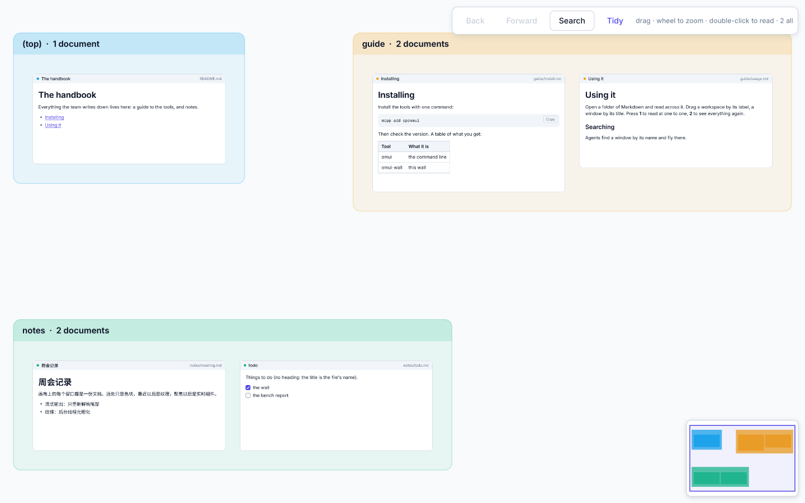

# S1 — the Markdown wall

`omui-wall` is a document wall: every Markdown file under a folder laid out on the infinite canvas, a workspace per folder, to read and search across. openmui's own design documents are read with it (`omui-wall .agents/docs`); with `--synthetic N` it is the benchmark's wall of N documents.



How it was made, layer by layer, and what making it taught: [dev story](dev-story.md).

```sh
mcpp run -p openmui.showcase.markdown_wall -- .agents/docs
mcpp run -p openmui.showcase.markdown_wall -- --synthetic 1000 --stream 20
mcpp run -p openmui.showcase.markdown_wall -- docs --headless --png wall.png
```

## What it shows

| A window, on screen | Drawn as | Costs a frame |
|---|---|---|
| under 160 px | a block and a title strip in its workspace's colour, its title written across it at a size fixed on screen (where it fits): each document known at any distance | next to nothing |
| 160–900 px | a texture of its page (`Kind::view`): the window's own element, laid out and painted by an offscreen runtime on the task pool at the mip level the screen asks for; the nearest ready level stretched meanwhile, so a fast zoom is never blank, and sharp again when it stops | a texture sample |
| 900 px and up, or focused | the live window: the same element, now interactive — select, scroll, follow links, tick tasks | a component's |

The texture and the live window are one element (`scene.cpp`'s `window`), so nothing moves when a window goes live; textures are drawn again in a new theme.

- **Workspaces** are folders: a backdrop and a label strip. A label drags its workspace with every window lying on it — `behaviors/group-drag.behavior.omui.toml`, a declarative statechart embedded in the program at build time (`openmui.build.embed`'s `behaviors()`); Esc mid-drag puts them back. A window drags by its title bar (canvas-kit's `drag`), with snapping to its neighbours; `select` and the `minimap` are canvas-kit's too.
- **Views**: 1 is one to one, 2 the whole wall, both on a spring; H shows or hides the HUD (`behaviors/views.behavior.omui.toml`).
- **Reading**: a double-click (or Enter) on a window opens it to read — close up, live; a link in a live window goes to the document it names (relative paths, `..`), an address opens outside. **Back** and **Forward** (the toolbar, Alt+← and Alt+→, the verbs `wall.back` and `wall.forward`) return the camera to where it was. **Search** (the toolbar, Ctrl+F or /, the verb `wall.search`): words in a title, a path or the text, titles first; Enter or a click opens one, Esc puts the box away.
- **Undo**: a window's or a workspace's drag is one step of the window's history (Ctrl+Z, `ui_undo`) — the canvas's `move_by`, the workspace with its windows.
- **Kept**: a folder's arrangement and camera are kept in it (`.openmui/wall.layout.omui.json`, written whole a moment after a change) and come back when it is opened again; a task ticked in a live window is written to its file.
- **The HUD** is immediate mode: the last frames' times against a 120 Hz frame, what the canvas drew by tier, the textures (count, memory, jobs on the pool, entering and leaving), how many are sharp, the zoom, the streams.
- **Streaming** (`--stream N`, or the verb `wall.stream {windows, rate}`): the N windows nearest the view's centre are written into at a language model's pace (50 tokens a second each by default). A live window gets the tokens at once — its document appends, parsing only the tail; a window drawn as a texture is made stale at most four times a second and drawn again on the pool, the old texture meanwhile. `wall.stop` ends it; what was written stays.
- **Agents** see the wall's windows and workspaces (role `window`, `group`, named by their titles), `find` across all of them, `focus_node` to fly to one (it goes live), `move_to` / `select` from canvas-kit, and the wall's verbs.

## The tour, in three languages

`scripts/tour.ts`, `scripts/tour.lua` and `scripts/tour.py` are one scene script (canvas-markdown §3.6) written three times: find a document by name across the wall, count the workspaces, fly to the document (it goes live), move it, choose it, look near where it went, stream into two windows and stop, be refused an action the wall does not offer, and go back to the overview — each step's answer recorded with the verb `tour.record`. TypeScript and Lua run in the program (openmui.lang's sessions); Python drives the wall as an agent does, through its endpoint, with `openmui_agent` (lang/python: the standard library only, `invoke` and `act` and `find` over openmui.tree@0.1). The test checks the three record the same answers and leave the same wall: the same camera, the window where the tour put it, the same choice.

A live window is still its item: the canvas's actions on it (`move_to`, `select` …) reach the canvas whether the window is drawn as a texture or live, and the semantic tree describes it as the window it is.

## Tests

`tests/wall_test.cpp`: documents read from a folder (titles, workspaces, order) and made for a seed; the layout (every window on its workspace below its label, nothing overlapping); the wall starting whole and sharp, a window going live when an agent flies to it; a link clicked where it is drawn going to its document; reading — search, open, back and forward, a double-click; the arrangement and camera kept and back; workspace and window dragging, Esc, undone and redone; the keys; streaming at the rate asked, textures made stale at most four times a second; the tour in three languages; the first frame's pixels, pinned. `tests/bench` drives the same wall: `wall/*`.
