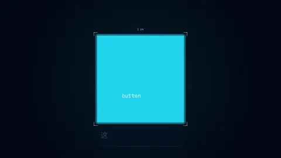

# Dev story — openmui's film

How the film was made: sixty seconds whose every shot is a live openmui scene, its timeline, lines and score data, rendered headless the same bytes every time — and what making it taught the framework.

## 1. What we set out to make

A promo at the bar of the agent-made videos that reached millions in 2026 (the design's §2: *Western Civilization / PROMETHEUS*, Remotion's launch video, *I'm Upping My P(doom)*): a hook in the first three seconds, one visual language, chapters, the picture on the music's beat, strong type, "the tool made this", something to copy, a call to action. And a real thing, not a demo (D-63): the film is a tool's output — `omui-promo` renders, checks and re-renders it from data, and the package is a template for anyone's film made the same way.

The rule for every shot: it is a real openmui scene showing a real capability, never footage of one. The settings panel the pixel belongs to is the style workshop's; the counter's four versions are run; the wall is S1's; the styles are S2's switch; the agent is acting through the runtime; the game is S4's field played through its actions.

## 2. The layers

| Layer | Package | What it gives the film |
|---|---|---|
| The timeline | `openmui.timeline` | the cuts: clips in exact time (flicks), keyed properties (hanim curves), markers, a readable file |
| Video and sound | `openmui.video`, `openmui.video.webm`, `openmui.audio` | encoding on exact frame and sample counts; the score's sequencer and synthesis; the mixer, ducking, limiter |
| The runtime | `openmui.view`, `openmui.host.headless` | frames at any time on a virtual clock; glyph motion; pixel effects; the semantic tree; actions, effects, undo |
| Scenes reused | `openmui.showcase.{style_gallery, markdown_wall, widget_breakout}`, `openmui.ui.canvas`, `openmui.ui.timeline`, `openmui.lang.*` | the panel, the wall, the styles, the game, the editor on the end card, the script hosts |
| The film | `showcase/promo-video` | the cuts, lines, score and sounds; a scene per chapter; the player; the overlay; the sound track; the acceptance; `omui-promo` |

## 3. How each part was built

- **The data first.** The storyboard became `promo.timeline.omui.toml`: a picture track of `shot:<name>` clips, each with its camera and choreography as keyed properties (the hook's magnification, the wall's `out` and `pan`, the styles' `style` as held keys, the agent's `step`); the lines' track; two music clips; the sound cues; a `chapter:` marker per chapter and a `hit:` marker on every beat the picture lands on. The short is another file over the same scenes, with its own keys.
- **The look is a style pack.** `blueprint.style.omui.toml` — navy paper, cyan lines, one accent — so the reused scenes take it by name (`theme::apply_style`), the style workshop switches back to it after the five packs, and what is drawn by hand reads the same palette (`:look`).
- **The hook reads the pixel.** The panel is rendered once on a host of its own; the pixel by the Save button's rounded corner is magnified 675× from the real raster (square, with a hairline between pixels), and its label is what `Headless::node_at_pixel` and the semantic tree say drew it. The pull-back shows the corner's softened pixels, then the button, the panel, its semantic tree with the path lit; the tree's lines are cut into seven hundred dashes that fly to the wordmark's outline (sampled from the text engine's own raster of it).
- **The code is run.** The four versions of the counter are files of the package (`code/`); the shot types `tally.ts` with a typewriter glyph motion over a code block (a row a line, a text a token, coloured by kind), reveals each node of the counter as the line that makes it is typed, and morphs to C++, Python and Lua with scatter and gather motions on the beat. Each version is executed in a runtime of its own — QuickJS-ng (esbuild-compiled), the C++ compiled into the film, PocketPy, Lua — and its tree digest and pixel hash are printed under it. They agree, so the chips go green; if a version drifted, they would say ✗.
- **The wall is S1's** (`wall::build`, its windows, tiers and minimap) with a thousand documents: the film's script pages first and last, the benchmark's set between. The camera is the clip's keys between the two pages and the whole wall; the corner counts the frame's windows by tier from the scene and the camera, not from a statistic of the frame before.
- **The styles** are the style workshop's own switch, on moments: a pack applied and cross-faded from the frame before. The semantic tree of its preview is hashed every frame.
- **The agent** works a notes panel through the runtime: a query, `act` on a checkbox (reversible), `undo` on the window's history, `act` on "Delete all" — an irreversible verb, refused with `needs-answer` — and the person's answer. The records shown are the envelopes' own JSON; the journal is the runtime's.
- **The game** is S4's field, paused and stepped through its actions by a bot that reads the simulation and tries five ways of meeting the ball; the rally it starts in is played before the shot's first frame. Its sounds come from playing it again on a layout-only host — the same steps, the same events.
- **The rewind is a clip of the film itself**: `source = "film"`, `in = "2999f"`, `speed = -5`. Its frames are the film's own, kept as they are drawn; its sound is the track at those times, backwards; the overlay gives it the tape's colours drifting apart (`chromatic`), its rows wavering (`displace`) and its speed.
- **The score** is a `*.music.omui.toml` written for the cut: 120 beats a minute, a section a chapter — a sine pad and a cold FM arpeggio for the hook, the beat dropping on the wordmark, a typing groove, a breakdown for the wall and a build into the dive, stabs on every style, a half-time pulse of doubt under the agent, a drive into the rewind, and an open C major to end. The sounds (a ping, keys, a morph, a snap, a warning, a crumple, the tape) are synthesised layers in A minor.

## 4. Making frames functions of time

The whole film rests on one property: any frame renders on its own and is the same bytes. Three things in the framework stood in the way, and were changed:

- **A canvas streams.** Its textures arrive over later frames, the nearest level stretched meanwhile, and its nodes go live once the camera rests: a frame depends on the ones before. `Services::complete_frames` (`HeadlessOptions::complete_frames`) asks every frame to be drawn as at rest: the canvas makes the textures the frame shows at their level first, and promotes without waiting. Its test draws a camera path in order and frames of it directly, byte for byte.
- **Motion starts when it is set.** A glyph motion now honours its transition's `delay`, so a line set when the overlay mounts rises on its clip's moment.
- **Where text is.** Layout bounds come before the visual transforms the film places its type with; `Runtime::drawn_bounds` gives the box as drawn, which the typography checks read.

And the player's rule, found by the seek test: a moment's change must be followed by its own frame however the frame asked for is reached — a style switch rebuilt the workshop's editor, whose sliders began their springs at the next frame drawn, which was a different frame when seeking. Drawing the moment's frame both ways fixed it.

## 5. Performance

On the 32-core development machine, release build, CPU reference renderer:

- The film's 3600 frames at 1080p alone (`--out promo.frames.txt`): 36 s with 8 workers (100 frames a second, 2.9 GB at most), 85 s with one (1.2 GB) — one player already draws each frame's rows in bands on every core, so more players buy less than it seems; the same hashes either way. 4K: 212 s with 8. (The machine is shared with other builds: the same run measured 52 s once.)
- With a WebM (VP9 real-time, 8 threads, 10 Mb/s): 68 s for the film (72 MB), 20 s for the short at 16:9 and 19 s at 9:16 — the encoder is the bottleneck; VP9 at its default quality on one thread (the same bytes everywhere) runs at about 2 frames a second.
- The sound track: 1.4 s for sixty seconds.

The plan's targets (§12.6) are not met yet: ≤ 15 s on the GPU with a hardware encoder, ≤ 60 s on the CPU including the encode, ≤ 1 GB at 1080p, and re-rendering only what an edit touches. The frames are ready for it — each a function of time, hashed, independent — but the video pipeline draws on the CPU reference renderer and encodes on one thread.

## 6. Self-review

- **Found by making it:** the canvas's history-dependent frames; two global registries (the component types, the canvas's scenes) written by several runtimes at once — a crash with 28 workers, now under locks; SheenBidi's scratch-buffer stack, which hands one buffer to two threads shaping at once (a canvas's textures on the pool; a heap corrupted now and then, found by ASan) — openmui.text now gives it a plain allocator; a canvas's offscreen runtimes outliving the fonts they shape with when the last job let them go; `Tasks::parallel_for` building its taskflow on the caller's stack, which the executor could still be tearing down after the wait (ThreadSanitizer); PocketPy's sixteen interpreters, which concurrent workers exceeded until the counters were run one at a time; a rewind whose first frame played back itself (`in = 50s` at 50 s) — the cut's check now refuses a `film` clip that reaches its own frames.
- **Still open:** with several players drawing at once *and* each splitting its rows into bands, two pixels of an effect layer (the tape's `chromatic`) came out different about one run in six; with one player per frame drawing in one band — what `--workers` above 1 now does — every run is the same bytes. The raster's bands are the suspect and are worth a test of their own under contention.
- **What is weaker than the rest:** the agent chapter is ten seconds of small type (the camera leans in, but it is the quietest); the game's room is sparse by the time the shot starts; the end card carries the command, the editor and the closing line at once. The score is written in the DSL by an agent and has not been heard by a person.
- **What is missing:** the GPU path and hardware encode; the incremental cache; the preview with hot reload and edits written back to the timeline; the shot-by-shot breakdown of the three benchmarks (it needs their files); the maintainers' scoring against them and the five outside viewers (§5.2).
- **Improvements to make:** a GPU frame source for `openmui.video` (rhi plus readback), the frame and chunk caches keyed by each frame's inputs, a shared font collection safe across threads (each worker loads its own), and an encoder that splits the film into independently encoded chunks.

## 7. A second opinion

A reviewer (codex, from a contact sheet of a frame every two seconds) scored it a strong engineering demo and a weak promo: too much small type, every chapter equally dense, the hook's meaning too small to grasp, an ending that says four things. What was taken: the hook now says its point in the lines (*This pixel knows what it is*) and its label is larger; the lines are a quarter larger; the code chapter states its verdict in large type (*same tree · same pixels ✓*); the wall's count is large; the style chapter's whole frame takes each pack's paper; the agent chapter has a headline per step and larger type, and leans in; the replay carries a MATCH stamp from a second, independent run of the game; the end gives the command and the editor their moment and then a clean card. What was not: shortening every line to six words (they are read in two languages at once and pass the reading-time check), and moving the command earlier (the doc's ending is the call to action).

## 8. Practices that generalise

See [best practices](../../docs/en/best-practices.md) §11: what a scene's time says, and its moments; motion pinned to its moment; frames drawn complete; text checked where it is drawn. And from §8: a film's acceptance is tests like any other — its hashes pinned, its seeks compared, its typography checked frame by frame.
