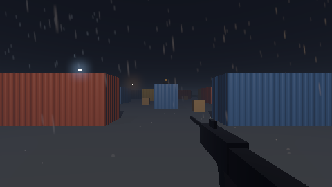

# Quay

A watchkeeper on a harbour at night, in the rain, has to light the beacon at the end of the breakwater before the tide covers it; rusted wardens patrol between the containers, and they find people only by what they hear and see. An original first-person game, M6.4's vertical slice ([the design](../../.agents/docs/2026-11-15-fps-slice-quay-design.md); the plan's §12).



**State of it**: the simulation (F1), the game as the runtime plays it with an agent at a person's tier (F2), the picture on the CPU reference and on a device with its frame budget (F3) the sound (F4) and the window to play in (F5) are done and tested, and so are the rain, the marks of shots and the containers' corrugated steel; the side-by-side comparison (F6) is next.

**The second night** (`quay --level second-night`; RC2.4): two lookouts sweep the quay from masts over the containers — a searchlight cannot fire; caught in its beam, it holds the beam on the watchkeeper and sounds its horn, and a warden that hears the horn goes where the beam falls (a shot puts the lamp out); the beacon has no power until two fuse boxes are switched on, one by the warehouse and one at the quay's far corner (half a second's work each, and the clunk is heard); a fifth warden. The guide wins it at 36.4 s, the agent playing as a person — shown the lamps in view and whether their beam is on it, the fuse boxes' lit panels — at 44.2 s; heard (the horn, the fuse thrown) and drawn (the masts, the beams, the panels red then green). A gamepad plays both nights: the left stick walks, the right stick looks (with the mouse), the right trigger or R1 fires, A jumps, X works, the left stick pressed runs; a recording names its level and replays bit for bit.

| Part | What |
|---|---|
| [src/sim](src/sim) (`omui.showcase.quay`) | The harbour as a 3D rigid world (`xengine.dynamics`' rigid3: Jolt under our contract) with the watchkeeper its character; the wardens on the quay's navigation mesh (`xengine.nav`: Detour's crowd) — on their rounds, searching where a noise seemed to come from, chasing what they see and firing; shots that meet the first warden or surface on their way, crates knocked by them; the tide's clock and the beacon. A pure function of the state and the step's actions; the state is a value (both native worlds held by `mlibs::simulation::Branching`): a copy is a branch |
| [src/headless](src/headless) (`omui.showcase.quay`) | Quay as `xengine.runtime` plays it (`quay::Standalone`): stepped without omui, sought back, branched ahead, its controls and first tasks said for an agent (D-186). What a person is shown (`quay::observe`) is what the watchkeeper sees and hears — the wardens in view, the beacon's light, the last half second's sounds as they reach the ears by `reach`, how far the eye meets something across the view — never where anything is; the `assist` tier adds places, minds and the hash |
| [src/picture](src/picture) (`omui.showcase.quay`) | The harbour at night from the watchkeeper's eye, drawn from the state by `xrender.mesh` (the CPU reference): the wet quay, painted containers, crates where their bodies are, lamps on posts and a floodlight, the beacon on its 9 m mast brightening as it is worked; the wardens bent by `hanim.skeleton` skeletons (`xrender.mesh::bend`) — walking, looking about, aiming, lying where they fell — their eyes the colour of their minds; the watchkeeper's rifle and the flashes of shots; fog, the light from everywhere, the glow. Which warden drew a pixel is the game's number (`warden_at`); `OnDevice` draws the same frame on a device (xrender.mesh.gpu: bodies bent on the device, shadows by maps, the glow) |
| [src/sound](src/sound) (`omui.showcase.quay`) | Quay heard: each step's events — the rifle, a warden's shot, steps on wet concrete, a walking warden's servos (which go with it), a warden falling, a hit taken, the beacon catching — as sounds in a place (`xengine.audio.space`) at the watchkeeper's ears, through the containers' steel (the rule the wardens hear by); the sounds are data (`sounds/quay.sound.omui.ts`, embedded). It only reads the state |
| [window](window) | Quay in a window, on the desktop and the Web: `quay [--record FILE]` — W A S D, the mouse to look (click the harbour; Escape lets go), the left button to fire, Space, E to work the beacon, Shift to run; the picture drawn on the host's own device (SDL_GPU; the page's WebGPU or WebGL2), each step heard through the system's output; what was played, recorded, plays the same bits with no window |
| [play](play) | Quay on this machine's device (desktop): `quay-play shot --out DIR` writes the guide's game frame by frame — the signature shot, the same pixels every run (`--reference`: the CPU reference, no device); `quay-play replay FILE` plays a window's recording with no window; the device held to the reference, and the window in a real SDL3 window on the device |

## How the wardens know

A warden never reads where the watchkeeper is. Each step's noises (a shot, running feet a step at a time, a walk's quieter ones) reach it by [`xengine.audio.space`](../../modules/projects/xengine/kernel/audio)'s `reach` — the rule the player's speakers play sound by: the distance, and each surface of the containers on the way letting 0.15 of it by and dulling it above 800 Hz. One loud enough (−58 dB against full) is heard; it turns the warden toward where it seems to have come from — further than it was when steel dulled it, so it walks that way 25 m at most and listens again. It sees within 28 m and 65° of its facing when a ray from its eye to the watchkeeper's head meets nothing on the way.

## An agent playing as a person

The playtest plays through the agent kernel's requests at the `human` tier: a tenth of a second's reaction, ten actions a second, shown only `quay::observe`'s person's view. It turns onto a warden by the bearing it is shown — counting the turn it asked for that has not shown yet — and fires when on it; a warden's shot it hears and does not see, it turns toward. Otherwise it goes for the beacon's light, trying every half second seven ways (the beacon's bearing and 30°, 60°, 90° either side) each on a `world.branch` a second and a half ahead, and taking the one that ends nearest the beacon and least hurt. On the harbour it lights the beacon at 27.4 s (health 88, 16 rounds fired, 336 ways tried); on the harbour with a container dropped across the breakwater (`level::flawed`) it stops 10.5 m short and says why: something solid across −40° to +40° on the beacon's side, the way closed.

## One tree, two views

The picture and the person's view are drawn from the same state by different means — pixels by xrender, the view by rays and `reach` — and the test holds them to each other: in a game played to the end by `quay::Guide` (the scripted player that knows the harbour), sampled every half second and at each shot, every warden the person is shown has pixels of its own, and every warden drawn clearly (a dozen pixels, within the night's 40 m) is shown — 59 frames of 59 agreeing; each shot of the watchkeeper's shows its flash at the muzzle.

```sh
mcpp test -p omui.showcase.quay          # the harbour (a copy is a branch; a warden hears a shot through the containers and goes to look); the person's view holds no places, the agent wins as a person, the planted mistake found and said; the picture from the start (containers, lamps, the beacon; one tree, two views); a shot on the right heard right-ear first and louder
mcpp test -p omui.showcase.quay.window     # played in a window by keys and the mouse, heard; the recording the same bits with no window
mcpp test -p omui.showcase.quay.play       # on the device (lavapipe in CI): the start, a warden near, the lit beacon within 0.4% of the reference's pixels; the window on a real window's device
# the frame on the page's WebGPU, timed as the desktop bench times it (D-187's 16.7 ms at the p99 on a real GPU): the full
# Chromium in a window (headless Chromium reaches Vulkan only through VK_EXT_headless_surface, which NVIDIA's driver lacks),
# its WebGPU through Vulkan on the driver omui-devtools gpu --real links; a display is needed:
mcpp test --target wasm32-emscripten --profile wasm-browser -p omui.showcase.quay --no-run
omui-devtools gpu --real -- omui-devtools browser --headed --chrome ~/.cache/ms-playwright/chromium-*/chrome-linux64/chrome --timeout 600 \
  --flag=--enable-features=Vulkan --flag=--use-angle=vulkan --flag=--ignore-gpu-blocklist -- target/wasm32-emscripten/*/bin/omui.showcase.quay.picture/web_frame_test.js --require-webgpu
```

## Agent surface

| | |
|---|---|
| State | `quay::State`: the watchkeeper, the wardens (each one's mind — patrol, search, chase — what it saw and heard this step), this step's noises and shots, the tide, the outcome and why; `checksum` |
| Control | `quay::Input`: the actions of a step (walk, turn, look, jump, fire, use, run) |
| Time | `step`, and copies: a copy is a branch to play ahead on |
| Observe | `world.observe` / `world.state` through `quay::Standalone`: the person's view above at `human`; places, minds and the hash at `assist` |
| Ops | The runtime's `world.*` (act, step, seek, branch, observe, state); `describe` says the game, its twelve controls and two first tasks (`look-around`, `walk-on`) |
