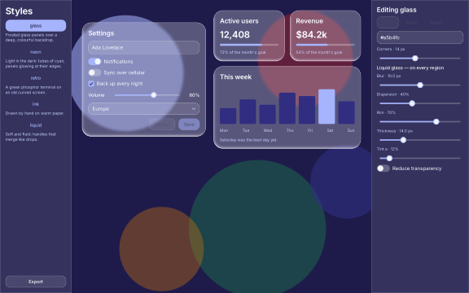

# S2 — the style workshop

`omui-styles` is where a style pack is made and tried: one real interface — a settings panel (a name, switches, a checkbox, a slider, a select, Save and Cancel that work) and a dashboard (stat cards, a chart) over a wallpaper — shown in each of openmui's style packs (`modules/ui/theme/styles`: glass, neon, retro, ink, liquid), with an editor for the pack shown and an export that writes it as a `*.style.omui.toml` another program loads.



```sh
mcpp run -p openmui.showcase.styles
mcpp run -p openmui.showcase.styles -- --style retro --headless --png retro.png
mcpp run -p openmui.showcase.styles -- --export-dir my-styles
```

- **A pack** is data (`theme::Style`): the theme it starts from, the tokens it changes, and the effects it puts on the window (`crt`, `paper`), on component types (`button`, `toggle`, `slider`) and on roles (`role:region` — the panels): `liquid_glass`, `neon`, `wobble`, `metaball`. Components say what surfaces they paint (`effect_shapes`: a switch's track and thumb), so neon lights them and metaball merges a slider's handle into its track.
- **Switching** (the sidebar, or the verb `styles.show`) is a cross-fade from the frame before (`Runtime::crossfade`, the pack's `crossfade` seconds).
- **Editing**: the accent, the corners, and every numeric parameter of each of the pack's effects, applied as they change (no cross-fade: an edit is seen at once). **Export** (`styles.export`, external: an agent states its answer) writes the edited pack; it reads back as the pack edited.
- **Only pixels change.** The semantic tree of the interface is the same under every pack, and an agent's actions do the same under each (the test checks both).

`tests/styles_test.cpp`: the same tree under the five packs and their pixels pinned; switching by a click and by the verb, with the cross-fade; an edit seen at once, an export that reads back, the answer it asks of an agent; the interface working (a switch, the slider, saving) under a pack.
