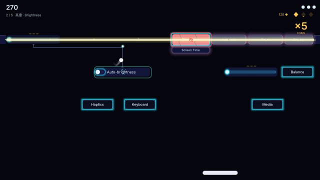
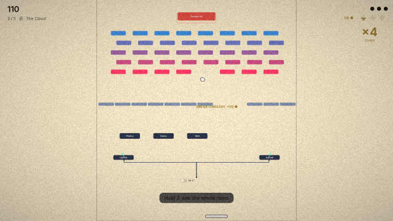
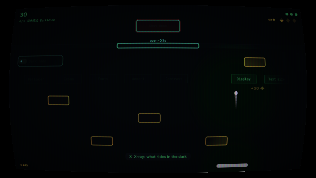
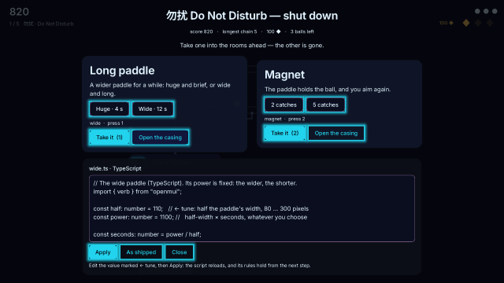

# showcase/widget-breakout

《组件打砖块：闹鬼的设置》 (S4, D-50): **the Settings panel is haunted, and every control works.** Charge Brightness and it fires a beam; switch off Do Not Disturb and the shield round the core slides open; chain it all together and shut the panel down. A breakout whose bricks are real openmui components ([design](../../.agents/docs/2026-10-29-mgame-s4-breakout-design.md) §8).

How it was made, part by part, and what making it taught: [dev story](dev-story.md).

## Playing

A run is five short rooms and three balls. Each room has a core (its power button): shut it down and the room short-circuits in a wave. Between rooms you take one of two contraptions into the rest of the run.

| Room | Style | What is new |
|---|---|---|
| 1 勿扰 Do Not Disturb | glass | aim the launch; a switch opens the shield round the core (and closes it again) |
| 2 亮度 Brightness | neon | capacitors: hit a slider until it is full and it fires a beam along its row; one beam can flip a switch that fires another |
| 3 云 The Cloud | ink | kickers send the ball up; break through the cloud into a chamber of files above, and the camera pulls back |
| 4 深色模式 Dark Mode | retro | only the ball and the paddle are lit; X-ray what hides; a gate that opens two seconds in seven |
| 5 同步 Sync | liquid | the copilot plays the top paddle; tell it what to do, and alternate returns charge a duet beam |

- **The chain** is everything the ball sets going after it leaves your paddle. Bring the ball back and three or more are **banked as sparks**; lose it and they are gone.
- **100 sparks rewind 2 seconds** (hold R). Taking time back also takes back what it banked, and the shot you abandoned stays on screen as a ghost.
- **Spin:** move the paddle as the ball meets it and the ball curves the way you moved.
- **Between rooms**, each contraption has two presets (huge and brief, or modest and long). **Open the casing** to see the script that makes it — TypeScript, Lua or Python — and change it: it reloads at once.

 

 

Keys: the pointer or ← → (A D) move the paddle; Space or a click launches; R held rewinds; X scans; Z held shows a tall room whole; 1–4 order the copilot (room 5) or, between rooms, take a contraption; Tab opens the inspector; Enter goes on.

## What it shows, without saying so

The bricks are real buttons, switches, sliders and progress bars, placed by openmui's layout; when the ball flips a switch, the switch is flipped and the semantic tree says so. The rewind is the simulation's timeline. The copilot is an agent that plays through the semantic tree and the field's actions, like any agent. The contraptions are scripts in three languages, hot-reloaded. Each room wears a style pack. **Tab** opens the inspector for anyone who wants the explanation: every brick's role and id, the tree's latest changes, the state's checksum, how the room is made.

## Packages

| Package | |
|---|---|
| `openmui.showcase.widget_breakout` (here) | The game: the field (`field.contract.omui.toml`) over a room's real components; the rooms as data; the copilot; the contraptions' scripts and their casings; the sounds; what the play looks like (sparks, trails, beams). `omui-breakout` runs it; an agent plays it through the field's actions (`launch`, `aim`, `move_to`, `step`, `rewind`, `order`, `choose`…) |
| [sim](sim) | The deterministic simulation: swept balls with spin, circuits, capacitors and beams, kickers, cores, chains and sparks, gifts; rewindable |

The tests play every room with two bots, a planner that understands the machine and one that only catches: every room can be cleared, no drain is unavoidable, nothing is still for long, and understanding the machine pays.
