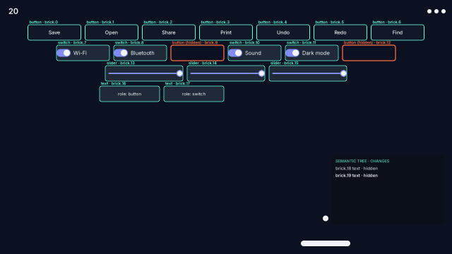

# Dev story — 《组件打砖块》, the widget breakout

How the breakout was made: a game whose bricks are real openmui components, where each level's play is one of the framework's abilities. The design, with the codex reviews that shaped it, is the [mgame S4 design](../../.agents/docs/2026-10-29-mgame-s4-breakout-design.md).

## 1. What we set out to make

A breakout that is fun on its own and, level by level, makes one thing about openmui obvious without a lecture:

| Level | The ability | Where it lives in the play |
|---|---|---|
| 1 Semantics | the semantic tree, explicit ids | Tab's lens: roles and ids over the bricks, hidden bricks only the tree knows, the tree's changes as they happen |
| 2 Styles | style packs | each cleared row brings the next pack; the play's checksum never changes |
| 3 Canvas | the infinite canvas, tiers | a wall four screens tall: boxes far away, live cards near; the camera follows the ball up |
| 4 Time | deterministic simulation, seeking any frame | a gate open once; hold R to rewind and play it differently |
| 5 Agents | agent-native | the top paddle is an agent's, playing through the semantic tree and the field's actions |
| 6 Languages | scripting and hot reload | the gifts' rules are TypeScript and Lua scripts, edited in the workshop while the game runs |

## 2. The layers

| Layer | Package | What it is |
|---|---|---|
| Game engine services | `mgame.world`, `mgame.sim`, `mgame.input`, `mgame.physics`, `mgame.ui` | entities in plain columns; a fixed-step clock and a timeline that seeks any kept frame; input sampled once a step; swept circle-against-box collisions with exactly rounded doubles; a game paced on openmui's clock |
| The game's simulation | `showcase/widget-breakout/sim` | the breakout as a pure step over plain data: paddles, balls, bricks, gifts, rules, gates, the camera |
| The game | `showcase/widget-breakout` | the field component, levels as data, the copilot agent, the workshop, the sounds, the application |
| Framework | openmui, `openmui.ui.canvas`, `openmui.theme.styles`, `openmui.lang.{js,lua}`, `openmui.audio` | what the levels show |

The simulation knows nothing of openmui. The field knows the simulation only through its events and state, and the copilot knows the field only through the semantic tree and its actions. Each boundary is the one a third party would use.

## 3. How each part was built

- **Bricks are read from layout, not placed by hand.** The field composes its level's rows of real buttons, switches, sliders and cards. On its first step it reads where openmui's layout put each one into the simulation's coordinates. A hit then changes the component: a switch flips, a slider loses a third, a broken brick goes `visible = false` and so becomes hidden in the semantic tree. A rewind restores every brick from the simulation's state.
- **One simulation, exact everywhere.** The step uses doubles with only + − × ÷ and √, no contraction and no fast-math, and no libm functions. Constants such as cos 40° are written correctly rounded. The whole game's checksum is pinned and is the same on GCC, LLVM and wasm.
- **The timeline is the rewind.** `mgame::Timeline` keeps a snapshot every 60 steps and every input; `seek` replays from the nearest snapshot. The gate of level 4, the rules of level 6 (a step's input carries a reload's rules) and the camera of level 3 all live in the state, so a rewind brings them back exactly, and a replay never runs a script.
- **Styles are the host's business.** The field only says which pack it wants (a `style` event); the application applies it with `theme::apply_style`. The component does not reach into the runtime's theme.
- **The canvas wall** is a `world::Scene` of 160 notes. One kind with two tiers: an instanced box far away, a promoted live card at 60 px and up. The field hands the simulation's camera to the canvas each step, and broken notes leave the scene.
- **The copilot is an agent like any other.** Thirty times a second it reads the field's semantic node (the balls) and the bricks still standing in the semantic tree. It predicts where the rising ball meets its line and calls `guard_to` as `agent:copilot`, which the runtime journals. A scripted player and the copilot clear level 5 in the tests.
- **The workshop** runs the gift scripts on openmui's script host (`openmui.lang`). An edit is a hot reload, then the verb `gift.<name>` is asked again. Its answer is checked (known fields, finite whole numbers, within bounds), and the rules reach the simulation at the next step. Measured: a reload under 200 ms, in the tests.
- **Sounds** play on the step that made them, panned across the field. Seeking back is silent, and a new branch is heard after what was.

## 4. Performance

- The simulation's step is plain data with nothing allocated; the timeline's snapshot is one copy of the state. **Not yet benchmarked on its own**: a `tests/bench` entry with a budget is owed (see §5).
- The canvas level draws 160 notes as one instanced batch when far; the canvas's own benchmarks keep a frame of 1,000 windows under 1 ms of CPU.
- The README loop is 144 KB: an animated PNG that stores only the rectangle that changed from frame to frame.

## 5. Self-review

**What worked**

- Putting everything that changes play into the simulation's state, including the camera, the gate, the rules and the gift carriers, made rewinding, replays and the tests trivial. Every level feature that tried to live outside the state (the style, the lens) turned out to be presentation, and that is where it stayed.
- Contract-first components made the field equally playable by a person, the copilot and the tests.

**What was hard, and what it says to improve**

- **Contract arguments were passed by position in alphabetical order, and a wrong signature still compiled** when every argument was a `Value`. `guard_to(x, seen)` received `seen` as `x`, and only a test caught it. Fixed in the contract generator, for every component: an action of two or more arguments now takes a generated struct of named members (`const GuardToArgs& args`).
- **Re-registering a script's verb on reload was refused.** Fixed in `openmui.lang`: a session re-registering its own verb now replaces the function. Hot reload means anything a script defines can be defined again.
- **TypeScript from an editor's text** needed a new entry point (`compile_typescript_source`); the player only compiled files. Editors are a normal place for code, so this is now general.
- **Pinned pixels that include changing text** (level 2's checksum line) break whenever the simulation's state layout changes. A pinned frame should avoid text derived from unrelated state, or pin a region.
- **Python gifts wait for an embeddable Python** (PocketPy, being published to mcpp-index). The CPython binding is host-mode only and cannot be embedded.
- **No simulation benchmark yet**: add `breakout/step` and `breakout/seek` to `tests/bench` with budgets.

## 6. Practices that generalise

See [best practices](../../docs/en/best-practices.md): state that changes play lives in the simulation; presentation is derived; a host applies what a component asks for; scripts produce data at load or reload, never per frame; validate script answers at the boundary and keep the old values on failure.
