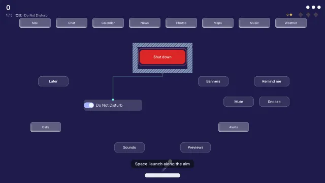

# Dev story — 《组件打砖块：闹鬼的设置》, the widget breakout

How the breakout was made: a game whose bricks are real openmui components, which shows the framework by being fun rather than by explaining it. The design, with the codex reviews that shaped it, is the [mgame S4 design](../../.agents/docs/2026-10-29-mgame-s4-breakout-design.md) (§8 is this version).

## 1. Design

The first version was a tour: six levels, one per department of the framework, with bricks spelling framework words, a paragraph at the end of each level, a live checksum on screen and a workshop of file names and reload times. It worked, and it was stiff: the framework was the subject and the game the vehicle. People share what they enjoy playing, so the second version starts from the game.

- **The hook:** the Settings panel is haunted, and every control works. A switch called Do Not Disturb really does guard the core; a slider called Brightness really does fire light when it is full. The joke is the demonstration: the controls are real components, so they can do what they say.
- **The loop:** aim the launch → hit controls → the machine reacts in a chain → bring the ball back to bank the chain as sparks → spend sparks on a rewind, or carry them on. Every return is a small bet: chase a longer chain, or catch the ball and keep what you have.
- **A run:** five short rooms (each with a core to shut down, so there is never a hunt for the last brick), three balls, and between rooms a choice of two contraptions that build a kit for the rest of the run.
- **Teaching by consequence:** the first launch's forecast runs into the switch, and the first shot opens the shield. Each hint appears once, when it is needed.
- **The framework shows through:** components that really change, a timeline that really rewinds, an agent that really plays through the semantic tree, scripts that really reload, style packs as each room's skin. The explanations live in the Tab inspector, for whoever asks.

## 2. How each part is built with the framework

| Layer | Package | What it is |
|---|---|---|
| Game engine services | `mgame.world`, `mgame.sim`, `mgame.input`, `mgame.physics`, `mgame.ui` | entities in plain columns; a fixed-step clock and a timeline that seeks any kept frame; input sampled once a step; swept circle-against-box collisions with exactly rounded doubles; a game paced on openmui's clock |
| The game's simulation | `showcase/widget-breakout/sim` | the breakout as a pure step over plain data: spin, circuits, capacitors and beams, kickers, cores, chains and sparks, gifts, the camera |
| The game | `showcase/widget-breakout` | the field component, the rooms as data, the copilot, the contraptions' scripts, the sounds, the effects, the application |
| Framework | openmui, `openmui.ui.canvas`, `openmui.theme.styles`, `openmui.lang.{js,lua,python.embedded}`, `openmui.audio` | what the rooms use |

The simulation knows nothing of openmui. The field knows the simulation only through its events and state, and the copilot knows the field only through the semantic tree and its actions. Each boundary is the one a third party would use.

- **Rooms are data, bricks are components.** A room lists each brick: its kind, its circuit, where it stands. The field composes them as real buttons, toggles, sliders, progress bars and plates, placed absolutely by openmui's layout (in shares of the field, so the field keeps its proportions at any size), in a panel named by the room. On its first step it reads where layout put each brick into the simulation. From then on, each step's events change the components: a switch's `checked`, a capacitor's slider `value`, a shutter's and a broken brick's `visible`. A rewind sets every brick from the simulation's state.
- **The machine is in the simulation.** Switches, shutters, kickers and capacitors are fields of a brick (`wire`, `on`, `charge`, `fuse`). A beam is an interval query along a row, not a test per pixel. Spin turns the velocity a little each step with a step along its perpendicular, renormalised: only `+ − × ÷ √`, so it is exact everywhere. Hit-stop, the shutdown's wave and the camera are state too, so replays and rewinds include them.
- **The rewind's cost is an input.** Sparks are banked in the simulation's state. A rewind seeks the timeline, and the first step after it carries `Input::pay`, so a replay pays it again. Rewinding past a bank un-earns it, and a rewind cannot go back past the last one's landing, so repeated rewinds only ever cost.
- **What it looks like is derived.** `:fx` turns each step's events into sparks, trails, squash, beams, wire pulses, rings and rising numbers. It uses fixed pools seeded from the frame, so the same play draws the same frames, and it is cleared on a rewind. Gameplay's colours (ball, beams, wires, cores) are the same under every style; on a light style they are drawn darker, and the ball and paddles get a dark rim.
- **The forecast is the simulation's own.** `trace()` follows the walls and bricks as they stand. It draws the launch's dotted forecast, and the bots use it to know where the ball will land.
- **The canvas room** is an `openmui.ui.canvas` scene: far, an instanced batch of boxes; near, live components (the Wi-Fi switch is a live toggle). The simulation's camera pulls back to the whole room while a ball is in the upper chamber; the field hands that camera to the canvas each step.
- **The dark room** is a layer of darkness with the lights cut out of it (an `erase` layer of radial gradients). The hidden caches are buttons with no opacity, so the X-ray shows what the semantic tree always knew.
- **The copilot is an agent like any other.** Thirty times a second it reads the field's semantic node and the bricks still standing in the semantic tree. Your order (`order`, a value of the field) decides where it aims. It calls `guard_to` as `agent:copilot` with what it saw, a word for you and where it means to send the ball, and the runtime journals it.
- **The contraptions' casings** are the old workshop, given a purpose. Each contraption is a script (`wide.ts`, `pierce.ts`, `slow.lua`, `magnet.lua`, `multi.py`) run on openmui's script host. A preset retunes the marked value and reloads the script in place; the casing's text box edits it directly. The answer is checked, and the rules reach the simulation as a step's input. Scripts never run in a step.

## 3. Assets and how they were made

Everything is made by code and data in this directory; there are no image files in the game.

- **Sounds:** `sounds/breakout.sound.omui.toml`, synthesised by `openmui.audio` from layers of waves, envelopes and filters. A switch snaps, a capacitor charges a step higher each hit and its beam roars, the core knocks and powers down. A chain's pops climb a major pentatonic scale (exact ratios), a banked chain is a chord, a lost one slides down. They play on the step that made them, panned by where across the field.
- **Pictures:** drawn each frame into the display list: plates, hatched shutters, wires, arrows, beams, sparks, rings. The components themselves are openmui's, in each room's style pack (glass, neon, ink, retro, liquid).
- **Rooms:** `src/rooms.cpp`, tuned with the bots (§4).
- **README media:** rendered headlessly by the tests. The loop is an animated WebP of room 1 played by the planner (`Headless::save_recording`, 640 × 360, 15 frames a second, about 220 KB). The stills are PNGs of a beam, the breakthrough, the X-ray and a casing open.

## 4. Self-review

**What worked**

- **Bots as design tools.** A lookahead planner (seven offsets or aims, each played a few seconds on in its head) and a catch-only player run every room in a second or two. The first numbers were damning: three rooms fell in seconds because a ball trapped against an exposed core beat every mechanic. The shield got a fourth side, the Brightness row became a dam only a beam breaks, and the final core got a roof. After that, the switch, the beams and the duet are what clear the rooms. The bots also found a kicker that kicked a ball back into itself 78,000 times in 100 seconds, and two capacitors that would fire each other for ever. They now gate the rooms in the tests: each can be cleared, no drain is unavoidable, nothing is still for ten seconds, and understanding the machine pays.
- **Everything that changes play is in the state:** spin, fuses, hit-stop, sparks, the camera, the rewind's payment. Rewinds, replays and the bots then needed nothing extra.
- **Reusing the workshop as the casing:** the scripting machinery was right; it only needed a reason to be opened.

**What was hard, and what it says to improve**

- **A new room read the last room's layout.** The rooms reused brick ids (`brick.N`) and, by chance, rooms 1 and 5 had the same number of bricks. The field began room 5 from room 1's nodes, before the recompose had landed, and nothing complained. Fix: bricks live in a panel named by the room, and a room begins only when its own panel is composed and laid out. Practice: whatever reads layout must check that it is reading the generation it means.
- **A canvas mounted before its scene is filled never placed its live nodes.** It watches the scene only if the scene exists when it mounts. Its scene-changed flag is also cleared by painting before the step that would act on it, so a scene changed from a timer can be missed. Worked around here by filling the scene when the room is composed and recomposing the canvas after changes. The canvas should handle both cases itself (reported).
- **PocketPy crashed when the script host was torn down while scripts were still loading** (`py_CFunction corrupts the stack!`). The bot tests build and destroy a game every second. The scripts now load when the first choice opens. A script host should be safe to destroy mid-load (reported).
- **Paused tests freeze springs and cross-fades,** so screenshots caught a switch's knob mid-flight and the last room fading out. The tests now let the picture settle (paused, so the play does not move) before taking it.
- **A `std::format_to_n` with a format string chosen by `?:`** made GCC 16 escalate the enclosing lambda to `consteval` (P2564), and the error surfaced deep inside `mgame.world::each`. Choose between two calls instead.
- **White on paper:** the ink style's light background swallowed the white ball and paddle. Gameplay colours need rims, or a darker variant on light styles.
- **The codex review of the result** (adopted): make the first circuit's payoff unmissable (the opening aim), let the shield visibly slide, give the chosen contraption at once as the next room begins, say "BANKED" plainly and light the meter, introduce the copilot by having it feed you first, keep actionable information visible in the dark, and thin the beam so what it strikes shows. Deferred: a playable preview on each card.

**Not done yet:** the cards' five-second previews, branching rooms (only the rewards branch now), daily seeds, a replay inspector after a run, a reduced-motion option, and play-testing with people who do not care about frameworks (§8.8 of the design lists what to measure).

## 5. Performance

- A step over a full wall stays allocation-free: fixed arrays for beams, fuses and contacts. `breakout/step` and `breakout/seek` in `tests/bench` keep their budgets (the simulation's API is unchanged in shape).
- The bots play a 90-second room in about 0.1–0.4 s of an unoptimised build, so the design checks run in every test pass.

## 6. Practices that generalise

See [best practices](../../docs/en/best-practices.md). From this version:

- Let a framework feature be a mechanic with a consequence, not a label. A switch that opens a shield shows components better than a brick that says "role: switch".
- Put a cost in the input stream when it must survive replays (a rewind's payment).
- Use bots as a design instrument, with fun-shaped checks (clearable, no unavoidable loss, no idle orbits, skill pays), not only as regression tests.
- Key composed children by the document they belong to, and verify that generation before reading layout.
- Keep cues readable across styles: fixed gameplay colours, rims, darker variants on light grounds.

## Playing it

- **Keyboard and pointer**: ← → (A D) or the pointer move the paddle; Space or a click launches.
- **Gamepad** (any): the left stick or the d-pad moves the paddle and south (A, Cross) launches. They are bound through `mgame.input` like the keys, and `tests/gamepad_test.cpp` plays it headless.
- **Web and Bilibili Toy**: `tools/ci/toy.sh openmui.showcase.widget_breakout` builds it for wasm32-emscripten, packs it with `dist-toy` and checks it with Toy's `toy_doctor.py`; serve `target/toy/omui-breakout/` and open it. The contraptions' scripts do not run on the Web yet: they need a single-threaded script host there, and JavaScript also needs a 32-bit QuickJS wrap.
