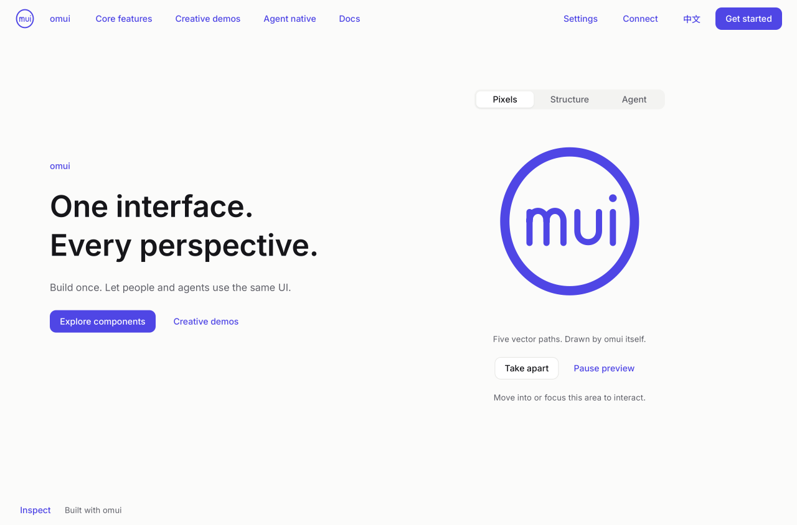
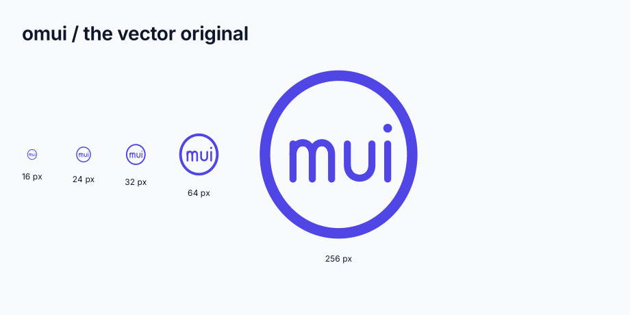

# omui's website (`openmui.site`)

The site shows omui's thesis instead of describing it: **the interface is a semantic tree, and everything else is a rendering of it** (D-84 §6.6). omui is the implementation; openmui is the open specification. The package and protocol identifiers retain their existing names. On the Web the site runs as wasm, and in a window it runs as a native program.



The current product review references come from the running native application:

| Area | Desktop | Phone | What to review |
|---|---|---|---|
| Home | [English opening](media/landing-home-en-desktop.png) | [Chinese opening](media/landing-home-zh-phone.png) | One live mark shared by pixels, structure and a visibly simulated agent; two primary destinations. |
| Components | [Single specimen stage](media/components-workspace-en-desktop.png) | [Chinese stage](media/components-workspace-zh-phone.png), [disclosed options](media/components-options-zh-phone.png) | One current component, a bounded directory and optional variants, motion, reference and semantics. |
| Basic animation | [700 px canvas](media/motion-basic-gallery-700.png), [animated player](media/motion-basic-player-700.webp) | [300 px canvas](media/motion-basic-gallery-300.png) | A real layout transition, with pause, reverse and seeking. |
| Creative demos | [700 px canvas](media/motion-creative-gallery-700.png) | [300 px canvas](media/motion-creative-gallery-300.png), [animated player](media/motion-creative-player-300.webp) | Real checkbox/card/button composition, runtime motion and scoped glass styling. |
| Useful output and materials | [Glass over live data](media/style-glass-session.png) | [Palette with current hex values](media/creative-palette-zh-300.png) | Actual refraction over a data plot, and mixed colours that can be copied as CSS. |

The [curved shape midway through its morph](media/motion-shape-path-middle.png) is a CPU-rendered stage crop from the same shared player. Its endpoint drawings contain no animation clock; the public runtime policy evaluates the path.

The [locally pixelated chart](media/style-local-pixel-chart.png) is a real
headless capture after native Agent actions change the normal controls.
Styles → Details exposes strength, block size, logical/device units and the
actual `pixel_effect` configuration. Only the chart painter is filtered;
labels and controls remain siblings in their original paint order, and glass
still refracts the same backdrop. Zero strength restores the original pixels.
This is a reusable renderer effect consumed by the website, not the completed
pixel style pack or general component part-isolation system.

Minimal Agent workflow: discover the styles page's stable control IDs, open
`actions/details`, use `act`/`set_value` on `details/pixel_amount` and
`details/pixel_size`, toggle `details/pixel_device` when needed, inspect the
result, and `capture` `comparison/styled` for actual PNG pixels. Restore
strength to zero to remove pixelation. The same native `agent::Protocol`
workflow runs in `feature_examples_test` without a window; browser presentation
tests also exercise real pointer input and semantic region capture.

The player sizes above are canvas widths; its reference host adds padding. The two WebPs record framework-rendered frames from the shared player. Stills cover both gallery sizes; only one desktop animation and one phone animation are published, each limited to 1 MiB. These are review evidence, not final art acceptance.

The latest presentation pass puts phone destinations immediately after the introduction, gives narrow material comparisons one full-width specimen, and mounts Agent protocol/design parameters only after **View details**. Agent previews perform one finite local script, yield to actual input, and retain explicit manual tasks with reduced motion. Actual Chromium captures after short transitions settle: [Chinese home](media/presentation-home-zh-phone.png), [phone material comparison](media/presentation-styles-zh-phone.png), [desktop Agent overview](media/presentation-agent-design-en-desktop.png), [Chinese Agent overview](media/presentation-agent-design-zh-phone.png). `tools/ci/site-presentation.mjs` checks NoScript links, first-view geometry, real comparison input, input ownership and reduced-motion task completion. These settled references do not close the separately observed intermediate text/layout overlap or final art review.

Remaining motion review: the [early phone mode transition](media/presentation-transition-agent-design-zh-390.png) and [desktop text transition](media/presentation-transition-agent-design-en-1280.png) retain the observed crossing/contrast evidence. They are intermediate captures, not accepted endpoint references; the settled views above do not replace their dynamic acceptance requirement.



The [construction study](media/study-assembled.png), its [unfolded state](media/study-unfolded.png) and its [Chinese phone layout](media/study-phone.png) are generated by `tests/brand_test.cpp`. `tests/home_landing_test.cpp`, `tests/gallery_redesign_test.cpp` and `tests/motion_gallery_test.cpp` generate the product references above. `tools/ci/readme-media.sh site` runs the native tests and copies the selected outputs; `tools/ci/readme-media.sh --check site` compares committed files with those outputs, retaining the existing brand, structure, catalogue and release-workspace gates.

Current rendered structure: [Home](media/structure-home-en-desktop.png), [Docs](media/structure-docs-en-desktop.png), [Explore](media/structure-explore-en-desktop.png), [Get started](media/structure-hello-en-desktop.png), [Chinese phone overview](media/structure-docs-zh-phone.png), [Chinese phone reading](media/structure-features-zh-phone.png). These are generated by the same native tests and checked with the media gate.

| Package | What it is |
|---|---|
| `openmui.site` (here) | The site as an application (`omui::site::app()`), its components (the lens, the page's time, the frame meter), its theme, the static page and the pre-renderer (`omui-site`) |

## What is on it

- **The mark** (`src/brand.*`): an O enclosing the inner letters, built with five vector paths and no fonts. The same geometry draws the header, the opening and the SVG original. Open `#/explore/brand` (`#/zh/explore/brand` in Chinese), to take it apart, assemble it, change its size and ink, reset it, and copy the original SVG. Movement comes from the runtime's motion slots.
- **The opening** (`src/home_landing.*`): one short claim, one live vector mark and two actions: explore components or creative demos. Pixels, Structure and Agent show the same object. The agent demonstration is explicitly scripted and activates the same real Assemble button through the runtime; it is not an LLM. The preview yields to pointer or keyboard input, respects reduced motion and explicit pause, and stops when off screen or after leaving Home.
- **The release workspace** (`src/hero.*`, `#/scenes/release`): a release workspace with stable task ids. Add, rename, check and remove tasks; undo or redo board changes, reset, and copy a Markdown checklist. Recording a release waits for every task and can itself be undone. The board holds up to 24 tasks with 96-grapheme titles, in memory for this visit; it does not publish a release. Text input has its own history, separate from board edits. Visiting another page keeps task data, while unmounting clears the old board undo scope; restoring history across visits remains open. Opening and closing an editor preserves the board's redo, and focus returns to a usable control.
  - **Inspect the same object** opens three optional panels: a screen reader description, an agent request and a test assertion, all derived from the selected node in the actual semantic tree. They start closed. User titles retain their `user_content` origin.
  - **The simulated agent** is explicitly scripted. It checks the current tasks by their ids and records the release through real runtime actions; Stop or leaving the workspace cancels pending steps. It makes no claim of LLM autonomy.
- **The release workspace's feature panels** (`src/screens.*`): connect a visitor's agent and inspect its actor log; seek visual time or compare an independent reference run to CI; switch the **same edited tasks** between a list and cards; compare effect tiers within the device's reported capability. A manual layout change releases scroll seeking and can be interrupted. Follow scrolling rebinds after a page visit or width-band rebuild. Motion-off still reaches the selected layout. Visual seeking does not undo application data.

  Retained workspace references: [desktop workspace](media/workspace-home-en-1280.png), [Chinese phone](media/workspace-home-zh-390.png), [optional technical panels](media/workspace-technical-en-1280.png), [phone panels](media/workspace-technical-zh-390.png), [list](media/workspace-motion-list.png), [a sampled moving frame](media/workspace-motion-between.png), [cards](media/workspace-motion-cards.png). These are generated by `site_test` and covered by the media gate; they are review evidence, not a completed art-quality assessment.
- **Places.** Product exhibits, agent use and documentation have separate entrances. A place's selected state is in the semantic tree:
  - **Home** is the concise opening above. The release board and its longer technical panels live at `#/scenes/release`; long documentation stays in Docs.
  - **Core features → UI components** (`src/catalog.cppm`, `src/gallery.*`): 36 components, one current live specimen and an eight-result directory with search and categories. The directory scrolls within its own bounds; on phones it opens when requested. Each component also has a detail address, for example `#/components/text-box` or `#/zh/components/data-grid`. The default visible preview yields to pointer or keyboard interaction. Details reveal variants, disabled/appearance controls, a local motion choice, builder expressions and live semantics; they retain real edited values. Plain, glass, neon, retro, ink and liquid affect the specimen scope. C++, TypeScript, Python and Lua samples are **API expressions**, not complete exported fixtures or verified standalone projects; complete fixture export and clean-consumer execution remain open.
  - **Core features → Basic animation** (`src/basic_motion.cpp`, `src/motion_gallery.*`, `#/motion`): 41 named design cases across surface, transform, layout, selection, text, values, presence and rhythm. These are distinct from the reusable motion primitives and the 37 component-type default recipes. The default opening morphs a triangle into a circle using public `vertex_path` configuration. Details expose its path bend and the existing scoped styles; copied motion JSON excludes the separate style selection. A bounded category/search selector changes one main canvas. Detail addresses include `#/motion/list-grid` and `#/zh/motion/list-grid`.
  - **Creative demos** (`src/creative_motion.cpp`, `#/demos`): 20 usable compositions combining real components, runtime motion and scoped materials. For example, `#/demos/packing-board` combines checkbox/card/button with shared motion and glass styling; the phone recording above shows this actual workspace. Other cases cover inbox triage, palette editing, appointments and workflows.
  - **The shared animation player**: the default loops only the current visible canvas when motion is full and the host has not requested reduced motion. Pointer entry, keyboard focus or a first touch finishes and releases the preview handles, then the actual controls keep their own default feedback. Pause remains paused across navigation; leaving stops the preview and a previously playing preview resumes on return. Details expose speed, timing and stagger, plus the exact reusable JSON `motion` configuration. This configuration is not a complete exported scene or a four-language project. Low effect tiers retain a simple motion candidate; motion-off keeps A/B states and real controls usable.
  - **Styling** and **One interface × languages** have their own core-feature pages (`#/styles`, `#/interface`), separate from reference documentation.
  - **Agent native** (`#/agent`): Use, Develop and Design views for real semantic actions, receipts and undoable records. Scripted demonstrations are marked; pairing connects the visitor's own agent.
  - **Docs**: a guide search and documentation directory, with Core ideas, Practical guide and Get started (`#/docs/start`). Example 01 (`examples/01-hello-im`) runs beside its own source.
  - **The mark** (`#/explore/brand`) and **Timeline editor** (`#/explore/timeline`) remain individually addressable works; the editor has its own undo history (S-12).

  A place scrolls within a centred measure of at most 1120 px. Its layout follows the actual available width, including resizing within one responsive band. On phones, Menu opens the primary destinations and settings; tools stay optional.
- **The site's own design language** (`theme/site.theme.omui.toml`, `.agents/docs/2026-11-01-openmui-site-design-language.md`): warm white (or night), one indigo accent, Inter at a 64 px display size. These are the theme's tokens over the framework's light and dark themes, so every component takes them as it is. The theme sets only tokens the spec defines; a name it adds is an error, and the site would fall back to the default theme (a test holds the site's own background).
- **Settings**, each choice the framework leaves to its users: light or dark (a crossfade), motion full, reduced or off, how things move (each control's own, simple, liquid or ink, D-90's motion styles), the effects tier, and who draws.
- **Inspect** reveals the lenses, time controls, semantic hash and CI comparison. These tools are closed by default; closing Inspect restores the live pixel view.
- **Who draws, and how fast.** The page is drawn by the machine's GPU where it has one (WebGPU, else WebGL 2; a software adapter counts as none), else by the CPU. The CPU's pixels stay the reference: the check against CI draws its frames with the CPU whoever draws the page. With Inspect open on a wide screen, the bar's **frame meter** (`frame_meter`, `src/frame_meter.*`) shows:
  - who draws: CPU, WebGPU or WebGL 2;
  - the frame rate and a frame's median cost, with the last frames as bars against a 60 Hz display's budget;
  - **idle** once nothing moves: the page then draws nothing (D-70), and the meter asks for no frame of its own. It reads the frames the host reports (`Runtime::frame_shown`), and an agent reads the same numbers with its `reading` action.
- **The lens.** One switch moves the page you are reading between four renderings of the same nodes:
  - **Pixels**: the page as drawn.
  - **Tree**: the semantic tree's wireframe over the pixels. Each node gets its box and role; nodes that an agent or a person can change are outlined in amber.
  - **Agent**: the JSON an agent receives, one node per line.
  - **Test**: the assertions a test would write.
- **Your agent, on this page** (agent connect, D-95). The visitor's own agent — Claude Code, Codex, any that runs commands — operates the page by its semantic tree through a bridge on their machine; the page has no chat box, no model and no key of its own.
  - **Copy the prompt** starts the page's agent link (`Runtime::link_agent`, the Web host's): a pairing code, good for ten minutes, in a prompt the person pastes to their agent. It points the agent at the site's `agent.md`.
  - The **actor log** (`actor_log`, openmui.ui.base) says the link's state and lists each agent's actions as they come, newest last. The last one its history holds is taken back from there; hovering one outlines the node it acted on.
  - **Hello, agent** is the self-check `agent.md` gives: the agent presses it, and the count says so.
  - Above everything, a question an agent asks the person: an external action waits for the person's answer, once or for the visit (a grant openas records), or no. The answer buttons are the person's own (S-10): an agent pressing them is refused whatever actor it names.
  - **A simulated agent**, marked so: a scripted one, no model, whose every step is still a real `openmui.tree@0.1` request on the bus that openas decides (S-11) — reading, switching places, editing the timeline and undoing it, opening a link (it asks first). The panel shows each request and its records.
- **`agent.md`.** What an agent needs to operate the site, beside the page: how to link (the code, `omui connect` or a bridge written from the protocol it gives), the tools, the places its navigation offers, the self-check, and the rules. The program writes it (`omui-site --agent-guide target/site`), as every openmui application does, with its machine-readable twin `.well-known/openmui-agent.json` and the page's `<link rel="openmui-agent">`. Prebuilt `omui` for Linux, macOS and Windows comes from the omui workflow, with SHA256SUMS.
- **Links.** A document's link to another document moves to that place. Any other link is opened by the host: the system's browser on the desktop, a new tab on the Web. This goes through `Runtime::open_url`, which accepts only http, https and mailto.
- **The page's time.** The footer is a strip of the page's last 20 seconds, with what happened marked where it did: a place reached, a language, a lens. It runs on a second at a time, on frames the page draws anyway, so an idle page stays idle and the strip is drawn the same whenever it is drawn again.
  - Drag the playhead back, or let an agent set it (the strip is a slider on the bus), and the page is drawn as it was: a place's page arriving, a document's translated lines arriving, a lens fading in.
  - Play it forwards or backwards. **Live** returns to the present.
  - Animations are functions of time, so every moment can be drawn again. The runtime re-evaluates what it holds (D-60), and components that animate on their own are told the time (`retimed`).
  - Only the drawing goes back; the tree stays as it is now.
- **Checked against CI, frame by frame.** **Check against CI** in the footer opens a panel that replays a fixed script offscreen in your browser: open Explore, then Docs and Core ideas, switch to Chinese, open Inspect and turn the lens to Tree, 5.9 seconds in all (`src/reference.*`).
  - It waits while the canonical font sources are incomplete, retaining the latest requested frame. Once they are ready it plays on a host of its own, at CI's size (1280×800), with only the program's own fonts (Inter, Noto Sans SC, JetBrains Mono), rastered in one band, every frame complete (`complete_frames`).
  - Ten frames a second are sampled; each frame's RGBA bytes are hashed (FNV-1a).
  - Drag to a frame and the panel draws it, with its hash here, CI's hash for it and whether they are the same.
  - CI's table is a data file, `reference/ci.frames.omui.json`, embedded in the program. `site_test` makes every frame and checks it against the table.
  - The replay runs in a stage of the frame after paint, not inside the slider's handler: there it would run inside the page's batch, its effects held back, and draw a stale frame.
- **The tree's hash.** The footer describes the current place's live semantic tree. A controlled home baseline is pinned in tests; the separate reference player compares fixed pixels with CI. Automatic previews and a visitor's edits are not reported as CI mismatches.
  - It covers ids, roles, names, values and lasting states.
  - It leaves out what follows the window: boxes, how far a view scrolls, and what is off screen. It also leaves out the pointer's hover and press, and motion under way.
  - Responsive layouts can change containment; canonical headings, usable actions and explicit data ids are checked across sizes.
  - A stage of the frame's pipeline reads the place again whenever its tree changes.
- **Both languages.** English and 中文. The English first frame carries the two characters of its language button; the regular Chinese face arrives after presentation. Chinese visits load that face before presentation and skip the initial asset. The selected page language takes precedence over the browser language for this choice. The node ids are the structure's, not the text's, so the tree keeps its ids when the language changes. On a switch, navigation labels update with short native feedback; documents retain their reading-order line arrival. This is glyph motion (D-68) applied to whole components, which do nothing for it. The tree is the other language's from the first frame, and at rest the pixels are those of the page opened in that language.
- **Routes.** Where the site is within itself is its route (`Runtime::set_route`): `/docs/features`, `/zh/explore/timeline`. On the Web the address's hash shows it, each move a step of the browser's history, and Back and Forward move the site. A link to `#/zh/explore/timeline` opens that place in that language.

## How it is built

```
mcpp run omui-site -p openmui.site               # in a window
tools/ci/site.sh                                 # for the Web, into target/site/
python3 -m http.server -d target/site            # and look at it
```

`tools/ci/site.sh` packs the site for wasm32-emscripten using the `site-web` profile (`-Os` for the whole program), without Toy's SDK (`dist_toy({.sdk = false})`). Native release keeps its normal optimization profile. Delivery and frame budgets remain checked in Chromium. The script then runs the native program with `--prerender target/site/index.html`, which writes every place into the page as static HTML. The Markdown is rendered by `openmui.markdown`'s `to_html`, whose output is byte-for-byte what md4c-html writes. The static page:
- sits in a `<main id="omui-static">` that readers without JavaScript and search engines read;
- uses the program's own fonts;
- shows just the current route, in its language, including when JavaScript is disabled;
- stays readable during loading, then hands over after a real presented frame and the current route's semantic mirror are ready;
- follows static link clicks during loading, restores scroll and the focused primary navigation, and exposes one accessible surface at a time.

The native `--first-frame` command also renders opening PNGs and semantic geometry from the production view at a fixed time. `tools/ci/site-frames.py` generates the seven feature openings for two languages, two viewport sizes and full/reduced motion. The static page requests only its current opening, labels it as a preview, and draws actual tree rectangles using decoded startup-resource progress. It keeps readable content and a retry action on failure; presentation and the selected semantic root must both be ready before handoff. `tools/ci/site-loading.mjs` exercises this path with real browser input, holds wasm, checks failure recovery and compares the first CPU frame with native reference pixels.

Browser review captures with wasm held: [English opening](media/loading-home-en-1280.png) and [Chinese phone with reduced motion](media/loading-home-zh-390.png). These capture the readable loading page in Chromium; they are separate from the deterministic native media gate and the full first-frame pixel comparisons.

Initial Inter and later complete faces preserve the same glyph ids and contextual substitution outlines. The complete face extends coverage within its family before another family's fallback; existing face references stay valid. Full Chinese input coverage, complete per-page font delivery and separate heavy programs remain open. Implementation and acceptance boundaries are in the [first-frame/loading design](../.agents/docs/2026-11-04-omui-first-frame-loading-design.md).

Static FontFaces now consume `omuiLoad.fontBytes` leases from the same decoded transfers as runtime FS installation. Body, code and Chinese faces are activated for the current static page, then released on handoff; URL faces remain in `noscript`. The [shared-font gate](../tools/ci/site-font-sharing.mjs) disables HTTP caches, observes actual requests and verifies both consumers, retry, cleanup and byte identity. Its review captures show the [Chinese phone with its actual loaded face](media/shared-font-home-zh-phone.png) and [the document's loaded body and code faces](media/shared-font-docs-en-desktop.png); only protocol publication was temporarily held for observation, while native presentation remained real. See the [shared delivery design](../.agents/docs/2026-11-04-omui-shared-font-delivery-design.md).

`.github/workflows/pages.yml` publishes `target/site` to GitHub Pages. `tools/ci/drive-page.mjs` loads the page in a real browser (headless Chromium, in real time) and can drive it through `window.omui`. That is how the packed site was checked: the same tree hash as CI at three window sizes, the routes, and places reached by a page agent.

## Delivery

`tools/ci/site-browser.sh` measures the built page in a real browser (`tools/ci/site-perf.mjs`), against `delivery.budget.omui.json`. It serves `target/site` with gzip and makes a cold English visit at 1280×800 over a 20 Mbit/s, 40 ms connection, then goes through Docs to Core ideas and back home. Single-run record, 2026-11-05, using `site-web` (headless Chromium 156), a fresh profile with within-visit HTTP cache enabled:

| Measure | Result |
|---|---|
| before the program's first-frame proxy | 2,838,285 bytes |
| total transfer, including the later Chinese font | 4,740,514 bytes |
| first-frame proxy / `window.omui` readiness | 1584.5 / 1548.7 ms |
| rAF intervals | p50 16.7, p95 16.8, max 50 ms; 1 over 33.4 ms |
| memory at the end | JS heap 13,400,000 bytes, wasm memory 28,639,232 bytes |

The first-frame proxy is the semantic mirror's first populated frame; it is not FCP, LCP or a direct measurement of presented frame rate. The site-wide Chinese text face still loads after presentation on English visits; its initial two-character asset is 230,568 raw bytes. Chinese visits use the site-text face before presentation. That face is a site-copy subset, not complete source-font coverage for arbitrary input. This run passes all seven budgets with **259,486 bytes** below the existing 5 MB total-transfer limit; per-page/input fonts and heavy-program splitting remain open. This is one sample, not evidence of a stable speed improvement. The [checkpoint report](../tools/ci/hanim-api-probe/2026-11-05-pixel-parameters.report.omui.json) preserves its conditions and results. The earlier [shared-font comparison](../.agents/docs/2026-11-04-omui-shared-font-delivery-design.md) distinguishes actual duplicate transfers from within-visit cache reuse. `site-perf.mjs --cache disabled --request-log FILE` records cache flags and actual response byte events; reports and pixel evidence are kept in the Pages workflow's `site-checks` artifact.

The same script then reads the page as assistive technology does (`tools/ci/site-a11y.mjs`), from Chromium's own accessibility tree, which is what a screen reader on the page is given. It checks that:
- the places are a navigation landmark and the place shown is the main one;
- the claim is a level-1 heading, and every button and link has a name;
- the page states its language and allows zoom;
- the static page is hidden once the program runs;
- the first Tab is the skip link, seen while it has focus, and Enter takes both the page's focus and the program's to the main landmark.

## Tests

`tests/home_landing_test.cpp` covers the concise opening, the shared vector mark, actual structure names, the scripted agent action, preview interruption and responsive layouts. `tests/gallery_redesign_test.cpp` covers one current specimen, bounded/empty search, preserved edits, progressive options, local overrides and real pointer/keyboard use.

`tests/basic_motion_test.cpp` covers the designs' distinct A/B drawings, intermediate frames, controls and phone/desktop bounds. `tests/creative_motion_test.cpp` checks 20 actual component × motion × style scenes. `tests/motion_gallery_test.cpp` drives the shared player's real motion handles: common seconds, pause/idle, seek/reverse/reset, first pointer/touch, navigation intent, reduced motion, simple low-tier fallback, reusable configurations and canonical links. It generates both animated references selected by the media script; no scene owns a frame timer.

The media gate keeps the earlier references as well as the selected product review files. Regenerate and inspect them before committing media:

```sh
tools/ci/readme-media.sh site
tools/ci/readme-media.sh --check site
```

`tests/site_test.cpp`:
- the release workspace: add, rename, remove, scoped undo/redo/reset and actual Markdown clipboard content; user text and ids survive language and page changes;
- five widths in both languages, long task editing and optional technical views; the same task ids in list/cards, a genuinely moving sampled frame, interruption, motion off and scroll rebinding;
- the simulated agent checks added task ids and cancels pending steps on Stop or leaving the release workspace;
- every place, in both languages, one live at a time;
- the language switch: letters on their way, the tree already switched, at rest the very pixels of the page opened in Chinese;
- links: to another place, or out through the host (never a script);
- the agent panel: real requests, a person's answer once and for the visit, the S-10 refusal, a revoked grant asking again; your own agent's prompt with its code, its actions in the log and taken back from there, the self-check it presses;
- the lens's four renderings of the same nodes;
- the controlled home tree's hash, pinned; canonical headings and actions retained in narrower layouts;
- the timeline editor: an agent's edit followed by the tree, then undone;
- the page's time: an agent dragging it back into a language switch (the view exactly as it was), live again, played backwards to the strip's start and forwards to live;
- the components: curated previews, search/empty/reset, detail routing, real value changes, reset and disabled state, four builder-reference languages and clipboard feedback, live semantics, scoped styling, all 36 detail destinations, and controls inside five viewport widths in both languages;
- example 01 typed into and clicked; the settings, each choice's name drawn and read by it and each changing what it says;
- on a phone: the bar wrapped, a panel in the place's place, the agent's tour putting it away;
- the pixels of home, the components, the wireframe, the agent's JSON, the timeline, getting started, the agent asking, the settings, the Chinese page and the page's time dragged back into a language switch, pinned on every platform (each picture's own hash printed, so a platform that differs shows which);
- the reference run: every sampled frame pinned (`reference/ci.frames.omui.json`; when they differ the run's own table is written to `$TMPDIR/openmui-tests/site-reference/`, with three of its frames beside it), a frame played to again the same; the panel in the page: an agent picks frame 9, and the hash drawn here is a fresh replay's and CI's;
- the static HTML and its injection into dist-toy's page.

The tests run natively on every CI row and on wasm32 under node in the Web row, with the same pins.

Changing a document changes the pinned hashes. Look at the pictures (`$TMPDIR/openmui-tests/site/`), then update the pins.

`tools/ci/site-structure.mjs` checks canonical and legacy routes without JavaScript, holds wasm while a person clicks a static link, checks handoff and focus, and follows Back/Forward without document reload. It runs in `tools/ci/site-browser.sh`. Native tests also render Home, Docs, Explore, Get started and Core ideas at desktop and phone sizes in both languages.

`tools/ci/site-fonts.mjs` holds the regular Chinese font while checking actual initial/complete pixels at desktop and phone sizes, a Chinese direct visit and an English visit with a Chinese browser locale. It also checks the waiting reference panel, its retained selection after reopening, and all 59 browser replay hashes against the native CI table. Reports and cropped pixels are retained as the Pages workflow's `site-checks` artifact.

`tools/ci/site-catalog.mjs` checks no-JavaScript detail destinations, direct live handoff, input/reference/reset consistency, real pointer clicks on a catalog link and specimen, retained search over Back/Forward, and the Chinese phone detail. It runs in `tools/ci/site-browser.sh`; reports and browser screenshots are retained with `site-checks`.

Additional component layout references: [desktop overview](media/catalog-overview-en-1280.png), [button workspace](media/catalog-button-en-1280.png), [input workspace](media/catalog-text_box-en-1280.png), [data workspace](media/catalog-data_grid-en-1280.png), [Chinese phone overview](media/catalog-overview-zh-390.png), [phone button](media/catalog-button-zh-390.png), [phone input](media/catalog-text_box-zh-390.png), [phone code editor](media/catalog-code_editor-zh-390.png). These native renders are checked by the media gate. They establish the gallery's new structure; they do not close the remaining specimen states, full exports, art review or the whole R2 checkpoint.

`tools/ci/site-workspace.mjs` exercises the delivered board with real pointer, keyboard text entry and wheel scrolling, alongside semantic observations. It verifies editing, undo/redo, Markdown clipboard content, shared task data in the motion view, language/page retention, Chinese phone controls, remove/undo and reset/undo. It runs with the other browser checks; its report and screenshots are retained with `site-checks`. Browser input tests wait for actual textarea focus and dynamic controls to mount.

## Semantic control of public-program animation

The active animation/creative gallery exposes six discoverable application
verbs through the existing `invoke` endpoint. They drive the same public
`omui::animation::Playback` used by the visible transport. No inner Engine
handle escapes, and host clock reanchoring, presentation, motion preferences,
visibility and interaction gates remain effective.

| Verb | Input | Result / effect |
|---|---|---|
| `motion.inspect` | none | Availability, selection, seconds, progress, signed rate, requested intent and host suspension; read |
| `motion.seek` | `progress`: finite number, 0..1 | Sample and pause; reversible |
| `motion.pause` | none | Pause automatic playback; reversible |
| `motion.resume` | none | Resume intent, subject to host gates; reversible |
| `motion.reverse` | none | Reverse direction, retain play intent; reversible |
| `motion.rate` | `rate`: finite number, 0.25..2 | Change speed magnitude, retain direction; reversible |

Minimal Agent SOP:

1. Open `#/motion/component-motion` (or select that example with the existing
   semantic navigation). Discover the verbs in the application's generated
   `agent.md`/manifest and the runtime verb list.
2. Call `motion.inspect`; continue only when `available` is true. The existing
   state-morph gallery cases are not falsely presented as Hanim Programs.
3. Invoke `motion.seek` with several intermediate progress values, inspect the
   actual resulting state, and use the existing authorized capture endpoint
   to review real pixels. Repeat in reverse order to verify reproducibility.
4. Use pause/resume/reverse/rate to review timing. `requested` is intent;
   `suspension` explains why a hidden, interacting or reduced-motion scene does
   not advance. No new UI is needed to reveal these controls to an Agent.
5. On invalid arguments, unavailable selection or denied permission, inspect
   the failure instead of assuming a change. No undo journal is advertised;
   seek to a previously recorded progress when restoring a sampled position.

For example: `omui page call '{"op":"invoke","verb":"motion.seek","args":{"progress":0.5}}'`.
The UI entry and the specific host operation are both checked: an operation
allowlist must permit `invoke` plus the desired `motion.*` names. The callback
converts its already bound UI Invocation using `to_control_invocation` and
enters a shared `mlibs.control::OperationScope`; no session is minted or policy
copied. Revocation still applies. This second scope controls these verb routes,
not all other UI entrypoints: configure `act`/`input` separately when narrowing
those capabilities. It is not a node/resource ACL.

The existing human controls remain usable and observe the same host state.
The semantic facade adds no animation algorithm, network transport, mandatory
Hanim control feature, or per-frame authorization. Rendering/capture stays in
its existing authorized host path. `motion_control_test` samples the real site
without a window; `site-motion.mjs` exercises the delivered Web interface.

The public-program note's **Follow a path** selection uses
`hanim::anim::move_through`: three timed offsets with per-leg easing and
`PointPath`, combined with title wobble and button pulse. Image effects and
local style remain independent. Its copied recipe is the same public C++ API;
the scene contains no waypoint sampler. Existing `motion.*` verbs can inspect
and sample the complete route. Returning to the start does not reset note data.

The note's **Fade** image-effect choice applies public `hanim::fx::opacity`
from 1 to 0.35 to its captured group, including text and controls. It combines
with the selected public motion and retains editable note data. This preview
uses a partially transparent endpoint; it does not use transparency as a visibility or
permission switch. The browser check captures the same pose with and without
the effect to verify an actual pixel change, with unchanged UI geometry.


The note's **Move, pause, return** selection composes public `hanim::delay` and
`hanim::wait` with relative movement, title wobble and button pulse. The card
holds its pose while another part continues; the interface remains editable.
These are timeline intervals, not host sleeps. The same semantic seek and
reverse controls sample the whole process. The copied C++ recipe and the live
scene use the same Hanim API; image effects and local style stay independent.
