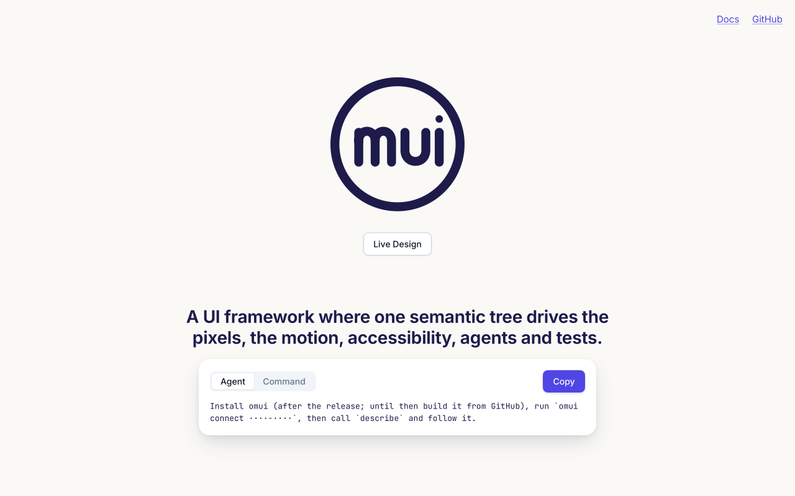
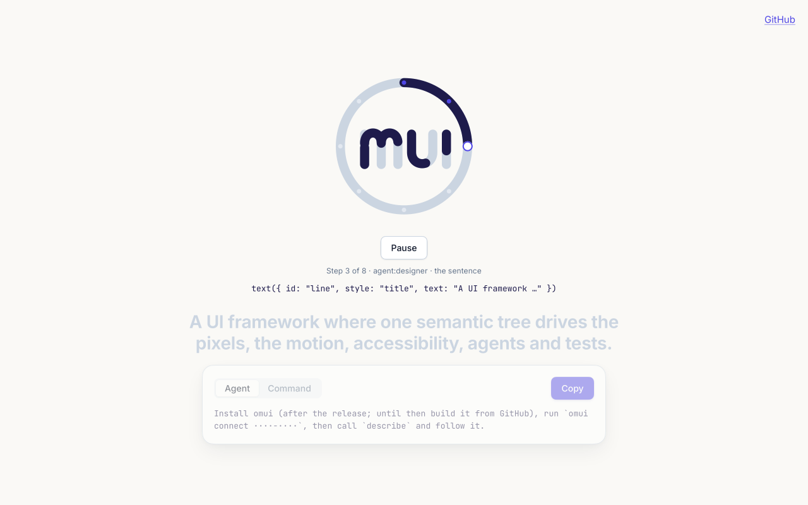
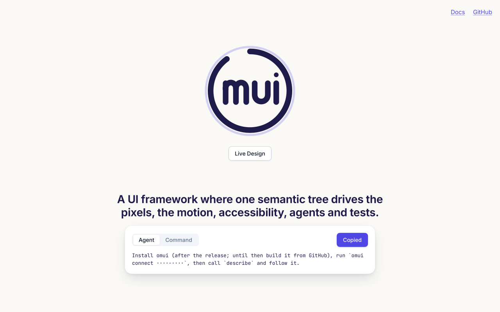
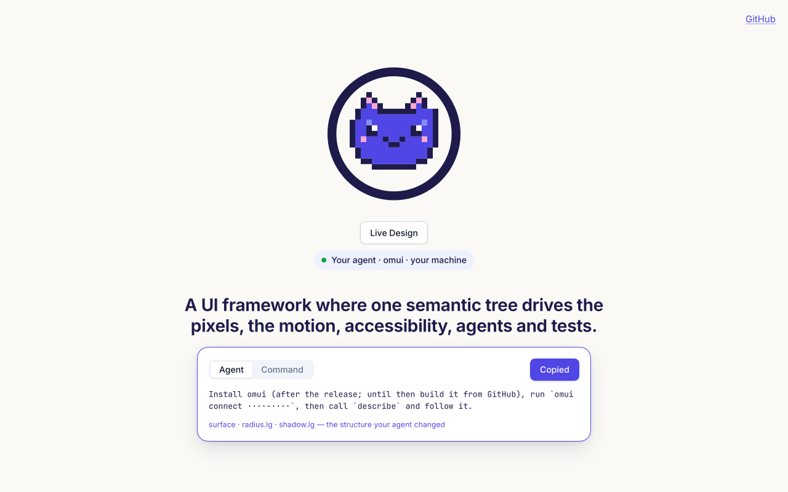

# omui's site (`omui.site`)

omui's site is one page: the logo, one sentence, the Live Design key and the install, in four states of one picture (G5; [the site's design](../.agents/docs/2026-11-19-site-live-design-design.md) §4). GitHub Pages publishes it at https://sunrisepeak.github.io/mui/.

The page is TypeScript (`app/main.ts`) run by the player, like any omui application. It is made by an agent in Live Design. The brand: **the logo is `mui` in a circle; the mascot is Mui's head in the same circle** (AGENTS §1). The four states below are what `tests/page_test.cpp` draws (1280×800, headless); `omui-devtools media site` copies them in.

| State | Picture | What it says |
|---|---|---|
| At rest |  | The logo, the sentence, a lot of room. The install is the one accented action; Live Design is a quiet key under the logo. |
| Live Design |  | The page is back to its sketch (grey) and grows again step by step. The logo's circle is the course of the design's steps: its own stroke is drawn in ink as far as the design has come, the steps' marks and the playhead (step 3 of 8) on it. Under the key: the step, its maker and the source it wrote. |
| Waiting |  | The prompt is copied ("Copied"). The circle opens, with a fainter, wider circle breathing around it. The pairing code is in the copied words only. |
| Connected |  | The circle closes and holds Mui: the mascot, her head (head16's, every pixel a vector square) in the circle. The visitor's agent and its omui appear beside it. The structure the agent changed is outlined and named for that moment. |

## How the states are driven

An agent drives the page through the protocol, with the same operations and pixels as a person's window:

```sh
omui-player --manifest site --serve --size 1280x800 --agent-name site
omui agent invoke site page.state '{"state":"waiting"}'
omui agent wait site --settled true
omui agent capture site --out waiting.png
```

`page.state` is the page's verb for its four states; on the page the Live Design key and the bridge (`omui connect`) drive them. `tests/page_test.cpp` does the same without a window: it sets each state through the verb, reads what each says in the semantic tree (the logo, the sentence, the keys, the design's course at its step, the agent's chip), checks that each state is a different picture and that returning to rest gives the first picture again, and writes each state's picture for this README.

## Drawn with

- `path` (omui.ui.base) draws the logo's circle, its word and Mui's head, scaled from their view boxes. The waiting circle is the same path with `trim` 0.9.
- `timeline` (omui.ui.base) lays the design's eight steps along the circle (`shape`: the circle in a 1×1 box; `line: false`: the circle's own stroke is the course, the timeline adds the marks and the playhead).
- `segmented`, `button` and `text` come from the theme's defaults. The colours are the brand's (`#1e1b4b` ink, `#4f46e5` accent) on `#faf9f6` paper.

## Made in Live Design

`tests/design_test.cpp` designs the page through the designer's verbs, the same ones an agent reaches over MCP (`design_*`), starting from what `omui new` writes ([`design/start.ts`](design/start.ts)). Each step is a commit of the design's history (the site's design §8):

1. The template.
2. The agent's drafts: the mark, the sentence under it, the Live Design key, the install's two tabs and Copy.
3. Mui: the four states of one picture, her head in the circle when an agent connects.
4. The person takes over: the sentence in their words, and more room around the install.
5. The agent reads the facts back: the history says who changed what, and two expectations hold.
6. A narrower install, tried on a branch from before the person's touch, and left.
7. At rest: the Live Design key plays this design.

The page ends as `app/main.ts` is. Its history ships as [`design/main.replay.xdef.json`](design/main.replay.xdef.json): nine steps, each in its maker's words, `agent:designer` or `person:maintainer`. [`omui.config.ts`](omui.config.ts) names that file. The Live Design key plays it in place (`generate.replay`): each step is the real page as it was, its maker framed at what it built. `OMUI_EXAMPLE_WRITE=1` writes the page and the replay instead of comparing them, for a change that is meant.

Copy starts looking for the visitor's own agent (`linkAgent()`, openmui 0.4.10: on the Web, a bridge on their machine) and puts the chosen tab's words on the clipboard with the pairing code in them (`copy()`, 0.4.7); the words on the page show the same code, and the page waits. When their agent runs `omui connect <code>`, the bridge pairs and says the omui it runs and the machine it is on; the page hears it through `agentLink()` (a signal the runtime keeps), turns connected, and names them: "Claude Code · omui 0.1.0 · linux-x86_64". If the bridge goes, it waits again. GitHub is a `link`.

While the design plays, its course goes round the circle: `omui.config.ts`'s `generation.replay` names it (`course: "o"`), and the replay lays its steps on that path where it is drawn (`timeline`'s `over`, openmui 0.4.8). While the page waits, the circle breathes: the wider, fainter circle has `motion: { ambient: "breathe" }`, the style's ambient motion (openmui 0.4.9); unseen at the other states, it rests and asks for no frame.

## On the Web

The page's program carries only the base components its scripts and its design's steps create by name. Its build program derives them from their imports (`closure()`, B7b), and its program takes the player's `closure` entry. `tests/page_test.cpp` runs the page with that set.

`omui build --web` packs the page as a static site ([`build.mcpp`](build.mcpp)): the player, its fonts cut down to the page's own text (the full faces fetched only when text asks for a character the cut lacks), the page's files, and its first screen as a document before the program runs (G2's projection: the sentence is its `h1`). `omui-devtools site split <page>` cuts its program in two by what its first screen runs (D5): the first half before the first frame, the rest compiled after it. `omui-devtools check site` serves it as Pages does and opens it in headless Chromium. First it measures the delivery against [`delivery.budget.xdef.json`](delivery.budget.xdef.json) on a cold visit. Then it walks the visitor's path with real clicks: the Live Design key plays the design to its end; Copy puts the prompt with a pairing code on the clipboard and the circle breathes; the command tab shows the same code; `omui connect <code>` pairs; the page turns connected, naming the agent, its omui and its platform; the agent reads the page; the bridge stops and the page waits again; with reduced motion the circle does not breathe.

## Not in this round

| What | Where it comes from |
|---|---|
| Material and light (the logo's halo, the install's surface) | The framework's effects (liquid glass, a theme layer), not page code |
| The motion between states | The default recipes (`path`: `default.structure`); the pictures are at rest |
| Chinese | G2's projection in a second language; the site's fonts on demand |

The page carries a copy of head16's rows from `brand/mascot.sprite.xdef.json`, because this round does not read the brand's file from the script.

## Decided in review (2026-11-20)

1. **The logo.** A plain circle around `mui`; connected, the same circle holds Mui's head (the maintainer's, 2026-11-21: no ellipse, no ears).
2. **The sentence.** The README's, held to the claims ledger in G7.
3. **The Live Design key.** Under the logo: the circle is its timeline.
4. **Live Design's course.** The O's own stroke is the played part; only the marks and the playhead are on it (`timeline`'s `line: false`).
5. **The palette.** Ink and indigo on paper; a dark variant later, from the theme's tokens, not the page.
