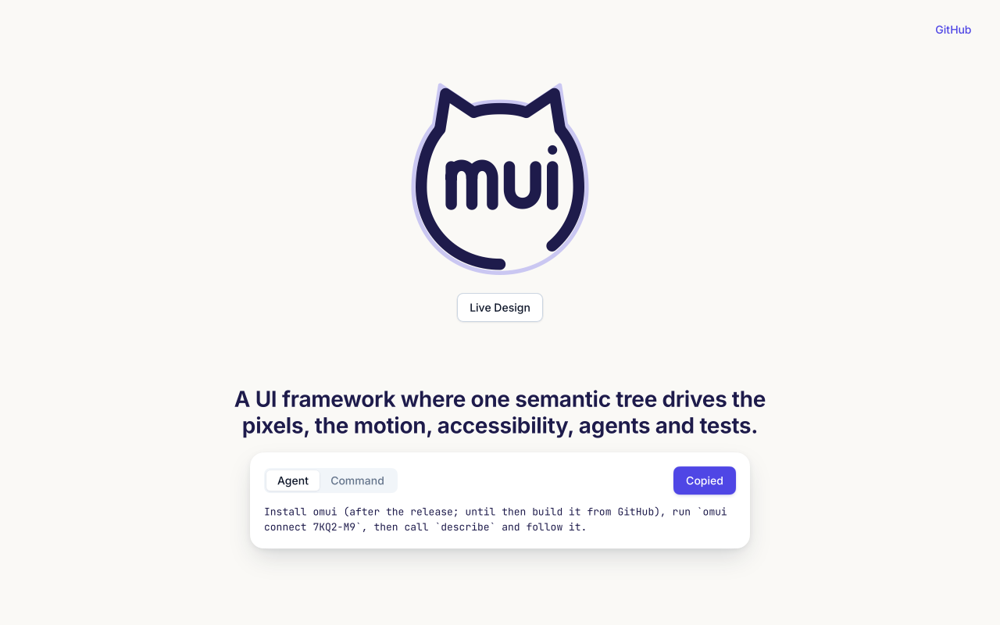

# omui's site, one page (`omui.site.page`)

omui's site as one page: the mark, one sentence, the Live Design key and the install, in four states of one picture (G5; [the site's design](../../.agents/docs/2026-11-19-site-live-design-design.md) §4).

The page is TypeScript (`app/main.ts`) run by the player, like any omui application. It is made by an agent in Live Design. When it lands, it replaces the C++ site under `../src`. **This round is the art direction's sketch**, which the design asks for before G5 starts: the four states, each drawn offscreen at 1280×800 and 390×844.

| State | Desktop | Phone | What it says |
|---|---|---|---|
| At rest |  | [390](media/sketch-rest-390.png) | The mark, the sentence, a lot of room. The install is the one accented action; Live Design is a quiet key under the mark. |
| Live Design |  | [390](media/sketch-design-390.png) | The page is back to its sketch (grey) and grows again step by step. The mark's O is the course of the design's steps: the part grown is drawn in ink, with the playhead at step 3 of 8. Under the key: the step, its maker and the source it wrote. |
| Waiting |  | [390](media/sketch-waiting-390.png) | The prompt is copied ("Copied"). The O opens, with a fainter, wider O breathing around it. The pairing code is in the copied words only. |
| Connected |  | [390](media/sketch-connected-390.png) | The O closes and the word becomes Mui (head16, every pixel a vector square). The visitor's agent and its omui appear beside it. The structure the agent changed is outlined and named for that moment. |

## How the sketches are drawn

An agent drives the page through the protocol, with the same operations and pixels as a person's window:

```sh
omui-player --manifest site/page --serve --size 1280x800 --agent-name sitepage
omui agent invoke sitepage page.state '{"state":"waiting"}'
omui agent wait sitepage --settled true
omui agent capture sitepage --out media/sketch-waiting-1280.png
```

`page.state` is the page's verb for its four states. Later, the Live Design key and the bridge (`omui connect`) drive them instead. `tests/page_test.cpp` does the same without a window: it sets each state through the verb, reads what each says in the semantic tree (the mark, the sentence, the keys, the design's course at its step, the agent's chip), and checks that each state is a different picture and that returning to rest gives the first picture again.

## Drawn with

- `path` (omui.ui.base) draws the mark's O, its word and Mui's pixels, scaled from their view boxes. The waiting O is the same path with `trim` 0.9.
- `timeline` (omui.ui.base) lays the design's eight steps along the O (`shape`: the O in a 1×1 box).
- `segmented`, `button` and `text` come from the theme's defaults. The colours are the brand's (`#1e1b4b` ink, `#4f46e5` accent) on `#faf9f6` paper.

## Not in this round

| What | Where it comes from |
|---|---|
| Material and light (the mark's halo, the install's surface) | The framework's effects (liquid glass, a theme layer), not page code |
| The motion between states, including the O's breathing | The default recipes (`path`: `default.structure`); the sketches are at rest |
| The real Live Design replay | `generate.replay` (G8), as in example 13 |
| The bridge and pairing | `omui connect` (G9) |
| Chinese, static HTML, budgets | G2's projection; the site's budgets (§6) |

The page carries a copy of head16's rows from `../brand/mascot.sprite.xdef.json`, because this round does not read the brand's file from the script.

## Open for review

1. **The O.** Today's ellipse is drawn. `../brand/marks.mark.xdef.json` also holds ears (A), a tail (B) and both (C). With ears, the O itself could become Mui's outline when connected, instead of holding Mui's head.
2. **The sentence.** It is the README's: "A UI framework where one semantic tree drives the pixels, the motion, accessibility, agents and tests." It is held to the claims ledger in G7.
3. **The Live Design key.** It sits under the mark (the O is its timeline). The design's first wording put it beside the install.
4. **Live Design's course.** The timeline's thin accent line runs inside the O's ink. The alternative: the O's own stroke is the played part, with only the marks and the playhead on it.
5. **The palette.** Ink and indigo on paper, with no dark variant yet.
